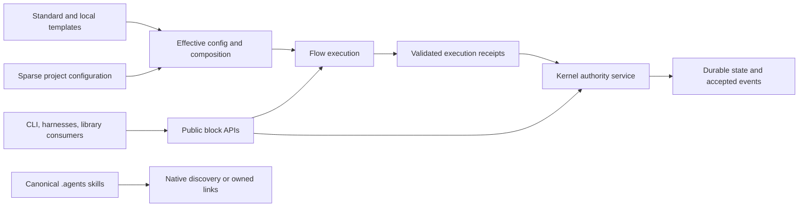

> Superseded in part on 2026-10-16 by the new-project rebuild plan — see [../2026-10-16-platform-rebuild/rebuild-plan.md](../2026-10-16-platform-rebuild/rebuild-plan.md).

# Forge final plan — draft v1

## 1. Bottom line

1. **Decisions needed:** choose the release path and approve the bounded scope and candidate policy below; default to staged evolution, with no implementation authorized by this draft.
2. **Yes, a useful 0.1.0 is achievable:** target **October 28–November 11, 2026**, assuming approval and work start around September 30–October 1; this is a conditional **4–6 week forecast**, not a measured completion date. [inferred]
3. Master already has the one-package foundations and green six-platform/runtime CI, but the public beta.8 artifact still has the older package graph and Node floor. Publishing reliable current content is an unfinished outcome. [read/ran: E1–E3]
4. Recommend one local product: Kernel authority, durable memory, safe worktrees, guarded delivery, usable public block APIs, two extendable workflow compositions, and separate additive config. [inferred]
5. Repair delivery truth and routine Windows/push cost first; retain the now-merged worktree safety fix, rather than scheduling it again. [read/ran: E4–E6]
6. Complete the decided pruning, no-importer D46 boundary, and physical canonical `.agents/skills` distribution with verified local links. [read/inferred: E7–E9]
7. Budget **4–6 ordinary PRs/day or 1–2 coupled changes/day**, with one landing owner; those are alternative planning rates, not additive capacity. [inferred from refreshed E4]
8. Keep G0–G8, all supported OS/runtime/mode/harness proof, **50 distinct clean journey/environment pairs**, and **seven exercised observation days** on the final candidate. [read: E10]
9. Resolve the promotion defect by certifying a stable-version candidate on npm `next` and a non-latest GitHub prerelease before promoting both channels; a tag pointing at `0.1.0-rc.N` cannot create version `0.1.0`. [external/read/inferred: E11]
10. Defer general template inheritance, complete facade thinning, cloud/team services, graph enrichment, marketplace expansion, and continuous improvement; finish the broader compatibility promise for 1.0 after real consumer use. [inferred]

**Status and scope.** This is the requested synthesis, not a locked implementation plan or a full `/plan` exit. All five research legs were read in full. Intent/research/setup already supplied by the brief are inputs; task generation, issue mutations, development, publication, and critic rounds are outside this invocation. The owning final-plan issue remains open (`73714c21-ee16-4246-b11c-cde72763dade`), and the old release proposal remains parked ([#564](https://github.com/harshanandak/forge/pull/564)). Only this file is written.

**Evidence convention.** `[read]` is inspected source/declaration evidence; `[ran]` is an observed command/API result, not automatically a successful behavioral test; `[external]` is a checked primary source; `[inferred]` is a recommendation, estimate, or conclusion. Source references below are pinned to `origin/master` (`7d448ec812ef8639790477af07c3c75962173f8a`), unless marked **parked** (`2f7fe92ce40195e85ca0e896c52c5d37786b2bd9`). The worktree remains on predecessor `ba56b9201782c4d1246c77bde6380867603184bf`; no checkout/reset/pull was performed. Current-state, architecture, and delivery claims were rechecked through read-only verification lanes and direct source/API reads. No new installed-package, migration, live-harness, or release journey was executed here.

## 2. Where we are

### Current source, published product, and release proof

| Area | Verified current state | What that means |
| --- | --- | --- |
| Source package | `forge-workflow@0.1.0-beta.8`, Node `>=24`, Bun `1.4.2`; three runtime dependencies: Babel parser, cross-spawn, YAML; only `packages/skills` remains a workspace. [read: E1] | The three Contracts/Flow/Memory workspaces have been folded into `lib`. Do not repeat that extraction. |
| CLI/API surface | **62** manifest commands. Contracts, Flow, and Memory-core have public source indexes; the root manifest declares no `main`/`exports`, and Kernel has no public index. [read/ran: E1, E7] | Source modules exist, but supported installed-library import paths and default assemblies still need a compatibility contract. A command count is not a capability count. |
| Recorded package baseline | **1,320,089 compressed bytes; 4,805,641 unpacked bytes; 454 files; zero nested-dependency files**. [read: E2] | This is a committed baseline, not a new pack of current master. Measure the settled artifact before resetting budgets. |
| Exact-master CI | **31 completed check objects: 18 successful, 13 skipped**, none pending/failed in the refreshed read. All six Ubuntu/macOS/Windows × Node 24/26 full lanes, CI Gate, size, CodeQL, Sonar, coverage, and E2E succeeded. [ran: E3] | Current repository CI is healthy. Event-specific skips do not establish mutation health or installed-RC acceptance. |
| Published npm channels | `latest=0.0.10`; `beta=0.1.0-beta.8`; no `next`, RC version, or stable `0.1.0`. [ran/external: E3] | There is **zero verified qualifying published-candidate observation evidence** for the new release. Beta age does not count. |
| Published beta.8 content | Registry metadata still says Node `>=22.16.0`, workspaces `packages/*`, separate `@forge/contracts`, `@forge/flow`, and `@forge/memory` dependencies plus fastest-levenshtein; declared unpacked size **5,838,297 bytes**. [ran/external: E3] | Master repairs have not reached this published version. Current source-level package fixes cannot close installed-product acceptance by themselves. |
| Static release command | Rechecked on the predecessor worktree: exit 0, `success:true`, `blockers:[]`. Its source evaluates **nine static blockers**, not G0–G8 or the candidate matrix. [ran/read: E10] | Preserve it as a preliminary check; add real aggregate acceptance. It does not prove that 0.1.0 can be promoted. |
| Kernel backlog | **1,659 records = 771 done + 7 cancelled + 850 open + 28 in progress + 3 review**; **881 unresolved**. P0/P1: **36/212 literally open**, **45/231 unresolved**. [ran: E12] | Epics, children, obsolete criteria, and fixture noise share this denominator. Do not turn all 881 records into release work or report a completion percentage. |
| Recent follow-ups | September 29 UTC: **45 created, 44 open, 1 done**. Stryker bump is done; importer removal, canonical skills, skills-workspace deletion, Windows cost, and related follow-ups remain open. [ran: E12] | Reconcile acceptance with merged source; open status alone does not prove implementation is missing. |
| Delivery cohort | All **27 requested PRs (#578–#604)** are now merged; refreshed median open-to-merge **308.3 min**, P75 **619.8**, P90 **1,319.1**, maximum **3,202.9**. [ran: E4] | Delivery works, with a long integration/review tail. Worktree safety (#582) is landed, not an outstanding merge prerequisite. |

### Remaining acceptance chain

The default Memory assembly and Flow runner remain open (`12d92893`, `1ff3d2f9`). Current constructors require an injected broker and synchronous `run` function; they are useful primitives, not accepted turnkey local assemblies. Kernel public receipt submission, malformed/stale/conflicting receipt rejection, claim-projection consistency, and native rollback remain release work. [read/ran: E7, E12]

Facade/harness integration (`5f4da13f`), claim reconciliation (`9e31a2f0`), mirror authorization/recovery (`209d80bc`, `c94f36f9`), monitor/restart reconciliation (`6ddd30c6`, `c5112cd4`), hook controls (`7268bc9b`), and MCP consent (`9658c21a`) need acceptance or missing behavior completed. PR6 migration (`f2a96ff1`) remains blocked on facade, claims, Memory, and Flow; PR7 convergence (`eb2f1753`) remains blocked on migration and controls. The release root (`8e634347`) still has broad skills evaluation (`d362bd71`) as an unresolved blocker. Narrow that obligation to supported release behavior, with continuous optimization explicitly deferred. [ran: E12; read: parked plan:63–86]

Old size, bundled-install, redundant-CI, and Sonar records are **reconciliation candidates**, not automatic closures. Current source changes and Sonar success justify an acceptance recheck; published beta.8 still makes fresh single-package installation a real outstanding outcome. Preserve unique criteria when splitting/superseding a record. [inferred from E1–E3, E12]

## 3. Target

**Product job:** one install makes AI-assisted engineering work durable and transferable: capture intent → own work → isolate it → execute → retain proof → resume or release. Users can also consume individual blocks without adopting the whole workflow. This is an engineering product hypothesis supported by owner use and existing authority/memory code; external adoption, willingness to pay, and measured user time savings remain unknown. [read/inferred: L4:49–87; E7]

| Dimension | Required at 0.1.0 | Completion at 1.0 |
| --- | --- | --- |
| Installation | One npm package, Node 24 minimum, Node 24/26 certification. Compiled binaries, while supported/advertised, have asset/setup parity proof. | Same one-package model, documented upgrade/support lifecycle, and compatibility proven with independent consumers. No mandatory package split. |
| Open blocks | Supported subpaths for Contracts, Flow, local Memory, and a narrow Kernel service; effective config/template resolution callable by consumers. Default local Memory assembly and deterministic Flow provider are usable without importing private files. | Stable API/error/lifecycle commitments for justified reusable blocks; CLI/harness clients consume owning services. Additional helpers become public only when a consumer needs them. |
| Authority | Kernel alone owns issues, claims, workflow/run acceptance, gates, and accepted evidence. Memory exposes local knowledge/authority access through that service; Flow executes and emits receipts. | Complete documented ownership boundaries and upgrade compatibility. Optional remote authority, if justified later, is a separate operational project using the same authority model. |
| Templates | **Two actual workflow compositions:** default TDD delivery and a small-change composition. One local extension can add/replace named optional nodes or bind a provider without editing Forge source. Required rails and issue-bound approvals remain enforced. | Versioned public template schema, mature local extension/migration rules, and broader compositions justified by use. General inheritance/network loading remains optional, not a 1.0 checkbox. |
| Separate additive config | Sparse `.forge/config.yaml` selects a template, binds providers, and supplies overrides. Named-ID maps merge explicitly; lists have declared replacement/extension semantics; unknown or malformed values have consistent errors. `options why/diff/lint` explains the effective result and origin. | All supported consumers use one effective config result; precedence/environment boundaries and config migrations are documented and stable. Personal overlays only if actual requirements justify them. |
| Skills/harnesses | Physical canonical `.agents/skills`; direct native discovery or verified local links. Four promised harnesses have installed-version evidence and honest T0–T4 behavior/degradation. Existing user content and hooks survive setup/update. | Mature adapter compatibility and runtime enforcement across the supported set, without maintaining multiple editable instruction authorities. |
| Delivery/recovery | Safe worktrees, truthful review/monitor state, current-head CI and ownership checks, guarded `forge merge --auto`, native backup/upgrade/rollback, usable Doctor, bounded supported-skill corpus. | Fully thinned promised facade paths, mature recoverability and consumer compatibility, and sustained measured delivery reliability. |
| Release promise | Real installed-artifact acceptance, no unresolved S0/S1, 50 distinct clean pairs, seven exercised days, truthful docs, and immutable publication/readback. Compatible `0.1.z` updates; deliberate breaking changes use a new minor with migration notes. | Explicit stable public API under SemVer, supported data migration window, and proven consumer/upgrade contract. A version label alone does not establish this. |

The adoption profiles `minimal/standard/full` and skills-only installation are **adoption settings**, separate from workflow choice. Existing known-ID toggles on a fixed graph do not yet satisfy user template extension. Reuse the current primitive constructors, sparse writer, and SkillRuntime; implement the smallest genuine composition seam. [read: E7; inferred]

All Forge blocks remain inside one package. Configuration and user extensions remain separate from shipped implementation. Local Memory can operate without Flow initialization; stateless Flow can execute without Kernel/Memory initialization; connected execution submits evidence to Kernel. Translate old “Flow absent” acceptance into absence of runtime/private dependency or activation, rather than manufacturing multiple install packages. Keep structural isolation and behavioral authority tests. [inferred]

## 4. Options

All options keep sole Kernel authority, Node 24/26, decided pruning, safety gates, and truthful artifact proof. Calendar ranges assume work starts around October 1 and the capacity in section 7; they are `[inferred]` scenarios, not commitments.

| Path | Scope and value | Effort and time | Risk | Cuts/trade-off |
| --- | --- | --- | --- | --- |
| **Thin freeze first** | Stabilize the pruned CLI, installed local journeys, canonical skills, supported harnesses, and narrow mature APIs; retain the current fixed workflow with inspectable config. Delivers a smaller reliable product soon. | **M–L**, roughly **3–4 weeks**, October 21–28, including observation. | Medium release risk; later resolver/facade changes repeat integration and migration work. Four-harness certification can erase its time advantage. | Defer genuine user workflow extension and broader facade/config integration. Explicitly falls short of the owner's complete target; cannot advertise profiles as an extension system. |
| **Full vision before first stable** | Complete generalized versioned templates/config, all justified block boundaries, full facade thinning, broader adapter/consumer compatibility before 0.1.0. Strongest initial architecture. | **XL**, roughly **8–12 weeks**, November 25–December 23. | High: several simultaneous compatibility, storage, projection, and lifecycle seams; larger critical path and more rework. | Still excludes cloud/team infrastructure, graph production integration, marketplaces, and Companion as mandatory dependencies. First useful stable release waits for broad transformation. |
| **Staged evolution — recommended** | Finish a complete local release, narrow public APIs/default assemblies, two real compositions with one local extension seam, additive config, canonical skill links, and all accepted safety/release proof. Evolve broader boundaries after use. | **L**, roughly **4–6 weeks**, October 28–November 11; RC iteration in weeks 3–4, final candidate acceptance in weeks 4–6. | Medium–high: harness/migration/release proof dominates uncertainty; bounded seams reduce simultaneous change. | Defer general template machinery and complete facade thinning, rather than deferring the basic extension/useful-block promise. No rewrite, second runtime, or second authority. |

**Recommendation: staged evolution.** Contracts/Flow/Memory foundations and Kernel authority already exist; the decisive missing pieces are supported composition, distribution, authority/recovery acceptance, and release evidence. Preserve working validators, lifecycle code, leases, and merge guards. Use a small replacement below one command seam only if a specific cycle resists extraction; do not start an internal strangler runtime by default. [read/inferred: E7]

## 5. The plan for the recommended path

Effort estimates describe scope: **S** is a bounded change; **M** is one service/distribution slice; **L** is coupled consumers and runtime behavior; **XL** is a broad migration/rewrite. Sizes below are `[inferred]`. Each milestone must earn the stated proof before dependent work advances. Implementation issues and task lists come after the owner/critic checkpoint; this draft does not mutate the tracker.

### Delivery foundation — lands before broad product work

| Item | Change and implementation approach | Why/value | Effort / risk | Proof gate | Prerequisites |
| --- | --- | --- | --- | --- | --- |
| **One landing contract and policy** | One integration/landing owner, ready queue initially capped at three, disjoint worker ownership, explicit owner/session identity and holder-authorized lease transfer with readback. Batch review into one correction head; fix P0/P1 and regressions, file genuinely non-blocking P2s. Correct quarantine instructions to require a demonstrated CI flake and cited original run; preserve failure/rerun history. | Stops rebase/review amplification, ad-hoc lease stalls, and local-timeout gate erosion. | **S–M / medium** steering risk. | Complete one worker handoff without waiting for lease expiry; stale/foreign lease is refused; no local-only quarantine; a destructive regression remains blocking regardless of its bot label. | Owner-approved scope and operating contract. Reuse existing lease/merge authority. [read/ran: E4–E6] |
| **One truthful required aggregate** | Use the supported workflow-retirement writer to retire the docs-only-triggered bypass whose `CI Gate` job unconditionally echoes success, after a fresh protection/ruleset/producer census. Preserve doc assertions and authoritative Tests coverage; retain mixed/rename fail-safe classification and expected-lane accounting. | Prevents independent echo-success from competing with real acceptance on that trigger. | **M / high** merge-authority risk. | Exactly one intended producer per required head/run; failed/cancelled/missing expected lanes cannot yield PASS; docs and renamed/mixed source paths still get correct proof. Record prior workflow bytes and restoration procedure before the later write. | Landing contract; supported retirement writer already merged in #596. Required contexts/strict protection are preserved. [read: E5] |
| **Bound routine Windows and push cost** | Fix identity reads in shared `scripts/process-tree.js`, measure native/batched reads before selecting a persistent helper, retain PID-reuse detection and fail-closed unknown identity. Bound reads. Remove the deprecated team-shell pre-push path through its owning hook/config change; retain required proof in CI and any existing local gate until its approved replacement is active. Profile fixture/subprocess cost before adding concurrency. | Targets the observed Windows bottleneck and reported 192-second optional sync step; benefits cleanup, lifecycle, and push proof together. | **M–L / high** process-identity safety risk. | PID-reuse, missing-process, timeout, cleanup and token-proof cases unchanged; measured distributions on the same Windows head/image; routine sync target ≤15 seconds if retained; no orphan or missing full-suite aggregate. | Truthful aggregate and retained #582 worktree safety. Start with one expensive local lane per host. [read/ran: E6] |
| **Truthful blockers and usable confidence** | Fix only remaining informational-comment/verdict inconsistencies and explicit handoff gaps after checking #585. Recover hosted-review outages on the same head, with bounded escalation. Diagnose Stryker's initial sandbox-suite failure; use a bounded risk-owned mutation corpus and seeded-mutant check, retaining uninstrumented structural/security/full-suite checks. Do not claim a score from instrumenting files or uploading an empty report. | Makes ordinary delivery resumable and optional confidence actionable. | **M / medium–high** classification/coverage risk. | Clean evidence yields a truthful verdict, unknown/actionable comments remain blocking, provider outage is distinguishable from code failure. Mutation produces a real scored report and catches a seeded semantic defect before RC. | Landing contract, current recorded failures, and consumer/risk census before changing optional mutation scope. No exhaustive 106,522-mutant run blocks independent work. [read/ran: E4–E6] |
| **Bounded delivery pilot** | Use five ordinary planned changes plus one coupled change from this train; capture correction/base-only heads, all CI attempts, review outage, ownership handoff, and merge receipts. Gather ten working days of rolling telemetry while product work proceeds. | Checks the capacity forecast before widening concurrency. | **S–M / medium** forecast risk. | Proposed targets: ≥90% first settled-head required-check success, ≤2 ordinary correction heads, ordinary P75 <4 hours, zero unauthorized cleanup or local-only quarantine. If missed, reduce WIP and diagnose shared cause. | The preceding safety/evidence fixes. The pilot is real planned work, not six artificial PRs or a separate ten-day waiting phase. [inferred from E4] |

**Worktree safety is a retained baseline.** PR #582 is already merged at the audited head. Recheck its dependency-link sentinel/refusal/restoration cases through CI when touching relevant code, and update the stale worktree skill (`10cb5a4d`). Do not reimplement it, clean the existing machine's worktrees as preparation, or assume a missing `node_modules` directory is a defect. Fresh worktrees prove compatible manifest/lock/workspace/install inputs or install locally. [read/ran: E6, E12]

### Product and release workstreams

| Item | Change and implementation approach | Why/value | Effort / risk | Proof gate | Prerequisites |
| --- | --- | --- | --- | --- | --- |
| **Lock acceptance and contract ownership** | Reconcile the release-critical graph, landed code, D44–D46, old Node rows, and obsolete package tasks. One owner freezes the minimal packet/provider/receipt/error compatibility surface and producer identity/version rules; keep existing schema IDs unless an actual compatibility case requires a change. Narrow skills evaluation to supported behavior. | Avoids implementing superseded requirements and lets consumer lanes work against one contract. | **M / high** semantic-authority risk. | Every required outcome has current evidence or one owning missing-work issue; no unique criterion is lost. N/N-1 reader/conformance cases, stale/malformed/conflicting/incomplete receipts, and exact authority bindings pass. | Delivery foundation. Flow's hard-coded beta.6 receipt producer is explicitly resolved before freeze. [read: E7, E10, E12] |
| **Native preservation and D46 retirement** | Reuse/extract generic JSONL codecs from the Beads compatibility module into the native owner first. Preserve native export/hydration, backups, provenance and existing data. Then remove shipped importer, Beads-only compatibility/config/current advertising and positive importer tests; reconcile native outbox/protected-data labels. | One authority and one reversible upgrade story without a Beads installation dependency. | **M–L / high** data-preservation risk. | Lossless issue/comment/dependency export/hydrate; verified backup/restore; historical/imported user data retained; fresh install needs no Beads; no automatic import or unauthorized writer. | Contract/acceptance lock; claim reconciliation before final migration. Keep negative isolation/recovery tests. [read: E8] |
| **Prune and unify skill/artifact ownership** | Retire serve/product dashboard and both Insights entry forms; deprecate/remove owned dep-guard/team-shell wiring; remove only four duplicate PR delegates. Finish `packages/skills` overlap, workspace/lock/CLI/plugin cleanup. Make physical `.agents/skills` canonical; deliberately move coverage metadata; update installer, allowlist, hooks, drift, references and compiled asset generation together. Prefer native discovery, otherwise create owned local links; unsupported links yield an actionable refusal. | Reduces maintenance and divergent instructions, without discarding unique Kernel operations. | **L / high** distribution/user-content risk. | Clean clone and installed tarball discover all canonical files; Windows/no-link/moved-worktree/dangling-link/update cases are honest; user-owned names survive. Binary setup has parity. Preserve `pr link`, targeted inbox/ack, typed memory/provenance, and test-report dashboards. | Native codec preservation where paths overlap; one integration owner for manifest/lock/generated files. No silent physical-copy fallback or parallel authoring tree. [read/ran: E9] |
| **Public local assemblies and entrypoints** | Add narrow supported package subpaths using existing indexes plus a Kernel service/lifecycle entry. Build the default local Memory assembly over existing storage/recall and one synchronous deterministic Flow provider; preserve executor semantics. Migrate promised CLI/monitor consumers through the owning service when touched; retain existing adapters/delegates where required. | Consumers can actually reuse blocks from one installed package; CLI and alternate executors share authority rules. | **L / high** API/lifecycle risk. | External clean-directory consumers import each subpath; memory store→provenance recall→restart→recall; public issue/claim/lease; non-Flow receipt acceptance/rejection; stateless/connected Flow with PASS/FAIL/INCOMPLETE/NOT_EXECUTED, timeout, acknowledged cancellation, terminal cleanup, zero orphans. | Contract lock, native preservation, package ownership. Census deep-import consumers before sealing private paths. Default assembly gaps (`12d92893`, `1ff3d2f9`) are completed here. [read: E7] |
| **Two compositions and additive config** | Reuse runtime-graph constructors, sparse writer, options introspection and SkillRuntime. Separate template description from project config; implement one local named-ID extension seam and two compositions. Define explicit map/list/precedence rules; unify malformed/unknown config handling on supported paths. Inject effective config into APIs; filesystem/environment discovery stays at integration edges. | Delivers the owner's basic customization model without a general extension framework. | **M–L / high** gate/behavior risk. | User extends a standard composition without editing Forge; cycle/missing-capability/unknown-node errors; required rail refusal; approval/stop points; equivalent CLI/library resolution; origin explanation, override/reset and legacy-config preservation. | Public primitive/service seam, contract lock, one shared config owner. Existing fixed graph and adoption profiles are foundations, not claimed completion. [read: E7] |
| **Controls, diagnostics, and supported harness proof** | Finish minimal facade/setup/Doctor coverage required by public journeys. Package required capability probes, reconcile harness lists, complete hook-control and MCP consent enforcement, authorized atomic projections/recovery, and any genuinely missing monitor/restart behavior. Preserve current PR monitor/review/merge regressions. | Users see real availability and permissions; resume/restart does not depend on a discarded initiating session. | **L / high** integration/permission risk. | Installed-version Claude/Codex/Cursor/Hermes certification of promised T0–T4 routes, wake/resume/cancel/cleanup; consent refusal/expiry; interrupted projection recovery; monitor durability/idempotent delivery/cursor/reaping; read-only Doctor deadlines/redaction and no side effects. Missing implementation is not satisfied by UNAVAILABLE. | APIs/config/canonical content and verified claim projections. Live Claude/browser checks require their permitted execution lanes in the later delivery program; none is invoked in this synthesis. [read: E7, E10, E12] |
| **Migration, candidate machinery, and docs** | Reuse beta.5 compatibility inventory/backup/dry-run code; complete single-artifact upgrade, interrupted cutover, post-write rollback/sole-writer proof. Extend current protected release generators and receipts with real BOM/artifact/journey aggregation, distinct-pair/stratum counting, signed/attested identity and observation events. Hold npm and GitHub/binary default channels; reject candidate asset overwrites. Finish versions/docs/changelog/pruning before candidate freeze. Repair essential-doc path copying or remove the false copy promise. | Upgrades become reversible; release readiness measures what users install. | **L / high** migration/evidence risk. | beta.5 preservation/restart/interruption/rollback; risk selection owns the new layout; malformed/wrong-head/wrong-digest/missing-shard aggregate refuses eligibility. Publishers pack/build once, certify actual artifacts and cannot promote stable before acceptance. Docs describe current commands, canonical source and real support. | Assemblies, controls, claims, config/skills migration. Reconcile PR6/PR7 instead of replaying their old package extraction branches wholesale. [read: E10–E12] |
| **Final candidate and stable promotion** | Iterate `0.1.0-rc.N` artifacts first. After settled preliminary proof, make the reviewed stable-version-only artifact, publish immutable `0.1.0` under npm `next` and a non-latest GitHub prerelease, then execute the full final-artifact matrix, 50 distinct clean pairs and seven exercised days against those exact npm/binary artifacts. Only after acceptance move npm `latest` and GitHub release/latest status without rebuilding; re-fetch both identities/integrity/provenance and exercise default installation. | Literal stable version and byte-identical accepted/published content, with no unproved evidence transfer or early binary promotion. | **L / high** publication/observation risk. | All G0–G8 PASS, every promised stratum covered, no unresolved S0/S1, complete native recovery and exact-head sequential landing exercise, current release-root blocker disposition, registry/release readback and fresh install. Missing evidence blocks. | All preceding release content/behavior; scored bounded mutation proof or an explicit approved retirement of that optional experiment. See candidate policy in section 9. [read/external/inferred: E10–E11] |

### Dependency order, ownership, and milestone dates

| Milestone | Dependency and exit | Forecast from approval/start |
| --- | --- | --- |
| **Delivery trustworthy** | Landing/policy, authoritative aggregate, safe dependency baseline, bounded fast-path fixes; mutation diagnosis begun and pilot instrumented. | Week 1 |
| **Scope and package ownership settled** | Acceptance/contract lock; generic codec/preservation; coordinated prunes and canonical skill ownership. Independent API inventory can proceed alongside pruning. | Weeks 1–2 |
| **Usable local product** | Public local assemblies, two compositions/config, required controls/diagnostics and supported harness slices. | Weeks 2–3, with harness tail allowed into week 4 |
| **Preliminary RC ready** | Upgrade/rollback, final docs and content, candidate aggregator and real artifact matrix; preliminary RC defects corrected before stable-version publication. | Weeks 3–4 |
| **Final candidate accepted** | Stable-version artifact on `next`; full final matrix, ≥50 distinct clean pairs across all strata, ≥seven exercised days, no unresolved S0/S1. | Weeks 4–6 |
| **Stable promoted** | Exact accepted artifact becomes `latest`, readback and fresh registry install; release tracker re-fetched and blockers resolved. | October 28–November 11 target window |

Use one owner for contracts; one for Kernel/native Memory/claims; one for Flow/monitor execution; one for template/config; one for controls/harness certification. An integration owner serializes `package.json`, `bun.lock`, generated manifests/projections/workflows, budgets, versions and docs sweeps. Canonical-skill migration and harness consumers serialize their shared paths. Bounded workers receive the active issue/approved plan, acceptance, owned files, pinned inputs, budgets, and stop conditions; they do not invent separate authority or actors. These are later implementation rules, not permission to begin here. [inferred]

After 0.1.0, finish public-service routing one vertical slice at a time, consolidate effective config readers, and expand only template/API seams justified by consumers. Plan a separate 1.0 compatibility campaign after at least two independent consumer integrations and repeated upgrades exercise the declared interfaces. A **further 8–12 week planning allowance** after 0.1.0 is reasonable for this work, but 1.0 has no defensible committed date before those acceptance cases are known. Cloud/team infrastructure is not required to declare the one-package local API stable. [inferred]

## 6. Cuts and deferrals

| Disposition | Explicitly outside 0.1.0 | Why / condition for reconsideration |
| --- | --- | --- |
| **Retire** | Product dashboard/serve and Insights, including `memory insights`; legacy team shell suite/dep-guard wiring; four duplicate `pr` delegates; overlapping skills workspace after checks; shipped Beads importer/integration. | Already-decided simplification. Preserve unique services, historical/user data, native codecs/recovery and negative safety tests. These are not automatic future reintroduction promises. |
| **Supersede** | Separate Contracts/Memory/Flow npm publication, dependency-ordered multi-package BOM, repository split as a milestone, Memory as a second authority, old Node 22 rows. | One package and sole Kernel authority are settled. Preserve independent capability journeys; replace obsolete mechanics. |
| **Defer** | Full facade thinning across every command/module; exporting all `lib` cohorts. | Large compatibility surface before independent consumers justify it. 0.1 completes the supported paths, not a blanket internal rewrite. |
| **Defer** | General template inheritance, network template loaders, marketplaces, source dependency solvers, automatic skill promotion, personal-overlay hierarchy. | Two useful compositions and one local extension are sufficient. Add machinery when a concrete user extension cannot be expressed simply. |
| **Defer** | Hosted/team storage, auth/member administration, multi-machine authority operations. | Separate high-risk operations program. Local authority/recovery must work first; retiring team shell scripts does not retire the future team-service boundary. |
| **Defer** | Graphiti/vector/temporal-graph production integration and broad provider catalogs. | Local FTS5/provenance is the floor; require measured recall/adoption benefit before adding operations dependencies. |
| **External, optional** | Agent Companion development, new Pi/OpenCode/other provider certification beyond the promised release harness set. | Generic provider/receipt contracts remain. External packages do not enter the Forge BOM or block core promotion. |
| **Defer** | Continuous self-improvement, holdout optimization platform, model winner evaluation, expanded efficiency supervisor and broad Doctor dashboards. | Keep bounded supported-skill acceptance, current bounded runtime behavior and essential health checks. Prove user value before broadening automation. |
| **Defer unless measured** | New CI framework, build-system migration, speculative cache/startup rewrite, additional matrix reduction. | Reuse duration-weighted partitions and current classifiers; optimize observed cost with equivalent risk coverage. Preserve Linux `test-env`, coverage artifacts, security and full release proof. |
| **Preserve** | Historical work/decision documents, current unique `pr link`, targeted Kernel inbox, typed memory/provenance, test-report dashboards, existing user worktrees. | They carry evidence or unique behavior. Historical docs already do not ship in npm; deleting them is not a package-size win. |

Confirmed orphan helpers and their implementation-only tests can be removed during a touched ownership slice after a final import/dynamic-consumer census. Do not turn optional catalog code or an unused-looking filename into a deletion mandate. The remaining Babel/cross-spawn/YAML dependencies have active callers; dep-guard retirement alone does not eliminate Babel. [read/inferred: E1; L4:110–152]

## 7. Achievability assessment

### Capacity and critical path

L3's original 26-merge cohort excluded worktree safety immediately before it landed. The refreshed 27-merge cohort raises the long tail: median **5.14 hours**, P75 **10.33 hours**, P90 **21.99 hours**, maximum **53.38 hours**. Historical Tests window metrics reproduce: **159 PR runs = 119 successful, 21 failed, 19 cancelled** on their latest attempts; that is **13.2% failed runs**, not a flake probability. OS job medians reproduce at **98s Ubuntu, 175s macOS, 536s Windows**; the same-head comparison in L3 found a **5.25×** median Windows/Ubuntu ratio. Refreshed workflow-span medians vary slightly with live rollups, about **551s** rather than 549s. None of these measures coding hours or guarantees accepted user outcomes. [ran: E4]

Use **4–6 ordinary PRs/day** for independent bounded changes, or **1–2 coupled changes/day** when shared semantics dominate. One lead with **three to five disjoint worker lanes** can exploit the former without promising the latter simultaneously. Budget approximately **30–40 ordinary slices plus 8–12 coupled slices** for the proposed scope; this is a workload hypothesis to refine after decomposition, not an issue inventory. Rough integration arithmetic is **(30–40)/5 + (8–12)/1.5 ≈ 11–16 active landing days**, before environment/certification slack. Add coupled sequencing, a real harness/migration campaign, and seven final-candidate observation days: **4–6 weeks is credible; one week is not**. The pilot replaces these assumptions with observed capacity. [inferred]

The critical path is **delivery truth → contract/native preservation → public assemblies and config/canonical distribution → controls/harness/migration acceptance → final candidate → exercised week → promotion**. API inventory and dead-surface caller scans can run in parallel; shared schemas, config, package/lock files, canonical-source migration and final artifact freeze cannot. Whole-backlog cleanup, optional Companion, general template machinery, and exhaustive mutation scoring are not prerequisites. [inferred]

### Principal risks and slip conditions

| Risk | Mitigation / trigger for replanning |
| --- | --- |
| Supported-harness behavior requires more implementation than metadata suggests | Certify one vertical slice per promised harness early, using installed versions and permitted live execution lanes. If T0–T4 or cancellation/cleanup cannot be proved by week 3, the 4–6 week forecast slips; missing implementation cannot be called a limitation. |
| Claim/migration inconsistencies or interrupted rollback lose authority/data | Reconcile claims before cutover; retain verified prior corpus/backups; prove post-cutover writes and sole-writer recovery. Any S0/S1 stops release regardless of elapsed observation. |
| Windows cost is broader than the identity spawn | Measure identity, Git, fixtures, install and active processes separately; retain assertions/timeouts; bound host concurrency. If shared source fixes do not improve equivalent runs, revise capacity rather than assuming a speed multiplier. |
| Review/base churn or provider outages consume the landing owner | Serial ready queue, one correction head, same-head provider recovery, explicit lease handoff. Two failed pilot targets or repeated shared-cause corrections reduce WIP and trigger a mechanism review. |
| Canonical skills break npm/binary/native discovery or user content | Ship physical files; links are owned local projections; binary embeds canonical bytes; refusal/recovery/user-owned collision tests. No silent copy fallback or stale duplicate source. |
| Template/config changes silently weaken permissions | One resolver owner, required-rail/approval tests, consistent malformed-config behavior. Broad extension machinery stays deferred. |
| Mutation still fails or cannot fit an operational budget | Diagnose the initial suite, demonstrate seeded-defect detection, and benchmark bounded risk-owned scoring. If not working by RC, owner must explicitly retire the optional experiment with preserved required checks; no invented score. |
| Final candidate changes, incomplete evidence, or immutable version rejection | Freeze behavior/docs/dependencies before final publication; exact digest/BOM receipts; retain every failure. A rejected published `0.1.0` cannot be overwritten: a corrective version and fresh acceptance are required. This can change both the date and literal first promoted version. |

Speed budgets from the parked plan remain **proposed targets**, to be measured on the candidate: cold version p95 ≤2s; setup p95 ≤30s excluding download; single-artifact smoke ≤60s with three Windows repeats; recall p95 ≤2s over 1,000 records and restart 3/3; deterministic local receipt p95 ≤2s; cancellation receipt ≤5s with zero orphans; complete full suite within its existing 25-minute ceiling, durable PASS and no unexpected skips. Do not inflate timeouts or discard coverage to meet the schedule. [read: parked plan:190–204; inferred adaptation to one artifact]

## 8. Value and transformation summary

| Change | User/owner gains | Measure or practical limit |
| --- | --- | --- |
| Publish the current one-package implementation | One install without stale internal package resolution; current runtime support reaches users. | Registry beta.8 declares **5,838,297 unpacked bytes** vs master's recorded **4,805,641** baseline. These are different declared artifacts, not a new equivalent-run benchmark; fresh installs must prove the improvement. [read/ran: E2–E3] |
| Narrow open APIs and default assemblies | Local Memory and Flow are usable outside the CLI with shared validation and one authority. | One clean installed consumer journey per supported entrypoint, plus all contract/failure cases; no claimed external adoption yet. [inferred] |
| Two real templates and additive config | Users customize the workflow without forking Forge or adopting every feature. | One local extension case, effective-config origin explanation, and required-rail refusal through both CLI and library API. [inferred] |
| Canonical skill ownership | One edit/source/version path and fewer projection/collision failures. | **79 shared root/mirror files are byte-identical**; root has **80** files because of coverage metadata. Removing duplicate tracked copies is not automatically an npm saving. [ran: E9] |
| Decided prune completion | Smaller support/security/setup surface and fewer redundant ways to invoke delivery. | Remove four duplicate PR delegates while retaining unique linkage; measure final pack and test-risk ledger. L4 byte savings are candidates, not an accepted final-size promise. [read/inferred: E9] |
| D46 plus native recovery | New users need no Beads integration; existing users keep data, provenance and rollback. | Lossless native corpus round-trip and interrupted/post-write rollback, rather than deleting compatibility files blindly. [read/inferred: E8] |
| Serial landing and review convergence | Less repeated base work and more predictable owner time. | L3 recorded **62 visible master-merge commits** and at least **111 post-open head updates** in its original cohort. Measure fewer base-only updates and a shorter P75; savings overlap and are not summed. [ran/inferred: E4] |
| Bounded Windows/shared fast paths | Faster cleanup/push/test feedback with PID-reuse and failure safety retained. | Windows full-job median **536s**; reported quick-sync **192s**. Per-call identity timing and achieved speedup remain unmeasured. [read/ran: E4, E6] |
| Truthful artifact aggregation and final publication | The release decision follows installed content, failure/recovery proof and registry identity. | ≥50 distinct pairs, seven exercised days, complete G0–G8, no unresolved S0/S1; a source PASS or dist-tag is insufficient. [read/inferred: E10–E11] |
| Narrow release corpus; defer continuous automation | First release proves promised skills without carrying an optimization platform. | Supported invocation/authority/stop-point behavior has explicit acceptance; broad improvement work remains a separate issue program. [read/inferred: E12] |

## 9. Relationship to the parked release proposal (#564)

| Keep | Supersede | Drop from this release |
| --- | --- | --- |
| D46 no shipped importer, preserving history/data and native rollback. | D45's importer exception in current active docs; D46 is owner direction, but the parked proposal is unmerged and code removal remains open. | Positive Beads importer product scope; historical/imported data is retained. |
| Kernel authority, shared contract validators, independent Memory/Flow journeys, supported facade behavior. | Separate `@forge/*` manifests/publication, Memory-as-wrapping-product terminology, private extraction ownership and multi-artifact BOM order. | Physical repository/package separation and duplicate authority plumbing. |
| Node 24 minimum, CI/candidate Node 24/26. | Old Node 22/24 rows and published beta.8 metadata; do not re-implement #594. | Old-runtime release lanes unless needed for a specific supported migration input. |
| G0–G8 risk classes and fail-closed receipts. | G2/G3 become block/subpath proof inside one artifact; G5 uses native one-package upgrade; G8 binds the actual published candidate. The nine static readiness checks remain preliminary. | Obsolete extraction/bundled-workspace tests after replacement installation proof, not authority/security/rollback obligations. |
| Four supported harnesses, truthful installed-version T0–T4 certification, monitor/cleanup preservation. | Old mirror-copy authority with physical canonical `.agents/skills` and owned local projections. | New marketplace channels and provider expansion as prerequisites. |
| ≥50 distinct clean pairs, required risk strata, seven exercised days, no unresolved S0/S1. | L5's 72-hour generic suggestion does not reduce this authority/migration/distribution release's seven-day floor. | Repeated unit runs, beta elapsed time, or quiet calendar days as observation substitutes. |
| Candidate freeze, provenance, live publication readback and metadata-only final channel promotion. | **Pointing `latest` at a prerelease cannot produce stable package metadata.** Use the final stable-version candidate policy below. | Evidence transfer based only on an unchanged-looking diff or a dist-tag assertion. |
| Minimal supported-skill release corpus and essential Doctor. | Broad eval blocker/dependency and broad health expansion become explicit post-release scope. | Continuous skill optimization and Companion from the Forge BOM. |

### Candidate policy: exact artifact through final promotion

1. Iterate ordinary immutable `0.1.0-rc.N` packages under an explicitly chosen candidate channel; change the npm and binary release workflows through their owning protected generation/authority surface so they implement the approved channel policy. Today's npm generator maps prereleases to `rc` and stable versions directly to `latest`. A version tag also creates a normal GitHub Release if absent, and default binary installers use `/releases/latest`. Both channels therefore need a gated two-step publication; candidate binary assets must be immutable rather than overwritten with the existing `--clobber` path. [read: `.github/workflows/npm-publish.yml:4–6,121–166`; `build-binary.yml:182–197,253–261`; `scripts/install.sh:171–180`; `scripts/install.ps1:55–64`]
2. Finish behavior, dependencies, canonical assets, docs and changelog before final freeze. Review the stable-version-only metadata delta; compare implementation files, dependency inputs and applicable assets against the settled RC. This equivalence check is a guard, not permission to reuse another BOM's acceptance. [inferred]
3. Publish the immutable literal **`0.1.0`** npm artifact under **`next`**, with npm `latest` unchanged, and its exact binary assets as a **non-latest GitHub prerelease**. It is public and explicitly installable by version but remains an unqualified candidate until acceptance; default npm and binary installers continue selecting the prior accepted release. Begin the full final-artifact matrix, npm/binary parity, ≥50 distinct clean journey/environment pairs, and ≥seven exercised observation days on **those exact stable-version artifacts**. Preliminary RCs do not add a second compulsory week. [inferred; external: npm publication/channel semantics]
4. Bind the signed/attested BOM to source SHA, artifact identity/digest/manifest, lock/toolchain, contract/config/capability/corpus/severity-policy digests and every required result. Missing strata, bad identity, timeout/truncation, unauthorized mutation, unknown evidence or unresolved S0/S1 yield FAIL/INCOMPLETE. No automatic success from partial shards, uploads, elapsed time or repeated identical pairs. [read/inferred: E10]
5. After acceptance, move npm `latest` to this exact artifact and promote the existing GitHub prerelease/latest status without rebuilding or replacing binary assets. Verify that metadata promotion does not trigger a republish/repack of an existing version. Perform live registry and GitHub Release/asset identity/integrity/provenance readback, fresh registry installation, and default binary installation. Preserve **both prior channel states** and verified native backup/restore paths for the later publication action. A channel rollback does not undo a local data migration. [external/read/inferred: E11]

**Trade-off requiring owner choice:** npm versions are immutable. If the published final `0.1.0` candidate fails, it cannot be replaced with repaired bytes under that version. Keep it unpromoted, visibly mark its status through the supported release process, and publish a corrective version with fresh exact-artifact acceptance. The first promoted version may then be `0.1.1`. This risk is why preliminary RC proof precedes stable-version publication. The alternative is conventional prerelease observation followed by an explicitly approved metadata-equivalence evidence-transfer policy and final stable-artifact verification; that requires revising the exact-BOM acceptance contract and is not the default. [external/inferred: E11]

### Disagreements resolved

- **L3 vs current worktree status:** its open #582 snapshot predates the merge. Keep its failure-model lessons and retained safeguards; use 27 merged PRs and refreshed tail metrics. [ran: E4]
- **L1 vs holdout skip:** L1 calls it unconditional; current source uses `test.skipIf(process.platform === 'win32')`. Use the source and L3's platform-limited description. Do not schedule an unnecessary skip repair. [read: `test/e2e/memory-recall-holdout.test.js:77–79`]
- **L1/L4 counts and package sizes:** use refreshed 881 unresolved, not L4's earlier 887; label the committed baseline separately from L4's predecessor dry-run pack. Add the verified published-beta gap rather than calling current source the delivered product. [ran/read: E2–E3, E12]
- **L2 broad evolution vs L4 thin release:** choose narrow real APIs/templates/config now, with general machinery and complete facade thinning later. This delivers a complete basic customization journey without postponing all usable extension. [inferred]
- **L3 mutation repair vs L4 optional retirement:** diagnose and obtain bounded risk-owned score/seeded-defect proof by RC; do not make exhaustive scoring a prerequisite for independent work. Explicit retirement is an owner alternative after required-context/risk-owner checks, not an automatic gate bypass. [read/ran/inferred: E6]
- **L5 generic observation vs parked acceptance:** retain seven days because this release changes authority/data/distribution, and the accepted requirement is stronger than the cited generic precedent. Retain L5's correct npm/SemVer promotion warning and physical-file/local-link transport model. [external/read/inferred: E10–E11]

## Evidence register

The references below identify verification performed for this synthesis, not merely claims copied from a leg. Raw issue/CI bodies were processed for the named fields; no secrets, new auxiliary artifacts, or live writes were produced.

| Ref | Rechecked source/command and limit |
| --- | --- |
| **E1 — package and surface** | `git show origin/master:package.json` (`:3–13,76–78,87–159`) and command-manifest entry census. One package metadata, dependencies, files/exports and 62 entries; declaration/source proof. |
| **E2 — artifact budget** | `git show origin/master:scripts/package-size-baseline.json` (`:2–5,40–42`). Committed accounting, not a fresh pack. |
| **E3 — live delivery vs publication** | Forge-routed paginated check enumeration for exact master; all PRs #581–#604; public GET of [npm registry metadata](https://registry.npmjs.org/forge-workflow) including every version/channel and beta.8 manifest/dist fields. [Master check objects](https://api.github.com/repos/harshanandak/forge/commits/7d448ec812ef8639790477af07c3c75962173f8a/check-runs?per_page=100). Metadata proof, not an executed consumer installation. |
| **E4 — refreshed capacity** | Forge-routed `gh pr view`/GraphQL for #578–#604 and Tests-run/job API window through September 29 19:03:42Z; current #582 merge refresh and live protection. 27/27 merges; open-to-merge nearest-rank percentiles, latest-attempt run outcomes and OS job distributions. Historical push counts remain lower bounds; no coding-time attribution. |
| **E5 — gate producer/protection** | `.github/workflows/required-checks-bypass.yml:19–35,104–114`: docs-only trigger, independent echo-success aggregate; Tests runs every PR and owns actual classification/acceptance. Live master protection requires CodeQL, ESLint, both Analyze contexts, Run eslint scanning and CI Gate, with strict/admin/conversation/linear settings enabled. [GitHub merge-queue eligibility](https://docs.github.com/en/repositories/configuring-branches-and-merges-in-your-repository/configuring-pull-request-merges/managing-a-merge-queue) confirms organization ownership is needed; current owner is User. Source risk, not a reproduced incorrect merge. |
| **E6 — delivery failure mechanisms** | `scripts/process-tree.js:251–273`, `lefthook.yml:71–74`, `test/QUARANTINE.md:8–9,28–40`, current #582 dependency/refusal paths; recorded Stryker [run 36570515358](https://github.com/harshanandak/forge/actions/runs/36570515358), job 109413065936 log/steps. Initial tests fail, 106,522 mutants instrumented, exit 1, no report; schedule/manual only and not a CI Gate dependency (`test.yml:656–695,962–970`). Local issue timings remain reported measurements. |
| **E7 — API/config/authority gaps** | `lib/contracts/index.js:17–31`; `lib/flow/index.js:93–114` and producer `:57–59`; `lib/flow/src/executor.js:217–276`; `lib/memory-core/src/authority-provider.js:37–59`; full Kernel tree/deep-import census; `lib/core/runtime-graph.js:645–716,972–996`; `lib/config-writer.js:56–126`; divergent malformed-config readers (`runtime-graph.js:562–599`, `issue-backend.js:53–60`). Source proof only. |
| **E8 — native preservation** | `lib/kernel/projection-jsonl-writer.js:6,96–98,168–170`; codec definitions in `lib/adapters/beads-kernel-compat.js:59–73`; parked decisions D46 and current importer. Identifies the dependency before removal; no new restore run here. |
| **E9 — skills/prune ownership** | Complete remote root/mirror blob census: 80/79 files, all 79 shared hashes identical, root-only coverage metadata. `lib/skills-sync.js:40–52,200–258`, `scripts/gen-embedded-assets.mjs:41`, `lib/package-root.js:52–77`, `lib/commands/pr.js:347–384`, `lib/inbox.js:118–160,213–224`, typed-memory callers and manifest prune entries; `lib/docs-copy.js:24–30` path mismatch. [npm package-file/link rules](https://docs.npmjs.com/cli/v11/commands/npm-publish/) independently checked. |
| **E10 — release acceptance** | `lib/release-readiness.js:1984–2025` plus predecessor CLI readback; full parked plan/decisions; current `docs/work/2026-08-09-forge-product-restructure/validation-matrix.md:8–18,60–90`. Nine static blockers differ from G0–G8; exact-BOM tri-state/strata/50-pair/seven-day rules retained. |
| **E11 — version and channel identity** | Current generated npm publisher `:4–6,121–166`; binary tag-release creation/upload `.github/workflows/build-binary.yml:182–197,253–261`; default latest selection `scripts/install.sh:171–180` and `scripts/install.ps1:55–64`; parked promotion clause `plan.md:83–85,226–228`; checked [npm publish](https://docs.npmjs.com/cli/v11/commands/npm-publish/), [dist-tags](https://docs.npmjs.com/adding-dist-tags-to-packages/), and [SemVer](https://semver.org/). Tag changes do not rename immutable versions; candidate policy holds both channels and is an explicit proposal. |
| **E12 — Kernel authority record** | Prescribed-session `node bin/forge.js list --json`, required-record show/recap reads, owning final-plan issue readback and PR #564 live state. Complete status/priority/recent-created counts and current release-chain dependencies; no issue mutations. |

## 10. Decisions needed — Open questions for the owner

These choices select the implementation contract after critic review; they do not authorize execution within this read-only synthesis. Settled package count, Kernel authority, Node policy, pruning, CI-first merging and gate integrity are not reopened.

1. **Release path.** **A — staged evolution:** bounded open APIs, real local template extension and complete local acceptance in 4–6 weeks. **B — thin freeze:** release existing fixed workflow sooner, explicitly deferring the extension promise. **C — full vision first:** complete broad architecture before first stable in 8–12 weeks. **Default: A.**
2. **First public API promise.** **A — narrow supported block/service subpaths:** Contracts, Flow, local Memory, Kernel, config/template resolution; other modules stay internal/experimental. **B — guarantee every reusable existing `lib` cohort:** larger consumer/coupling audit and release delay. **C — CLI only:** postpone usable block APIs and acknowledge a smaller product. **Default: A.**
3. **Final publication identity.** **A — literal stable-version candidate under `next`:** preliminary RC iteration, then all 50 pairs/seven days on the exact stable artifact; accept immutable-version rejection risk. **B — conventional RC then metadata-only stable:** explicitly revise and sign the unchanged-input evidence-transfer rules and require complete final stable-artifact checks; no automatic transfer. **C — promote prerelease only:** advertise an RC channel outcome, not completed stable 0.1.0. **Default: A.**
4. **Optional mutation lane.** **A — repair bounded scoring:** initial sandbox diagnosis now, risk-owned scored/seeded-defect proof by RC, keep required structural/security/full-suite gates. **B — retire the optional experiment:** fresh required-context/consumer census, explicit owner disposition and preserved unique risk proof; no claim of mutation confidence. **C — make full-repository scoring mandatory before broad work:** benchmark first and extend the schedule if it cannot fit. **Default: A.**
5. **Capacity and sequence.** **A — conservative pilot-backed rates:** one landing owner, three-ready-PR limit, 4–6 ordinary or 1–2 coupled changes/day, rolling telemetry; reconcile release-chain issues first. **B — budget observed burst rates:** more WIP with explicit integration/certification contingency. **C — whole-backlog disposition first:** audit all 881 unresolved records before implementation. **Default: A.**
6. **Skills distribution failure behavior.** **A — canonical physical content and owned links:** direct discovery where available; actionable refusal if required links cannot be created, no independent copies. **B — explicitly permit managed copy exceptions:** add ownership/version/drift/recovery proof and acknowledge physical duplication. **C — add new marketplace bundles now:** build from the same canonical source and add cache/update certification. **Default: A**, following the already-decided links model.

Valid replies are a label for each numbered choice, or a combination supplied in order; silence selects the stated defaults. **Default overall: staged evolution; narrow APIs; exact stable candidate; bounded mutation repair; conservative delivery pilot; canonical content with owned links.**

## Confidence

**High** in the current remote/package declarations, live registry gap, exact-master check enumeration, refreshed backlog/cohort metadata, and identified source dependencies/steering contradictions. **Medium** in the staged scope/dependency ordering: it reuses real foundations but lacks new installed assembly, rollback and harness behavioral proof. **Low-to-medium** in calendar/capacity forecasts and savings: the sample is short and mix-dependent; scope decomposition, live harness access and migration findings can change the date. The 4–6 week target is conditional on the stated start, pilot and proof gates. No release, implementation or full planning completion is claimed by this draft.
