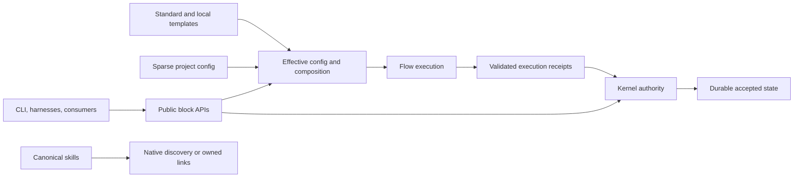

> Superseded in part on 2026-10-16 by the new-project rebuild plan — see [../2026-10-16-platform-rebuild/rebuild-plan.md](../2026-10-16-platform-rebuild/rebuild-plan.md).

# Forge final plan — draft v2

## 1. Bottom line

1. **Decisions needed:** select the staged scope, upgrade boundary, certification resources and candidate policy in section 10; this revision authorizes no implementation or publication.
2. **A useful 0.1.0 is achievable in principle; October 28–November 11, 2026 remains a stretch scenario, not an endorsed forecast.** Reforecast after owned decomposition, the delivery pilot and certification access checks. [inferred]
3. Current master contains the one-package foundations and healthy repository CI; published beta.8 still has the old package graph. Installed-product acceptance remains unfinished. [read/ran: R1–R3]
4. Keep the bounded local product: sole Kernel authority, durable Memory, independent Flow, narrow public APIs, two real compositions, one local extension, additive config and four supported harnesses. [inferred]
5. Lock acceptance and interfaces first; repair authority/evidence/safety defects early. Run optional Windows optimization, mutation investigation and throughput measurement alongside independent product work. [read/inferred: R4, L3, L4]
6. Provision certification at the start: npm on six OS/runtime environments, seven binary targets, permitted harness-origin lanes and a candidate-bound observer. Access is currently unverified. [read/inferred: R5]
7. Retain landed package folding, Node changes, worktree safeguards and claim tools; recheck their acceptance rather than schedule them again. [read/ran: R1–R4]
8. Support native-Kernel upgrades from beta.5 and beta.8; refuse automatic upgrade from stable 0.0.10 without altering its data/config. Certify all selected dispositions before freeze. [inferred; registry basis: R2]
9. Keep G0–G8, every promised risk stratum, at least 50 distinct clean pairs and seven automated exercised days on the exact final artifact; an initial campaign inventory contains 80 pairs, not a reduced 50-case matrix. [read/inferred: R6]
10. Promote only accepted immutable npm/binary artifacts. A rejected published `0.1.0` requires a corrective version and a replacement campaign; first stable promotion may therefore be `0.1.1`. [external/inferred: R7]

**Status and scope.** This is a synthesis revision using the current draft, all three round-one critiques and relevant evidence from all five research legs. It retains the synthesis brief's ten sections. Only this file and `eval/round1-revision-log.md` are written. No implementation, task generation, Kernel/GitHub mutation, commit, push, browser or Claude invocation occurs. The final-plan issue remains open (`73714c21-ee16-4246-b11c-cde72763dade`); the parked release proposal remains open ([#564](https://github.com/harshanandak/forge/pull/564)). [ran: R3]

**Evidence.** `[read]` means inspected source/records, rung 2; `[ran]` means an executed command/API read or calculation and proves only the returned result, not installed behavior; `[external]` identifies checked primary documentation; `[inferred]` identifies recommendations, assumptions and estimates. Repository evidence is pinned to freshly fetched `origin/master` (`7d448ec812ef8639790477af07c3c75962173f8a`); parked evidence to `origin/docs/release-010-parallel-plan` (`2f7fe92ce40195e85ca0e896c52c5d37786b2bd9`). The worktree remains at predecessor `ba56b9201782c4d1246c77bde6380867603184bf`. No installed-artifact, migration, live-harness or observation campaign was run in this revision. Historical measurements retain their research attribution and are not claimed as new benchmarks.

## 2. Where we are

| Area | Checked state | Release implication |
| --- | --- | --- |
| Source package | `forge-workflow@0.1.0-beta.8`, Node `>=24.0.0`, three runtime dependencies: Babel parser, cross-spawn and YAML. Only `packages/skills` remains a workspace. [read: R1] | Contracts/Flow/Memory folding is landed. Do not repeat separate-package extraction. |
| Installed-library contract | Manifest has no `main` or `exports`; Memory authority provider requires an injected broker; Flow executor requires a synchronous provider. Default-assembly issues remain open (`12d92893`, `1ff3d2f9`). [read/ran: R1, R3, R8] | Existing indexes/primitives need supported import paths and useful lifecycle wiring. They are not accepted turnkey assemblies. |
| Recorded package baseline | 1,320,089 compressed bytes, 4,805,641 unpacked bytes, 454 files. [read: R1] | Committed accounting baseline, not a fresh pack of current master. Measure the settled artifact before changing budgets. |
| Repository CI and protection | Exact-master census: 31 completed check objects, 18 successful and 13 skipped. Strict protection requires CodeQL, ESLint, Analyze (javascript-typescript), Run eslint scanning, Analyze (actions), CI Gate. [ran: R3] | Healthy returned CI metadata. Preserve strict/current-base checks; it does not certify installed artifacts or supported harness behavior. |
| Published channels | `latest=0.0.10`, `beta=0.1.0-beta.8`; the complete returned dist-tag map has neither `next` nor `rc`. [ran: R2] | No qualifying final-candidate campaign was established here. Do not count beta age or private uninspected logs as observation. |
| Published beta.8 | Node `>=22.16.0`, `packages/*`, separate `@forge/contracts`, `@forge/flow`, `@forge/memory` dependencies; declared unpacked size 5,838,297 bytes. [ran: R2] | Source fixes have not reached this version. Fresh installed-package acceptance is a real outstanding outcome. |
| Current user origins | Registry contains stable 0.0.10, beta.5 and beta.8 with different package/runtime declarations. [ran: R2] | Version metadata cannot prove state-format equivalence. The upgrade table in section 5 explicitly prices support and refusal. |
| Kernel backlog | 1,659 records: 771 done, 7 cancelled, 850 open, 28 in progress, 3 review; 881 unresolved. [ran: R3; arithmetic] | Includes epics, stale criteria and fixture noise. Reconcile the release-critical graph; do not audit all 881 as an entry requirement. |
| Claim reconciliation | Parent remains open (`9e31a2f0`); projection child (`6b8e3108`) and repair-tool child (`0fd8b8c1`) are done. The latter's verification comment says live repair was not executed and remains separately human-gated. [ran: R3] | Retain implementations. Corpus/candidate acceptance and any live operator cutover are separate obligations; current live-store repair status is unknown. |
| Delivery cohort | All 27 requested PRs (#578–#604) are merged. Open-to-merge median 308.3 min, nearest-rank P75 619.8, P90 1,319.1, maximum 3,202.9. [ran: R3] | Queue/review tail matters; elapsed PR time is not engineering effort or sustainable owner capacity. Worktree safety (#582) is landed. |
| Proof infrastructure | Binary workflow builds seven dispatch/tag targets but smoke enables Linux x64 only. Harness parity explicitly proves metadata, not live invocation. Release-readiness evaluates nine static blocker functions. [read: R4–R6] | Real artifact execution, harness routes, receipts and observation must be provisioned early. Preserve existing checks and extend their owning mechanisms. |

The research identifies unfinished facade/controls, authorized projection recovery, monitor/session durability, migration and release-convergence acceptance. Its recorded PR6 dependency chain includes facade, claims and default assemblies; PR7 follows migration/controls, while release root (`8e634347`) still carries broad evaluation (`d362bd71`). The root and eval records were re-read as open; the detailed dependency inventory is attributed to L1:320–455 and must be refreshed at scope lock before mutation. Narrow continuous evaluation to supported release behavior without losing unique acceptance. [read/ran: R3, L1]

## 3. Target

**Product job:** one install makes engineering work durable and transferable: capture intent → own work → isolate → execute → retain proof → resume or release. Individual capabilities remain usable without adopting the whole workflow. Owner use and source architecture support this hypothesis; external adoption, willingness to pay and measured time saved remain unknown. [read/inferred: L4:181–223]

| Dimension | Required at 0.1.0 | Completion at 1.0 |
| --- | --- | --- |
| Installation | One npm package; Node 24 minimum, certification on 24/26. Advertised binaries have native install/setup/runtime and content parity evidence. | Same package model, documented compatibility/support lifecycle and repeated upgrades with independent consumers. |
| Open blocks | Supported Contracts, Flow, local Memory, narrow Kernel-service and config/template subpaths. Useful default assemblies over existing owners; no deep private imports in examples. | Stable justified APIs/errors/lifecycles; promised CLI/harness paths use owning services. No blanket export of every helper. |
| Authority | Kernel alone accepts issue/claim/workflow/run/gate/evidence transitions. Memory's authority access delegates there; connected Flow submits receipts there. | Mature ownership and migration commitments. Optional remote/team operations remain separately justified work. |
| Templates | Default TDD delivery and small-change composition; one local extension can add/replace optional named nodes or bind a provider. Required rails, approvals and stop points survive. | Versioned extension/migration contract expanded from real consumers; general inheritance/network loading is optional. |
| Additive config | Sparse `.forge/config.yaml` selects template/providers/overrides. Explicit named-ID map and list semantics; one effective result with origins and consistent errors, consumed by supported CLI/library paths. | Consolidated supported consumers and documented config migrations/precedence. Personal overlays only when demanded. |
| Skills/harnesses | Physical canonical `.agents/skills`, packaged bytes, native discovery or verified owned local links. Claude/Codex/Cursor/Hermes have installed-version T0–T4 evidence for promised behavior, with user content/hooks preserved. | Mature supported adapters without multiple editable authorities; additional harnesses only with demand/proof. |
| Delivery/recovery | Safe worktrees; truthful evidence/monitor/review state; owned exact-head CI-first `forge merge --auto`; native backup/upgrade/rollback; essential read-only Doctor and bounded skill acceptance. | Complete promised facade routing, mature consumer/recovery compatibility and measured operational reliability. |
| Release promise | Selected upgrade origins or explicit non-mutating refusal; G0–G8, required strata, ≥50 clean pairs, seven exercised days, no unresolved S0/S1 and live artifact readback. Compatible `0.1.z`; deliberate breaks use a new minor and migration notes. | Explicit stable public API and data migration window proven by consumers; a version label is insufficient. |

Adoption profiles `minimal/standard/full` and skills-only installation are adoption settings, separate from workflow composition. Existing fixed-graph toggles are not a user extension system. Library consumers inject effective config; environment/filesystem discovery stays at integration edges. Memory can run without Flow activation; stateless Flow without Memory/Kernel activation; connected execution uses the same Kernel authority. [read/inferred: R8, L2:225–236]

## 4. Options

All options retain one package, Kernel authority, Node 24/26, decided pruning, gate integrity and truthful supported-artifact proof. Durations are comparative planning scenarios from an October 1 start, not measured capacity or commitments. [inferred]

| Path | Scope/value | Effort/time scenario | Risk and cuts |
| --- | --- | --- | --- |
| **Thin freeze** | Stabilize the pruned CLI, installed local journeys, canonical skills/harnesses and narrow mature APIs on the current fixed workflow. | M–L; approximately 3–4 weeks if access/recovery are ready. | Medium–high. Defers genuine workflow extension and broader config/facade integration; explicitly delivers a smaller outcome than the owner's target. Certification may erase the time advantage. |
| **Full vision first** | Generalized versioned composition/config, broad justified APIs, complete facade thinning and broader consumer compatibility before the first stable release. | XL; approximately 8–12 weeks before discovered constraints. | High coupling and delayed useful release. Still excludes mandatory cloud/team, graph, marketplace and Companion development. |
| **Staged evolution — recommended** | Complete bounded local product: narrow APIs/default assemblies, two compositions/one extension, additive config, canonical distribution, supported controls/recovery and exact-artifact proof. | L; 4–6 weeks is a **stretch** scenario (October 28–November 11); a capacity sensitivity reaches 6–8 weeks or more. Reforecast in section 7. | Medium–high. Defers general machinery/full facade cleanup, not basic reuse/customization. Unknown operator/native/harness access can dominate dates. |

Recommend staged evolution: reuse existing constructors, validators, leases, storage, monitor/lifecycle code and release writers. A narrow extraction below a difficult command seam is allowed only to solve a demonstrated cycle; no second runtime/authority or default rewrite. [read/inferred: R8, L2]

## 5. The plan for the recommended path

Sizes are scope estimates: **S** bounded change; **M** one service/distribution slice; **L** coupled consumers/runtime; **XL** broad migration/rewrite. All implementation and schedule choices below are `[inferred]`, grounded in the cited source/research. Later task generation records exact owned files, prerequisites, acceptance and reverse paths in the approved plan/issues.

**Admission rule:** each task must close a named promised journey, preserve an authority/data/security invariant, complete an owner-decided retirement or produce required release proof. Otherwise defer it. Performance goals and optional-confidence experiments do not become product-admission gates merely by appearing here.

### Start with acceptance, access and required delivery truth

| Work package | Change/how and value | Effort/risk | Proof gate and prerequisite |
| --- | --- | --- | --- |
| **Acceptance and interface lock** | Reconcile release-critical criteria with landed code, D44–D46, one package and Node 24/26. Freeze packet/provider/receipt/error and producer-version policy, plus minimal template/resolved-config shape, origins/errors, map/list precedence, authority floor and injected defaults. One config owner implements the resolver once; APIs/controls consume it. | M / high semantic risk | Every promised outcome has evidence or one missing-work owner; N/N-1 conformance and stale/malformed/conflicting receipt cases remain. Resolve Flow's beta.6 producer declaration. Decide upgrade/claim/mutation boundaries now. **First package**, following owner scope approval; no dependency on optional optimization. [R8] |
| **One landing authority and recovery handoff** | One landing owner, initial ready queue ≤3, disjoint workers and explicit holder-authorized lease release/transfer/readback. Retain P0/P1 and all regression fixes; file non-blocking P2s in the later authorized program. Quarantine only a demonstrated CI flake with its run. | S–M / medium steering risk | Foreign/stale lease refuses; valid handoff resumes without waiting for expiry; no local-timeout quarantine. Preserve issue/head/base/receipt/checkpoint for a designated successor; only one landing authority remains active. Prerequisite: interface/scope contract; no new coordination service. [R3, L3] |
| **Truthful required evidence and handoffs** | Retire the duplicate echo-success producer through the existing protected workflow writer after fresh contexts/rulesets/producer census. Preserve doc assertions, authoritative Tests coverage, mixed/rename fallback and expected lanes. Recheck prior verdict fixes; repair only remaining false-blocker/handoff behavior. Distinguish review-provider outages from code defects and recover on the same head. | M / high merge-authority risk | Failed/cancelled/missing required lanes cannot become PASS; intended required producer is unambiguous per head/run; correct doc and rename selection. Record prior bytes/reverse path before later writes. Prerequisite: landing contract; protects dependent merges, not read-only API inventory. [R4] |
| **Decided hook retirement and required process safety** | Delivery owner removes deprecated team-shell hook/config wiring; pruning owner later retires its remaining owned scripts/docs/allowlist using the same replacement-proof receipt. Reuse landed worktree sentinel/refusal/restore safeguards. Admit shared identity/cleanup repairs as blockers only where safety, bounded execution or a required supported-path failure demonstrates necessity. | S–M; safety fix can be M–L / high | Surviving local/CI gates remain active; PID-reuse, unknown-identity refusal, timeout/cleanup/token-proof and dependency-install compatibility pass. No user worktree cleanup as preparation. Prerequisite: owning proof contract; final shell retirement depends on hook removal. [R4, R8, L3] |
| **Certification readiness and thin evidence path** | Certification lead assigns the campaign below to actual operators/runners, captures versions/access/turnaround, and wires one installed tarball → journey → receipt → aggregate path using existing release mechanisms. Start with an available Linux/Node24 CLI/skill route; add the new public API/resolver slice as soon as its implementation lands, before broad consumers. | M / high access/evidence risk | One real artifact path produces digest-bound PASS and controlled FAIL/INCOMPLETE; a missing/wrong-digest result blocks. Confirm every required lane and observer has an accepted operator, access and recovery path. Unassigned lanes keep readiness incomplete. Prerequisite: acceptance contract; proceed alongside delivery repairs, without falsely passing broken gates. [R5–R6] |

### Product work and release acceptance in dependency order

| Work package | Change/how and value | Effort/risk | Proof gate and prerequisite |
| --- | --- | --- | --- |
| **Native preservation and claims acceptance** | Extract/reuse generic JSONL codecs under the native owner before deleting importer dependencies. Retain history/provenance, native export/hydration and verified backups. Revalidate landed claim projection/repair tools on a copied, versioned corpus; verify stale epochs, terminal release and connected receipt authority. | M–L / high data/authority risk | Lossless issues/comments/dependencies and historical fields; backup/restore/replay/interruption; **verified claim/lease projections and stale-epoch rejection**. Prerequisite: interface lock; required claims evidence feeds connected API acceptance and migration. Live-store operation follows the separate cutover boundary below. [R8, R9] |
| **Pruning and canonical artifact ownership** | Complete decided serve/dashboard/Insights retirement, four duplicate `pr` delegates, dep-guard/team-shell deprecation/owned wiring, skills-workspace overlap and D46 importer removal. Physical `.agents/skills` becomes canonical; coordinate metadata, manifest/lock, installer, hooks/drift, references and compiled assets once. Native discovery first; owned links where necessary. | L / high distribution/user-content risk | Clean clone/tarball/binary contain required bytes; Windows/no-link/dangling/moved-worktree/repeat-update/user collision/refusal cases. Preserve unique `pr link`, targeted inbox/ack, typed-memory/provenance and test-report dashboards. Prerequisites: codec/recovery preservation for importer removal; hook receipt for shell retirement; one package integrator. [R1, R7–R8, L4] |
| **Public local assemblies** | Supported package subpaths and narrow Kernel lifecycle/service entry over existing blocks. Default local Memory wires existing recall/storage and delegated authority; deterministic Flow retains synchronous executor semantics. Touched promised consumers call owning services; avoid exporting all internals. | L / high API/lifecycle risk | Clean-directory installed consumers; Memory store → provenance recall → restart; public issue/claim/lease; external receipt acceptance/rejection; stateless/connected Flow outcomes. First API/resolver/discovery vertical slice lands before bulk consumer wiring. Prerequisites: contract lock, settled installed resources and native/claims evidence where connected. [R8] |
| **Two compositions and one resolver** | Reuse graph constructors, sparse writer, options introspection and SkillRuntime. Separate template descriptions from project selection/bindings/overrides; add the one local named-node extension. Reconcile malformed/unknown config on supported paths; APIs consume the same effective result. | M–L / high permission/behavior risk | Real user extension without editing Forge; cycle/missing-capability/unknown-node errors; required-rail/approval/stop refusal; CLI/library equivalence, origins, override/reset and old config preservation. Prerequisites: locked resolver/template interface and existing public primitive/service seam. Can develop alongside assemblies using that interface, with one config owner. [R8] |
| **Controls, execution and four harnesses** | Complete supported facade/setup/essential Doctor, capability probes, hook controls/MCP consent, authorized atomic projection/recovery and genuinely missing monitor/restart behavior. Keep durable delivery/cursor/idempotency/session-run lifetime and reaping. Reuse lifecycle/process-tree owners for real process timeout/cancel. | L / high integration/security risk | Installed-version T0–T4 and permission refusal/expiry; wake/resume/restart, cancellation acknowledgement, terminal cleanup/zero orphans; read-only Doctor deadlines/redaction/no side effects. One live slice per promised harness before the broad campaign. Prerequisites: applicable API/config/canonical/claims slices and provisioned permitted lanes. [R5, R8] |
| **Upgrade, candidate machinery and truthful docs** | Implement the selected origin table; reuse beta.5 corpus only after demonstrated layout/format equivalence. Prove dry-run, backup, cutover, interrupted and post-write recovery/sole-writer handling. Extend existing BOM/receipts/generators/aggregate, actual npm/binary matrix and observer; gate both publication channels and prohibit asset replacement. Versions/docs/changelog/pruning settle before freeze. | L / high recovery/publication risk | Every supported origin has preservation/restart/interruption/post-write/rollback; every unsupported origin refuses without mutation and has recovery guidance. Wrong SHA/digest/corpus/missing shards refuse release. Fix essential-doc copying or its false promise. Prerequisites: assemblies/controls, claims, canonical config/distribution and readiness path. [R2, R6–R9] |
| **Final campaign and promotion** | Iterate preliminary immutable RCs, then publish literal stable-version candidate to npm `next` and a non-latest GitHub prerelease. Execute complete final-artifact campaign and seven exercised days; promote the same accepted bytes only. | L / high immutable-version risk | G0–G8 PASS, all required strata, ≥50 clean pairs, no unresolved S0/S1, recovery, exact-head train and publication/default-install readback. Prerequisites: all promised content/behavior and selected required proof; **optional speed targets or mutation scoring do not independently block**. Section 9 governs corrections and channel reversal. [R6–R7] |

**Task-local removal receipts.** Before each deletion, enumerate static/dynamic callers, assets, manifest/setup/hook/docs/CI references and surviving responsibilities; attach replacement tests and exact previous-byte/data restore steps. Remove owned positive tests with the retired surface, retain independent negative isolation/security/recovery tests. Orphan cleanup stays within touched slices; no historical-doc purge or unrelated dependency replacement. [read/inferred: native-codec dependency R8; L4:108–177]

**Execution seam.** `createWorkPacketExecutor` invokes `run` synchronously and rejects a Promise (`executor.js:217–248`); a result normalizer cannot cancel a provider already blocking that process. Keep the inline deterministic provider bounded and synchronous. The external process-backed route must supervise execution from a separate controlling process using `createProcessLifecycle`, existing process-tree tracking and receipt builders; its controller owns timeout, cancellation acknowledgement, kill/reap and one terminal receipt. Never pass an asynchronous provider into the synchronous primitive or claim reducer transitions prove actual termination. Certify real hanging/late/no-ack/PID-reuse/error children against the supported artifacts. Reuse first; add only the missing assembly wiring identified by that proof. [read/inferred: R8]

### Upgrade support and claim cutover boundaries

The table is a **proposed support contract**, not executed upgrade evidence. Version alone does not establish eligible storage. A native-Kernel store must pass schema/layout/integrity and sole-writer preflight; Beads-only activation is outside every automatic path. Node 24/26 are the target runtimes; isolated legacy input fixtures do not add an old target-runtime promise. [inferred; R2, R8–R9]

| Origin | Default disposition | Required evidence / cost boundary |
| --- | --- | --- |
| Fresh installation | Supported on npm Node24/26 and advertised binaries. | Clean install, selected profile/harness, content preservation, first use/restart and cleanup. Core campaign budget. |
| Published beta.5 with native Kernel state | Supported upgrade; retain prior importer provenance as data. | Inventory actual binary/config/JSON/database inputs; dry-run, verified backup/restore, restart, interrupted cutover, post-cutover-write resolution and rollback to the prior usable installation. Existing corpus is a foundation, not automatic final proof. |
| Published beta.8 with native Kernel state | Supported upgrade, explicitly included in migration work. | Independently cover old `@forge/*` graph, config/skill ownership and state. Same preservation/failure/rollback assertions; reuse beta.5 fixtures only with checked equivalence and unique beta.8 installation cases. This added origin is included in L-sized migration, not free. |
| Published stable 0.0.10, or any Beads-only/unsupported layout | **No automatic in-place upgrade in 0.1.0.** | Non-mutating preflight refusal, untouched source data/config/hooks/skills and runnable prior installation; honest backup/manual transition/return guide. No activation/importer is shipped. Additional automatic support needs a separately priced owner choice before freeze. |

If beta.5/beta.8 eligibility or recovery cannot be proved, keep that path blocking until repaired or obtain an explicit narrower support decision and update docs/campaign/forecast. Never silently replace the promised supported upgrade with a refusal. Backup preservation, activation in Kernel and restoration of a working old installation are separately asserted.

**Claim acceptance versus live cutover:** default release scope certifies projection/repair/upgrade behavior on copied versioned native corpora, including legacy contradictions; it does **not** require repairing the owner's current operational database to demonstrate product behavior. At acceptance lock preserve and disposition the reconciliation parent's unique criteria; if it requires a real operator cutover, record that as an additional explicitly approved dependency. Do not rebuild done children or close operational criteria from corpus results. The current shared-store state remains unknown. [ran/read/inferred: R3, R9]

For any later live repair: schedule writer quiescence across all shared-worktree actors; stop claims/comments/issue updates before fixed-time preflight; create and independently verify separate backup and restore evidence; obtain separate human approval of the exact whole-database digest; apply with `BEGIN IMMEDIATE` and exact CAS; read back all relevant claim/lease projections and the receipt before resuming writers. Any intervening Kernel write invalidates approval and requires fresh preflight/approval. Restore fences writers, closes handles, preserves failed DB/sidecars and restores verified backup to a separate path before authority replacement. General plan approval is not digest approval, and no quiet window/process stop is performed here. [read: R9]

### Certification inventory, permitted operators and applicability

The certification lead owns campaign/receipt integration; the landing owner owns required source/CI acceptance; native runner operators own binary execution; the maintainer owns publication and any exact-digest operation. Assign **actual names, access confirmation and turnaround** at program start. These role assignments are a proposed execution contract; availability is unverified until the readiness checkpoint, so the date cannot depend on presumed resources. [inferred]

| Lane / environment set | Execution route and owner | Applicability and exit |
| --- | --- | --- |
| npm: Ubuntu, macOS, Windows × Node24/26 = six environments | Certification lead extends GitHub Actions jobs that install the exact downloaded tarball in a clean consumer directory. | Four modes: Memory-only, Flow stateless, Flow connected and facade. Each case declares exact OS/arch/runtime/product mode, fixture/digest, steps/transitions and cleanup. Do not borrow checkout assets. |
| Binary: Windows x64; macOS x64/arm64; Linux glibc x64/arm64; Linux musl x64/arm64 = seven targets | Native operators arrange hosted/self-hosted runners or owner-operated native devices; musl uses the target libc, ARM64 actual matching execution. Store binary/checksum/runner identity. | Runtime/install/setup/public-resource/cleanup proof for every advertised target. Bun-compiled executable uses its embedded runtime; Node24/26 is not an extra binary axis. Compilation or cross-build alone does not pass. No runner has been provisioned by this revision. |
| Live Claude/Cursor/Codex/Hermes on supported Ubuntu/macOS/Windows | Named authorized session operators return installed versions, transcript and receipts. **Claude requires a Claude-origin operator/session; Codex does not dispatch it.** Cursor/Codex/Hermes use their permitted installed host routes. | Capture trust/auth access without secrets, canonical discovery, real invocation and promised T0–T4 delivery/wake/resume/notification/cancel/cleanup. Host-managed runtime is declared separately from the npm Node axis. Metadata fixtures remain fast checks. A documented installed-version limit can earn tested refusal/degradation; missing promised implementation/access cannot. |
| Upgrade/authority/train | Native/Kernel owner supplies immutable corpora; CI certification executes origin/failure/security cases. Landing owner runs one sequential exact-head train simulation. | Preflight/backup/restore/interruption/post-write cases, leases/epoch/approval/refusal and public receipt semantics remain mandatory. Any optional real-store repair has its separate operator gate. |
| Observation and publication | Certification lead owns durable automation and interruption recovery; maintainer reserves publication/readback windows and a substitute permitted operator. | Daily candidate-bound installed journeys and failure events; pinned BOM/digests, durable time/event ledger and alerting. Maintainer alone applies approved promotion/reversal. Unknown observation intervals are incomplete. |

**Initial applicable pair inventory, to freeze before fan-out:** the six npm environments are individually enumerated by OS and Node24/26; the seven binaries above are individually enumerated by target; each of the four harnesses has three proposed host cases. No blanket `3 × 2 × 4 × 4` cross-product is presumed. The corpus binds supported capabilities and explicitly tests refusal for genuinely unsupported combinations. A release-scope change requires an owner decision, never a quiet reduction to reach 50. [inferred]

| Named journey group | Environments | Initial distinct pairs |
| --- | --- | ---: |
| Memory-only lifecycle/provenance; Flow-stateless packet/results; Flow-connected authority/monitor; facade configuration/delivery — four distinct cases | Each of six npm environments | 24 |
| **First use and resume:** minimal install, selected harness/user-content preservation, own/isolate work, record decision/evidence, restart, retrieve authoritative next work, cleanup | Six npm environments | 6 |
| **Independent block consumer:** clean-directory public imports, local Memory without Flow/full setup, deterministic Flow without Kernel initialization and explained resolver result | Six npm environments | 6 |
| beta.5 native-Kernel upgrade/recovery; beta.8 native-Kernel upgrade/recovery — two distinct origin cases | Six npm environments | 12 |
| Stable/unsupported-origin refusal and preserved prior installation | Six npm environments | 6 |
| Live harness invocation/permission/delivery/lifetime/cleanup — one complete case for each of four harnesses | Three declared native hosts per harness | 12 |
| Binary native install/setup/resource/runtime/cleanup | Seven target environments | 7 |
| Adversarial authority/contracts/protected writes, stale receipt/lease epoch and recovery | Six npm environments | 6 |
| Sequential owned exact-head/current-base merge-train simulation | One controlled integration environment | 1 |
| **Initial inventory total** | Distinct indexed cases and exact environment identities; no repeated case/environment inflation | **80** |

Eighty is an **inventory**, not completed evidence or an exhaustive substitute for G0–G8. Split composite cases if attribution/tri-state proof requires it; new risk cases can increase the count. Every case includes required receipts, failures and cleanup, and the campaign must cover all mandatory schema/provider/config/consent/monitor/authority/data/platform strata. Scope lock checks that mapping. Fifty remains the acceptance floor, not an allowance to drop applicable cases. Binary and live-harness access can change campaign effort without changing the promise. [inferred; normative basis R6]

Run one representative artifact→aggregate path early, then the first installed API/resolver/discovery slice and one real slice per harness before dependent breadth. Final evidence belongs to the final published BOM. Preliminary success exposes infrastructure defects but does not transfer clean-pair or observation credit automatically. Seven cumulative qualifying automated days require exercised journeys and reconstructable events on that identity; pause credit for an observer outage and resume only with intact evidence, otherwise start a fresh qualifying window. Product/dependency/toolchain/corpus/policy correction creates a new candidate and fresh required acceptance/observation; unresolved S0/S1 blocks eligibility. [read/inferred: R6]

### Optional delivery improvement: bounded, alongside the product

Run the five-ordinary/one-coupled pilot on real planned work; collect ten working days before increasing WIP. Track all attempts/correction/base-only heads, owner active review/landing/operator time, ready-queue wait, provider wait, CI/setup time, refusal/intervention and receipts. Operating goals remain proposed: ≥90% first settled-head required-check success, ≤2 ordinary correction heads, ordinary P75 <4h, no unauthorized cleanup/local-only quarantine. Misses reduce WIP and trigger mechanism diagnosis; they do not alone fail product release. [read/inferred: L3:188–218]

Optional Windows/process-speed and mutation experiments share a **maximum two worker-days and four owner-hours**, with at most one worker-day/two owner-hours per experiment in the initial program. Try native/batched identity reads before considering a persistent helper; preserve PID-reuse/fail-closed behavior. Measure same-head/runner warm/cold identity, Git, fixture, installation and test costs separately. Stop optional redesign at the cap if no reproducible correctness-preserving benefit. Required safety/bounded-execution fixes remain admitted and re-estimated if they exceed it; a cap cannot excuse an unsafe supported path. [inferred; source basis R4, R8]

At scope lock census mutation's required contexts/consumers and uniquely owned risk. Current source makes mutation schedule/manual-only, outside CI Gate dependencies. Default: retain existing configured jobs/visibility, allow the bounded initial-suite/scored/seeded-defect experiment, and **do not rely on unearned mutation confidence**. Only a risk explicitly admitted as required makes its proof release-critical. Cap exhaustion defers optional new scoring work; it does not disable a job, waive a gate or create an exemption. Retirement requires a separate explicit owner disposition through the supported writer with required/unique risk proof preserved. No exhaustive 106,522-mutant campaign is newly promised. [read/inferred: R4; historical failure L3:154–169]

## 6. Cuts and deferrals

| Disposition | Outside 0.1.0 / removed scope | Boundary |
| --- | --- | --- |
| **Retire/deprecate as decided** | Product dashboard/serve and Insights including `memory insights`; duplicate PR delegates; dep-guard/team-shell owned wiring; overlapping `packages/skills`; shipped Beads importer/advisory/integration. | Caller/asset/replacement census and task-local reverse paths; preserve unique linkage, native services/history and security/isolation/recovery proof. Deprecation/removal follows the approved support disposition, not unrelated deletion. |
| **Supersede** | Separate Contracts/Memory/Flow publication, multi-package BOM/extraction milestones, Memory as another authority, Node22 release target. | One artifact with independent runtime capability journeys; legacy fixtures are inputs, not old target-runtime support. |
| **Defer** | Full facade thinning, public export of all internal cohorts, unrelated config cleanup. | Finish promised paths; migrate further slices when consumer demand justifies compatibility cost. |
| **Defer** | General template inheritance/network catalogs, marketplace expansion, automatic promotion/dependency solvers/personal-overlay hierarchy. | Two actual compositions and one local extension are enough; no temporary second resolver. |
| **Defer** | Hosted/team storage/auth/admin and multi-machine operations; Graphiti/vector/temporal enrichment and broad provider catalogs. | Separate operations/data value case after local authority/FTS5/provenance works. |
| **Optional external** | Agent Companion and additional Pi/OpenCode/provider certification beyond the promised four harnesses. | Generic contracts remain; external development is outside the Forge BOM and promotion gate. |
| **Defer** | Continuous skill optimization/holdouts/model ranking, broad efficiency automation and Doctor dashboards. | Retain bounded supported-skill/essential diagnostic proof; reconcile broad-eval dependencies explicitly. |
| **Defer unless admitted** | Uncapped Windows redesign, scored mutation as a new universal gate, CI framework/build migration/cache/matrix reductions. | Timeboxed experiment or named risk only; existing required proof remains. No timeout increase/retry-to-green/quarantine of deterministic slowness. |
| **Unsupported automatic origin** | Stable 0.0.10/Beads-only activation and every unlisted historical origin. | Refusal, preservation and manual recovery guidance are included; automatic support requires separate pricing/approval. |

Keep historical design evidence; correct active installation/support docs. Remaining Babel/cross-spawn/YAML are declared runtime dependencies with reported active callers, not removal targets merely because dep-guard retires. Limit orphan cleanup to touched slices after the full caller search. Package savings and speedups are measured on settled artifacts, not summed from overlapping research estimates. [read/inferred: R1, L4]

## 7. Achievability assessment

### Capacity, prerequisites and date checkpoints

L3's 4–6 ordinary or 1–2 coupled PRs/day are conservative judgments, not measured sustainable capacity. Its historical OS medians (98s Ubuntu, 175s macOS, 536s Windows) and 5.25× paired Windows/Ubuntu ratio measure CI jobs; PR merge latency includes waiting. Neither supplies owner hours, authoring effort, escaped defects or certification turnaround. Keep reported Windows identity/192-second push costs as diagnosis inputs, not a release-date multiplier. [read: L3:14–31,104–169,188–204]

**Resource assumptions to verify at start:** one active landing owner with approximately three focused hours per workday (illustrative allocation: 90min review/landing, 60min certification/operator coordination, 30min decisions); initially three disjoint implementation lanes and one certification lead sharing those workers rather than four extra people. Contract/config/manifest/lock/generated artifacts each have one owner. Native device and four permitted harness operators must confirm access and time. Owner availability and these allocations are **unknown today**; absent commitments, there is no defensible calendar commitment. [inferred]

| Milestone / bounded inventory | Existing versus missing work; exact unlock | Stretch placement from an October 1 start |
| --- | --- | --- |
| **Acceptance and access settled** | Already supplied: one package, Node24/26, merged worktree/claim tools, strict CI. Missing: promised-outcome/resolver contract, actual operator access, upgrade/claim/mutation dispositions and initial receipt path. Interface lock unlocks parallel native/Flow/config work. | Days 1–3; access unresolved means reforecast, not invented readiness. |
| **Delivery proof trustworthy** | Existing protected writer/Tests aggregate retained; fix duplicate producer/remaining verdict contradictions and narrow retired hook wiring. Required safety failures have owned fixes. Unlocks dependent landing; inventory/access work can precede it. | Week 1, with five-ordinary/one-coupled pilot begun. |
| **Native and package foundations accepted** | Revalidate existing claims/projections; native codec extraction and copied-corpus preservation; coordinated prunes/canonical packaging. Settled package/config bytes unlock installed assembly/discovery proof; claims acceptance unlocks connected authority. | Weeks 1–2; manifest/lock/generated integration counted once. |
| **One usable vertical product, then supported breadth** | Missing default assemblies and real composition/resolver completed against locked seams; first installed API/resolver/skill route, then one slice per harness. Controls/monitor consumers follow their accepted seam, not a whole-workstream blanket wait. | Weeks 2–3; all harness routes and remaining controls may extend into week 4. |
| **Recovery and preliminary RC complete** | beta.5 foundations reused; beta.8 and unsupported-origin assertions added; final recovery/docs/channel immutability/observer completed. All promised installed behavior and applicable campaign resources ready. | Weeks 3–4 only if calibration supports it. |
| **Final candidate accepted and promoted** | Full 80-pair initial inventory plus required-risk supplements, G0–G8, ≥seven automated exercised days, no S0/S1; maintainer readback/default installs. | Weeks 4–6 stretch; corrections/access may move it later. |

This is an owned **work-package inventory**, not an approved per-file task list or measured effort. Do not derive engineering days by adding S/M/L labels. Translate each missing slice into one owner, outputs/dependents, authoring/verification effort, active owner/operator demand and elapsed CI/access wait before endorsing dates. Reuse existing implementations; avoid double counting package/config/generated-file or delivery foundation work. [inferred]

The v1 workload hypothesis of 30–40 ordinary plus 8–12 coupled slices is retained only for sensitivity: at 5 ordinary/day and 1.5 coupled/day, `(ordinary/rate + coupled/rate)` is 11.3–16.0 active landing days; at illustrative 3/day and 0.75/day, 20.7–29.3. Add the same minimum seven observation days and measured authoring/access/campaign/rework demands. Neither row is a resource-loaded critical path; rates are alternative mix assumptions, not additive staffing capacity. The second case can push a start-of-October program into November/December without a dramatic failure. [ran: arithmetic; inferred scenarios]

**Reforecast checkpoints:** at the end of the five-ordinary/one-coupled pilot or day 5, whichever exposes a constraint first (approximately October 7), publish an owned resource/dependency forecast and certify access plus the thin receipt path. At ten working days (approximately October 14), use observed owner active time, queue/CI/provider wait, coupled integration and certification rates to retain or revise dates/WIP. If scope decomposes later, start those clocks from real execution. Do not wait for all 881 records or the full observer week to discover missing lanes. [inferred]

**Critical path:** acceptance/interfaces + provisioned certification → required delivery truth/native preservation and settled artifact ownership → public/config/controls vertical slices + claims acceptance → supported-origin recovery and final content → final published candidate → full proof and seven qualifying days → maintainer promotion/readback. Native access/operator approvals and config/package shared ownership can serialize it. Optional speed/mutation/pilot targets are outside product admission; ten-day telemetry gates only higher WIP. [inferred]

### Risks, recovery and slips

| Risk | Mitigation and consequence |
| --- | --- |
| Owner or landing session unavailable | Preserve owning issue/lease/head/base/receipts/remaining blockers in the checkpoint. Designated successor resumes only after holder-authorized release/transfer/readback; never two active landing owners. No owner/approval capacity means dependent landing/operator work pauses and date shifts; extra workers do not supply it. |
| Required native/harness lane unavailable | Confirm early; arrange permitted operator/device before dependent breadth. Claude-origin execution is separate. Missing promised proof stays INCOMPLETE; arrange access or obtain explicit support/date decision. |
| Claim approval drift/shared-store recovery | Default copied-corpus acceptance avoids unnecessary operational repair. Any required live cutover gets fenced writers, fixed-time backup/restore, separate exact-digest approval/CAS and full projection readback. Changed digest or missing quiet window delays cutover. |
| Migration mismatch or old-origin rollback gap | Exercise beta.5/beta.8 separately and supported stable refusal; include post-cutover writes and prior installation/config/skills restoration. S0/S1 stops release and reforecasts recovery work. |
| Distribution/config weakens safety or loses user content | One resolver/package owner, required-rail/consent tests, physical canonical bytes and owned links, negative/refusal/recovery cases. No silent copy or metadata-only harness pass. |
| Provider cancellation only exists in reducers | Keep sync deterministic provider limited; separately control real child execution, timeout, acknowledgement and reaping. Hanging/no-ack/PID-reuse tests must earn behavioral proof. |
| Review churn or Windows cost dominates | Separate active owner time/ready wait/provider wait from CI/process cost. Batch corrections, same-head outage recovery and WIP reduction; no speculative persistent helper or gate weakening. |
| Candidate rejected or observer interrupted | Reserve correction ownership and maintainer windows before publication. One corrective loop includes implementation/CI/access/campaign time plus **a fresh seven-day qualifying window**, with no invented fixed coding allowance. This is additional to the stretch dates. Missing event time earns no credit. |
| Bun automation/master advances during observation | Pin candidate source, dependencies/lock, Bun, corpus/policy/config and artifact BOM. Weekly latest-stable Bun automation and unrelated master work continue on separate inputs. No rebuild against a moving master. Candidate changes get new identity and acceptance; normal master updates do not rewrite accepted bytes. |
| Optional mutation remains red | Keep failure visible; no unearned score. Stop optional work at cap, retain configured gates or seek separate supported retirement with unique-risk proof. Newly required authority/security/structural cases cannot be waived. |

Parked speed budgets remain **proposed targets until measured**: version p95 ≤2s; setup p95 ≤30s excluding download; single-artifact smoke ≤60s with three Windows repetitions; recall p95 ≤2s/1,000 records and restart 3/3; deterministic receipt p95 ≤2s; cancellation receipt ≤5s/zero orphans; full suite within its existing 25-minute ceiling, durable PASS/no unexpected skips. Keep the actual safety/correctness/timeouts; speed failure calls for diagnosis or an explicit requirement disposition, not increasing timeouts. [read: parked plan:190–204]

After 0.1.0, complete promised service/config routing incrementally and expand only consumer-justified seams. A 1.0 program follows independent consumer integrations and repeated upgrades. An additional 8–12 weeks is merely a planning allowance, with no committed 1.0 date or cloud/team prerequisite. [inferred]

## 8. Value and transformation summary

| Change | User/owner gain | Observable measure / limit |
| --- | --- | --- |
| Current one-package artifact reaches users | Predictable single install and current runtime/resource support. | Fresh registry install and final manifest/integrity. Beta.8's declared 5,838,297 unpacked bytes versus committed 4,805,641 source baseline is a gap between artifacts, not a measured equivalent saving. [R1–R2] |
| Default assemblies and narrow APIs | Independent reusable Memory/Flow and shared authority. | Named independent-consumer journey plus per-subpath contract/lifecycle/refusal assertions; external adoption unknown. |
| Two compositions and additive config | Customization without a Forge fork or mandatory full adoption. | One real local extension, origins/reset and locked-rail refusal through CLI and library. |
| First use/resume wiring | Restart retains decisions/evidence and authoritative next work. | Record first successful use, resume correctness, owner intervention, supported refusal, user-content preservation and cleanup in existing corpus; no separate adoption study. |
| Canonical skills and decided prunes | Fewer editable/support surfaces and collision failures. | 80 source files/79 mirror files, all 79 shared blobs equal; required physical bytes delivered through npm/binary; final size/test-risk ledger. Removing tracked duplicates is not automatically an npm saving. [R8] |
| D46 and explicit upgrade support | No Beads prerequisite; supported native beta users retain data and rollback, stable legacy users get honest refusal. | Per-origin preservation/activation/restoration evidence; no blanket promise for every historical install. |
| Early proof/access plus one landing owner | Fewer late infrastructure surprises and repeat integration. | Actual operator access, artifact→receipt path, owner active time/queue wait and fewer base/correction heads; no summed speed multiplier. |
| Bounded performance/confidence work | Product progress continues while optional improvements earn their cost. | Two-worker-day/four-owner-hour combined cap; correctness-preserving comparable measurements or visible deferral, never claimed mutation confidence from instrumentation alone. |
| Exact-artifact recovery and promotion | Release follows what users install and can recover. | Required strata/G0–G8, ≥50 clean pairs, seven qualifying days, no S0/S1, registry/release/default-install readback. |

Gains above are `[inferred]` outcomes with source/record bases where marked. Existing owner work supplies the pilot/candidate exercises; external adoption and willingness to pay remain unmeasured. No market campaign precedes this owner-focused release.

## 9. Relationship to the parked release proposal (#564)

| Keep | Supersede / adapt | Drop as a first-release prerequisite |
| --- | --- | --- |
| D44 sole Kernel authority; D45 live-Beads retirement; D46 no importer with retained provenance/history/native rollback. | D45's importer exception in current active material; parked D46 is owner-approved direction, unmerged code policy. Extract shared native codecs before deletion. | Positive Beads importer/integration scope or new importer to solve old-origin activation. |
| Independent Memory/Flow and shared contract semantics. | Separate `@forge/*` manifests/publication/extraction and dependency-ordered multi-artifact BOM; block subpaths share one artifact. | Repository/package split, second runtime/authority, complete facade rewrite. |
| Node24 minimum, Node24/26 CI/candidate proof. | Old Node22 rows and beta.8's published metadata; landed runtime changes are retained. | Old-runtime product lanes; legacy fixture execution is explicitly input-only. |
| G0–G8 fail-closed risk classes, receipts, claim/lease/gate/merge authority and recovery. | G2/G3 prove blocks/consumers in one artifact; G5 covers selected native origins/refusal; G8 the actual candidate. Nine static readiness checks remain preliminary. | Obsolete extraction tests only after replacement proof; never authority/security/structural/rollback obligations. |
| Four harnesses and real installed-version T0–T4/monitor/lifetime/cleanup proof. | Copy-mirror authority becomes physical canonical `.agents/skills` and owned links; provision live/native operators early. | New marketplaces/provider catalogs; metadata fixtures as live acceptance. |
| 50 distinct clean-pair minimum, every required stratum, seven automated exercised days, no S0/S1. | Applicability inventory and resource plan, initially 80 pairs; candidate-bound observer. L5's generic 72-hour recommendation does not lower this release's floor. | Repeated pairs, beta age, quiet days, unavailable promised lanes as success. |
| Current native upgrade/rollback corpus and exact-digest operator safeguards. | Add beta.8 and stable-origin refusal; distinguish certified upgrade behavior from optional current-store cutover. | Automatic activation for stable 0.0.10, every old version, or general-plan approval treated as live digest approval. |
| Candidate freeze, provenance and live publication readback. | Final stable-version candidate on `next` plus non-latest GitHub prerelease; both channel holds and immutable binary assets. | Promoting a prerelease tag as literal stable metadata, or implicit transfer of another BOM's acceptance. |
| Bounded supported-skill/Doctor acceptance. | Broad evaluation dependency is reconciled to supported behavior; mutation risk scope decided up front. | Continuous optimization/Companion and optional scoring as universal admission gates. |

### Candidate policy and correction contingency

1. Iterate immutable `0.1.0-rc.N` packages on an explicit non-default channel. Before any candidate tag, fix owning npm/binary publication generators so stable candidates are held off default channels. Current binary source creates a normal GitHub release and uploads with `--clobber`; replace that behavior through its protected owner with prerelease/non-latest creation, asset-identity refusal and approval-bound promotion. Preserve prior workflow/channel states as the later reverse path. [read: R5; current npm mapping previously inspected in v1: section 9; recheck generator at task start]
2. Settle behavior, dependencies, canonical assets, docs/changelog and approved support. Pin source SHA, npm version/manifest/lock/Bun, binary target inputs, contract/config/capability/corpus/severity-policy digests. Review preliminary-RC → stable-version metadata delta; equivalence is a guard, not permission to transfer acceptance. Unrelated master changes/Bun updates remain outside this candidate. [inferred]
3. Pack/build once; publish the actual immutable literal `0.1.0` tarball under npm `next`, keeping `latest` unchanged, and exact binary assets as a non-latest GitHub prerelease. Certify those published bytes with the full matrix/G0–G8, applicable pairs and seven qualifying days. Exact-version installation is public but candidate status remains explicit. Preliminary RC iterations do not add a mandatory extra week. [external/inferred: npm permits alternate tags and immutable versions; R7]
4. Preserve all failures/retries and tri-state receipts. Wrong/missing digests/strata/shards, stale heads, timeout/truncation, unauthorized mutation, unverifiable events/time and S0/S1 cannot yield release eligibility. Observer recovery cannot manufacture elapsed credit. [read/inferred: R6]
5. Reserve maintainer publication/readback windows and a permitted substitute before final freeze. If this candidate is rejected, keep it unpromoted, visibly disposition it through the supported publication process, fix content under a new version (possibly `0.1.1`) and repeat required exact-artifact acceptance plus seven qualifying days. Correction/CI/native/harness access are variable additional time; the schedule does not hide this loop inside a guaranteed date. No asset overwrite or version reuse. [external/inferred: R7]
6. After acceptance, move npm `latest` and existing GitHub release/latest metadata to the accepted identity without rebuilding, repacking or triggering republish. Re-fetch registry integrity/provenance and every required release asset, exercise default npm/binary installation and re-read release blockers. Preserve both prior channel states and verified native backups for any authorized reversal. Channel rollback redirects future installs; it does not roll back migrated local data. [external/inferred: R7]

### Disagreements resolved

L3's open-worktree snapshot predates #582's merge; use the refreshed 27-merge cohort and retain safeguards. L1's exhaustive backlog is orientation, not a release task list. L2's broader API/template architecture is bounded by L4's useful-minimum test: narrow assemblies/two compositions/local extension now, general machinery later. L3's speed/mutation recommendations become measured capped lanes alongside required safety work; L4's optional-retirement suggestion cannot itself disable configured gates. L5's physical-files/local-links and immutable version warning are retained; its 72-hour general observation suggestion does not supersede the seven-day authority/data/distribution requirement. [read/ran/inferred: R1–R9, cited legs]

### Evidence register for this revision

| Reference | Independently checked source / readback and limit |
| --- | --- |
| **R1 — source/artifact baseline** | Fresh `git fetch -q origin master docs/release-010-parallel-plan`; `git rev-parse` for both refs/HEAD. `git show origin/master:package.json`; `scripts/package-size-baseline.json:2–6`. Declarations/baseline, not new pack/install evidence. |
| **R2 — published origins** | Live read of [complete forge-workflow registry metadata](https://registry.npmjs.org/forge-workflow), projecting complete dist-tags and version/engines/workspaces/dependencies/unpacked-size for 0.0.10, beta.5, beta.8. Quickstart's `@beta` versus bare-install note rechecked from remote. No installed upgrade. |
| **R3 — records and GitHub** | Prescribed `FORGE_SESSION_ID=delivery-train-20260928a`; `node bin/forge.js list --json` over all 1,659 rows; `show 0fd8b8c1 --json`, including final verification comment. Forge-routed `gh pr list` enumerates all 27 #578–#604; timestamps calculated with nearest-rank percentiles. Exact-master check-runs API (31 objects), protection API (strict/six contexts), `gh pr view 564` (OPEN/parked head). Record/check metadata, not runtime/cutover acceptance. |
| **R4 — delivery proof boundaries** | Remote `test.yml:656–675,961–1008` (mutation event policy/aggregate), `required-checks-bypass.yml:104–114` (echo success), `lefthook.yml:64–79` (retired non-blocking team sync). Windows identity `scripts/process-tree.js:251–273` spawns PowerShell without timeout. No new timing or mutation reproduction. |
| **R5 — execution access** | Remote `build-binary.yml:38–54,253–261` (seven targets/one enabled smoke and normal-release/clobber); `AGENT_SKILL_PARITY.md:156–164` (metadata proof boundary); local `agent-config/global/routing.md:101–111` (Claude-origin constraint). Installed versions/devices/access remain unverified. |
| **R6 — acceptance contract** | Remote `validation-matrix.md:8–18,60–90`: G0–G8, mode/harness/recovery, BOM/tri-state/distinct-pair/severity/seven-day rules; obsolete Node22 row explicitly superseded. `release-readiness.js:1984–2025` gives nine static blockers. Parked `plan.md:190–204` proposed speed budgets. Normative requirements, not completed campaigns. |
| **R7 — external publication semantics** | Checked [npm publish](https://docs.npmjs.com/cli/v11/commands/npm-publish/) (immutable name/version, physical package files/no symbolic links), [npm dist-tags](https://docs.npmjs.com/adding-dist-tags-to-packages/) (default `latest`, alternate channel selection). Candidate/promotion workflow is a proposal, not executed publication. |
| **R8 — reuse/ownership dependencies** | Remote Memory provider `:37–59`; Flow receipt producer `index.js:52–59`, sync executor `src/executor.js:217–248`, lifecycle `src/process-lifecycle.js:355–466` and exported owners. Native projection `projection-jsonl-writer.js:6`, codec definitions `beads-kernel-compat.js:59–78`; malformed-config disagreement `runtime-graph.js:565–596` vs `issue-backend.js:53–60`. Skills `skills-sync.js:40–52`, complete remote blob census: 80/79 files, all 79 shared hashes equal. Source dependencies, not executed assemblies/recovery. |
| **R9 — decision/repair boundary** | Remote locked decisions `:567–599` (D44/D45); parked `:605–617` (D46). `LEGACY_CLAIM_REPAIR.md:9–32,106–112` (whole-database digest, fixed time, verified backup, exact approval/CAS and fenced restore). No live-store scan/dry-run/apply performed. |

Research inputs consulted: L1's release/gate/dependency inventory; L2's APIs/composition/config/native/distribution transformations; L3's measured-delivery definitions, Windows/mutation and capacity caveats; L4's useful minimum, CI/cut/value boundaries; L5's artifact/channel and skill-transport analysis. Their historical claims remain attributed; every central blocking revision above was checked against the source or command recorded here.

## 10. Decisions needed — Open questions for the owner

These choices select a later implementation contract; silence selects the stated planning default, **not permission to implement, operate a live store or publish in this revision**. One package, Kernel authority, Node24/26, decided pruning, CI-first merging and gate integrity are fixed.

1. **Release path.** **A — staged local product**, narrow reusable APIs/two compositions/local extension with full required proof. **B — thin freeze**, explicitly postpone real extension. **C — full vision first**, broader compatibility/architecture before release. **Default: A.** Dates remain conditional scenarios.
2. **First public surface.** **A — narrow Contracts/Flow/Memory/Kernel/config-template subpaths. B — guarantee all reusable lib cohorts**, requiring larger audit. **C — CLI only**, smaller product. **Default: A.**
3. **Upgrade origins.** **A — native beta.5 and beta.8 supported; stable 0.0.10/Beads-only gets preserved non-mutating refusal/manual guide. B — add automatic native stable-origin support**, inspect/price/prove before date lock. **C — fresh/beta.5 only**, explicitly refuse beta.8 too and narrow docs/campaign. **Default: A.** No shipped Beads importer under any choice.
4. **Claim release boundary.** **A — copied/versioned corpus certification; live operational repair separate**, reconcile unique parent criteria at lock. **B — require current-store cutover**, arrange quiet window/backup/restore and later exact-digest approval. **Default: A.** Neither choice approves a digest here.
5. **Certification resources and forecast.** **A — arrange named native/harness/observer operators now, keep October 28–November 11 as stretch and reforecast after pilot/access and ten working days. B — secure full resource commitments before selecting a date**, otherwise same scope. **C — explicitly revise support scope/date after showing which lane is unavailable**, retain full proof for whatever is promised. **Default: A.** No missing behavior is labeled graceful degradation.
6. **Optional delivery investment.** **A — acceptance first; required safety/evidence fixes early; performance/mutation experiments share two worker-days/four owner-hours alongside product. B — expand that budget**, name added value/owner capacity and reforecast. **C — defer new optional experiments entirely**, retain configured jobs/gates and visible limitations. **Default: A.** Pilot measures real work and does not gate product on speed targets.
7. **Mutation policy.** **A — retain configured lane; bounded repair without assumed confidence; require only risks explicitly admitted at scope lock. B — separately approve retirement of optional experiment**, fresh consumer/context census and unique proof preserved. **C — require broad scored mutation before release**, price it and extend dates. **Default: A.** No implicit disablement at budget exhaustion.
8. **Final publication identity.** **A — preliminary RCs then literal stable-version candidate on `next` plus non-latest GitHub prerelease**, exact full campaign; accept possible first promotion of 0.1.1. **B — conventional RC then stable with explicit signed evidence-transfer contract and complete final checks**, requires revising exact-BOM rules. **C — remain prerelease**, not a completed stable release. **Default: A.**
9. **Skill-link failure.** **A — physical canonical content, native discovery/owned links, actionable refusal if a required link fails. B — managed copy exceptions**, explicit provenance/drift/recovery proof. **C — add new marketplace artifacts**, independently certify caches/update. **Default: A**, following the links decision.

Valid replies are a choice for each numbered question, or a combination in order. **Overall default: staged scope, narrow APIs, native beta.5/beta.8 upgrade plus stable refusal, corpus claim acceptance, provisioned certification with pilot reforecast, capped optional investment, retained bounded mutation lane, exact stable candidate and canonical owned links.**

**Confidence:** high in the fetched source/record/channel/check boundaries and verified reasons for all five blockers; medium in the bounded product architecture and revised dependency order; low in sustainable capacity/calendar until owned effort, owner time and native/harness access are demonstrated. The 80-pair campaign, upgrade contract, cancellation assembly and candidate observer are proposed work, not release certification. No implementation, release or full `/plan` completion is claimed.
