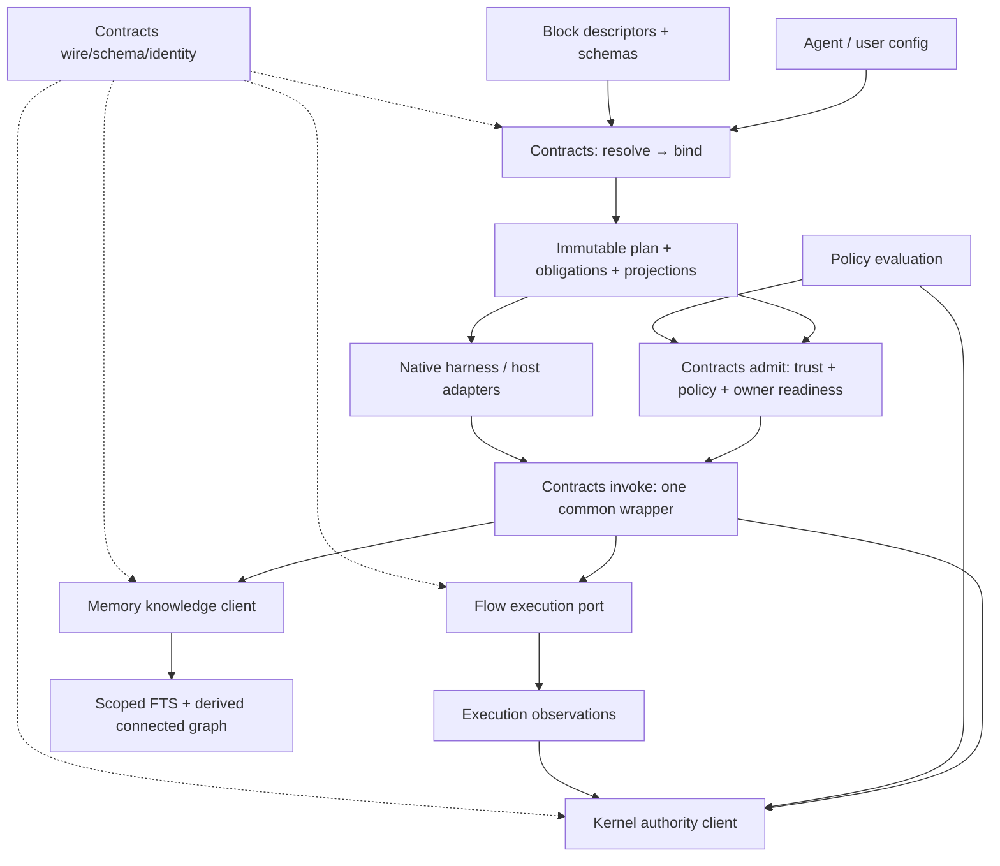

# P11 — Functional block architecture and composition API

**Decisions needed:** the three staging choices at the end (default **A+A+A**). Functional redivision, one maintainer, one package, Kernel authority and mandatory Pi/OpenCode/Codex support follow the owner's direction and are not reopened.

```json
{
  "protocolVersion": "1.0",
  "requestId": "forge-p11-block-architecture-20261002",
  "contextDigest": "9a0d99fe2d2a2a38beef9ded6576bbe6caab0ae5f0646331035a6e96e53510f8",
  "context": {
    "summary": "Forge final plan, leg P11: redraw the core block boundaries by function and design the complete block catalogue and composition API."
  },
  "flowSpec": null,
  "cwd": ".",
  "route": {"model": "gpt-6.1-sol", "thinking": "xhigh", "search": true}
}
```

The route above preserves the **requested route**, not model self-attribution. Date: 2026-10-02. Research/design only; the output of this phase is this document.

## Bottom line

1. **[inferred]** Use six functional layers: composition/Contracts, authority/Kernel, knowledge/Memory, execution/Flow, policy/gates and adapters.
2. **[read]** Today's Memory-core includes authority delegation, PR acceptance and monitor-store plumbing; knowledge lives in Memory/router/typed APIs and Kernel-backed storage.
3. **[read]** Today's Contracts validates fixed wire envelopes and identities; the fixed runtime graph and sparse writer live elsewhere and are not yet the owner's generic composition API.
4. **[inferred]** Rehome existing clients/facades and reuse validators, SQLite, reducers and effect owners; add a single generic resolve/bind/admit/invoke path.
5. **[inferred]** Blocks are reusable capabilities and declarative resources; workflows, agent tools and PR pipelines are user-selected structures over one catalogue.
6. **[inferred]** Keep execution bounded and host-complementary; a general agent loop, durable workflow engine or new authority database is unnecessary.
7. **[read; inferred]** Typed decision writes and issue dependencies already provide seeds; device scope, connected semantic graph and complete public contracts need explicit additional work.
8. **[read]** Owner items 13–18 supersede earlier operator/tier assumptions: one maintainer plus agents; Pi/OpenCode/Codex mandatory; Claude/Cursor well supported but nonblocking.
9. **[inferred]** Estimate 41–70 overlapping worker-days for the functional slice; approximately 12–21 are new rehoming/knowledge work, plus 2–4 for the OpenCode requirement delta.
10. **[ran]** This phase inspects a tracked-ref snapshot and writes a design; live remote freshness, native behavior, performance and implementation readiness are unproved.

## Evidence, scope and source lineage

**[read]** (local scratch) was read first. Its discipline is used throughout: **[read]** inspected source/document; **[ran]** observed command result; **[external]** fetched primary URL; **[inferred]** reasoning/proposal. All proposed APIs, paths, block names, config syntax and estimates below are inferred unless explicitly marked as existing. Existence by source inspection is not installed runtime proof.

**[ran]** `git rev-parse HEAD origin/master` returned worktree head `ba56b9201782c4d1246c77bde6380867603184bf` and tracked remote ref `7d448ec812ef8639790477af07c3c75962173f8a`. Code findings use **`git show origin/master:<path>` / tracked tree and search**, not the different local head. `git ls-remote origin refs/heads/master` failed because the configured proxy at 127.0.0.1:9 was unreachable. This is therefore a pinned tracked-ref snapshot; it is not a claim that GitHub master still has that exact head. No fetch or remote mutation succeeded.

**[read]** Supplied untracked final-plan documents are a separate evidence source: north-star.md (all 58 lines), platform-plan-final.md §3/§10, P5–P8 and the seven harness dossiers. The latest owner direction at north-star.md:28–50 wins over older planning tier/architecture language. Dossier source/installed observations remain attributed to their original dates; no native harness/browser run occurs here.

**[external]** This phase refreshed the primary MCP tool/schema, Agent Skills and Cordis service-test references used below. P5/P8 vendor adoption/version/license conclusions are attributed to those supplied reports; this phase does not repeat their integration trials or silently promote them to current installed proof.

**Research boundaries:** no implementation, test suite, commits, pushes, GitHub writes, Kernel mutation, browser, context-mode tool or edits outside this output. Read-only specialist lanes supplied core and surface evidence; the lead owns synthesis. These lanes do not own code or integration.

## 1. Current-state map

### 1.1 Measured source size and responsibility

**[ran]** A tracked-tree inventory (`git ls-tree -r --name-only origin/master -- lib/contracts lib/flow lib/memory-core lib/memory lib/kernel` and `git cat-file --batch`) inspected all **49 JavaScript files**, totaling **20,259 physical source lines**, including comments/blanks. Counts below are JavaScript source counts, not schema/fixture assets, logical complexity, removable code or installed footprint. Export inventories are CommonJS source declarations, not a promise that these symbols are supported npm subpaths.

| Current directory | JS files | Lines | What it actually contains [read] |
| --- | ---: | ---: | --- |
| Contracts | 7 | 881 | Fixed envelope contracts, canonical hashing/preflight, semantic attempt identity, schema generation/version list and baseline verification; entry index at `lib/contracts/index.js:3–32` |
| Flow | 9 | 2,760 | WorkPacket execution/RunReceipt, SkillRuntime, bounded loop and process reducers, monitor reducer/durability bridge, efficiency supervision and stable serialization; `lib/flow/index.js:3–114` |
| Memory-core | 6 | 1,984 | Kernel authority adapter, backend execution/receipt registry, feedback intake, PR lifecycle authority, usage evidence and durable monitor-store facade; `lib/memory-core/index.js:265–331` |
| Memory | 5 | 872 | Config/provider routing and legacy note conversion; typed categories including decisions; hygiene; Graphiti MCP descriptor; broad compatibility re-export; `lib/memory/router.js:31–40,143–180,326–469`, `typed-api.js:90–102` |
| Kernel | 22 | 13,762 | SQLite storage/schema/migrations/FTS/monitor/evidence, broker event acceptance, leases/claims/readiness/taxonomy/dependencies, issue CLI contracts/IDs, backing issue and close-on-merge, projections, filesystem/Windows ACL, owned handle lifecycle |
| **Total** | **49** | **20,259** | One codebase, not four independently certified products |

**[read]** Related composition/projection foundations are outside those five directories: `lib/core/runtime-graph.js` **1,051 lines**, `lib/config-writer.js` **202**, `lib/plugin-catalog.js` **359**, `lib/plugin-manager.js` **314**, `lib/agents-config.js` **974**, `lib/hook-renderer.js` **700**, `lib/mcp-config-renderer.js` **288**. Counts came from `git show` line arrays. The runtime graph clones a fixed delivery graph and applies known sections (972–996); the sparse writer writes YAML directly (56–60,72–84). Neither is the complete generic revision-checked config API proposed here.

**[read]** Current `package.json:1–20,76–78` identifies `forge-workflow@0.1.0-beta.8`, Node >=24.0.0 and a no-op typecheck message. Those are snapshot facts; no publish/install proof was run. Public type/contracts packaging is future work under P10/decision 33, not inferred from source indices.

### 1.2 Per-file line counts and exported symbols

**[ran; read]** Every JS module in the five named directories appears below. Each row is evidence from the complete tracked source file (`origin/master:<directory>/<file>`, lines 1 through the stated count). Names are literal exported keys; a class/factory's returned methods are not additional module exports. Duplicate keys across indexes are re-exports.

**Contracts — `lib/contracts/`**

| File | Lines | Exported symbols |
| --- | ---: | --- |
| index.js | 32 | ENVELOPE_FIELDS, CONTRACTS, ContractValidationError, canonicalize, classifySemanticAttempt, computeContentHash, generateJsonSchema, parseContract, semanticIdentity, supportedSchemaVersions, validateContract, validateContractStructure, validateEnvelope, verifyContractBaseline |
| src/baseline.js | 23 | verifyContractBaseline |
| src/canonical.js | 157 | CanonicalizationError, canonicalize, computeContentHash, preflightCanonicalValue |
| src/definitions.js | 183 | ABSOLUTE_USER_PATH_PATTERN, CONTRACTS, EXTENSION_ID_MAX_LENGTH, EXTENSION_ID_PATTERN, PAYLOAD_FIELDS, SECRET_PATTERN |
| src/identity.js | 42 | classifySemanticAttempt, semanticIdentity |
| src/schema.js | 72 | generateJsonSchema, supportedSchemaVersions |
| src/validate.js | 372 | ContractValidationError, ENVELOPE_FIELDS, parseContract, validateContract, validateContractStructure, validateEnvelope |

Schema/baseline/fixture assets accompany the JS: fixed v1 capability manifest, claim/context/work/lease/run/feedback/monitor/delivery/error contracts and negative fixtures for stale authority, digest/identity/privacy/bounds/malformed envelopes. These are wire assets; no existing generic arbitrary-author block schema is inferred from them [read: `lib/contracts/schemas/v1/`, fixtures/v1, contract-baseline.v1.json, compatibility-matrix.v1.json tracked tree].

**Flow — `lib/flow/`**

| File | Lines | Exported symbols |
| --- | ---: | --- |
| index.js | 114 | BoundedLoopError, EfficiencySupervisor, FlowExecutionError, MonitorDurabilityError, MonitorRuntimeError, ProcessLifecycleError, SkillRuntime, createBoundedLoop, createBoundedLoopState, createMonitorReceipt, createMonitorDurabilityBridge, createMonitorState, createProcessLifecycle, createProcessState, createRunReceiptSkeleton, createWorkPacketExecutor, reduceBoundedLoop, reduceMonitor, reduceMonitorBatch, reduceProcessLifecycle |
| src/bounded-loop.js | 458 | BoundedLoopError, MAX_ATTEMPTS, EVENT_BYTE_BUDGET, MAX_ELAPSED_MS, MAX_EVENTS, MAX_HISTORY, createBoundedLoop, createBoundedLoopState, reduceBoundedLoop |
| src/efficiency-supervisor.js | 90 | EfficiencySupervisor, THRESHOLDS |
| src/executor.js | 279 | FlowExecutionError, createWorkPacketExecutor |
| src/monitor-durability.js | 419 | MonitorDurabilityError, createMonitorDurabilityBridge |
| src/monitor-runtime.js | 474 | MonitorRuntimeError, createMonitorReceipt, createMonitorState, reduceMonitor, reduceMonitorBatch |
| src/process-lifecycle.js | 542 | MAX_ATTEMPTS, EVENT_BYTE_BUDGET, MAX_ELAPSED_MS, MAX_EVENTS, MAX_GRACE_MS, MAX_HISTORY, ProcessLifecycleError, createProcessLifecycle, createProcessState, reduceProcessLifecycle |
| src/skill-runtime.js | 365 | DEFAULT_LIMITS, SkillRuntime |
| src/stable-stringify.js | 19 | stableStringify |

**Memory-core — `lib/memory-core/`**

| File | Lines | Exported symbols |
| --- | ---: | --- |
| index.js | 331 | All five src-module exports below, plus MonitorConflictError, MonitorStaleError, MonitorStoreError, MonitorTerminalError, MonitorUnavailableError, createMonitorStore |
| src/authority-provider.js | 67 | MEMORY_AUTHORITY_METHODS, MEMORY_PR_LIFECYCLE_METHODS, assertMemoryAuthorityProvider, createMemoryAuthorityProvider |
| src/backend-registry.js | 180 | BACKEND_METHODS, RECEIPT_SCHEMA_ID, RECEIPT_SCHEMA_VERSION, assertBackend, createMemoryBackendRegistry |
| src/feedback-intake.js | 243 | FEEDBACK_SCHEMA_ID, FeedbackIntakeError, createFeedbackIntake, createFeedbackReport, redactString |
| src/pr-lifecycle-authority.js | 958 | PR_LIFECYCLE_PROVIDER_METHODS, PrLifecycleAuthorityError, createPrLifecycleAuthority |
| src/usage-evidence.js | 205 | USE_KINDS, USAGE_EVIDENCE_MIGRATION, UsageIdempotencyConflictError, UsageMemoryScopeConflictError, appendUsageEvidence, createUsageEvidenceStore, installUsageEvidenceSchema, normalizeUsageEvidence, rebuildUsageProjection |

**Memory — `lib/memory/`**

| File | Lines | Exported symbols |
| --- | ---: | --- |
| graphiti-mcp.js | 106 | DEFAULTS, SERVER_NAME, buildGraphitiServerDescriptor |
| hygiene.js | 191 | MEMORY_REVIEW_ENTRY_LIMIT, STALE_AFTER_DAYS, reviewMemories, stalenessForMemory |
| router.js | 469 | MEMORY_BACKENDS, DEFAULT_MEMORY_BACKEND, DEFAULT_RECALL_LIMIT, ENV_VAR, readMemoryConfig, resolveMemoryBackend, assertMemoryConfigValid, registerMemoryBackend, unregisterMemoryBackend, migrateJsonlNotesOnce, toNote, append, appendWithReceipt, recall |
| typed-api.js | 102 | CATEGORIES, writeTyped, readTyped, searchTyped, writeDecision, writeEpisode, writeSkill, writeState, writeIssue, writeAudit, writePreference |
| usage-evidence.js | 4 | Re-exports all of ../memory-core; not merely usage-evidence keys |

**Kernel — `lib/kernel/`**

| File | Lines | Exported symbols |
| --- | ---: | --- |
| backing-issue.js | 323 | ensureBackingIssue, classifyBranch, deriveTitle, extractEncodedIssueId, findExistingLink, matchesIgnoreGlob, DEFAULT_PROTECTED_BRANCHES, DEFAULT_IGNORE_GLOBS, AUTO_STUB_LABEL |
| broker.js | 2,108 | LOCAL_BROKER_PRAGMAS, buildLocalBrokerConfig, createLocalBroker, execMigrationStatement, resolveGitCommonDir |
| claim-reconciler.js | 238 | createManifestReader, createWorktreeInspector, reconcileClaims, reconcileKernelClaims, verifiedManifestForClaim |
| cli-broker-factory.js | 141 | buildKernelIssueDeps, buildMigratedKernelIssueDeps, ensureKernelMigrated, resolveKernelDatabasePath |
| close-on-merge.js | 154 | closeLinkedIssueOnMerge, buildMergeEvidence, buildCloseReason |
| conflict-signal.js | 82 | CONFLICT_SIGNAL, classifyConflictSignal |
| evaluators.js | 195 | buildConflict, dependencyCreatesCycle, evaluateKernelEvent, normalizePayload, stableStringify |
| fs-class.js | 520 | classifyFromSignals, gatherSignals, classifyFilesystem, assertFilesystemSafeForKernel, resetFilesystemWarningMemo, isUnsafeFsOverrideActive, defaultProbeDriveType, parseNetUseDriveType, pathStartsWith, REMEDIATION |
| issue-command-contract.js | 559 | ISSUE_COMMAND_CONTRACT, ISSUE_COMMAND_ERROR_SCHEMA, ISSUE_COMMAND_ERROR_SCHEMA_VERSION, ISSUE_COMMAND_EXIT_CODES, ISSUE_COMMAND_RESPONSE_SCHEMAS, ISSUE_COMMAND_SCHEMA_VERSION, ISSUE_PRIORITIES, ISSUE_STATUSES, ISSUE_TYPES, formatIssueCommandError, getIssueCommandContract, isValidIssuePriority, normalizePriority, resolveNextCommands |
| issue-id-resolver.js | 186 | MAX_AMBIGUOUS_CANDIDATES, MIN_ISSUE_ID_PREFIX_LENGTH, OPERATION_ID_POSITIONS, resolveIssueId, resolveIssueIdArgs |
| lease-enforcer.js | 178 | DEFAULT_LEASE_TTL_MS, buildClaimConflict, buildClaimRow, computeLeaseExpiry, isClaimOwnedBy, isLeaseExpired, isValidExpiresAt, planClaimAcquisition |
| legacy-claim-repair.js | 442 | CLAIM_STATES, ClaimRepairError, buildClaimRepairPlan, cleanupRestoreProofDirectory, createVerifiedClaimRepairBackup, prepareRestoreProofSnapshot, publicClaimRepairPreflight, verifyClaimRepairBackup |
| live-claim-projection.js | 26 | isLiveClaim, projectLiveClaims |
| migrations.js | 476 | buildClaimActiveLeaseMigration, buildEventExpectedRevisionMigration, buildIssueContentFieldsMigration, buildIssueFidelityColumnsMigration, buildKernelMigrationPlan, buildMemoryFtsMigration, buildMemoryProjectionMigration, buildMonitorDurabilityMigration, buildPrWatchOwnershipMigration, buildUsageEvidenceMigration, buildPrLinkageMigration, buildSchemaMigration, buildWorktreeLinkageColumnsMigration, memoryFtsDdl, validateKernelMigrations |
| owned-kernel.js | 43 | resolveOwnedKernel, closeIfOwned |
| planning-buckets-schema.js | 109 | BOARD_MUTATION_EVENT_TYPES, MILESTONE_STATES, PLANNING_BUCKET_TABLES, RELEASE_STATES, SPRINT_STATES, getPlanningBucketsSchema, validatePlanningBucketsSchema |
| projection-jsonl-writer.js | 450 | SCHEMA_VERSION, DEFAULT_PROJECTION_DIR, DEFAULT_PROJECTION_TARGET, DEFAULT_MAX_ATTEMPTS, DEFAULT_BASE_BACKOFF_MS, PROJECTION_FILE_ORDER, normalizeProjectionModel, buildProjectionSnapshot, serializeProjection, importProjection, resolveProjectionDir, writeProjection, readProjection, computeBackoff, runJsonlProjectionConsumer |
| readiness-model.js | 501 | READINESS_REASONS, READINESS_STATES, DEFAULT_TOP_K_READY_PICK, buildReadinessIndex, deriveReadiness, evaluateIssueContract, isWorkableStatus |
| schema.js | 439 | KERNEL_FIELD_AUTHORITIES, KERNEL_STORAGE_CLASSES, KERNEL_TABLES, classifyKernelStorage, cloneTableList, deepFreeze, field, getKernelSchema, index, table, validateKernelSchema |
| sqlite-driver.js | 5,956 | BUILTIN_SQLITE_RUNTIME_ORDER, CONFLICT_SIGNAL, classifyConflictSignal, createBuiltinSQLiteDriver, hardenBackupPermissions, hardenBackupPermissionsBatch, requireSqliteRuntimeModule, resolveWindowsCscriptPath, secureWindowsPathsAcl, selectBuiltinSQLiteRuntime, syncClaimRepairRecoveryDirectory, validateBuiltinSQLiteRuntimeDriver, WINDOWS_PRIVATE_ACL_SCRIPT_PATH, WINDOWS_PRIVATE_ACL_SCRIPT_SHA256, _runWindowsProcess |
| taxonomy-validator.js | 397 | CLAIM_STATES, STATUS_TRANSITIONS, TERMINAL_STATUSES, TYPE_BEHAVIORS, TaxonomyValidationError, ISSUE_STATUSES, ISSUE_TYPES, assertAcyclicDependencies, findDependencyCycles, findParentCycle, getTypeBehavior, isClaimableType, isTerminalStatus, isValidIssueStatus, isValidIssueType, isValidStatusTransition, normalizeRank, priorityLabelForRank, rankForPriorityLabel, toEpochMillis, validateActiveClaimUniqueness, validateClaim, validateIssueTaxonomy, validateParentChild, validateStatusTransition |
| windows-private-acl.js | 239 | FILE_ALL_ACCESS, inspectDescriptor, inspectIidDescriptor, runWithDependencies |

### 1.3 Callers and migration blast radius

**[read; ran]** Direct runtime path-import search was separated from broader module-name/reference searches. Runtime consumers below are the migration-relevant observed paths; tests/projection metadata are another class. This is a static caller map, not a dynamic trace or proof of every computed load.

| Module | Observed external runtime consumers / import anchors |
| --- | --- |
| Contracts | `lib/commands/merge.js:50`; `lib/flow/index.js:3`; Flow executor:9, monitor-durability:8, monitor-runtime:8; `lib/memory-core/index.js:4`; feedback-intake:9, pr-lifecycle-authority:11; `lib/pr-monitor/flow-monitor.js:6` |
| Flow | `lib/pr-monitor/flow-monitor.js:14` is the observed direct runtime package import. `lib/workflow/*` name matches are a different module, not additional Flow callers. |
| Memory-core | `lib/commands/merge.js:592`, shepherd.js:316; `lib/kernel/migrations.js:2`, sqlite-driver.js:33; `lib/memory/router.js:35`, usage-evidence.js:4; `lib/pr-monitor/reconcile-executor.js:1084` |
| Memory | `lib/commands/doctor.js:13`, hooks.js:643, memory.js:8, recall.js:3, remember.js:4, setup.js:1985/1989 |
| Kernel | `lib/adapters/beads-kernel-compat.js`; commands `_issue`, `_resolve-command-opts`, clean, doctor, export, merge, migrate, plan, pr, push, setup, shepherd, stage, test, worktree; `lib/grounding/context-events.js`; PR-monitor reconcile-executor/shepherd-lease/watch-owner; `lib/validation/risk-manifest.js`; `lib/workflow/enforce-stage.js`; `scripts/lib/{behavioral-eval-runtime,eval-evidence}.js`; internal broker/driver imports also recorded |

Core unit consumers are `test/contracts/*.test.js` and src tests, `test/flow/`, `test/memory-core/`, `test/memory/{graphiti-mcp,hygiene,router,usage-evidence,monitor-store}.test.js`, and `test/kernel/`. Cross-owner coverage includes merge-authority, monitor-durability, standalone-package-smoke, PR monitor and command/workflow linkage tests. Broader grep matches in workflow/skill tests are **references**, not automatically exact Flow imports. No tests were executed.

**[read]** Package/structural callers also encode topology: `scripts/package-budgets.json:10–15` retains old packages/*/@forge paths alongside lib owners; `test/structural/pr2-root-integration.test.js:15–51` maps lib Contracts/Memory-core/Flow to retired package identities; `test/package-runtime-allowlist.test.js:184–193,243` enumerates baselines/block entrypoints/validator copies; `lib/package-root.js:73` includes the Kernel ACL asset. These need owning inventory/equivalence updates during migration, never deletion of a gate to accommodate a move. Current internal Beads compatibility imports exist; D45/common.md's retirement direction does not mean those callers have already disappeared.

### 1.4 Tangles, overlaps and invariants

| Finding | Evidence [read] | Design implication [inferred] |
| --- | --- | --- |
| Memory-core mixes knowledge and work authority | index.js:319–331 combines authority, registry, feedback, PR lifecycle, usage and monitor persistence; authority-provider.js:37–56 forwards broker methods | Rehome authority/evidence/store clients to Kernel and knowledge registry to Memory; preserve methods/ownership |
| Kernel imports Memory-core while that aggregate exposes a Kernel-broker facade | Kernel migrations.js:2 and sqlite-driver.js:33 consume Memory-core; authority-provider.js:37–56 accepts/forwards broker methods (not proof of a reverse import) | Depend on leaf schemas/ports, not aggregate indexes; relocate usage schema constants only with equivalent migration imports |
| Two levels of knowledge-backend orchestration | Memory-core backend-registry.js:85–170 plus Memory router.js:143–180,384–451 | One provider registry with separate edge config/selection; retain distinct local-plus-enrichment receipt semantics |
| Compatibility shim widens the knowledge API accidentally | memory/usage-evidence.js:3–4 re-exports all Memory-core | Narrow intended public facade while retaining old internal forwarding path until caller census |
| Composition config is spread across fixed graph, writer and renderers | runtime-graph.js:236–553,562–599,972–996; config-writer.js:43–60,72–126; hook/MCP renderers | One Contracts compiler/editor; templates own stage defaults, adapters own host formats |
| Sparse writer also resolves skills and lacks the proposed transaction boundary | config-writer.js:129–192; direct writeFileSync:59 | Asset resolution goes to catalog; checked revision/atomic/readback belongs to config edge |
| Storage driver owns many domains and platform details | sqlite-driver.js 5,956 lines; broker.js 2,108; migrations.js includes memory/monitor/usage/claims | Keep private store implementation; expose domain ports. Do not split tables/DBs merely to mirror folders |
| Canonicalization appears in several owners | Contracts canonical.js; Flow stable-stringify.js; Kernel evaluators.js exports stableStringify | Compare real semantics before deduplication; contract hashing, reducer comparison and display serialization may differ |
| Decisions and dependency graph are real but incomplete seeds | memory/typed-api.js:4,95; Kernel evaluators.js dependencyCreatesCycle and taxonomy DAG helpers | Build first-class decision/query/connected-graph contracts; do not call all knowledge work missing |
| Read convenience can migrate legacy notes | memory/router.js exposes migrateJsonlNotesOnce and recall; final plan:433–437 analyzes the write/read issue | Public memory-read path must use existing owner read/projection without implicit conversion; conversion needs separate authorization |

The protected acceptance/effect checks, durable schemas, hash semantics, error/status distinctions, owned/borrowed lifetime, process cleanup and all gates stay intact. Source inspection justifies wrapper/move seams; it does not prove equivalence, deletion savings or runtime performance.

## 2. Functional division: six ownership layers, one package

Everything in this section is **[inferred: proposed design]**, grounded in the inventory in §1 and the owner direction at north-star.md:28–50. A layer is a dependency/ownership boundary, not a package, process, product, or one block. A block is a versioned capability provider or declarative resource; several operations may belong to one block. A solution selects instances, binds capabilities and exposes them through structures and flows. Kernel authority remains D44; existing algorithms remain their implementation.

| Layer / proposed home | Single responsibility | Public boundary | Must stay outside |
| --- | --- | --- | --- |
| **Composition — Contracts** (`lib/contracts`) | Turn declared blocks, bindings and ordered config into one explainable executable/exposure plan | catalog/discover, resolve, bind, validate, explain, preview/apply, admit orchestration, invoke orchestration | SQL, issue acceptance, model calls, policy approval issuance, harness-specific dispatch |
| **Authority/state — Kernel** (`lib/kernel`) | Accept authoritative changes and maintain durable work/evidence/lease/revision state | scoped issue/run/evidence clients and owned open/close | Semantic ranking, arbitrary author loading, host agent loops |
| **Knowledge — Memory** (`lib/memory`) | Store and retrieve scoped, provenance-bearing knowledge and derived relationships | notes, decisions, search, graph query, export/forget; repo/device providers | Issuing claims/approvals, conversation history engine, mandatory vector/graph service |
| **Execution — Flow** (`lib/flow`) | Execute one admitted operation and truthfully observe execution/cleanup | invoke port, bounded built-in process supervision, sequential reference-template lowering | Config precedence, policy decisions, general durable/parallel orchestration, agent/model loop |
| **Policy/gates** (`lib/policy`, initially facades over owners) | Evaluate and explain applicable obligations and refusals | requirement/evaluator contracts and additional-denial providers | Replacing Kernel/effect-owner enforcement or minting protected approval from evaluator PASS |
| **Adapters** (`lib/adapters`, classified subdirectories) | Translate public capabilities to external tools, hosts, harness formats and evidence | describe/probe, project/apply-owned, call/map-result, cleanup | Domain authority, duplicated config compiler, an alternate Memory store |

The wire/schema/identity primitives remain a **dependency-light foundation inside Contracts**, reachable through a leaf `contracts/wire` API; they are not a seventh service. Kernel, Memory, Flow and policy depend on that leaf, never on Contracts' assembly machinery. Contracts' composition implementation depends on **ports supplied at bind time**, not private drivers. The CLI and harness adapters are consumers of the same Contracts API. Avoid a root-index eager import that opens Kernel or loads every adapter when a consumer only validates an envelope.



The arrows describe allowed functional dependencies, not universal startup. Stateless tools open no Kernel. A connected assembly opens existing owned authority handles before dependent clients; borrowed handles remain caller-owned. Every actual effect repeats its owning authorization/lease/revision/head checks. A pure compiler cannot authorize a write.

### 2.1 File-level move map

**[inferred]** These are target responsibilities and proposed paths, not edits performed in this phase. Start with forwarding facades and dependency tests; physically move files only after callers are redirected. Moving all private SQL methods merely to make a prettier tree would violate the no-rewrite constraint.

| Current file/group | Target ownership / proposed placement | Migration treatment |
| --- | --- | --- |
| `lib/contracts/src/{canonical,definitions,identity,schema,validate,baseline}.js`; schemas, fixtures and baselines | Contracts wire foundation, optionally `lib/contracts/wire/` | Keep algorithms, schema IDs, validation/error semantics, hashes and fixtures unchanged; old imports forward. New author manifests are separate schemas, not a repurposed provider CapabilityManifest. |
| `lib/core/runtime-graph.js` constructors + config normalization | Contracts composition; `lib/contracts/compose/{resolve,bind,validate}.js` | Reuse constructors/known-field validation. Move its fixed stage/role/subskill definitions into the reference-template descriptor. Introduce new generic bindings around this code; do not pretend the fixed graph is already a generic compiler. |
| `lib/config-writer.js` raw sparse writer | Contracts config edge; `lib/contracts/config/{reader,writer}.js` | Preserve sibling-preserving key-path behavior; add whole-plan validation, expected revision, atomic replace/readback and reverse record at the edge. Its skill search functions move logically to the asset/catalog resolver; preserve existing precedence until explicit asset migration. |
| `lib/memory-core/src/authority-provider.js` | Kernel public scoped client, `lib/kernel/authority-client.js` | Rehome adapter delegation/owned lifetime without replacing broker/driver; retain old exports. |
| `lib/memory-core/src/pr-lifecycle-authority.js` | Kernel evidence acceptance client | Keep protected PR/head/lease acceptance here; PR fetching stays a delivery adapter. |
| `lib/memory-core/src/feedback-intake.js` | Authority-side evidence intake plus review adapter normalization | First retain the intact file behind a Kernel facade. Split only at existing function boundaries once receipt/effect tests prove equivalence. |
| `lib/memory-core/src/backend-registry.js` | Memory knowledge-provider registry | Move registry ownership, retain local floor, receipt shape, unavailable/degraded behavior; do not introduce a second registration mechanism. |
| `lib/memory-core/src/usage-evidence.js`; `lib/memory/usage-evidence.js` | Memory evidence/provenance API and adapters | Reuse delegate relationship; keep policy acceptance separate. These are not automatically duplicated engines. |
| `lib/memory-core/index.js` monitor store/errors/normalization | Kernel-owned durable observation store client; e.g. `lib/kernel/monitor-store.js` | Extract the existing store facade verbatim before reducing index to compatibility exports; no table migration. Flow supplies observations, Kernel persists them. |
| `lib/memory/{router,typed-api,hygiene}.js`; `lib/{project-memory,memory-recall,memory-digest,memory-recall-events}.js` | Memory knowledge/API/index ownership | Consolidate entry points, not the data store. Separate read-only recall from router's implicit legacy conversion; conversion is an authorized upgrade path. Typed decision categories become a first-class decision facade. |
| `lib/memory/graphiti-mcp.js` | Optional knowledge adapter, `lib/adapters/knowledge/graphiti.js` | Preserve descriptor; constrain future ingestion to explicitly selected decisions, never source code. |
| All `lib/kernel/*.js`, especially schema, migrations, sqlite-driver, broker, leases, claim repair, ACL | Kernel | **Stay**. They own existing authority and storage behavior. Knowledge tables/FTS can remain physically in the driver behind a knowledge port; no new database or invasive SQL split in 0.1.0. |
| `lib/flow/src/{executor,skill-runtime,bounded-loop,process-lifecycle,efficiency-supervisor,monitor-runtime}.js` | Flow | **Stay**; wrap one operation/unit and preserve budgets, reducers, process kill/reap and status semantics. Efficiency and loops remain optional built-in mechanisms, not a general agent runtime. |
| `lib/flow/src/monitor-durability.js` | Thin Flow-to-authority adapter | Keep bridge behavior; depend on durable-store port, not the old “Memory” product identity. |
| `lib/flow/src/stable-stringify.js` and Contracts canonicalization | Their current owners initially | Compare semantics/caller corpus before unification. Stable serialization and contract content-hashing are not interchangeable merely because both sort keys. |
| Protected-state, approval, gate-event and preflight owners; `lib/doc-gate/*` | Policy public facade + Kernel/effect-owned enforcement | Move pure evaluation/explanation only; retain protected issuance/revocation/currentness at existing owner. Do not move authority into a plugin callback. |
| `lib/agents/*.plugin.json`, plugin-manager, harness-capability matrix; hook/MCP/rules/skill/safety renderers | Adapters/harness and Contracts data catalog | Descriptor data enters common catalog; host payload/return/install rules remain adapter-specific. Preserve ownership/backup/refusal. New emitter consumes a compiled plan. |
| `lib/plugin-catalog.js`, plugin-recommender and add/lock source identity helpers | Contracts catalog plus optional tool adapters | Reuse recommendation metadata and source fingerprinting; extend a single catalog schema. Current tool recommendations and harness descriptors are distinct record kinds, not already callable blocks. |
| `lib/review-adapter.js`, `lib/adapters/greptile-review-adapter.js`, issue-sync/provider transport, GitHub helpers | Adapters/review, tracker and delivery | Keep normalization and provider IDs; effects are separate granted operations. Kernel authority stays native. |
| `lib/commands/{plan,dev,validate,ship,review-related,merge,worktree,memory,gate,options,...}.js` | Thin CLI consumers of owners | Gradually delegate public operation handlers; keep existing command behavior and guarded effects until equivalence. “review-related” denotes actual review SPI/PR commands, not an invented `commands/review.js`. |
| `skills/*`, `rules/*`, workflow templates | Declarative catalog assets / reference solution | Keep body content; migrate canonical source/links through existing sync owners. Product APIs must not inherit the reference workflow's mandatory stage ladder. |

### 2.2 Why six functional layers

| Alternative | Strongest case | Why this recommendation wins / change trigger |
| --- | --- | --- |
| **Keep Contracts/Flow/Memory/Kernel as four unchanged product boundaries** | Cheapest naming-only documentation; fewer imports change | Memory-core currently owns authority, PR acceptance and monitor durability while Memory owns knowledge; Contracts currently lacks composition. It leaves functional responsibilities hidden. Choose this temporarily as compatibility directories, not the target ownership model. |
| **Six layers with compatibility facades — recommended** | Clear owner for acceptance, knowledge, invocation, config, policy and translation; maps to existing seams | Reuses working logic and lets users compose independent capabilities without importing a product stack. Adds boundary/API work, which must be justified by concrete public consumers. |
| **Fine split into issues, leases, receipts, FTS, decisions, graph, scheduling, plugins, gates, every command** | Very small units and potentially reusable services | As separate ownership/runtime units this creates excessive lifecycle and one-maintainer support work. These are catalog capabilities within six layers, not dozens of mandatory packages or processes. Reconsider a split only when a distinct provider/lifetime/maintenance owner actually needs it. |
| **Adopt Cordis or an agent/workflow framework as the core** | Mature injection/lifecycle or orchestration | Their machinery does not supply Forge's authority/grant semantics and would introduce a mandatory engine. Learn explicit requirements/owned cleanup from Cordis, expose operations into existing hosts, retain Forge owners. Reconsider only after a measured adopter task and footprint/caller-equivalence proof. |

**[external]** Cordis' upstream service tests exercise dependency readiness and lifecycle disposal, supporting the useful pattern rather than adoption of its whole runtime: [service tests](https://github.com/cordiverse/cordis/blob/main/packages/core/tests/service.spec.ts). **[read]** P5:A4 and P8:110–129 retain authority and narrow durable execution/policy adoption. **[inferred]** A failed two-consumer slice, excessive import cycles, or repeated need for outside stateful lifetimes would change the boundary/profile and its cost; renaming alone is not a delivered improvement.

## 3. Contracts is the composition API and config writer

**[inferred: proposed, not installed exports]** Contracts becomes the agent-facing API connecting every block. Its four runtime phases are one path, shared by CLI, native tools, MCP, SDK facades and a later visualization app:

```javascript
const resolved = contracts.resolve({ document, catalog, layers });
const bound = contracts.bind(resolved.plan, { ports, targetProfile });
const admitted = contracts.admit(bound, { actor, grants, sourceConsent, purpose });
const result = contracts.invoke(admitted, {
  operation: "memory.recall", input: { query: "API migration" }, requestId
});
```

Resolve/bind previews return metadata without importing outside code or probing credentials. `bind` first resolves declared slots/types; live handle binding occurs only in admitted assembly. `admit` asks the existing trust/policy/authority owners; it cannot create their decisions. `invoke` dispatches through the common wrapper and owning operation port. Immutable admission binds artifact/config/contract/catalog, local placement, purpose, actor/grant and expiry; invocation rechecks live mutator prerequisites. An ordinary bind cannot authorize a mutation.

### 3.1 Schema and result contracts

Retain the final plan's separated version axes and safe author subset rather than inventing a parallel dialect [read: platform-plan-final.md:240–281,471–510].

| Record | Required shape / rules [inferred] |
| --- | --- |
| **Block descriptor** (`forge.block/1`) | id, artifact version/source/integrity, author ABI/profile, entry/files, config schema, provided capability/interface/operation schemas, required slots, effects, lifecycle, docs and support. Native/adopted/adapter is a disposition; asset/tool/service is a representation, not a trust level. |
| **Solution** (`forge.solution/1`) | id/version, input schema, selected block instances/config/bindings, structures/exposures, optional logical graph, output mappings, target profile. One capability namespace supports outside names; no maintainer allowlist of domains. |
| **Catalog snapshot** | Selected data-only native/outside descriptors, pinned source/schema identities and support evidence; explicit immutable input to compiler. Catalog discovery may read descriptors; the pure compiler performs no filesystem/environment/network discovery. |
| **Resolved plan** | Exact selected sources, normalized config/origins, provider/operation bindings, explicit edges/mappings, applicable obligations, support/readiness, digests and proposed native artifacts. Logical identity excludes absolute install paths/target placement; local admission binds them separately. |
| **Admission** | Host-owned source/purpose consent and service authorization references; protected approval remains a separate owner record. Publisher signature, schema validity, enable flag and conformance PASS cannot stand in for admission. |
| **Invocation result** | `OK|FAIL|INCOMPLETE`, schema-valid domain value only on OK, typed errors and host-owned observation references; accepted-authority result is separate. A successful empty selection is distinct from unavailable/incomplete retrieval. |
| **Edit proposal/receipt** | expected config revision/byte digest, patch operations, whole-plan validation, diff/origins/affected bindings, prior owned bytes/revision, resulting revision/readback. Activation/restart is a distinct operation. |

Two additive **structure projections** are necessary to express the owner's full catalogue: `agent-tools/1` selects exposure aliases and operation keys without imposing a loop; `pr-pipeline/1` records head-bound security/review/effect obligations. They lower to the same capability instances/bindings/operation catalog. A skill or agent descriptor is validated/projected as an asset; it is not executed as arbitrary JavaScript by Flow. These structures extend the final plan's examples/schema deliberately and need contract-lock fixtures.

Keep defaults → pinned template → project → invocation; scalar replacement, maps by stable ID, whole-array replacement, add/replace/remove/reset with JSON Pointer, null distinct from reset, and atomic provider-option replacement. Add **explicit knowledge scope selection** (`repo:<id>`, `device:<id>`) without implicitly introducing user-config precedence; device storage scope and config precedence are different features. Private device data requires explicit allowed read scopes. Preserve existing settings through an authorized migration rather than reject them as unknown prematurely.

Generated schemas/docs/types must cover input, output, errors, effects, availability, examples and supported host profiles. Copy exact rooted catalog schemas for mapped fields; equal canonical schema identity is the initial static proof. Different schemas require a named projection capability, not hidden coercion. Keep the plan's bounded schema/ref/patch/capture/parse budgets and outside sync ABI; confirm them experimentally before support. Author `title/description/examples` stay in documentation records under the retained restricted profile, not silently accepted keywords.

### 3.2 Lifecycle, validation and actionable errors

| Phase | Does | Must refuse / evidence |
| --- | --- | --- |
| **resolve** | Fold declared layers; resolve descriptors and exact schemas; normalize topology | Duplicate/unknown IDs, unsupported schema/profile, cycles, budget exhaustion, invalid references; data-only diagnostics |
| **bind** | Select exact providers/versions, required slots, execution compatibility, ordered mappings and target carriers | Missing/ambiguous providers, unequal mapping schemas, async client in sync action, unsupported required harness surface; readiness UNKNOWN until explicit probe |
| **admit** | Bounded captured-source snapshot; verify source identity and affirmative purpose consent; evaluate applicable policy; open existing owned clients | Absent/expired/wrong-source consent, denied effect/grant/scope, changed bytes, unavailable required owner; dispose partial owned assembly |
| **invoke** | Validate actual input; recheck current effect guards; execute one operation via wrapper; validate output; observe cleanup/receipt | Provider loss, Promise from outside sync action, invalid output, stale head/lease/revision, ignored required-client failure; no dependent success |
| **dispose/restart** | Close owned handles/units/snapshots; preserve durable authority and borrowed resources | Unknown pending effect requires owning recovery/idempotency or refusal; no automatic replay/hot replacement |

`validate` runs resolve+semantic bind without execution. `explain` returns topology, config origin/diffs, bindings, protected obligations and why each selected carrier is available/refused. `dryRun` is an explainable plan, not a “run but undo”; no imports, installs, conformance, secret lookup or remote write. Explicit `probe` is separately admitted when it executes provider code. Proposed stable errors include `CAPABILITY_MISSING`, `CAPABILITY_AMBIGUOUS`, `INTERFACE_INCOMPATIBLE`, `MAPPING_COMPATIBILITY_NOT_PROVED`, `ADMISSION_REQUIRED`, `SOURCE_CHANGED`, `GRANT_DENIED`, `AUTHORITY_STALE`, `HOST_SURFACE_UNAVAILABLE`, `BLOCK_ASYNC_UNSUPPORTED` and `RESULT_SCHEMA_INVALID`.

Each error contains phase/code, JSON pointer, origin, instance/operation, expected constraint, redacted observation and a schema-valid repair option. A repair changing providers/effects produces a new plan and fresh applicable admission; it cannot lower gates. Errors distinguish invalid config, unavailable runtime and failed operation. IDs and source hashes accompany human-readable titles.

**[external]** MCP tools provide input/output schemas and structured results, but clients must treat untrusted annotations as untrusted. Generate those carriers from the operation catalog; annotations never grant permission. [MCP tools specification](https://modelcontextprotocol.io/specification/2025-06-18/server/tools). The standard JSON Schema extension rules explain why generic `allOf`/closed-schema handling needs care; the initial Forge profile stays explicit rather than claim unrestricted schema support. [JSON Schema object semantics](https://json-schema.org/understanding-json-schema/reference/object).

### 3.3 Native plugin and host-adapter emission

The compiler emits a **projection plan**, not installed host state. `adapter.planProjection(plan, hostTuple)` maps capabilities to native assets/tools/hooks/MCP/agent declarations; `applyOwnedProjection` preserves user bytes, prior hashes and rollback. A native registration adapter calls the same `contracts.invoke`; an MCP or Vercel tool facade does likewise. No per-block harness switch, no second resolver or issue state.

One package contains generated host-specific assets from one catalog and canonical skill source. Agent Skills is an adopted format, including its progressive loading; its experimental allowed-tools metadata cannot replace service authorization [external: [Agent Skills specification](https://agentskills.io/specification)]. Portable plugin formats, native hooks and agent formats remain separate. Required host surfaces must pass exact installed positive/negative/cleanup proof; unsupported capabilities are explicit UNAVAILABLE. Detailed carriers and tier corrections are in §4.

### 3.4 Three concrete proposed compositions

These are **design fixtures**, not currently valid installed Forge configs. The schema registry below is part of the proposed contract lock. `native` selects a descriptor from the supplied exact Forge-package catalog; interface ranges in requirements resolve to exact versions in the lock. Schema IDs name full catalog schemas, not permissive string placeholders. Operation references use instance.operation; grant keys use qualified capability@exact-interface#operation. Sources do not auto-install. Grants/consent are explicit invocation inputs, absent from saved config.

**Workflow: knowledge → migration advice.** The two-node declared workflow is executed only as an approved Forge reference template (or lowered to host-owned steps); it is not a new general graph runtime.

```yaml
schemaVersion: forge.solution/1
id: local/migration-advice
version: 0.1.0
inputSchema: { catalog: "forge.example/migration-input@1.0.0" }
blocks:
  memory:
    source: { native: forge.memory }
    config: { readScopes: ["repo:fixture-project"] }
  advisor:
    source: { package: "@example/migration-note-advisor", version: "0.1.0" }
    config: {}
structures:
  workflow:
    profile: forge.reference-sequential/1
    template: forge.migration-advice
graph:
  context:
    operation: memory.recall
    after: []
    input:
      query: { from: "$input", pointer: "/query" }
  assess:
    operation: advisor.assess
    after: [context]
    input:
      changes: { from: "$input", pointer: "/normalizedApiChanges" }
      notes: { from: context, pointer: "/notes" }
output:
  findings: { from: assess, pointer: "/findings" }
```

The disclosed `assess` handler uses mapped notes. The separate retained `recallAndAssess` author fixture declares and binds a lookup slot and actually calls `services.lookup.invoke("recall", ...)`, as required by the final plan's bound-client proof. This mapped composition does not claim to prove a service call. A missing Memory read refuses advice, rather than fabricate an empty success. Rooted Note/Change schemas are exactly the retained final-plan schemas (398–437,1007–1069).

**Agent tool set: the host chooses actions, Forge constrains capabilities.** This is an exposure structure without a Flow loop.

```yaml
schemaVersion: forge.solution/1
id: local/project-assistant-tools
version: 0.1.0
inputSchema: { catalog: "forge.empty-object@1.0.0" }
blocks:
  issues:
    source: { native: forge.kernel.issues }
    config: { projectId: fixture-project }
  memory:
    source: { native: forge.memory }
    config:
      readScopes: ["repo:fixture-project", "device:fixture-user-device"]
  decisions:
    source: { native: forge.memory.decisions }
    config: { scope: "repo:fixture-project" }
  policy:
    source: { native: forge.policy }
    config: {}
structures:
  assistant:
    kind: agent-tools/1
    operations:
      - { alias: issue_context, operation: issues.recap }
      - { alias: project_recall, operation: memory.recall }
      - { alias: decision_history, operation: decisions.query }
      - { alias: explain_guard, operation: policy.explain }
    resources: [decisions.history]
exposures:
  - { adapter: forge.harness.pi, structure: assistant, carrier: native }
  - { adapter: forge.harness.opencode, structure: assistant, carrier: native }
  - { adapter: forge.harness.codex, structure: assistant, carrier: local-plugin }
  - { adapter: forge.transport.mcp, structure: assistant, carrier: stdio }
```

Device and repo records are separate read scopes with provenance in output; default access remains current repo only. No claim/write/merge tool appears, so host autonomy cannot infer those grants. Customization adds/removes operations, assets, providers and scopes; a required carrier that cannot preserve refusal cannot activate this exposure.

**PR pipeline: inspect → security → review → guarded eligibility → merge.** The user's CI orchestrator owns the flow; Forge binds the same exact-head evidence owners.

```yaml
schemaVersion: forge.solution/1
id: local/pr-security-review
version: 0.1.0
inputSchema: { catalog: "forge.delivery/pr-context@1.0.0" }
blocks:
  checks:
    source: { native: forge.validation }
    config: { checks: [lint, tests, dependency-audit] }
  security:
    source: { native: forge.security.evidence }
    config: { providers: [repository-codeql, dependency-audit] }
  review:
    source: { native: forge.review }
    config: { provider: greptile, maxAttempts: 1 }
  authority:
    source: { native: forge.kernel.evidence }
    config: { projectId: fixture-project }
  delivery:
    source: { native: forge.delivery }
    config: { mode: strict-serial, expectedHeadRequired: true }
    bindings:
      evidence:
        instance: authority
        capability: forge.kernel.evidence
        interface: "1.0.0"
structures:
  pipeline:
    kind: pr-pipeline/1
    orchestrator: host
    evidenceContext: { from: "$input", pointer: "" }
    stages:
      - { id: quality, operation: checks.observe }
      - { id: security, operation: security.observe, after: [quality] }
      - { id: review, operation: review.read, after: [security] }
      - { id: eligible, operation: delivery.explain, after: [review] }
      - { id: merge, operation: delivery.merge, after: [eligible],
          checkpoint: explicit-merge-authorization }
exposures:
  - { adapter: forge.host.ci, structure: pipeline, carrier: json-cli }
```

The input PR-context schema includes project/issue/PR identity, exact source head/base and expected revision. Each evidence operation returns typed source/head/producer/coverage/status/receipt references, not an unbound boolean. Eligibility resolves **all configured required checks** and current review policy, not just the illustrative stage names. The Greptile selection reuses the existing review adapter foundation, subject to configured credentials/readiness and exact-head proof. A future `codex-review` substitution needs its own provider/completion contract: current generic normalization is not a dedicated Codex completion gate. A required unavailable provider makes the pipeline INCOMPLETE. Merge always rechecks current issue binding/owned lease/head/base/rules/approval/provider confirmation; the structure cannot mint authorization. Semgrep/OSV/PR-Agent are optional provider substitutions under §4, not mandatory dependencies or gate replacements.

**Contract-lock schema registry for these examples [inferred].** Publish closed `migration-input` (query and normalizedApiChanges), empty object, PR-context, recall Note array, advisor Finding array, issue recap, decision query/history, policy explanation, typed check/security/review evidence, eligibility and merge result schemas. Public wrappers translate existing return shapes; they do not invent missing fields. Freeze the full schemas, resolved references and error unions alongside these three configs; mapping equality and carrier support are validated in installed-consumer fixtures. The examples do not count as the independently sealed outside-author trial.

## 4. Complete capability catalogue and composition

**[inferred] Catalogue rule:** a block is a declared reusable capability/resource with identity, schemas, effect/lifetime and support evidence. A command name, folder, vendor name or prose “stage” is not automatically an independently supported block. The following is the complete **functional-family catalogue for the inspected scope**, not a promise to make every internal symbol public at launch.

**Status terminology:** **exists** = an inspected implementation foundation; **partial** = some mechanism exists but the named complete public capability/profile is unimplemented or unproved; **missing** = no implementation found in the named inspected/search scope, not a universal absence claim. Every I/O below describes the **proposed public contract** unless a current export is explicitly named; no guessed private driver shapes are advertised. The appendix in §1 names actual exports/callers.

**Disposition:** **native** owns a Forge-specific contract/guard; **adopted** reuses a standard/tool through a declared capability; **adapter** translates an external provider/host. A family often combines a native owner with adopted format and optional adapter. P8 corrects P5's coarse verdicts; it supplies engine/license/version/footprint caveats, not proven deletion savings.

**Target surface shorthand:** **tools** = CLI/public API, native Pi/OpenCode tool handlers, Codex plugin MCP/CLI, optional Claude/Cursor MCP/commands; **assets** = harness-native skill/rule/agent/plugin resources; **hooks** = host-specific event/deny adapters plus owning CLI/git/CI checks; **CI** = host-owned workflow invoking public handlers/checker. These are proposed carriers; the host matrix below gives today's foundation and proof limits. No Markdown-only guard or host descriptor proves enforcement.


| Capability / purpose | Disposition and layer | Public input → output; target carriers | Today and evidence [read], unless noted |
| --- | --- | --- | --- |
| **Skills** — reusable procedures/resources | Adopt Agent Skills format; Contracts asset catalog + adapters; P5:C9/P8:273 | skill ID/version and selected resources → descriptor/projection; **assets** on Pi/OpenCode/Codex/Claude/Cursor | **Exists/partial distribution**: canonical tracked skills and mirror copying, not completed canonical-link target; skills-sync.js:6–21,198–256,320–352; rules/using-forge.md; P7:25–32 |
| **MCP tools/resources** — expose selected operations across clients | Adopt protocol, native guarded handlers + transport adapter; P5:A5/P7 | selected catalog/plan and validated call → schema-valid value/error/observation; **MCP/tools** on all selected hosts | **Config exists; Forge server missing in inspected commands/renderers**: mcp-config-renderer.js:4–40,238–287; P7:34–39. Context7/Graphiti descriptors are not a Forge MCP server |
| **Agents/reviewers** — reusable host-native roles/tool sets | Host-native resource/adapters; Contracts owns descriptor, host owns loop; P5:A4 | agent role/skills/operation allow-list → host definition/effective exposure; **assets/native agent APIs** where supported | **Partial**: role metadata in runtime-graph.js:99–110,776–810; native reviewer projection not delivered in harness-capability-matrix.js:148–152. Pi/Hermes reviewer may be a skill; do not invent common subagent semantics |
| **Workflows** — connect steps and evidence | Native declarative composition; Flow reference execution, host orchestration adapter; P5:A4/P8:110–120 | schemas + operations + explicit edges → bound plan/results/accepted checkpoints; **CI/tools/assets** | **Exists fixed workflow; generic public composition partial**: runtime-graph.js:236–553,972–996; commands/_registry.js:249–321; Flow executor/SkillRuntime. General outside DAG engine not a required new block |
| **Config/composition** — users/agents connect blocks | Native Contracts compiler/writer on adopted JSON Schema/Pointer; P8:200,273 | explicit catalog/layers/config → normalized plan, diagnostics, edit receipt; **tools**, later UI client | **Partial**: config-writer.js:43–126 and runtime-graph.js:562–599,972–1051; new generic schema/resolve-bind-admit-invoke missing as a complete installed public API |
| **Templates/roles** — opinionated reusable structures | Native declarative catalog assets; adopted distribution | exact template + overrides → editable solution/role bindings; **assets/tools** | **Exists/partial generality**: runtime-graph.js:99–205,236–553; skills/plan,dev,smith; templates remain reference defaults, not universal product law |
| **Lint/format** — code-quality observations | Adopt ESLint/Biome/Prettier/other tools, native evidence wrapper; P5:C/P8 conformance boundary | workspace/head/config → findings/status/tool identity/coverage; **CI/tools/hooks** | **Exists**: commands/lint.js; plugin-catalog.js:153–180; package.json:24; strict gate retained |
| **Tests/types/mutation** — behavioral/static confidence | Adopt test/compiler tools; native validation acceptance | exact artifact/head/profile → PASS/FAIL/INCOMPLETE evidence/coverage; **CI/tools/hooks** | **Exists tests/validation; public types partial**: commands/test.js,validate.js; validation-receipt.js; package.json:15–20,33. Typecheck is currently no-op; P10 adds real public declarations |
| **PR security stages** — check dependencies/source/publish inputs | Native policy/conformance, adopted scanners/evidence; P8:131–141,260–263 | exact source/lock/artifact + tool/dataset → typed vulnerability/source hygiene/provenance result; **CI/tools/hooks** | **Exists foundations/partial unified contract**: commands/validate.js, audit-evidence.js, bun-lockfile-proof.js, package-budget.js; CodeQL recommendation plugin-catalog.js:212–220. OSV optional only after Bun/coverage/freshness proof; no bespoke scanner |
| **Block/config conformance and provenance** — outside authors' compatibility/security proof | Native checker; adopt npm/Sigstore/SLSA/Scorecard formats/providers; P5:C11/P8:135–139 | exact admitted artifact/config/profile/corpus → per-check status/coverage/source identity; **CI/tools** | **Partial**: Contracts baselines/fixtures, package/runtime allowlist and existing audit/release owners. Generic outside-block checker/capture/native-consumer proof remains proposed. Signature/source hygiene never means harmless or admitted |
| **PR review** — normalize and consume findings | Native review SPI, adapter providers CodeRabbit/Greptile/community PR-Agent; P8:214–226,270 | PR/head/provider → findings/thread/producer/head evidence; reply/resolve are separate effects; **tools/CI/native reviewer assets** | **Exists normalization; named universal completion gate partial**: review-adapter.js:73–132; adapters/greptile-review-adapter.js; pr-state-adapter.js. Qodo hosting and community PR-Agent are different; Python CLI not a core Node dependency |
| **Planning/research** — turn intent/evidence into approved plan | Native procedure and context, optional retrieval/provider adapters; P5 complement | brief/constraints/source evidence → plan/decision/artifact references; **skills/commands/tools** | **Exists CLI/skills; typed host tools partial**: commands/plan.js:254–346,453–511; skills/plan,research; orientation.js; no invented commands/research.js |
| **Issues/comments/dependencies/leases** — authoritative work coordination | **Native Kernel**; tracker projections adapters, P5:C1/P8:153–161 | actor/project/expected revision + typed command → accepted/rejected state/lease/event; **tools/MCP/CI** | **Exists guarded authority**: kernel/schema.js:65–252, broker.js:294–320,908–1086,1677–1810; lease-enforcer.js:30–169; issue-command-contract.js. GitHub/Linear/Jira cannot become alternate authority |
| **Readiness/planning buckets** — ready work and milestone/sprint views | Native Kernel read models | scoped issues/deps/claims → ready/blocked/orphan/reason/bucket view; **tools/resources** | **Exists**: kernel/readiness-model.js; planning-buckets-schema.js; sqlite-driver.js:346–398,659–717; commands/ready,blocked,orphans |
| **Repo memory/FTS** — durable work knowledge | Native Memory local floor; Graphiti/Mem0 optional adapters; P5:C2/P8:179–187 | scoped query/record/provenance → complete notes/result or explicit incomplete; **tools/resources/hooks** | **Exists; narrow public projection partial**: memory/router.js:384–469; typed-api.js:13–90; kernel/sqlite-driver.js:2326–2634; project-memory.js. Required read must not trigger legacy migration |
| **Device/cross-project memory** — reusable personal knowledge | Native scope/provider boundary; optional cloud adapter later; north-star:38 | explicit device/repo scope + grants/query → source-scoped records; **tools/resources** | **Partial/missing device runtime in inspected memory/Kernel API scope**: existing typed preferences/skills categories and repo-root routing are seeds, not proof of device/cross-device operation; typed-api.js:3–11,95–101; device provider/public contract is proposed |
| **Decisions** — rationale/history/supersession | Native Memory typed records; Graphiti decisions-only adapter, decided 30 | scoped decision/source/rationale/status → revisioned decision/history/link view; **tools/assets/resources** | **Partial**: writeDecision/readTyped/searchTyped exist, typed-api.js:50–101; complete decision schema/revision/supersession surface is not established by a category name |
| **Connected graph** — connect issues, knowledge, decisions and evidence | Native bounded typed-link/read projection; Graphify optional code-graph adapter; P5 memory narrowing/decided 30 | source IDs/link types/query bounds → provenance-bearing subgraph; protected dependency writes via Kernel; **tools/resources** | **Partial**: authoritative issue dependency graph exists, kernel/schema.js:104–113, taxonomy/evaluators, projection-jsonl-writer.js:55–87. Complete semantic knowledge graph and Graphify adapter not found in the inspected core catalog; do not call all graph work missing |
| **Policy/rules/gates/approvals** — explain and enforce obligations | Native Policy evaluation + Kernel/effect authority; OPA/Cedar optional evaluators, P8:122–129 | actor/context/policy/evidence → explanation/refusal; protected owner separately accepts approval; **hooks/CI/tools/rules** | **Exists**: protected-state-authority.js, gate-events.js, preflight/, doc-gate/, rules/security,tdd,kernel-tracking,workflow. Rules prose alone is not enforcement; custom permit cannot mint protected approval |
| **Harness projection** — native exposure of a solution | Adapter layer; adopted Skills/plugin formats, P5:C10/P8:273 | compiled plan + exact host tuple → contained assets/projection receipt/support; **assets/hooks/tools** | **Exists four-host foundation, partial/stale coverage**: agents/*.plugin.json; harness-capability-matrix.js:5–64,111–198; hook-renderer.js; mcp-config-renderer.js. Pi/OpenCode selected native emitters missing in these owners |
| **Worktrees/isolation** — guarded workspace lifecycle | Native guard over Git, optional host workspace adapter; P5:A4/P8 worktree row | issue/branch/path/preservation context → linked workspace/refusal/cleanup receipt; **tools/CI** | **Exists**: commands/worktree.js:537–665,678–815,820–943; kernel claim reconciliation/linkage. Host isolation can substitute only with declared identity/cleanup proof |
| **Ship/push/PR linkage** — deliver checked changes | Native guarded delivery owner + Git/GitHub adapter | exact source/branch/issue/receipts → push/PR/link result; **tools/CI/reference skills** | **Exists**: commands/push.js,ship.js; lefthook-wiring.js; validation-receipt.js. No config/admission grants publishing or outreach automatically |
| **Merge/post-merge** — protected integration and terminal proof | Native exact-head/lease/approval guard; queue adapter optional, P8:163–177; P9 supersedes wholesale replacement | PR/head/base/current rules/owned authority → confirmed merge + distinct health/terminal receipt; **tools/CI** | **Exists**: commands/merge.js, smart-merge.js, merge-rules.js; kernel/close-on-merge.js. Queue enqueue is not confirmed merge; no deletion or gate weakening credited |
| **PR observability/shepherd** — observe checks/verdicts/owners | Native observations/evidence, provider-event adapter optional; P5:C8/P8:16 | PR/cursor/source head → bounded verdict/events/terminal observations; **tools/hooks/CI** | **Exists**: pr-monitor/watch.js:76–170,186–308; events.js,verdict.js,journal.js, reconcile-executor.js; commands/shepherd.js. Continuous watcher retirement needs its own equivalence/cleanup scope |
| **Events/logs/state queries** — inspect accepted state and advisory activity | Native owner stores; adopt CloudEvents and optional OTel export, P8:224–228 | scope/cursor/filter → paged snapshot/watch/history; **tools/resources**, later external UI | **Partial unified API**: Kernel events/outbox/projections, monitor store and PR events exist; no complete common public event/search/watch contract inferred from several stores. Accepted versus advisory stays explicit; GenAI/MCP conventions experimental |
| **Export/restore/upgrade** — portable recovery | Native snapshot/projection/migration owners, optional destination adapters | selected dataset/revision/snapshot → integrity/readback/restore/conflict receipt; **tools/CI** | **Exists/partial platform-wide contract**: commands/export.js,migrate.js,upgrade.js; kernel/projection-jsonl-writer.js:209–410; owned snapshot/migration helpers. Import preserves history; leases/trust cannot be resurrected |
| **Marketplace/discovery/recommendation** — find/pin reusable blocks/assets | Native catalog/index semantics; adopt npm/host directories, P5:C12/P8 adoption ledger | exact source/manifest/review tier → data-only descriptor/lock/index; **tools/assets** | **Partial**: plugin-catalog.js, plugin-manager.js, plugin-recommender.js and add/lock foundations exist; general external-block marketplace/publishing format is proposed. Recommend metadata is not code admission |
| **Cloud/data sync** — optional durable transfer across devices | Later adapter around native export/authority, P8:202–212 | selected consented records/revisions/tombstones → backup/read replica/transfer acknowledgement; **transport/tools later** | **Missing hosted/sync service in inspected core owners; local export exists**. Do not substitute libSQL/PowerSync/Litestream for the sole writer; target/data contracts are proposed §3.8 |
| **External-app/UI APIs** — BYO consumers of setup/state | Adapters/public scoped clients; no core UI, north-star:16–18 | grants + state/config/query/watch → filtered value/edit receipt; **library/transport**, UI later | **Partial**: existing CLI/options/graph/event sources; complete common grants/search/edit/watch bridge is proposed. Retire dashboard/serve per common.md; a visualization app is a separate consumer |
| **Execution/process supervision** — observe one invocation and clean up | Native Flow; durable engines optional host/service adapters, P8:110–120 | admitted packet/input/provider/context → validated output/RunReceipt/status/cleanup | **Exists internal foundation**: flow/index.js, executor.js:16–279, process-lifecycle.js, bounded-loop.js, monitor-runtime.js. Public arbitrary block wrapper is additional work; sync limits do not preempt a hung handler |
| **Orientation/session hooks** — deliver fresh scoped context | Native context API + adapter trigger; host owns session | project/actor/current issue/session → bounded recap/context; **hooks/resources/commands** | **Exists/partial host coverage**: commands/hooks.js, orientation.js, grounding/context-events.js; hook-renderer.js:107–154; matrix bootstraps differ per host |
| **Efficiency/usage evidence** — measure work and reuse | Native local optional evidence; trace export adopted | opt-in usage/time/result/context → provenance/quality/effort view; **tools/hooks/CI** | **Exists foundations**: memory-core/src/usage-evidence.js, flow/efficiency-supervisor.js; P6:7–18. No universal productivity uplift or automatic cloud telemetry claim |
| **Optional execution providers** — consume external jobs/receipts | Adapter (Agent Companion decided 34; host loop remains external) | scoped work packet/source/cwd/admission → returned observation/cancellation/cleanup | **Partial generic seam**: WorkPacket/executor/receipt primitives exist; Companion provider contract/install not inspected/proved here. No new core session driver |
| **Release/version automation** — package and publish exact candidate | Native readiness/protected publish; optional Release Please/Changesets recipe, P8:143–151 | selected artifact/BOM/version/evidence → publish/terminal identity receipt; **CI/tools** | **Exists**: npm-publish-workflow.js, release-readiness.js, bun-release.js. Recipe may propose notes/version; no replacement of exact artifact/gates |
| **Doctor/preflight/adoption checks** — explain environment/readiness | Native structured checks plus tool probes/adapters | declared profile/tool/runtime/filesystem → diagnostics/remediation/availability; **tools/CI** | **Exists**: commands/doctor.js, runtime-health.js, preflight/runner.js, adoption-profiles.js. Preview probes are explicit; no “configured” equals authenticated/ready |
| **GitHub context/account edge** — select authenticated remote context | Adapter, native operation identity/permission boundary | explicit account/repo/action/source → guarded remote observation/result; **CLI/tools** | **Exists command foundation**: commands/github.js and registry auth resolution, commands/_registry.js:45–327. Git author, transport and API actor stay distinct; public provider facade needs exact contract proof |
| **Business/event/handoff bridges** — useful outside domains | Community/adapted providers; Contracts composition, P5 complement/plan §3.13 | schema-specific snapshots/event/intents → advisory join/draft or separately granted effect | **Missing core implementation for the proposed bridge examples**; plan §3.13:1144–1157 proposes tabular+knowledge, human handoff, automation, communication, business-system, scheduler and payment edges. These are catalog extension families, not a mandate to build all vendor connectors |

### 4.1 Harness carriers, support and correction of old tiers

**[read]** All seven harness dossiers and P5–P8 were inspected by the surface lane. Their source/installed observations are attributed evidence. **[inferred; owner-decided constraint]** The following release requirements apply the later north-star.md:40–44, superseding the earlier Experimental/nonblocking assumptions in P7 and the final plan. Mandatory means a declared selected native profile must earn installed proof, not that all host features are already supported.

| Harness/host | Native carriers and significant constraints [read: local dossier] | Current Forge foundation [read: origin/master] | P11 requirement / proof boundary [inferred] |
| --- | --- | --- | --- |
| **Pi** | Extensions/pi package, registerTool/Command/MCP, tool_call denial, session/context, JSON/RPC/SDK; trusted extensions have ambient Node privileges; no universal native subagent contract. pi-deep-dive.md:7–16,128–266,274–292,333–345 | No Pi row in harness-capability-matrix.js:5 or selected Pi native renderer; .agents/skills/AGENTS zero-adapter consumption is inferred/unrun, P7:360–367 | **Mandatory, priority/flagship.** Native handlers over one API; selected optional MCP; direct/nested deny and rewrite/correlation/settlement/cleanup proof, exact artifact/OS and permitted TUI proof. Tier remains Experimental until earned; missing required proof blocks release |
| **OpenCode** | Plugin/agent/command/skill/rule/MCP/SDK/TUI surfaces; awaited tool.execute.before must throw/reject to deny, bus events are not barriers. opencode-deep-dive.md:7–16,81–200,208–247,293–337 | Detection exists (doc-gate/detect.js:150); no selected OpenCode row/native hook or tool emitter in inspected owners; zero-adapter skill/instruction path untested | **Mandatory selected stable native profile**, rather than the older Experimental-after-Pi launch default. Root package entry/installed exact tuple and native pre-effect refusal required; stable/TUI/v2 independently scoped |
| **Codex** | Agent Plugins root/legacy distinction, native skills, MCP, trusted hooks and separate TOML agent lane; root loader capability and parent policy differ. codex-deep-dive.md:7–16,93–246; final plan:646,664–666 corrects P7 simplification | .agents/skills and CLI/instruction projection; global/opt-in hook renderer; full local plugin/MCP/reviewer profile not delivered, matrix:34–37,121–177 | **Mandatory.** Distinct local legacy versus portable root bundles; normal /hooks trust plus executable digest; actual MCP ready/schema/refusal, effective child policy, cleanup. Parsed metadata or trust hash alone cannot earn all surfaces |
| **Claude Code** | Plugin skills/agents/hooks/MCP/settings/commands; plugin agents cannot host gates/MCP. No documented .agents/skills discovery; Windows lacks shell sandbox. claude-code-deep-dive.md:5–14,100–182,229–360 | Activation plugin/hooks plus setup-generated skills/hooks/MCP/permissions: plugin/.claude-plugin/plugin.json:2–3, plugin/hooks/hooks.json:3–10; P7:25–32 | **Well supported, nonblocking.** Generate contained native resources and deterministic hooks; version/hierarchy-aware instructions. Preserve current support and improve without making additional Claude proof a launch prerequisite |
| **Cursor** | Rules/skills/agents/commands/hooks/MCP; deny-capable preToolUse and imported Edit; desktop/CLI/cloud differ. cursor-deep-dive.md:19–28,66–186,260–357 | Current shell-deny/observational edit renderer and skill/rule/MCP/ignore projection; hook-renderer.js:387–405; matrix:118–138 stale “no pre-edit deny” | **Well supported, nonblocking.** Correct matrix/emitter and certify named desktop/CLI claims separately; do not preserve mandatory Cursor desktop/author trial as a blocker over the latest tier direction |
| **Hermes** | Native plugin.yaml/Python plus portable subset, 41 hooks/middleware, project trust, MCP/gateway/cron/headless; native hook failure semantics differ. hermes-deep-dive.md:7–16,83–331 | Descriptor/skills/CLI and opt-in global hooks; no native Python plugin package; old “MCP unsupported” matrix stale, P7:151–178 | Named staged compatibility profile, not silently mandatory. Embed minimal optional shim in one npm artifact if scoped; preserve provider memory/trust and prove Linux/native Windows separately |
| **T3 Code** | Host/provider passthrough, internal tools/API/UI/workspaces; not a Forge harness or loop to replace. t3code-deep-dive.md:23–25,42–112,166–277,323–398 | No T3-specific native carrier in inspected owners; dossier does not prove installed MCP/denial/rendered UI | Optional named host profile. No stock Pi or OpenCode V2 proof inferred; host UI activity and native enforcement/receipts remain separate. Do not delay mandatory native harnesses for T3 breadth |

**Emission mechanics [inferred; read: final plan:662–678].** Skills and docs come from one source; Claude/Cursor packaged resources are physically contained generated artifacts, not editable mirrors. Codex legacy/root bundles stay separate. Pi native tool registration and OpenCode awaited pre-effect hooks call one public handler. Native agent definitions use their real host format; Pi/Hermes can project role procedures as skills until a separately scoped child API is proved. MCP uses one optional same-package server. Host plugin installation/trust, code-source admission and service grants remain separate.

### 4.2 From blocks to useful structures and flows

**[inferred]** Composition has three distinct edges:
- **Provider binding**: which instance fulfills an interface/required slot, including schema/effect/lifetime compatibility.
- **Data/topology edge**: which declared result feeds which consumer, with explicit ordering and exact schema mapping.
- **Exposure edge**: which host native tool/skill/hook/resource carries a public operation or asset.

A planning structure joins issue context, scoped memory, decisions and optional graph queries. A developer's agent tool set exposes only the selected operations and skills to its host. A PR structure joins lint/test/security/review evidence to protected delivery owners. A workflow may call the same Memory operation deterministically; an agent may choose to call it dynamically. Config controls instances, providers, scopes, asset selection, roles, topology, outputs, effect obligations and host carriers. It cannot rewrite accepted history, remove applicable repository/owner guards, grant itself code trust or infer a protected approval.

Users can add an outside-namespaced block, substitute a compatible provider, layer config, select another host exposure or author an opinionated template using the same catalogue. New providers get their own exact source/support/admission evidence. Unavailable required capability remains INCOMPLETE; optional degradation is declared and preserves local knowledge. At 0.1.0, adding a domain capability does not require core edits, while broader execution/lifetime classes still require explicit supported profiles and proof.

### 4.3 Build versus adopt ledger

**[read: P5:205–225; P8:251–287]** Keep native Kernel authority, local provenance/FTS, protected gates, generic config semantics, conformance, bounded execution owners and delivery guard. Adopt Agent Skills/plugin formats, JSON Schema/Pointer, CloudEvents, signature/build-provenance/evidence vocabulary and optional trace export. Use adapters for external review, conversation/semantic memory, durable orchestration, policy languages, tracker projections, merge queues, cloud backup/read replication and release recipes.

P8 narrows Scorecard to advisory hygiene, OSV to optional coverage/freshness-validated evidence, and OTel GenAI/MCP mappings to experimental conventions. Community PR-Agent and hosted Qodo are separate, c12 is more than a discovery helper, and Mastra conversation storage need not always use embeddings. None changes the native zero-key floor or sole authority. Keep exact engine-versus-SDK/spec version/license, Node patch/runtime compatibility, destination/deletion/lifetime and support evidence in catalog records. Refresh vendors before implementation; do not promise package/line savings until actual caller/equivalence/packed-footprint proof.

## 5. Migration without a rewrite

All sequencing, effort and risks here are **[inferred: planning allowances]**. One maintainer plus agents owns the whole effort. Worker-days mean focused engineering-equivalent implementation/review/integration work, not a count of simultaneously available human operators or a measured agent speedup. The maintainer approves API semantics, integrates changes and supplies permitted native proof; agents can execute bounded leaf work. Do not divide the estimate by the agent count to promise a date.

| Order / exit criterion | Reuse and work | Effort, worker-days | Main risk / reverse path |
| --- | --- | --- | --- |
| **1. Freeze contracts and baseline** | Inventory exports/imports; characterize current pure functions, lifetimes, errors, store identities and packed entrypoints; declare six owners and supported operation set | 3–4 | Incomplete caller census. Baseline fixture/results remain unchanged; no renaming until captured. |
| **2. Install functional facades** | Move authority-provider/monitor store ownership, knowledge registry ownership and dependency-light wire imports; old paths forward to existing code | 4–7 | Cycles/duplicate handles. Keep original entrypoints and schema/table IDs; revert facade/import changes without data migration. |
| **3. Make Contracts' generic path real** | One catalog plus pure resolve/bind; extend sparse config writer with checked atomic edit; common admit/invoke dispatch through ports; reference-template descriptor replaces fixed stage assumptions | 8–13 | Inert YAML or bypass path. Freeze one config dialect and admission/effect owner; old CLI path stays until behavioral equivalence. |
| **4. Publish selected capability contracts** | Wrap issues, notes, decisions, policy, validation/security, review, worktrees, delivery and event queries; generate schemas/docs/types from one inventory | 5–8 | Publicizing private return shapes/SQL. Add narrow projections and explicit support status; forwarding facades preserve internal callers. P10 declaration generation itself is separately costed below. |
| **5. Add the minimum knowledge scope/graph slice** | Explicit repo/device scope; portable IDs/provenance/forget; typed decision history; SQLite links/read graph over notes/decisions/issues; reuse FTS | 8–14 | Private cross-project leakage and confusing derived links with authority. Versioned additive migrations and scoped export/restore/tombstones; no broker/DB replacement. |
| **6. Compose and project three structures** | Workflow, agent tools and PR pipeline over common catalog; native Pi/OpenCode/Codex emitters consume compiled plan; shared optional MCP handler path | 6–11 | Divergent host semantics, duplicate source assets, config that emits no useful operation. Exact tuple assets/trust/negative/cleanup receipts; prior owned projection retained for restore. Full dossier certification beyond this integrated slice stays in its existing budget. |
| **7. Prove equivalence and safety** | Stateless/connected use, real bound calls, all three config fixtures, read-only preview, protected negatives, concurrent/stale-head refusal, cleanup/resume and packed consumer import | 5–9 | Producer PASS promoted to authority, silent metadata loss. Required FAIL/INCOMPLETE is retained; repair the owner before migration. |
| **8. Switch callers, retire facades deliberately** | Operation-by-operation CLI/reference-template handoff; complete consumer/import census; permitted canonical asset switch | 2–4 | Hidden consumers or personal-project data loss. Preserve backwards internal paths until census; all-five migration retains its separate verified rollback/readback gate. |
| **Total functional migration slice** | Sum of these rows; no mandatory cloud/graph service or runtime rewrite | **41–70** | Unmeasured allowance, not calendar commitment. |

**Budget reconciliation [read: platform-plan-final.md:14,443,778,1613; inferred].** The 41–70-day slice overlaps the existing public-contract/compiler/catalog/handler/projection/conformance work; it is **not 41–70 days to add blindly to the plan's 79–140 additions**. The clearly new P11 work is functional rehoming/facades plus the device/decision/graph increment; approximate **12–21 worker-days** (rows 2+5), with up to **2–4 additional days** of mandatory OpenCode scope/proof versus the prior Experimental staging. Exact overlap is unknown until the day-five slice assigns each deliverable once. Public declarations (P10, 9–18), full installed native certification/host breadth, all-five personal migrations, cloud/remote auth and later UI are excluded from this incremental number because they already have separate plan allowances or staged scope. Do not count a schema wrapper twice as P10 typing and P11 catalog work.

**Language/runtime [read: north-star.md:39; platform-plan-final.md:1667,1687; inferred].** Keep working CommonJS JavaScript and public schema/JSDoc-derived declarations under decided 33. There is no measured basis here for a Rust/Python/TypeScript runtime rewrite. Minimize many-project RAM by data-only/lazy catalog loading, bounded parse/capture, one explicit owner per open handle, selected adapter loading, incremental/indexed reads and no per-repo always-on service requirement. Device knowledge can reuse a short-lived owned SQLite connection; a persistent broker is an optimization requiring measurements, not a new default. Measure cold/warm resolve/invoke, peak/RSS and retained handles across 1/10/50 projects against today's equivalent operations; report tails/failures and agent-time spent repairing configs. No latency/RAM reduction or numerical threshold is claimed as measured. Optional Graphiti/Python and scanner binaries remain edge processes selected for demand, not every-project core overhead.

### 5.1 Knowledge and connected graph: minimum implementable semantics

**[inferred]** Repo memory remains the default. Device memory is a user-owned knowledge dataset identified independently of a repo path; it holds explicitly shareable preferences/decisions/skills metadata. Query scope is explicit and access-filtered **before FTS/ranking**, with repo-only as the safe default. Cross-project retrieval returns original scope/source/device/project IDs, revision, timestamps, classification, confidence and supersession where actually present. Two similar facts in different scopes do not silently overwrite each other. Asset sharing reuses pinned skills/templates; shared assets do not transfer execution consent.

A decision is a typed knowledge record with rationale, source references, status and explicit supersedes links. It is not an issue status or protected approval. The graph supplies bounded typed links (`depends-on`, `informs`, `supersedes`, `evidence-for`, `implemented-by`, `related-to`) and connected search. Kernel dependency links remain authoritative through Kernel commands; Memory reads them as projections alongside knowledge links. Derived suggestions are labeled advisory with provenance; accepting a protected edge uses its owner, never a generic graph write. Use existing SQLite/FTS plus a small link/read model, not a native graph database or code parser. Graphiti decision enrichment and Graphify code graph remain separate optional adapters under decided 30.

Export/sync contracts include portable dataset/record IDs, revisions, provenance, origin and deletion tombstones. **0.1.0 designs/proves local device scope and transfer boundaries; 0.2 opt-in cloud backup/read sync** can follow retained decision 11A. Read replicas and imported device knowledge cannot resurrect leases, mint approvals, or become a second issue/workflow writer. Concurrent knowledge drafts remain conflicts or explicit revisions; destructive forget/deletion must invalidate derived indexes and preserve privacy across rejoin. Imported old records with missing promised metadata refuse or retain an explicitly limited legacy view; no invented provenance.

### 5.2 Exact §10 decision changes

These are recommendations to the integrating plan, **not edits to it in this phase**. Numbering refers to platform-plan-final.md §10, not skeleton D44/D45.

| Decision(s) | Exact disposition |
| --- | --- |
| **1, 9** | Keep trusted bundled sync outside-action ABI and startup/restart lifecycle. Contracts orchestrates one path; Flow supplies execution. No outside stateful service/HMR expansion. |
| **4** | Replace “commission named operators” with **one maintainer plus agents**, serial integration and permitted owner-native proof. Reforecast after the same measured pilots; no assumed extra humans. Owner direction 13 already decides this constraint. |
| **2, 3, 5, 6** | Mark **DECIDED A** per north-star item 13; remove them from open questions. Launch identity/proof/budget/integrity remain unchanged. |
| **7, 20** | Retain one canonical editable asset/catalog source and contained generated native artifacts. Explicitly include skills, MCP, agents, rules, commands, hooks and structures; do not reduce the block catalogue to executable actions. |
| **8** | Keep config precedence A. Add explicit repo/device knowledge scope contracts; do not infer a user/team override hierarchy from device memory. Scope breadth question is separately costed in this report. |
| **11, 12** | Keep cloud/UI staged; add portable device/cross-project knowledge, asset and graph transfer contracts. No extra writer, sync-derived trust or core UI. |
| **17, 21, 27** | Retain one handler/catalog path for framework, MCP, workflows and agents; generated three-structure docs/examples replace scattered API inventories. |
| **18** | Keep default A's admitted operation/sequential Forge-template boundary. Compile a user's complete structure/graph; host executes its workflow/agent loop. Do not restrict the catalogue/composition API to Forge's own delivery stages. |
| **22, 31, 32, 36, 37** | **Pi, OpenCode and Codex are mandatory release harnesses** under item 18. Replace OpenCode's Experimental-after-Pi launch default with a required selected stable native profile and installed proof. Pi priority and earned tier, normal Codex trust, native handlers/optional MCP remain. Missing proof blocks or requires an explicit owner scope/date revision; never advertise unsupported proof. |
| **24, 35, 38, 44** | Claude Code and Cursor remain well supported **without blocking release**; correct Cursor desktop/additional-author proof as a release blocker. Hermes/T3 remain named staged profiles, not silently added mandatory harnesses. Outside author proof remains two real harnesses, preferably Pi+Codex (or OpenCode+Codex) rather than a mandatory Cursor pair. |
| **25, 30** | Retain native authority/compiler/conformance and optional adopted providers; add explicit decisions and connected graph capability contracts. Local project/device knowledge is native; Graphiti decisions-only and separate Graphify unchanged. |
| **28** | Keep advisor/check-and-review/recovery sequence, and publish the three P11 composition fixtures as views over the same capabilities. They add no independent trial count or hidden delivery-only requirement. |
| **33, 41, 43** | Keep decided JS/public declarations and optional compatible tooling. Add measured many-project footprint acceptance to language rationale; no rewrite or unproved performance saving. |
| **26, 39, 40, 42, 45** | Keep serial delivery, bounded observations, evidence-bound infrastructure-only retries, optional release recipe and focused refresh. Functional redivision is not permission to remove watchers/gates or claim adoption savings. |

**Reconciliation count [read; inferred].** §10 currently says 45 entries, 41 open, four decided (30/31/33/34), at lines 1613 and 1747. Owner item 13 settles four more (2/3/5/6), so those same 45 entries would contain **37 open and eight decided**, before the integrator consolidates/replaces other questions. Item 14 settles the architectural direction; item 18 settles harness priority/tier requirements, not successful certification. Do not preserve a misleading “41 open” count or reopen settled language/Graphiti/Companion choices.

## Bottom line (10 lines)

1. Re-divide responsibilities into Contracts composition, Kernel authority, Memory knowledge, Flow execution, policy evaluation and adapters; keep one npm package.
2. Rehome clients/facades and reuse working logic; do not replace SQLite, reducers, protected gates or owned lifetimes.
3. Contracts owns the sole catalog/config writer and resolve/bind/admit/invoke orchestration; wire validation remains a lightweight leaf.
4. Catalog capabilities include assets, agents, tools, workflows and policy/evidence as well as callable operations.
5. One declared solution yields workflow, agent-tool and PR-pipeline structures without introducing a Forge model/agent runtime.
6. Issues and protected transitions remain Kernel-authoritative; knowledge/graph results and producer PASS are evidence or advice.
7. Native repo/device knowledge, FTS, typed decisions and bounded links provide the local floor; optional enrichers stay separate.
8. Pi/OpenCode/Codex are mandatory; Claude/Cursor remain well supported and do not block launch.
9. Functional migration is estimated at 41–70 overlapping worker-days; the clearly new boundary/knowledge increment is about 12–21, plus 2–4 for OpenCode scope/proof.
10. Source evidence supports the seams; installed API/harness behavior, performance, deletion savings and calendar dates remain unproved.

## Recommended plan changes (exact list)

1. Replace §3's four product-shaped boundaries with the six functional ownership layers and dependency-light Contracts wire leaf in §2.
2. Make Contracts the single public catalog/config API and writer; retain existing validators/identities and declare resolve/bind/admit/invoke plus owner ports.
3. Move Memory-core's authority/PR acceptance/monitor-store ownership to Kernel and its knowledge registry/provenance ownership to Memory, initially through compatible facades.
4. Move fixed delivery stages/roles/subskills into reference-template descriptors; make generic namespaces, bindings and topology available to all solutions.
5. Publish a complete capability catalogue with disposition, schemas, effects/lifetime, owners, source/support evidence and native carrier mapping; label current versus proposed surfaces.
6. Add versioned workflow, agent-tool and PR-pipeline structure examples/contract-lock fixtures that use one compiler/handler path.
7. Add explicit repo/device scoped knowledge, typed decision history and bounded connected graph APIs over the existing SQLite/FTS owners; keep issue edges protected.
8. Preserve Graphiti decisions-only, separate Graphify/code graph and optional host/Companion/runtime providers; add no mandatory heavy engine.
9. Correct §10 decisions 2/3/5/6 to decided A, decision 4 to one maintainer plus agents, and the existing open/decided counts.
10. Correct release support to mandatory Pi/OpenCode/Codex and well-supported nonblocking Claude/Cursor; move outside-author proof to two mandatory harnesses while retaining equivalent positive/negative proof.
11. Sequence facade migration → generic path → knowledge slice → three structures/native projection → packed refusal/equivalence proof; preserve reverse paths and all-five personal migration.
12. Reconcile estimates by deliverable once; add many-project startup/RSS/handle measurements and actual usability trials, rather than promise lower memory or agent-driven parallel calendar savings.

## Open questions for the owner

Owner direction is already decided. These questions select implementation breadth **within** it, and this research phase takes defaults only as recommendations; it authorizes no implementation or system write.

1. **First knowledge increment. A — local repo/device scope, FTS, typed decisions and bounded link/query graph in 0.1.0; cloud backup/read sync staged. B — implement repo capability/API first and device runtime in the next increment, with an explicit narrowed release promise. C — add cross-device shared authority/cloud now and recost. Default: A.** Reason: directly satisfies item 16 while reusing existing local storage; B delays a stated useful capability, C adds operating/security burden for one maintainer.
2. **First user workflow execution. A — compile any supported structure; execute single operations and selected sequential Forge templates, with other flows delegated to the host. B — add general executable DAG/resume scope now (decision 18B). C — all ordering belongs to the host, including reference templates (18C). Default: A.** Reason: gives customization and native structure without competing with host runtimes or rewriting working reference execution.
3. **Physical migration pace. A — functional ownership/facades first; relocate files only with caller/equivalence proof. B — move all files first under the six folders. C — retain all paths indefinitely and document ownership only. Default: A.** Reason: reduces integration risk while making the actual public dependency boundary testable; B maximizes churn, C leaves the long-term boundary unenforced.

**Choices:** knowledge increment **A/B/C**, execution boundary **A/B/C**, migration pace **A/B/C**. **Default: A+A+A.** These letters select planning options, not capability IDs or permission to implement.

## Confidence

**High — source-grounded responsibility map and owner reconciliation.** The report labels the tracked-ref snapshot, local supplied planning evidence and proposals separately; old product names do not override owner items 13–18. Working validators, owner methods, reducers and storage are reusable by source inspection.

**Medium — proposed Contracts/schema/ports and catalogue division.** The boundaries have concrete existing owners and three proposed compositions, but a complete public compiler, device/graph contracts and native emitters have not been implemented or run here. The apparent duplication must pass semantic/caller tests before consolidation.

**Low — effort/calendar/performance/adoption.** Worker-days are allowances for one maintainer plus agents, with disclosed overlap. No live runtime/harness proof, release CI, footprint measurement, migration or saving was performed. Live origin verification was blocked; audited harness/provider facts are attributed to October 1 dossiers, not silently refreshed installed claims. No commits, pushes, GitHub writes, Kernel mutations or browser use occurred in this research phase.

