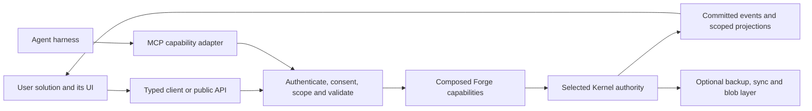

# Bottom line

1. **Decisions needed:** choose the staging defaults at the end; no decision blocks this research deliverable. [inferred]
2. Forge is an unopinionated block platform; marketplace, optional cloud and external UIs are target architecture, with outside authors supported by 0.1.0's contracts. [read: north-star.md:5–31]
3. Start the marketplace with a reviewed index repository, versioned manifests and existing artifact hosts; a new package registry or storefront adds little to the first author-to-user journey. [inferred]
4. Keep publisher identity, artifact integrity, compatibility review and Forge maintenance as separate trust claims; popularity and signatures do not establish safety. [inferred]
5. Demand should guide support and promotion through requests, repeat use and maintenance evidence; downloads and ratings are inputs, not automatic core-admission rules. [inferred]
6. Model A reserves stable project identity and a per-user Forge home, but the inspected broker still defaults to the Git common directory; this is a design/runtime gap. [read: docs/PROJECT_DESIGN.md:560–583; lib/kernel/broker.js:132–150]
7. Cloud backup can preserve local authority; shared multi-device/team writes require one authoritative Kernel command endpoint and fenced handoff, not independently writable synced databases. [inferred]
8. Prefer an accepted-event log and explicit commands for authority; CRDTs may serve collaborative content, while libSQL replicas and Electric/PowerSync patterns serve distinct replication needs. [inferred]
9. External solutions keep their own UI and domain data, connecting through versioned APIs, events and consent-scoped grants; MCP exposes the same capabilities to agents. [inferred]
10. Reserve identity, manifests, contracts, authorization and sync boundaries in 0.1.0; stage hosted discovery, backup, shared authority and mature app governance across 0.2 and 1.0. [inferred]

## Scope, sources and evidence

**Leg:** P3-marketplace-cloud. **Research date:** 2026-09-30. This is a design recommendation, not an implementation or a vendor selection. The owner north star overrides conflicting framing in the shared brief: the TDD delivery workflow is a reference solution, not the definition of the platform. Forge itself remains one npm package; third-party packages depend on its public contracts. Kernel authority applies to issue/workflow state in compositions that use it; this does not require every unrelated capability to become an issue-tracking application. The north star was reread during verification; its added separate-visualization-app requirements are incorporated below. [read: north-star.md:5–31; (local scratch), “Owner direction already decided”; inferred]

Repository evidence below comes from `git show origin/master:<path>`. A read-only `git ls-remote origin refs/heads/master` matched the inspected ref **7d448ec812ef8639790477af07c3c75962173f8a**. [ran: remote-ref comparison] `[read]` means source inspection, evidence rung 2; `[ran]` identifies an executed check, rung 4; `[external]` means retrieved primary documentation, not a Forge runtime test; `[inferred]` means analysis or a proposed design. No marketplace, sync, authorization or restore experiment was run. The word “successful” below describes useful established ecosystem mechanisms; this research does not prove which mechanism caused adoption.

### Existing seams and limits on origin/master

| Seam | Verified evidence | Consequence for this plan |
| --- | --- | --- |
| Storage Model A | Accepted decision: `~/.forge/projects/<uuid>/kernel.sqlite`, central registry, committed project UUID marker and opt-in JSONL projection. The ledger explicitly says implementation is a later track. [read] [docs/PROJECT_DESIGN.md:560–583](https://github.com/harshanandak/forge/blob/7d448ec812ef8639790477af07c3c75962173f8a/docs/PROJECT_DESIGN.md#L560-L583) | Reserve stable identity and a location resolver. A cloud API must identify a project by ID rather than filesystem path. Do not describe Model A as shipped. [inferred] |
| Current local broker | Builds its default database path under `<git-common-dir>/forge/kernel.sqlite`; uses SQLite/WAL and an optional database-path override. [read] [lib/kernel/broker.js:30–55](https://github.com/harshanandak/forge/blob/7d448ec812ef8639790477af07c3c75962173f8a/lib/kernel/broker.js#L30-L55), [132–150](https://github.com/harshanandak/forge/blob/7d448ec812ef8639790477af07c3c75962173f8a/lib/kernel/broker.js#L132-L150) | Extend the broker boundary instead of teaching every block or UI how to open SQLite. Location migration and cloud sync are separate work. [inferred] |
| Authority versus projections | Storage reference assigns issue/claim/stage/run authority to the Kernel, separates read models, projections and evidence archives, and requires server acceptance in team mode. Its cloud section names Cloudflare. [read] [docs/reference/FORGE_KERNEL_STORAGE_MODEL.md:41–118](https://github.com/harshanandak/forge/blob/7d448ec812ef8639790477af07c3c75962173f8a/docs/reference/FORGE_KERNEL_STORAGE_MODEL.md#L41-L118) | Preserve the authority/read-model split. Cloudflare is a historical planning option, not a verified deployed backend. [inferred] |
| Cloud backend proposal | A later **proposed** ADR favors self-hosted `sqld` namespaces with managed Turso as an on-ramp, superseding the earlier Cloudflare slice in part; acceptance requires further verification. [read] [docs/adr/0002-team-server-backend.md:1–75](https://github.com/harshanandak/forge/blob/7d448ec812ef8639790477af07c3c75962173f8a/docs/adr/0002-team-server-backend.md#L1-L75) | Reuse the proposal as a candidate; neither its historical vendor observations nor its near-zero migration estimate constitute current runtime proof. [inferred] |
| JSONL projection | Version 3 exports issues, comments and dependencies with revisions; deterministic ordering and a hash accompany a manifest published last. [read] [lib/kernel/projection-jsonl-writer.js:8–37](https://github.com/harshanandak/forge/blob/7d448ec812ef8639790477af07c3c75962173f8a/lib/kernel/projection-jsonl-writer.js#L8-L37), [73–115](https://github.com/harshanandak/forge/blob/7d448ec812ef8639790477af07c3c75962173f8a/lib/kernel/projection-jsonl-writer.js#L73-L115) | Reuse deterministic export for portability/bootstrap. A snapshot of these objects is not a complete backup of memory, receipts and evidence, or a multi-writer sync protocol. [inferred] |
| Plugin catalog | A frozen, read-only catalog classifies CLI/skill/MCP/config/LSP tools by reference-workflow stage, price tier, detection and installation metadata. [read] [lib/plugin-catalog.js:1–100](https://github.com/harshanandak/forge/blob/7d448ec812ef8639790477af07c3c75962173f8a/lib/plugin-catalog.js#L1-L100) | Reuse descriptions and recommendation experience. Its price tiers are not security tiers, its stage taxonomy cannot define all platform blocks, and embedded install-command strings must not become executable marketplace instructions. [inferred] |
| Memory adapters | Guide documents local FTS5 as the default and Graphiti as experimental with the emitter not shipped. Router additionally exposes custom backend registration. Registry validates five methods, rejects asynchronous results and executes the local floor before the selected adapter. [read] [docs/guides/memory-backends.md:10–49](https://github.com/harshanandak/forge/blob/7d448ec812ef8639790477af07c3c75962173f8a/docs/guides/memory-backends.md#L10-L49), [lib/memory/router.js:123–153](https://github.com/harshanandak/forge/blob/7d448ec812ef8639790477af07c3c75962173f8a/lib/memory/router.js#L123-L153), [lib/memory-core/src/backend-registry.js:3–50](https://github.com/harshanandak/forge/blob/7d448ec812ef8639790477af07c3c75962173f8a/lib/memory-core/src/backend-registry.js#L3-L50), [113–150](https://github.com/harshanandak/forge/blob/7d448ec812ef8639790477af07c3c75962173f8a/lib/memory-core/src/backend-registry.js#L113-L150) | Registration is an existing outside-provider seam. Do not put network sync into synchronous calls or promise Graphiti round-trip sync. Use a durable outbox and an asynchronous delivery boundary. Memory's local fallback does not authorize a team Kernel to fall back to a second writer. [inferred] |
| Contract primitives | Existing contracts export canonicalization, content hashing, schema generation, validation and semantic identity; envelopes carry producer, provenance and capability digests. Kernel command schemas preserve versioned result/error envelopes and next commands. [read] [lib/contracts/index.js:3–31](https://github.com/harshanandak/forge/blob/7d448ec812ef8639790477af07c3c75962173f8a/lib/contracts/index.js#L3-L31), [capability-manifest.schema.json:1](https://github.com/harshanandak/forge/blob/7d448ec812ef8639790477af07c3c75962173f8a/lib/contracts/schemas/v1/capability-manifest.schema.json#L1), [lib/kernel/issue-command-contract.js:145–162](https://github.com/harshanandak/forge/blob/7d448ec812ef8639790477af07c3c75962173f8a/lib/kernel/issue-command-contract.js#L145-L162) | Reuse serialization and validation, with purpose-specific new schemas. The existing runtime capability-manifest contract is not automatically a block publishing manifest. [inferred] |
| External issue integration | Proposed ADR reserves provider mappings, external references, revision CAS, origin and conflict quarantine; it excludes claims from external push. [read] [docs/adr/0004-external-issue-sync.md:1–55](https://github.com/harshanandak/forge/blob/7d448ec812ef8639790477af07c3c75962173f8a/docs/adr/0004-external-issue-sync.md#L1-L55) | A useful integration direction, with proposed portions kept distinct from implementation. External field changes must enter through Kernel validation and cannot overwrite Forge-owned claims/gates. [inferred] |

Parsing the tracked `package.json` returned package name `forge-workflow`, version `0.1.0-beta.8`, and no `exports` property. [ran: JSON parse of `git show origin/master:package.json`] Module existence is therefore insufficient proof of a deliberate, stable SDK import surface. Reserve documented package exports and compatibility tests rather than telling outside authors to depend on arbitrary internal paths. [inferred]

## A. Blocks and templates marketplace

### What to borrow from existing ecosystems

The recurring useful separation is **artifact distribution → identity/metadata → discovery → admission/support policy**. Forge can adopt that separation without operating every service. A directory entry says where a thing is; publisher verification says who controls it; provenance says where those bytes came from; testing says what a particular release did; first-party status says who maintains it. [inferred]

| Ecosystem | Publishing format and identity | Verification/provenance and the useful Forge lesson |
| --- | --- | --- |
| VS Code Marketplace | `package.json` extension manifest, `publisher.name` identity, VSIX packaged with `vsce`; engine constraints express compatibility. Domain ownership underpins the verified-publisher badge. [external] [Publishing extensions](https://code.visualstudio.com/api/working-with-extensions/publishing-extension) | Marketplace signing authenticates distribution and detects modified packages; publisher trust, scanning and blocklisting are distinct protections. Ratings, reviews and publisher responses inform users. Copy explicit identity and version compatibility, plus a removal channel; a verified publisher is not a guarantee about code. [external] [Signing](https://code.visualstudio.com/updates/v1_75#_vs-marketplace-extension-signing), [Runtime security](https://code.visualstudio.com/docs/configure/extensions/extension-runtime-security) |
| Open VSX | Publishes the same VSIX ecosystem through `ovsx`; the manifest publisher becomes the namespace. Publication membership and namespace ownership are separate. [external] [Publishing](https://github.com/eclipse-openvsx/openvsx/wiki/Publishing-Extensions) | Verified status requires an owned namespace and an authorized publisher; namespace claims are public and owners manage contributors. Copy transparent claims/transfers and interoperable manifests. Do not treat this identity verification as equivalent to VS Marketplace signing or source review; this research did not establish an equivalent artifact-signing policy. [external] [Namespace access](https://github.com/eclipse-openvsx/openvsx/wiki/Namespace-Access) |
| npm plus a curated index | npm distributes versioned packages; `@user/package` or `@org/package` scopes provide namespacing. A separate Forge index can add block capabilities, examples and compatibility review without replacing npm. [external] [Scopes](https://docs.npmjs.com/about-scopes/); [inferred: curated-index design] | Registry ECDSA signatures bind package identity/version/integrity; provenance links a release to its source/build, and supported OIDC publishing avoids long-lived publishing tokens. npm downloads are available through a count API, but are not unique users or successful Forge compositions. Copy existing supply-chain tooling and separate curation from distribution. [external] [Registry signatures](https://docs.npmjs.com/about-registry-signatures/), [Trusted publishing](https://docs.npmjs.com/trusted-publishers/), [Provenance verification](https://docs.npmjs.com/viewing-package-provenance/), [Download API](https://github.com/npm/registry/blob/main/docs/download-counts.md) |
| Terraform Registry | Providers use source namespaces; modules use a standard repository structure and semantic release tags. The public module registry ingests repositories and release updates. [external] [Module publishing](https://developer.hashicorp.com/terraform/registry/modules/publish) | Current provider tiers include Official, Partner Premier, Partner, Community and Archived. Provider installation verifies registry signatures, distinguishing HashiCorp, trusted-partner and self-signed providers. Current module docs use “Partner”; the API's `verified=true` filter means partner modules, not universal security certification. Copy explicit support ownership and reviewed tiers with identical consumption contracts. [external] [Provider tiers](https://developer.hashicorp.com/terraform/registry/providers), [Signatures](https://developer.hashicorp.com/terraform/cli/plugins/signing), [Partner modules](https://developer.hashicorp.com/terraform/registry/modules/partner), [Registry API](https://developer.hashicorp.com/terraform/registry/api-docs) |
| Home Assistant HACS → core | HACS consumes public GitHub repositories, root `hacs.json`, repository-type conventions and releases; custom integration code has its own Home Assistant structure. [external] [HACS publishing](https://www.hacs.xyz/docs/publish/start/) | Core admission is a separate contribution/review process. New integrations must meet Bronze quality requirements; communication belongs in a reusable library. HACS inclusion/popularity does not automatically promote an extension. Copy the path from community distribution to maintained native integration through a small reviewed contribution and quality bar, not a download threshold. [external] [Contributing to core](https://developers.home-assistant.io/docs/core/integration/contributing_to_core/) |
| n8n verified nodes | npm packages use `n8n-nodes-` or a scoped equivalent, a discovery keyword, and node/credential declarations in `package.json`. Creator Portal submission connects publication to review and integrated discovery. [external] [Submission](https://docs.n8n.io/connect/create-nodes/deploy-your-node/submit-community-nodes.md) | Retrieved guidelines require source/maintainer checks, provenance, no external dependencies and no filesystem/environment access for verified nodes. Verified nodes can appear in the node panel across deployment types. Copy a reproducible, documented review profile and a better discovery tier; those restrictions suit n8n's node role and must not blindly prohibit legitimate Forge filesystem blocks. Verification is not first-party maintenance. [external] [Verification guidelines](https://docs.n8n.io/connect/create-nodes/build-your-node/reference/verification-guidelines.md), [Verified-node discovery](https://docs.n8n.io/integrations/community-nodes/installation-and-management/install-verified-community-nodes.md) |
| Claude Code marketplaces | A Git directory/repository carries `.claude-plugin/marketplace.json` with owner, catalog name and plugin sources; each plugin has its own manifest/components. Install identity includes the catalog; sources can be pinned. [external] [Marketplace format](https://code.claude.com/docs/en/plugin-marketplaces) | A small index, local validation and private team catalogs can constitute a marketplace. Plugin details expose components before installation; plugins can add hooks and MCP servers. Copy the low-cost publishing/discovery loop and explicit trust. Do not infer that any custom marketplace or listed plugin is vetted or cryptographically signed. [external] [Installation and trust](https://code.claude.com/docs/en/discover-plugins) |
| MCP registries | Standard `server.json` metadata describes packages/remotes and configuration. Reverse-DNS names bind to GitHub/DNS authentication; package-ownership markers connect metadata to the actual package. [external] [Schema](https://github.com/modelcontextprotocol/registry/blob/main/docs/reference/server-json/generic-server-json.md), [Authentication](https://modelcontextprotocol.io/registry/authentication) | The official registry supplies metadata; downstream registries/marketplaces add consumption/discovery policy. Identity verification is not a code-safety assessment. Copy registry federation and origin binding; a discovered MCP server remains a separately trusted dependency, rather than silently becoming a native Forge block. [external] [Registry scope and trust](https://modelcontextprotocol.io/registry/about) |

These are mechanisms, not identical promotion ladders. In particular, the cited VS Code/npm/Claude/MCP documentation does not establish an automatic “popular → core” rule. Forge's owner explicitly wants demand-led promotion, so Forge needs its own maintenance/admission policy. [inferred; read: north-star.md:14]

### Minimum viable Forge marketplace

**Recommendation: one curated public index repository, existing npm/Git artifact hosting, one publishing schema family, and release-specific review records.** The first marketplace should prove the loop: outside author publishes → maintainer reviews metadata/release → user discovers → user explicitly trusts → config validator resolves → block composes → receipt names the exact release. A JSON index and generated documentation/search are sufficient initially. No payments, accounts service, new binary hosting or bespoke PKI are needed for that loop. [inferred]

Separate the author-owned manifest from index-owned endorsements and user-owned lock/trust records:

| Contract | Minimum contents and rules |
| --- | --- |
| Author manifest | Schema version; stable publisher/name ID; block or template kind; release version; Forge contract range; description/license/repository/support; config schema; provided/required capabilities; entrypoint or declarative config; dependencies; declared effects/resources and external data destinations. Templates declare block dependencies and required inputs, including secret **references**, never values. [inferred] |
| Artifact reference | Registry/package/exact version plus integrity for npm; repository/full commit/path plus verified artifact digest for a config-only template. No moving branch/tag or `latest` as a lock identity. Choose these limited source types first; add other transports only through a versioned resolver. [inferred] |
| Index record | Manifest/artifact digests; publisher ownership evidence; immutable review result for that release; reviewer/date/compatible Forge range; support owner; current deprecated/quarantined/revoked status; supersession/transfer history; request and source links. Authors cannot award themselves reviewed or first-party badges. [inferred] |
| Composition lock | Registry identity and trusted index revision; logical IDs; exact artifacts and transitive resolution; contract/config revisions; integrity/provenance verification outcome; approved effects. Lockfile placement follows the composition's shared/personal config policy. [inferred] |

**Identity:** choose one canonical form, such as `io.github.publisher/name`, with a reserved Forge-controlled namespace; use npm's package coordinate as distribution metadata, not as an implicit proof of ownership of the Forge name. Bind the publisher to the repository and package through authenticated ownership evidence. Permit a reviewed account/package transfer while retaining the logical ID and history. Config carries registry origin explicitly, so a private index cannot shadow an official ID through search order. Retain aliases/deprecation mappings when promotion changes the packaging. [inferred]

**Manifest evolution:** distinguish manifest-schema version, block API version, capability contract versions, and artifact release version. Unknown consequential permissions/capabilities fail closed; namespaced advisory metadata may round-trip. Config validation and `explain` must resolve declarations without executing an unknown block's code. Even if Forge's npm version is below 1.0, publish a compatibility/deprecation policy for these contracts; do not make outside authors infer guarantees from package SemVer alone. [inferred]

**Template behavior:** default to declarative config plus documented input/output schemas. Instantiating a template creates an inspectable composition and lock; it does not silently run hooks, fetch credentials or grant permissions. A template with executable steps must declare them as block dependencies and pass the same trust decision as direct installation. Users may edit the instantiated solution without remaining coupled to template upgrades. [inferred]

**Publication/admission:** submit an index PR referencing the already-published artifact; statically validate naming/schema/paths/license/ownership, verify digests and available provenance, and exercise the declared composition against its supported contracts. Tests involving unknown executable packages run in isolated CI with no publishing or production secrets. Merge only an exact reviewed release. A changed artifact, capability surface, maintainer identity or data destination triggers a new review/trust decision; it does not inherit safety from a previous release. [inferred]

### Verification, signing and runtime trust

Use separate dimensions, even if the UI presents them as badges:

| Claim | What Forge may say | What it cannot imply |
| --- | --- | --- |
| Listed/community | Manifest valid and origin declared; locally supplied blocks can also be unlisted. | Safe execution or Forge support. |
| Publisher verified | Account/domain/repository/package-control relationship checked. | Code review, compatibility or absence of malicious behavior. |
| Release reviewed | Specific digest passed the documented contract/security review profile for a supported range. | Every future release, dependency or deployment is safe. |
| Forge supported | Forge owns maintenance, regression coverage, security response and upgrade compatibility. | That every capability must become part of every solution or be bundled into the minimal core. |

All rows are proposed policy. [inferred] Reserve reviewer-issued attestations keyed to the artifact digest, so verification can later be automated or delegated without changing block identity. Initially use existing npm provenance/signature verification where applicable, plus a pinned official index snapshot distributed with the Forge release. A digest detects changed bytes; it authenticates no publisher unless bound to a trusted source. A custom index requires an explicit trusted origin/revision. Add index signing/key rotation and broader transparency when independently updated/federated catalogs justify them; do not hand-roll package signing. npm documents that provenance establishes source/build origin rather than guaranteeing harmless code. [external] [Provenance](https://docs.npmjs.com/generating-provenance-statements/), [Signature/provenance verification](https://docs.npmjs.com/viewing-package-provenance/); [inferred]

Trust must cover installation as well as activation: package lifecycle scripts, transitive dependencies, hooks and launch commands can execute before a block's API is called. Inspect/resolve without enabling unapproved scripts; require explicit approval for executable effects. A cached, locked composition should work offline without querying the index at every invocation. Honor locally known revocations and show the freshness of advisory data rather than pretending an offline device knows new server advisories. [inferred]

**Critical boundary:** in-process JavaScript blocks can access the hosting process's privileges. Effect declarations, permission prompts and dependency injection explain trust; they do not sandbox that code. Token scopes constrain mediated APIs, not a trusted local process reading files directly. Process isolation with reduced OS privileges is a later execution option; untrusted native execution cannot be made safe by marketplace badges. This follows the owner's explicit constraint that composition is not sandboxing. [read: north-star.md:23; inferred]

### Demand and promotion into supported/native blocks

Begin with public capability/template requests and upstream issue links. Record the problem, requested capability contract and affected composition, not just a package vote. Where users separately opt in, successful composition/activation receipts can provide coarse repeat-use and failure signals without uploading project names, prompts, issue contents or user-identifying paths. Publishing, cloud membership and installation do not imply telemetry consent. [inferred]

Use a dashboard or periodic maintainer report later; no scoring algorithm is necessary at launch:

| Signal | Useful interpretation | Bias/control |
| --- | --- | --- |
| Downloads/installs | Exposure and an adoption lead. | CI, caches and bots distort counts; a package download is not a successful composition. |
| Repeated successful use | A capability serves an ongoing need. | Only visible for consenting users; publish coverage and sample limitations. |
| Ratings/reviews | Qualitative friction and satisfaction. | Keep rating volume/context; resist brigading and paid placement; do not turn reviews into security claims. |
| Requests/upstream issues | Missing capabilities and recurring breakage. | Dedupe by underlying need and include users who never installed a block. |
| Compatibility, support and incidents | Whether Forge can responsibly take ownership. | Demand alone cannot override release gates or incident response. |

All interpretations are recommendations. [inferred] Promotion is **community → reviewed/recommended → Forge supported → bundled/native only when justified**. Require an agreed license/maintainer transition, evidence of repeated demand, a contract that fits multiple solutions, compatibility/migration tests, and a named support owner. Preserve ID/aliases, provenance and attribution; give existing users an explicit migration. Popular niche blocks may stay external and supported. Core admission should be driven by platform necessity or substantial shared reuse, not by one reference workflow's preferences. A minimal PR can promote an adapter without importing its upstream SDK implementation, following Home Assistant's reusable-library pattern. [external] [Core integration requirements](https://developers.home-assistant.io/docs/core/integration/contributing_to_core/); [inferred]

### Marketplace seams now versus later

| Must reserve/design in 0.1.0 | Can wait |
| --- | --- |
| Stable block/template/capability IDs; registry-origin binding and transfer rules; schema versions and public API exports; exact artifact resolution; config schema/validator/explain; lifecycle cleanup; separate manifest/review/trust records; revocation/deprecation representation; one reproducible outside-author journey. [inferred] | Hosted search/storefront, automated publisher signup, ratings service, payment/revenue sharing, broad malware-analysis farm, registry federation operations, sophisticated ranking and bulk promotion. [inferred] |

## B. Optional cloud data layer

### Compare architectures by the invariant they preserve

Local-first describes the user experience and ownership model; it does not settle who may accept an authoritative write. Forge should separate **backup**, **read synchronization**, **draft synchronization**, and **shared authority** in config and UI. [inferred]

| Approach | What primary sources establish | Fit and limit for Forge |
| --- | --- | --- |
| CRDT documents, e.g. Yjs | Shared types support concurrent collaborative editing; transport and persistence can be composed independently. [external] [Yjs collaborative editor](https://docs.yjs.dev/getting-started/a-collaborative-editor) | Suitable for an optional shared-note/draft block. CRDT convergence does not decide exclusive claim ownership, legal stage transitions or evidence-based gates. Do not apply generic merge rules to the Kernel graph. [inferred] |
| Domain-command log with accepted events/outbox | Existing Kernel code carries event identity/idempotency and expected revisions; projections already use revisions and deterministic exports. [read] [lib/kernel/migrations.js:137–145](https://github.com/harshanandak/forge/blob/7d448ec812ef8639790477af07c3c75962173f8a/lib/kernel/migrations.js#L137-L145), [projection writer](https://github.com/harshanandak/forge/blob/7d448ec812ef8639790477af07c3c75962173f8a/lib/kernel/projection-jsonl-writer.js#L28-L37) | Best authority seam: one Kernel validates a command and commits state plus an accepted event; clients resume projections from cursors. Event existence alone does not prove complete event sourcing, a public event API or reconstructible backups. Those need explicit contracts/checks. [inferred] |
| libSQL/Turso embedded replicas | Default writes go to the remote primary; successful initiating writes update the local replica, giving read-your-writes. Offline writes are separately configurable; reads are local, and replica encryption is documented. [external] [Embedded replicas](https://docs.turso.tech/features/embedded-replicas/introduction.md) | A strong candidate for a SQLite-compatible shared Kernel and local read cache. Give users the Forge command API, not raw database tokens; preserve validation, leases and gates at the primary. Do not enable independent offline authority merely because the driver permits local writes. [inferred] |
| Current Turso Sync | Current docs recommend a newer logical-sync engine for new sync projects; reads/writes happen locally, with explicit push/pull and documented “last push wins” conflict behavior. [external] [Sync usage](https://docs.turso.tech/sync/usage.md), [Embedded-replica guidance](https://docs.turso.tech/features/embedded-replicas/introduction.md) | Distinguish this from libSQL's default primary-routed replicas. Evaluate it for non-authoritative data; generic last-push resolution cannot substitute for Kernel command acceptance. Engine/schema/error compatibility and conflict behavior require a spike before replacing the current SQLite driver. [inferred] |
| Electric-style sync | Current Electric is a Postgres read-path sync engine providing partial replicas; documented write patterns use an application API and optimistic state/change logs. [external] [Current README](https://github.com/electric-sql/electric/blob/main/README.md), [Write patterns](https://electric-sql.com/docs/guides/writes) | Borrow selective subscriptions, cursor resumption and separation of optimistic drafts from accepted data. It is not a drop-in SQLite Kernel backend; introducing Postgres solely to get UI sync adds a migration/operations boundary. [inferred] |
| PowerSync-style sync | Clients read managed local SQLite, receive filtered source data and queue writes. The developer's upload function calls the application backend, where authorization and business rules apply. [external] [Client architecture](https://docs.powersync.com/architecture/client-architecture) | Borrow the authoritative backend/upload queue boundary and distinguish pending from accepted UI state. A local optimistic claim must not enable a protected action before Kernel acceptance. This is an architectural pattern, not a recommendation to add PowerSync immediately. [inferred] |

**Recommendation:** retain SQLite local authority; reserve domain commands plus committed change feed, durable delivery outbox and content-addressed blob transfer. Start optional cloud with explicitly selected backup/restore. For true shared authority, investigate the already-proposed libSQL family first, with the API and export format insulating compositions from the vendor. Neither historical Cloudflare plans nor managed-database marketing should freeze 0.1.0's public contracts. [read: backend ADR cited above; inferred]

### What syncs, and what does not

The unit of consent is a project, dataset, destination and purpose; selecting cloud must not recursively upload the Forge home or repository. [inferred]

| Data class | Cloud behavior when explicitly enabled | Consistency/privacy rule |
| --- | --- | --- |
| Kernel issues, dependencies, comments and workflow state | Portable snapshots for backup; in shared mode, accepted events and scoped read models. | One Kernel authority per project. Revisions/origin/identity retained; claim history can be audited but live leases are not resurrected on restore. |
| Memory notes and decisions | Selected project/team records, with record IDs, versions, sources and deletion markers. | Private notes stay private unless included; superseding statements retain provenance. External Graphiti/LLM delivery needs its own destination consent and retention policy. |
| Receipts | Immutable, versioned result/provenance envelopes and referenced hashes. | Receipt presence does not prove current state or authorize action. Verify schema, source, evidence binding and freshness through the same gates. |
| Evidence metadata | Run/artifact association, media type, size, integrity and authorized object reference. | Metadata first; raw payload is a separate opt-in upload and access scope. Content-addressing deduplication stays inside an authorization/tenant boundary. |
| Raw evidence bundles | Selected redacted/encrypted logs or artifacts, with retention limits. | Redact before sharing. A redacted derivative gets a new digest and derivation link; never modify the signed/hashed original while retaining its identity. |
| Composition config and locks | Shared non-secret composition, schema/contract revisions and resolved identities where the owner chooses. | Do not upload resolved credentials or personal overrides. Config synchronization never grants permission to activate newly introduced blocks. |
| Derived indexes/caches | Usually rebuild from permitted source records. | Search indexes, embeddings and Graphiti graphs are projections; they do not become new Kernel authority. Sending them elsewhere is data disclosure requiring consent. |

All rows specify the proposed contract, not shipped behavior. [inferred] The storage reference already puts raw prompts/tool logs local by default and treats evidence metadata separately from large archives. [read] [Storage matrix:104–118](https://github.com/harshanandak/forge/blob/7d448ec812ef8639790477af07c3c75962173f8a/docs/reference/FORGE_KERNEL_STORAGE_MODEL.md#L104-L118)

**Local-only by default:** secrets and credential/key stores; raw prompts/transcripts/tool logs; arbitrary repository/worktree files; absolute local paths and process IDs; device session/lock state; personal harness preferences; unsent drafts; caches and temporary files. Share secrets through a user's existing secret manager when needed, using references and a distinct authorization path. Cloud may hold token hashes, revocation metadata and server key material needed to run the service; it must not copy the user's plaintext local credential store. [inferred]

The JSONL share/export knob remains useful and opt-in. A Git merge of exported issue snapshots is not a claim-lease protocol, and projection import must be a validated command/bootstrap operation. Likewise, copying a live SQLite file without a consistent snapshot/WAL procedure is not a backup contract. Use the driver's supported consistent backup/export mechanism, checkpoint/cursor binding and tested restore; preserve the existing canonical export rather than creating another competing issue model. [read: Model A and projection sources above; inferred]

### One Kernel authority across devices and teams

Define an explicit per-project authority descriptor: authority ID, mode, endpoint or local owner, and fencing generation. In **local mode**, the existing broker accepts local commands and cloud holds a backup/read copy. In **shared mode**, a server-hosted Kernel accepts commands and device databases hold read replicas plus pending drafts. Cloud storage does not become a parallel authority. [inferred]

Concrete conflict: two offline devices both see revision 7 and an unclaimed issue, then each claims it and starts protected work. Last-writer-wins or CRDT reconciliation can eventually choose an owner, but cannot retract both devices' earlier authority promises. Shared claims, renewals, close/verify and protected stage transitions therefore require authority acceptance and a currently valid lease. Offline users can read, draft comments or propose changes; UI/API responses distinguish `pending`, `accepted` and `rejected`. A cached expired lease cannot authorize execution. [inferred: failure trace, not a performed test]

Reserve these semantics:

- **Commands:** stable command ID/idempotency key, project/actor context, expected entity revision, config/contract revision, and authority generation. The server derives authenticated actor identity; client timestamps never decide lease expiry. Reusing an idempotency key with a different payload is an error. [inferred]
- **Accepted changes:** event ID, per-project ordering/cursor, entity revision, source/origin and causation; transactional state/outbox commit, duplicate-safe delivery and resumable snapshots. Grant revocation/deletion markers survive compaction long enough to avoid resurrection by stale devices. [inferred]
- **Authority handoff:** local → shared freezes the old writer, snapshots at a cursor, verifies destination import, increments the fence and switches clients. Rollback fences the abandoned writer and restores a known snapshot. Shared → local needs an accepted latest export and explicit detach; server outage cannot silently trigger a local writer for the same shared project. [inferred]
- **Multi-device/team membership:** separate device identity, user identity, app identity and membership roles. Read models expose revision/cursor freshness; synchronization chooses permitted projects/datasets, not all databases in a user's registry. A cloned/copied project marker has an explicit “same project” versus “fork as new project” operation. [inferred]

A full project replica is appropriate only for a client authorized to read that complete dataset. Page-level partial fetching is a bandwidth feature, not field/row authorization. Narrow external apps need filtered API projections, not a database token that can obtain the entire project. [inferred]

### Encryption and operational boundaries

Use TLS, project/tenant isolation, encryption at rest, secure local key storage and explicit retention/deletion from the first cloud release. A backup can be encrypted on-device with user-controlled keys and treated as opaque by the cloud. Reserve key IDs, rotation, authenticated encryption metadata, recovery policy and schema/export version in the backup envelope; lost user keys mean unrecoverable encrypted content unless the user deliberately enabled recovery. [inferred]

Do not market server encryption at rest as end-to-end encryption. A shared Kernel must be able to validate authority fields and membership/leases; full opaque encryption of those fields conflicts with server validation. Keep minimal authority metadata readable to the service, encrypted at rest, and allow client-encrypted evidence/private payloads where their capabilities do not require server inspection. E2EE search, team key distribution and recovery are distinct later designs, not implied by the embedded replica's `encryptionKey` support. [external] [Replica encryption](https://docs.turso.tech/features/embedded-replicas/introduction.md); [inferred]

Revocation blocks future authorized transfer and should purge connected caches where feasible; it cannot claw back data already copied by an app or an offline former team member. Team removal triggers credential/key rotation where appropriate, stops sync/webhooks, and records the cutoff cursor. The product must state those practical limits in consent/retention terms. [inferred]

### Cloud seams now versus later

| Must reserve/design in 0.1.0 | Can wait |
| --- | --- |
| Stable project/record/device/actor IDs independent of paths; authority descriptor/fencing; revision-aware command envelopes and idempotency; accepted-event versus draft distinction; consistent export/import; asynchronous sync/outbox boundary; deletion/retention semantics; portable blob references; explicit dataset/destination consent and encryption envelope. [inferred] | Hosted accounts/storage, production sync transport, CRDT editor, team server, conflict UI, multi-region failover, managed key recovery, E2EE team search and automatic cross-device sharing. [inferred] |

Reserve contracts and implement only the local path needed by 0.1.0. Do not add empty vendor adapters or dependency stacks “for later.” The unresolved storage relocation can ship separately behind the location resolver without changing logical identity or external contracts. [inferred]

## C. Bring your own solution and UI

### A capability platform with multiple consumers

External applications should not have to become Forge plugin UIs. A desktop app, internal web app or agent-authored solution can own its navigation, persistence and business logic while composing Forge capabilities. Forge exports versioned capabilities and selected data; apps retain authority over their own domain objects. Existing Kernel issue/workflow fields still change only through Kernel commands. [read: north-star.md:17–23; inferred]

The latest north star also specifies an optional **first-party visualization app separate from the core**, consuming the same APIs/events as external apps. Its information must be searchable and editable, setup/config edits must use the agent config APIs, and people can extend the app with panels/views. Consequently, reserve scoped queries for composition topology, resolved capabilities/config, agent activity and saved history; expose config validation, dry-run/explain and revision-checked edits as public operations. These are core data/API obligations even when no UI ships in 0.1.0. Search filters and results obey the same dataset grants as direct reads. UI-panel contracts belong to the separate app and cannot create a privileged config/Kernel side door. This leg reserves the shared boundary; it does not require a core dashboard or design the visualization app's component framework. [read: north-star.md:16; inferred]

This is the proposed data flow, not a deployed service diagram. [inferred] Cloud improves durable exchange and availability across machines, but local integration must work without a cloud account.

| Surface | Responsibility | Boundary |
| --- | --- | --- |
| Public in-process API | Typed block/config/data contracts, composition/lifecycle and validation inside Forge's single package. | For trusted application/block code; it shares process privileges. Document exports and distinguish experimental APIs. |
| Local bridge | Optional adapter exposes selected capabilities to a desktop/local web UI; OS IPC for native clients or authenticated loopback HTTP for browsers. | Routes to the same broker and authorization policy; contains no built-in dashboard requirement. Retiring the existing `serve`/dashboard product does not remove the need for a narrow adapter block. |
| Cloud API | Versioned resource queries, commands, transfer jobs and subscriptions for approved projects/datasets. | Routes to the project's configured authority. Read-cloud backups must not accept live issue mutations or execute a user's local filesystem capabilities. |
| Events/webhooks | Versioned accepted changes, transfer status and revocation notifications. | Subscribers receive their authorized projection; delivery failures do not roll back accepted Kernel events. |
| MCP | Capability discovery, structured tool calls and data resources for agent harnesses. | Same consent/scopes/contracts/gates as the app API; agent connection does not create a second privileged backdoor. |

All rows are recommendations. [inferred] HTTP schemas can produce OpenAPI/client docs and typed clients; config/data schemas should share definitions rather than drift across SDK, CLI, MCP and HTTP. SDK convenience must not erase structured errors, revision/freshness or `pending` status. Agents should receive actionable validation errors and explainable configuration. [inferred]

### Auth: common grants, appropriate transports

Start with an explicit application/grant model shared by local and remote adapters. Scopes identify operations, for example `issues:read`, `issues:propose`, `memory:read`, `memory:append`, `receipts:read`, `evidence:metadata:read` and a separate raw-evidence grant. Scope names alone are insufficient: attach project IDs, dataset/field filters, destination, purpose, expiry and grant revision. Keep permission to execute a block's external side effects separate from permission to transfer data. [inferred]

For local transport, use explicit pairing and short-lived audience-bound credentials/session material; store durable credentials outside shared config. A loopback listener binds to loopback only, checks Host/Origin, rejects unapproved browser origins, uses authenticated requests and CSRF protection where cookies are involved, and exposes no arbitrary shell/SQL endpoint. CORS alone does not authenticate a caller. Browser access needs an explicit approved origin and deployment-compatible network policy; “localhost” is not automatic permission. MCP's HTTP transport spec likewise calls for Origin validation against DNS rebinding, localhost binding and authentication. [external] [MCP transports](https://modelcontextprotocol.io/specification/2025-06-18/basic/transports); [inferred]

For remote/user-facing apps, adopt authorization code with PKCE, exact redirect validation, short-lived scoped access tokens, refresh-token rotation/revocation and audience binding. Use a reviewed OAuth implementation/provider when the hosted layer ships; do not implement an authorization server as speculative 0.1.0 work. Public browser/native clients contain no client secret. Service integrations use separately scoped app/service principals, with team administration and audit. [external] [OAuth security BCP, RFC 9700](https://www.rfc-editor.org/rfc/rfc9700); [inferred]

MCP HTTP authorization uses OAuth resource metadata and resource/audience validation; tokens must not be passed through to unrelated services. The cited versioned spec treats stdio credential handling separately from HTTP OAuth. A Forge MCP adapter should obtain its own approved grant and use secret references, rather than forwarding a broad harness/cloud credential to a third-party server. The adapter negotiates its supported protocol version; the research citation is a versioned design reference, not a claim about every harness's current support. [external] [MCP authorization](https://modelcontextprotocol.io/specification/2025-06-18/basic/authorization); [inferred]

### Clean data-transfer contract

Define a versioned exchange envelope around existing canonical data primitives, not direct access to internal tables. Minimum fields: schema/contract version, transfer/command ID, project ID, object kind/ID/revision, authenticated actor and app, source/destination, purpose/grant ID, classification, payload or blob reference, integrity/provenance and expiry/retention. Preserve the existing receipt envelope when transferring receipts; wrap transfer metadata outside it rather than weakening validation or mutating the original hash. Unknown consequential fields fail; bounded namespaced advisory extensions round-trip. [read: contracts index and capability envelope cited above; inferred]

**Example journey:** an external release board asks to read selected issue titles/status and receipt summaries, then append an issue comment. The user sees those exact datasets, write operation, destination and retention policy. The board never receives raw prompts, evidence bundles, claim tokens or DB credentials. Its comment carries an idempotency key and expected revision; Kernel authorization/validation accepts or rejects it and returns a receipt/revision. A committed event updates the board. Revoking the app stops later queries, comment writes and subscription delivery. This is a proposed acceptance scenario. [inferred]

The transfer pipeline should be:

1. **Preview and consent:** disclose app/publisher, destination, purpose, operations, selected records/fields, execution effects and retention. Show a data preview/size estimate when feasible. No bundled grant for “all Forge data”; added scopes/destinations require renewed consent. [inferred]
2. **Authorize and minimize:** validate token audience/expiry/grant revision and project membership at every operation. Query only the permitted projection. Authenticate actor attribution separately from app-supplied provenance. [inferred]
3. **Export or import:** validate schema/size/media type, redact as required, compute integrity and encrypt in transit. Imports are typed commands to the relevant capability; external text is untrusted data, never an instruction to execute tools or override policy. Namespace an app's supplemental fields rather than allowing it to replace Kernel authority fields. [inferred]
4. **Deliver and acknowledge:** use bounded retries, stable IDs and an application acknowledgment. Large objects upload through short-lived, scoped URLs with digest/size checks; quarantine mismatches. A transport success is not proof of authority acceptance. [inferred]
5. **Audit and revoke:** append protected audit records containing actor/app/grant, operation, dataset/object references, result/revision and cutoff cursor, without token values or raw sensitive payloads. Revoke access/refresh grants, sessions, subscriptions, queued deliveries and expiring object URLs; recheck authorization when dispatching, not only when queueing. User deletion/retention instructions propagate as explicit operations. [inferred]

RFC 7009 supplies a token-revocation mechanism; stopping queued transfers, connected caches and stored-data retention is additional Forge/app policy, not something OAuth accomplishes automatically. [external] [Token revocation](https://www.rfc-editor.org/rfc/rfc7009)

**Events:** use a CloudEvents-compatible envelope, with a versioned data schema, event ID/source/type/subject and project cursor/causation extensions. Reserve duplicate delivery, retries, out-of-order handling, gap detection and replay semantics now. Webhook subscription filters are server-authorized; include minimal data or an authorized fetch link. For hosted delivery, authenticate/sign messages, use TLS, constrain destinations against SSRF, preserve delivery IDs for deduplication and provide bounded redelivery/dead-letter handling. [external] [CloudEvents](https://cloudevents.io/), [GitHub webhook practices](https://docs.github.com/en/webhooks/using-webhooks/best-practices-for-using-webhooks); [inferred]

Applications needing approval-free background transfer receive a previously approved narrow grant, not implicit consent from every future agent tool call. External app scopes do not bypass ownership checks, live-system safeguards or delivery gates. A third-party UI may propose an action and display approval state; it cannot self-attest that a protected gate passed. [inferred]

### External-app seams now versus later

| Must reserve/design in 0.1.0 | Can wait |
| --- | --- |
| Public exports and capability/data schemas; transport-neutral query/command/result/error envelopes; searchable setup/activity/history and config validation/explain/edit operations; app/user/device separation; project-bound scopes and consent-grant lifecycle; versioned event/provenance/audit formats; revision/idempotency/freshness; typed import/export; a trusted outside solution using its own UI over documented APIs. Any shipped network bridge must enforce auth immediately. [inferred] | Production hosted OAuth/account service, automatic app registration, cloud webhook fleet, broad SDK-language support, visualization-app panel framework, app billing, custom dashboards and cloud execution of local blocks. [inferred] |

## D. Staged roadmap and release proof

The stages below distinguish **contracts that must exist now** from **services whose support can wait**. They are proposed release scope, not work claimed complete. [inferred]

| Area | 0.1.0: prove the platform contracts | 0.2: opt-in usable second layer | 1.0: maintained ecosystem and shared operation |
| --- | --- | --- | --- |
| Marketplace | Outside-authored block and declarative template; versioned manifest/config/capability schemas; public exports; local/package discovery; exact lock/trust; small curated index and per-release review; deprecation/revocation representation. | Generated hosted discovery/search; reproducible review CI; ownership transfers/private indexes; request tracking and optional coarse success metrics; first reviewed community catalog. | Supported promotion program, sustained publisher governance/security response; independent catalog updates with signing/rotation; interoperable private/federated discovery where demand warrants. |
| Cloud | Local-first authority, project identity/location seam, export/import and sync-envelope designs; no cloud requirement; explicit local/backup/shared semantics and pending-state contracts. | Selected encrypted backup/restore plus cross-device read/projection access. Shared authority can be a separately flagged pilot only after command/lease/fencing tests; no general offline claims. | Production multi-device/team Kernel authority, scoped read models, verified membership/revocation, tested handoff/failover/restore, retention/deletion and clear encryption promises. |
| Own UI/integration | Trusted independent solution calls documented APIs; same contract used by CLI/MCP adapters, with searchable state/events and config edit APIs reserved for the separate visualization app. Design app grants and events. If included, narrow local bridge is experimental and authenticated; no core UI required. | Local bridge supported; cloud API plus OAuth-consented dataset transfer; one complete third-party app journey and signed webhook delivery. | Stable SDK/API compatibility policy, mature audit/revocation, team service principals and app governance; more client SDKs only for demonstrated use. |

**Dependency order:** publish identity/contracts/validation first; prove outside-author composition and exact artifacts; expose the same capability/data boundary to external UI; add consistent export and consented backup; add shared authority with fencing; expand discovery and promotion as requests and use reveal demand. Backup and discovery do not depend on a bespoke plugin UI or shared team authority. [inferred]

### Required proof before calling each stage supported

| Stage | Acceptance scenarios, to be implemented/run by delivery legs |
| --- | --- |
| 0.1.0 | An outside author uses only public docs/exports to build a block, publish a valid manifest, compose it with an existing capability and obtain a receipt naming its exact artifact. A template produces editable, validated config. Bad schema/contract, origin collision, integrity mismatch and undeclared consequential capability fail before activation. A permission increase cannot inherit previous consent. A cached locked composition runs without cloud. An independent trusted solution with its own UI uses the public data/command API and preserves errors/revisions. Lifecycle disposal cleans owned resources. |
| 0.2 | Backup/restore proves a consistent snapshot and rejects corrupt/schema-incompatible artifacts; restore never reactivates old claims. Interrupted transfer resumes without duplicate records. Selected datasets export while local-only records stay local. An app cannot read a different project or raw evidence with a metadata grant. Token/grant revocation blocks queued retries/subscriptions and altered webhook delivery fails validation. If shared pilot exists, competing revision/claim commands yield only one accepted owner and disconnected protected actions remain pending/rejected. |
| 1.0 | Two devices and two team members use the same authoritative Kernel without split ownership; explicit handoff/failover fences the previous writer. Removal/revocation, compaction and long-disconnected rejoin cannot resurrect deleted records or grants. Team backup recovery meets declared retention/recovery objectives, with concrete restore evidence. Promotion preserves compatibility/identity or supplies a tested migration. API/manifest evolution retains old supported compositions or rejects them with actionable migration errors. |

These are release criteria, not passed tests. [inferred] For 0.1.0, marketplace identity/trust is critical to the outside-author promise; selecting a cloud vendor and operating a storefront are not. For 0.2/1.0, reliable restore, consent enforcement and single authority are support prerequisites, not optional polish.

### Main risks and smallest responses

| Risk | Smallest response consistent with the north star |
| --- | --- |
| Marketplace silently becomes reference-workflow-only | Catalog capability contracts independently of stages; ship outside-authored examples with a composition unrelated to the default delivery ladder. |
| Reviewed badge becomes a blanket security promise | Review exact digests against a published profile; expose identity/provenance/support separately and retain explicit execution trust. |
| Backup turns into accidental database synchronization | Separate config modes and use validated consistent snapshots. No writable replicas pretending to own shared leases. |
| New vendor engine changes broker behavior | Keep a transport/driver boundary; test SQLite invariants, transactions, CAS and error contracts before adoption. Do not assume libSQL compatibility extends to every Turso product. |
| UI/API exposes broad database or local-process access | Public commands and filtered projections; narrow grants and no arbitrary SQL/shell surface. Trusted in-process APIs remain explicitly distinct. |
| Cloud encryption promise exceeds the actual boundary | State which payloads are client encrypted, which authority fields the server reads, and how keys/recovery/removal work. |
| Seams become speculative scaffolding | Publish minimal versioned contracts and prove one real composition; defer unneeded servers, adapter implementations and UI frameworks. |

All responses are design judgments. [inferred] No issue mutations were made: this leg's hard limit permits only this output file, so unresolved implementation risks remain here for the lead planner to reconcile with the authoritative backlog.

## Open questions for the owner

These choices settle staging, not the already-decided platform direction. No answer is required to use this research; defaults are explicit. Letters are reply shortcuts only.

| Decision | Choices | Default |
| --- | --- | --- |
| First marketplace | **A:** curated index repository, npm/config artifacts and release-specific review. **B:** also ship independently updated/private registry operations in 0.1.0, expanding supply-chain/support scope. | **A** |
| First cloud service | **C:** selected encrypted backup/restore, then shared-authority pilot. **D:** prioritize shared team authority before backup launch, accepting a larger first operational gate. | **C** |
| First external UI proof | **E:** public SDK with a trusted independent UI, plus an authenticated experimental local bridge only if needed; hosted OAuth follows in 0.2. **F:** require supported browser/network API and hosted OAuth in 0.1.0. | **E** |
| Promotion policy | **G:** demand opens consideration; exact-release review, license, compatibility and maintenance ownership decide promotion. **H:** additionally introduce formal commercial partner tiers at launch, with explicit obligations separate from safety claims. | **G** |

**Default reply: A+C+E+G.** This preserves all 0.1.0 seams and the outside-author promise while staging hosted services behind evidence. [inferred]

## Confidence

**High** in the inspected seams, north-star alignment and distinctions between identity, provenance, support and Kernel authority: repository claims cite the verified remote ref, and ecosystem claims cite retrieved primary documents. **Medium** in implementation cost and the preferred log/replica staging: no compatibility, concurrency, restore, adversarial-auth or end-to-end external-block experiment was run. **Low** in any vendor performance/availability or demand-ranking forecast; none is claimed. The storage ledger is ahead of the current broker path, the team/backend and external-sync ADRs remain proposed, and Graphiti's runtime limitation must stay visible. The next evidence step is the outside-author composition plus focused authority/transfer spikes, not more speculative marketplace infrastructure.
