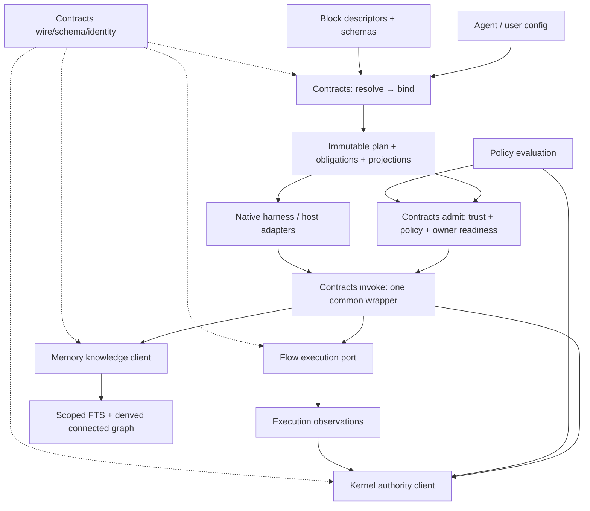

> **Superseded in part on 2026-10-16 by the new-project rebuild plan — see [../2026-10-16-platform-rebuild/rebuild-plan.md](../../2026-10-16-platform-rebuild/rebuild-plan.md). This document remains the record of the decisions it settled; where they conflict, the rebuild plan wins (notably bottom-line point 5: “refactor, not rewrite” is replaced by a new-project rebuild).**
>
> **Status: decisions settled 2026-10-04** (owner answer “Decisions: all defaults”; recorded in `decision-report.answers.json`).

# Forge platform plan — final integration

## 1. Bottom line

**Status: decisions settled 2026-10-04.** The owner answered “Decisions: all defaults”; every §10 entry now shows its outcome. Settled choices authorize planning only, not implementation, installation, migration, spending, outreach or publication.

1. **Decisions settled 2026-10-04:** the staging and operating choices in section 10 were all decided as the stated defaults; this document authorizes no implementation or publication.
2. **Add a capability / Change behavior / See native activation** is the headline: think of a missing feature, add it through one public path, change desired behavior in one project config and inspect the native effective result in every selected supported harness. Simplicity is the value; parity, hot reload and productivity uplift must be earned per tuple. [read: N19; P15 §1; inferred]
3. Forge is one open building-block package; delivery is one selectable reference solution. Contracts connects outside capabilities to native hosts. Static exact-release discovery and open local/CI conformance stay; marketplace/cloud/BYO-UI operations are demand-led. [read: N14–19; P15 C8–C14; inferred]
4. **Smaller 0.1.0:** mandatory Pi/OpenCode/Codex installed profiles, well-supported nonblocking Claude/Cursor base with honest limits, generic MCP/public API/JSON CLI, trusted sync outside authors, local repo/device FTS/decisions/bounded links and all-five migration. Defer new Hermes package, T3 enforcement, Vercel/LangGraph-specific certification, SDK/provider demos and unadvertised compiled-Bun experiment. Keep six functional boundaries, 37 descriptors and G0–G8. [read: P15 recommendations 1–16; N18; inferred]
5. Reuse existing Contracts, Flow, Memory and Kernel working logic, but redraw public block boundaries by function. **Contracts owns the composition API and config writer**, with one generic resolve/bind/admit/invoke path; this is a facade/API refactoring proposal, not a rewrite of functioning engines. Flow owns bounded execution; Memory owns durable scoped knowledge; Kernel alone owns issue/workflow authority. Host loops, durable external orchestration and conversation memory stay with the host. [read: N14–16; S1–S5; P5 A4; inferred]
6. Support trusted startup-only synchronous outside actions first, including pinned independently installed packages; wider services, effects, automatic installation and hot replacement follow evidence. [inferred]
7. Ship agent APIs and searchable structured state/events, **no core UI**; reserve one solution/config identity across self-hosted and Forge-hosted targets, and stage isolated hosted workloads plus the separate plugin-extensible visualization app after 0.1.0. [read: N; inferred]
8. Keep one Forge npm package, sole Kernel authority, local-first operation, Node 24/26 certification, explicit execution trust and intact gates. [read: N, C, S1, S5]
9. **Fresh experimental launch, breaking changes allowed:** decided package/version/lighter publication proof remain unchanged. Add cold outside capability activation in all three mandatory native harnesses, including denial/trust/reload/identity; preserve original Codex/Pi trials, candidate limits and config corpus. Test publishes remain beta/next only. [read: decided 2/3/6; P15; inferred]
10. **Safe migration of all five personal projects remains a release blocker.** Adopt provisionally **92–163 agent-days**, **175–279 nonrecurring maintainer hours reserved**, plus **1–2 upkeep hours/week**, giving **10–19 calendar weeks at 20–25 focused hours/week** and three assumed five-day agent lanes. §6 corrects the unexplained 12–20-day allocation, subtracts marginal named cuts and adds UX/P14 once. Replaces 126–220 days / 11–19 weeks; not measured capacity or a date. [read: P15 §4; P14 §5; inferred]

**North-star principle (owner-approved addition, 2026-10-04): design for smarter agents.** Plan for agents that keep getting more capable. Scaffolding that exists only to compensate for weaker agents — extra process steps, hand-holding checklists, prescriptive step-by-step choreography — is dropped or made optional. What stays is what a smarter agent still needs: contracts, a single authority, outcome evidence, trust and limits. **Gates judge outcomes, not process:** a gate or acceptance criterion states the outcome it protects (what must be true, with evidence), never a procedural step an agent must have performed.

**Current owner direction [read: N13–19; binding correction].** One maintainer plus agents; decided 2/3/5/6/30/31/34 stay closed. Local cross-harness memory/resume/run already work through the shared git-common-dir Kernel issue store, forge recap, stage-exit comments and forge remember/forge recall, reached by every harness via CLI. Only typed/validated handoffs, issue-bound step evidence and automated next-step dispatch are pilot additions. Cross-device active resume is later broker/cloud work. Fifteen reports retain original pins; no new native workflow/live proof here.

### Forge complements; it doesn't compete

**Positioning (one sentence) [read: N19; P15; inferred].** Add a capability, change behavior in one place, and see the admitted result activate natively in your harnesses; retain your existing runtime and inspect exact-identity authority/evidence through Forge’s public composition API.

**The complement principle [inferred from T3 Code and Codex App Server, external: P5 A2].** T3 Code drives each harness through that provider's own CLI, auth and app server and owns only the multi-harness control surface. Forge follows the same four rules: (1) consume the host's runtime through its official seam; (2) own only a layer the host lacks, which for Forge is verifiable capabilities and work authority; (3) degrade to the host, so removing Forge leaves the user's LangGraph, Mastra or Claude Code setup working minus Forge tools and guards; (4) speak the host's extension format, never a Forge-specific one. The review test for any capability is: "Would a user of runtime X have to stop using X's equivalent feature to use this?" If yes, it is overlap and must be narrowed or delegated. [read: P5 A2]

**Owner direction, decided October 1 [read: N item 12; owner request O; decisions 30–34].** Pi is the **priority/flagship exposure harness**; its current release tier is **Experimental until installed-version headless proof passes** (owner chose P7 Pi question 1.A). The open follow-up is “Pi flagship: run the Pi proof before release so Pi ships Supported” (decision 32, default A), with an L3 transcript as well as L2. T3 Code is a **host to certify against**, using its existing provider seam, not a replacement harness or a Forge session driver. Local Forge project/decision memory is the default; Graphiti receives decisions only, Graphify is a separate optional code-graph block, public code stays JavaScript with schema-generated data types and JSDoc+checkJs-derived public `.d.ts` contracts under P10, and Agent Companion is an optional execution-provider block outside the core.

**Forge never does (normative for docs and review checklists) [read: P5 A4; inferred]:**
1. Call a model or abstract model providers.
2. Run an agent or tool-calling loop.
3. Provide durable workflow orchestration for external solutions: no timers, retries-as-graph, interrupts/human-in-the-loop resume, parallel scheduling or long-running jobs.
4. Store conversation history or provide semantic/vector recall as a core engine.
5. Stream chat UI or ship a chat frontend.
6. Drive harness sessions as a client (spawn or steer Claude Code, Codex, Cursor, OpenCode or Pi turns). AI SDK 7 `HarnessAgent`, T3 Code and the Codex App Server own that [external: P5 A3/B1].
7. Host agent deployments or offer an evals platform.
8. Become a second issue authority, or invent a packaging format where a cross-vendor one exists (Agent Skills, Agent Plugins).

**Workflow or agent: the integration rule [read: P6 §3; external sources cited there: Anthropic 2024-12-19, arXiv 2512.08296].** Ordinary code or one model call first. Use a deterministic topology when the steps and effects are known. Use one bounded agent (step cap, tool allow-list, checkpoints, stopping condition) when the next action is unknown. Use limited multi-agent work only for truly independent branches, with one integration owner and an equal-budget outcome comparison. Gates and Kernel acceptance sit outside that choice: whichever produced a change, a producer PASS is an observation, never accepted state (§3.6). No universal productivity effect or workflow-versus-agent ranking is established, so Forge makes no such claim [external: P6 sources 3, 4, 7].

**Reasoning [read: P14 §§2–4; P15; inferred].** Packaging has uneven semantics, but workflows and cross-harness orchestration already exist: Claude workflows, Pi Taskflow, Companion, agtx, Agent Orchestrator and VS Code handoffs. Forge already shares local issue/knowledge/run context via CLI. Incremental advantage is public authoring, checked typed handoffs, accepted evidence and safe next-step dispatch across those substrates. Reject first/only, core agent loop and general scheduler claims. If equal-budget native alternatives win with less glue, narrow Forge to useful authority/evidence adapters.

### Market value and worth

**Verdict [read: N, item 10; C; M's comparative research; inferred].** Forge's core and marketplace are open source. Success is broad use and exposure: more agents and harnesses can reuse useful capabilities, more independent authors can compose and publish, and builders spend less time integrating. Revenue chances may be low; that is acceptable and does not fail the worth test. Conformance and security verification of blocks/configs are built-in open capabilities (§3.7), with the same checker available locally and in CI. The plausible gap remains **neutral, explainable composition with consistent authority and exact-identity evidence across consumers**. Adoption is unmeasured; an ecosystem's size cannot prove demand for another layer. Prefer native tools/frameworks directly if they complete the same job with less glue. Change the wedge or shrink Forge to the useful integration seam if comparative tasks, outside authoring or retention fail; payment is not a success criterion.

#### First adopter community and why people would use it

| Priority / community | Job and adoption mechanism | Evidence, alternative rejected and what changes it |
| --- | --- | --- |
| **First: independent JS/TS agent-tool and integration authors**, including maintainers, startups and small teams | Publish one useful block/template; reuse Memory/Contracts/Flow/config instead of rebuilding them; consume the same public capability from a coding harness, framework tool and headless job. Reusable examples and open verification reduce evaluation effort. | N item 10 widens the destination beyond chat; M:28–40/195–216 motivates author-first supply [read]. Lower integration effort is a hypothesis [inferred]. Reject a buyer/procurement wedge or targeting every developer at once. Prefer another community if unassisted authoring, cross-consumer reuse and week-four retention are stronger there. |
| **Framework/MCP maintainers and headless/CI builders** | Keep their own orchestration/model/state owners; wrap Forge at one tool/API/process boundary. Runnable integrations make Forge discoverable within a community they already use. | Official framework tool/MCP surfaces are researched in §3.5 [external]. Reject replacing their frameworks or claiming a listing guarantees users. Prioritize the channel whose activated builders retain and publish reusable work. |
| **Solo builders, platform teams and enterprises** | Use free reference compositions, local/private catalogs and the same open contracts/checker; contribute repeated capability requests and outside solutions. | These are adoption/learning cohorts, not staged paid segments [read: N; inferred]. Reject speculative enterprise/governance breadth or installs as evidence of value. Advance a recurring need when multiple independent consumers demonstrate it and maintenance capacity exists. |

**Why many could adopt [inferred, not measured].** A useful outside block can bring its own audience; one understandable config and reusable capability reduces per-harness/per-framework glue; open checks make evaluation reproducible; local use and self-hosting remove account/hosting prerequisites. Those benefits compound only when authors publish independently and other builders actually reuse them. Cross-harness invocation and generic tools already have strong substitutes (below). Reject “one-stop” as a claim that every integration already works or Forge must implement every connector. Earn reach through open registration, narrow certified profiles and useful templates; remove a wrapper if the native option is simpler. The six metrics and comparative pilot below decide whether the mechanism works.

#### Adoption metrics and privacy-preserving measurement

No metric is currently observed here. These definitions are proposed [inferred]; publish the method and denominators before collecting results. Optional telemetry is **off by default**, separately consented and revocable; local reports remain usable without uploading. Use participant-held random pilot IDs or voluntary public identities, never silent machine/repository fingerprints. Keep no prompts, source, project/customer names, raw paths, secrets or business payloads. Publish only aggregates, suppress cells below five participants and delete consented event-level pilot data after 90 days. Public signals count public activity only; private activity and non-consenters are unknown, not zero. Do not merge public and opt-in samples as if they were a complete population.

| Required success metric | Unit / method | Privacy, confounders and useful interpretation |
| --- | --- | --- |
| **Harness and agent integrations** | Versioned integration/profile with a public runnable example plus candidate-bound conformance result; separately count **certified**, **experimental**, and **independently maintained** profiles. Track distinct frameworks, MCP clients and headless/CI consumers as well as chat harnesses. | Public adapter repos/docs/receipts, or an opt-in report containing integration family/version and profile status only. Two transports of one framework are not two new communities; a registry listing alone is not a working integration. |
| **Independent outside authors** | Distinct voluntary outside publishers who release a useful block/template without core edits/private imports; report assisted and unassisted authoring separately. | Public publisher/release links with consent for attribution, or opt-in anonymous author counts deduplicated only within the pilot. Maintainers and the same person's aliases are not independent supply. Unknown identity remains unknown. |
| **Published and reused blocks** | Count immutable published block/template releases separately from **reuse**: a distinct independent solution locks and successfully runs/validates an exact release. Report blocks with at least two independent consumers and releases retained after four weeks. | Public manifests/locks/examples or local aggregation uploaded only with consent as block release + coarse successful-use count. Never upload config/payload. Downloads, CI reinstalls and the author's own demos do not establish independent reuse. |
| **Solutions built** | Distinct usable compositions with declared job/assertions, not config files generated; count new versus template-derived, delivery versus non-delivery, and multi-consumer reuse separately. | Voluntary public runnable template/solution links or anonymous opt-in completed-job counts with a participant-held solution label. A renamed demo/fork is identified as derivative, not an unrelated solution. |
| **Integration time saved** | Paired equivalent task on pinned consumer/Forge/native versions: minutes of active setup/composition/repair and total elapsed time, including failures and human assistance. Report baseline, median paired percentage change and range for ten comparable jobs. | Participants time locally and upload only consented numeric observations and coarse task class; code/prompt/repo identity stays local. Include zero/negative savings; no forecast from install speed or maintainer-only demos. |
| **Retention of active builders** | Meaningful composition/extension or relevant successful validation/run again in week four, divided by activated consenting participants who have a full follow-up window. Track later month-three repeat use if consent remains. | Coarse week-of-activity with participant-held random IDs; public recurring releases are a separately labeled proxy. Report attrition, missing follow-up, cohort size and assisted use. Stars, followers and downloads are reach proxies, not retention. |

#### Productivity task metrics (proposed; N item 11)

Adoption shows reach; it does not show that work got better. These seven task metrics sit beside the six adoption metrics and use the same local, opt-in, off-by-default protocol above (participant-held random IDs, suppression below five participants, 90-day retention, no prompts/source/payloads/paths/secrets). They reuse the existing usage-evidence module in memory-core rather than a new backend or a revived insights dashboard. [read: P6 §7, memory-core index per P6 §1; inferred]

| Task metric | Definition | Honest-measurement rule |
| --- | --- | --- |
| **Defects** | Follow-up defects within 30 days per accepted task, with severity | Count accepted tasks only; missing or censored follow-up is reported, not zero |
| **Rework** | Repair minutes plus the count of correctness repairs | Kept distinct from scope changes |
| **Cycle time** | Accepted to verified, with active and waiting time, as p50/p90 | Distinct from DORA change lead time [external: P6 source 13] |
| **Review effort** | Active review minutes and number of rounds | Not comment counts; no individual rankings |
| **Integration** | Docs opened to first success, including install repairs; a deliberate refusal counts as success | Dropouts counted; a second consumer measured separately |
| **Recovery** | Failure to a verified safe state | Must show no replay of accepted effects |
| **Total cost** | All attempts per attempted and per accepted task, including failures, branches and human time; actual versus estimated | Dated price; unknown cost is reported as unknown, not zero |

**Measurement rule and claim limit [read: P6 §7; external: P6 sources 2–6].** Compare the same model and orchestrator with and without Forge, separately in workflow mode and agent mode; match task classes, randomise order, pre-register criteria and count every failed, timed-out, denied or abandoned attempt. Concurrent human time is measured as non-overlapping intervals. Quality is a non-inferiority check against an owner-declared risk threshold. **Forge publishes no percentage-uplift claim** (decision 29): published evidence ranges from a 26% task gain (Microsoft field experiments) to a 19% slowdown for experienced maintainers (METR 2025), and METR's 2026 update says later speedup estimates are unreliable. These are context, not Forge evidence. **Rejected:** headline speedups from demos or self-reports, a hosted telemetry backend, and a statistical uplift release gate (no powered study is feasible). **Would change it:** a properly powered matched study, or an owner decision to collect opt-in cloud data under §3.8 with consent and a data contract.

**Who integrates and how [read: P6 §5; inferred].** Five personas use the same surfaces, with authors and integrators first; this is not five launches: (1) independent block author (§3.1 ABI, local conformance); (2) AI SDK app developer (certified facade, §3.5); (3) delivery-workflow team (check-and-review template, §4); (4) platform/guardrail engineer (grants, connected readback and recovery, §3.6); (5) solo template builder (stateless advisor composition, §3.12). The shared first-success **target is 14 minutes** (3 install + 5 config + 4 run + 2 inspect), counting repairs and abandonment. It is an untested target, not a measured timing. In every persona, a plain script or existing SDK feature that already does the job wins.

#### Distribution: exposure at an existing point of use

This is a ranked experiment, not measured audience acquisition [inferred]. **Owner priority: Pi is the flagship exposure harness** (N item 12; decisions 31–32). Prove and package its native extension early, alongside useful GitHub/npm templates, the selected framework integration and the shared MCP profile; then pursue public listings where eligible. N18 now makes Pi/OpenCode/Codex the mandatory native tier; outside-author proof uses Codex/Pi, retaining the same brief/candidate limits. Claude/Cursor remain well supported with independent receipts, without becoming release blockers. Compare channel-attributed unassisted activation, outside releases, reuse and week-four retention; use optional referral tags or a voluntary “where did you find it?” answer, with no cross-site tracking. Raw traffic/downloads describe reach but cannot select a winner alone.

| Channel | Concrete distribution and reason | Rejected alternative / change trigger |
| --- | --- | --- |
| **Framework integrations and templates** | Publish small Node examples for Vercel AI SDK and LangGraph/MCP; show the same useful non-delivery block, config, explain/refusal and cleanup. Offer upstream examples/documentation contributions only in later authorized outreach. Official tool/MCP APIs provide the consumption points [external: §3.5 sources]. | Pi remains the owner-prioritized harness exposure lane; framework/tool examples are parallel consumption seams. Broad framework certification or a new generic orchestrator delays useful reach. Expand to Mastra/OpenAI Agents SDK when independent example users repeat the job and an owner funds compatibility proof; change the first pair if measured retained activation favors another. |
| **GitHub and npm** | Put the open author quickstart, templates, exact-release receipts, CI example and release notes where contributors can inspect, fork, reproduce and link them; Forge stays one npm package. | Stars/npm downloads are not users. Prefer a narrow useful template to repository promotion without activation; keep the template if it yields reuse even with low traffic. |
| **MCP registries** | Publish an eligible metadata listing for the experimental local server, with package/transport/version/source and explicit tested client profile. The official registry stores server metadata and points to package/remote locations [external] [Registry overview](https://github.com/modelcontextprotocol/registry/blob/main/docs/modelcontextprotocol-io/about.mdx). Mirror the exact listing for self-hosted discovery. | A registry is discovery, not execution trust, sandboxing or client certification. Reject another proprietary directory; use external registries alongside the open Forge index. Advance when registry referrals activate retained builders; remove stale/ineligible listings. |
| **Harness marketplaces** | Generate eligible native plugins from one generated plugin tree (§3.5, decision 20) for the supported hosts, plus proof-gated mandatory OpenCode/Pi packages; keep each host's packaging and verification claims distinct. Claude and Cursor document plugin discovery surfaces [external] [Claude plugins](https://code.claude.com/docs/en/plugins), [Cursor plugins](https://prod.cursor.com/docs/plugins); OpenAI runs one plugin directory shared by ChatGPT and Codex [external: P5 B1, [Plugins quickstart](https://developers.openai.com/plugins/quickstart)]. Self-hosted marketplace files ship first; public directory submissions follow decision 23. | Do not assume all four have an identical marketplace, approval process or native powers; listing/publication is later authorized work. Prioritize a host only on actual listing access and retained activation without dropping its existing certification. |
| **Community showcase and promotion** | A small open index highlights reproducible independent solutions and exact checks, with license/maintenance owners and demand-led promotion; let authors bring their own audience. | Listing volume, paid placement and storefront conversion are weak proxies. Expand hosting/search after submission/reuse workload needs it and hosted costs have coverage; preserve downloadable index snapshots. |

**Reach context [read: M:42–70 and the prior integration's dated primary-source checks].** Historical Copilot account counts, GitHub repository counts, MCP SDK downloads and skill installs identify places to test distribution; their units are not unique Forge adopters. This revision does not remeasure those ecosystems or infer a Forge TAM. Vendor revenue, hypothetical paid conversion/ARR, list-price comparisons, marketplace fee benchmarks and subscription contribution tables are removed from the decision path because N item 10 makes adoption/extension value the objective. Their original dated research remains in M; it supplies no Forge demand proof.

#### Competition and the defensible gap

P4's twelve comparisons remain research judgments, not head-to-head benchmarks. The preceding integration's dated primary checks below document relevant overlap; this revision retains them as attributed comparisons and does not remeasure those products. A capability not settled by those sources is **unknown**, not absent. [read: M:72–99; external; inferred comparisons]

| Competitor group | Established overlap / why Forge should complement it | Proposed Forge distinction; alternative rejected; falsifier |
| --- | --- | --- |
| **LangGraph/LangSmith; CrewAI/AMP** | Durable/stateful orchestration, human intervention, tracing/evaluation and packaged team/cloud operations are established territory. [external] [LangGraph](https://docs.langchain.com/oss/javascript/langgraph/overview), [CrewAI Flows](https://docs.crewai.com/en/concepts/flows); [read: M for AMP/LangSmith breadth] | Reuse suitable runtimes as providers. Reject building another generic runtime/eval platform. Forge must add simpler reusable composition plus useful authority/evidence; if builders do not need those semantics, their existing framework wins. |
| **Mastra/Factory** | Factory combines persistent coding agents, workspaces, intake, planning, implementation and PR review in a configurable SDLC; it is open source with local components and self-hosting options. [external] [Factory](https://mastra.ai/factory) | Closest challenge to Forge's delivery reference. Reject “competitors are only frameworks” and “local-first is unique.” Compare the same outside-authored and non-delivery jobs; if Factory or Mastra meets them more cheaply, integrate instead of clone. |
| **Claude Code, Codex/OpenAI and Cursor plugins; MCP Registry/Smithery** | Native bundles/marketplaces and tool discovery already supply distribution; common packaging does not prove equal native powers. [external] [Claude plugins](https://code.claude.com/docs/en/plugins), [Cursor plugins](https://prod.cursor.com/docs/plugins), [MCP Registry](https://blog.modelcontextprotocol.io/posts/2025-09-08-mcp-registry-preview/); [read: M for OpenAI/Smithery surface details] | Consume/emit standards and separate tools, procedures, hooks and transports. Reject another directory as the value proposition. If native standards provide the required config/state/authority/evidence with less glue, shrink Forge to the remaining integration seam. |
| **OpenSpec, Spec Kit and BMAD** | Shareable specs, processes, templates and agent integrations already exist [read: M:72–89; P1/P2]. This integration does not claim a new live benchmark of those products. | Offer them as opinionated solutions on the platform where useful. Reject prescribed SDLC as the platform definition. If users only want process instructions, the simpler process kit may suffice. |
| **n8n/Zapier Agents; Retool Agents** | Broad SaaS connectors, prompt-built automations, reusable templates and business/visual operations already compete with bridge solutions. Retool accepts remote MCP tools. [external] [n8n Webhook](https://docs.n8n.io/integrations/builtin/core-nodes/n8n-nodes-base.webhook/), [Retool quickstart](https://docs.retool.com/agents/quickstart); [read: M for Zapier category coverage] | Join them at typed boundaries instead of owning their app catalogs. Reject a generic automation/visual-builder launch. Ordinary SaaS automation with no added reuse/evidence advantage is a reason to use them directly. |
| **Harness session drivers: AI SDK 7 `HarnessAgent`, T3 Code, Codex App Server** | They spawn and steer Claude Code, Codex, Cursor, OpenCode and other harness sessions; T3 Code drives each through the provider's own CLI/auth [external: P5 A2/A3, [HarnessAgent adapters](https://ai-sdk.dev/docs/ai-sdk-harnesses/harness-adapters), [t3code](https://github.com/pingdotgg/t3code), [App Server](https://learn.chatgpt.com/docs/app-server)]. | Forge projects and certifies (plugins, skills, MCP, hooks) and never drives sessions; it documents `HarnessAgent` plus Forge tools for headless harness runs. Reject a Forge session runner. A certified host with no non-interactive run path at all would change this. [inferred; §1 never-list item 6] |
| **Vercel AI SDK/Workflow/skills; Supabase** | AI SDK 7 already offers experimental HarnessAgent adapters for configured harnesses including Claude Code, Codex and Pi. Supabase supplies data/auth and MCP/skills/plugin integration. [external] [AI SDK 7](https://vercel.com/blog/ai-sdk-7), [Supabase AI tools](https://supabase.com/docs/guides/ai-tools) | Reuse infrastructure and adapters where they fit. Reject claiming cross-harness invocation or portable instructions as novel. Only tested composition semantics, consistent authority and useful identity-bound evidence justify an extra layer; an equivalent simpler offer changes the plan. |

**Defensibility, if earned [read: M:91–99; inferred].** Independently useful blocks, maintained compatibility history, trusted maintainers and integrations retained inside customer solutions can create value that is costly to reproduce. Open manifests, namespaces, hashes and packaging alone are copyable. Self-hosting/export remain supported; portability and broad use are the objective. Reject claiming a moat before retained multi-harness users and comparative evidence exist. Change the strategy when upstream standards absorb the gap or users choose simpler tooling; preserve the public exit path.

#### Hosted-cost sustainability: one operating decision

**Default [read: N items 6/8/10; C; inferred; decision 14].** Keep the core, marketplace source/formats/index generator, self-hosted service implementations and checker open. Minimize centrally hosted infrastructure: downloadable index snapshots/static discovery, local/author CI verification first, optional cloud/workload hosting only after a named operator and funded capacity exist. Seek sponsorship/grants for public index and eligible shared verification capacity. Funding buys capacity, never PASS, rank, public contracts or a privileged verification feature. No account or payment is needed to run the same checks locally or in one's CI.

The real cash cost line is **hosted infrastructure**: optional cloud data/auth/sync, outside-solution UI/backend hosting, index/search/bandwidth/storage, isolated verification runner time and observability/backup. Track usage and the actual bill by those buckets, with per-job/workload quotas, a monthly spending cap, alerts, backup/export and a named operator. Engineering and maintainer time remain capacity constraints in §8; they are not a speculative product-margin model. This plan proposes no price or paid feature tier.

Reject a monetization program, paid verification/certification access, marketplace take-rate and mandatory hosting accounts. An **optional cost-recovery hosting tier** is a fallback if grants/sponsorship do not cover measured infrastructure demand; it sells managed resources/convenience only, with the same open functionality/checker, export/self-host path and no core feature gate. Require scoped isolation/restore/operations proof under decisions 11–12 before any hosted launch. If the spending cap cannot be met, queue/rate-limit new hosted work, reduce central indexing/runner capacity or defer hosting; local/CI verification and existing data-export/restore remain available. Sustained infrastructure cost exceeding coverage, rather than lack of product revenue, changes decision 14. Sponsors may fund an explicit maintained workload but cannot change release/verification standards.

#### Demand-led adoption after capability proof

[read: P15 C11; inferred] Start a small opt-in postlaunch cohort only after add/change/activation and the bounded typed-handoff pilot are useful. Publish assistance, recruitment/follow-up gaps, reuse and effort. Defer six-week/hundred-activation campaigns until demand and sole-maintainer capacity exist. Existing metrics remain definitions; no uplift/retention claim from demos. Telemetry/public demand collection is deferred; private local diagnostics remain consented/off by default. Decisions 16/29 govern staging.

### Existing cross-harness foundation and incremental hypothesis

**EXISTING [owner-reported, binding direction; read, source rung 2].** Kernel issue/run context in the shared git common dir, `forge recap`, stage-exit issue comments (summary, decisions, artifacts, next) and `forge remember`/`forge recall` already support local cross-harness memory, resume and run through the CLI. Inspected tracked sources: `origin/master:lib/kernel/broker.js` lines 58–147 (common-dir/storage), `lib/commands/recap.js`, `lib/commands/remember.js`, `lib/commands/recall.js`, and AGENTS.md stage-exit convention. This credits existing behavior supported by source; no new native run was performed. It does not claim cloud/device authority transfer.

**MISSING / PROPOSED [inferred, P14 narrowed by owner].** Checked capability/schema bindings and validated handoffs; step evidence bound to the existing issue/run; automated next-step dispatch through native modes or optional Companion after trusted acceptance. Core never drives sessions. Broker-fenced cross-device active resume is later. §6 replaces P14’s original 12–20-day/35–60-hour estimate.

### Evidence register

Code references resolve at each evidence record’s pinned remote SHA; supplied planning inputs are local artifacts. Do not assume local HEAD equals origin/master: P8–P10 identify different refs, and P8 found differing local files. Round 5 reads the supplied dossiers and owner fact without a new fetch or external check. S1–S18/E1–E5 retain prior inspection/probe lineage: “here,” “ran” and “independently verified” in those records refer to their named revision, not new installed proof. Exposure-first's framework/security research and preservation checks remain attributed. **This release revision** rechecked remote/registry identities, npm primary documentation, migration-loader source, all five actual stores/Beads inputs and user `.forge` metadata read-only, then verified the edited document. It ran no import/cutover, platform/native campaign or publication. §6.1 states snapshot/fidelity limitations rather than rounding data coverage up to migration PASS.

| Key | Inspected basis and boundary |
| --- | --- |
| **N** | [Owner north star](../north-star.md), definition items 1–10 and consequences. Item 10 (owner correction, October 1) fixes open core/marketplace, built-in secure verification, any agent/framework/harness and adoption/exposure success. Overrides older money framing and both older product definitions. Owner N13–18 were restated 2026-10-02 and reread after an external in-phase update; these supersede older staffing/tier/status assumptions. |
| **C** | (local scratch): repository/read-only/write limits and retained owner constraints. Its old product scope yields to N. |
| **R** | [Prior plan](../plan.md): historical upgrade/claim boundary 113–128 and full campaign/observer 130–159; capacity 186–213; immutable candidate/correction policy 259–266; nine decisions 288–304. Y supersedes the public-origin/copied-corpus obligations and makes the heavy campaign optional; intact technical/CI/merge requirements remain. |
| **Y** | (local scratch) (owner, October 1): fresh experimental release, breaking changes permitted, five-project safe migration before importer/legacy retirement, identity/proof choices and beta/next-only testing. Live read-only inventory is in §6.1; registry readback above and npm primary documentation distinguish name/version availability from compatibility promises. |
| **B** | [Prior block plan](../blocks/blocks-plan.md): admission 124–136; lifecycle/protection 138–165; layers/resume 202–307; baseline/delta accounting 397–480; six decisions 484–501. Its renderer-only/later-third-party limits are superseded here. |
| **P** | [P1](P1-platform-external.md), [P2](P2-gap-reframe.md), [P3](P3-marketplace-cloud.md): outside authoring, config gap, marketplace/data/app seams. Positive source claims were checked through S1–S10; ecosystem mechanisms used here retain the prior draft's pinned primary-source checks E1–E4. V3 opened E5; those inherited checks are not presented as new experiments here. |
| **L** | [L1](../research/L1-current-state.md), [L2](../research/L2-architecture.md), [L3](../research/L3-delivery.md), [L4](../research/L4-value-scope.md), [L5](../research/L5-external.md), [B1](../blocks/B1-prior-work.md), [B2](../blocks/B2-code-seams.md), [B3](../blocks/B3-external.md). Historical inventory, independent capability boundaries, preservation/cuts, delivery measurements and lifecycle research. |
| **M** | [P4 market/value research](P4-market-value.md): segments 28–40, dated reach signals 42–70, competition 72–99, original worth hypotheses 156–172, innovations 174–191 and acquisition/references 193–251. Its demand/retention/effort figures are hypotheses. Prior commercial/pricing/ARR assumptions are superseded by N item 10; historical source checks are attributed to their original dated research, not refreshed by this revision. |
| **I** | (local scratch): prior one-file final-integration brief. **X**: (local scratch) is the active targeted revision; preserve technical contracts/gates, revise money/adoption/connectivity/verification/sustainability/decisions, and append an Exposure-first revision log. C retains one-output-file/no other edits/commits/pushes/tracker writes. |
| **Z** | (local scratch) (owner, October 1): complement-don't-compete positioning, DELEGATE/NARROW/KEEP verdicts, adapters into host runtimes, confirmed OpenAI surfaces with staging, build-versus-adopt verdicts. The program brief for this revision also folds in P6 and P7. |
| **P5** | [P5 complement and OpenAI](P5-complement-and-openai.md): runtime ownership table A1, complement principle A2, overlap check A3, dispositions and never-list A4, adapter model A5, OpenAI platform B1–B4, build-versus-adopt part C. Its external sources were fetched October 1 through a summarizing fetcher; items it marks "named, not verified" carry no factual weight here. |
| **P6** | [P6 usage and productivity](P6-usage-and-productivity.md): workflow-versus-agent rule §3, one block in two modes §4, personas §5, misconceptions §6, seven task metrics §7, ranked templates §8. No integration, timing or productivity trial was run. |
| **P7** | [P7 harness plugins](P7-harness-plugins.md): Forge's current harness inventory §1.1, gaps §1.2, stale claims §1.3, per-harness surfaces §2, cross-harness generator §3, tiers §4 and the Pi addendum P.0–P.7. Surfaces are [external] from vendor docs fetched October 1; Forge state is [read] at origin/master; no harness was installed or run. |
| **O** | Owner decisions in revision request `forge-plan-revise-4-20261001` (protocol `1.0`; context digest `59354b0064cc7a0f7974cebf7fa5f373a515f81523c29533e7c19b4ea857a856`): Pi Experimental until proof and flagship exposure priority; T3 Code host certification; local/default decision memory, decisions-only optional Graphiti, separate optional Graphify; JavaScript + JSDoc/checkJs `.d.ts` (P10 was pending in that prior phase; research is now supplied); optional Agent Companion execution provider. These are decisions, not researched implementation claims. |
| **P8** | [P8 adoption verification](P8-adopt-verification.md): primary metadata/license/engine checks, SDK-versus-server distinctions, typed evidence providers and proposed fit ledger. External facts are dated 2026-10-01; no alternative integration or deletion was proved. |
| **P9** | [P9 shepherd and merge queue](P9-prmonitor-vs-merge-queue.md): pinned source/caller census, 10,070 monitor/shepherd lines plus 2,065 guarded-merge/rule lines, queue availability and conditional pruning. Live entitlement/rules/settings and queue equivalence remain unverified. |
| **P10** | [P10 JavaScript and public types](P10-typescript-types.md): corrected 105-file checkJs closure, 241 non-strict/5,418 strict diagnostics, failed exploratory declaration emit and successful small control; selected public-type and packed-consumer proposal. These are the report's experiments, not reruns here. |
| **P11** | [Functional architecture](P11-block-architecture.md): pinned source responsibility/caller inventory, six functional layers, 37-family catalogue, common composition path, three structures and 41–70 gross/12–21 provisional new-day migration. Source existence is not installed equivalence; report's old count/language reconciliation yields to Round 5/current explicit reopening. |
| **P12** | [Knowledge layer](P12-knowledge-layer.md): actual local FTS/source observations; proposed repo/device/cross-device/asset scopes, Model A identity, bounded graph/provenance/privacy/transfer/provider verdicts.23–41 gross/14–24 provisional incremental days; cloud/provider/Node26/restore/resource claims retain limits. |
| **P13** | [Runtime/language](P13-runtime-and-language.md): five-trial busy-host safe CLI/hook/module RSS/load measurements at checkout HEAD distinct from tracked source ref; failed compiled-Bun prerequisite; process-topology scenarios and conditional runtime recommendation. Successful issue/recall/resident/quiet-host/Rust/PSS/throughput remain unproved. |
| **O6** | Approved synthesis request: protocol 1.0, requestId forge-plan-revise-6-20261002, contextDigest 59ba3628f2fc89a378ee38a9e4692555821bc0bfd1dcb91c60ce29ce31c7d0ae. Context summary: Fold P11 block architecture, P12 knowledge layer and P13 runtime/language into the Forge plan, re-forecast for one maintainer plus agents, rebuild the decision report. Writes restricted to plan/report/round6 digest/pre-round6 backup; no commits/pushes/tracker/browser/context-mode. |
| **H** | Seven complete dossiers: [Pi](../harness/pi-deep-dive.md), [Claude Code](../harness/claude-code-deep-dive.md), [Codex](../harness/codex-deep-dive.md), [OpenCode](../harness/opencode-deep-dive.md), [Cursor](../harness/cursor-deep-dive.md), [Hermes](../harness/hermes-deep-dive.md), [T3 Code host](../harness/t3code-deep-dive.md). Source/doc/help and isolated-fixture evidence retain their individual pins/qualifications; none supplies Forge installed L2/L3 certification. |
| **O5** | Owner fact checked 2026-10-01 at [Claude memory documentation](https://code.claude.com/docs/en/memory): native conditional AGENTS.md from 2.1.277, separate Claude skill path. PR #605 is owner-reported OPEN, not merged; its pointer-only removal flag is not claimed shipped. Revision protocol 1.0, request forge-plan-revise-5b-20261001, context digest 97d11914e92cfe33812a4f2b4006007904d39ea7f200cad02280240eb0909a30. No fresh web/GitHub or installed proof in this phase. |
| **S1** | [package.json](https://github.com/harshanandak/forge/blob/7d448ec812ef8639790477af07c3c75962173f8a/package.json#L1-L76): one package/bin, residual skills workspace, Node floor; no main/exports/types map. Existing source indexes are not yet promised installed subpaths. |
| **S2** | Contracts index:17–31; Flow index:93–114; Memory-core index:319–331; [SkillRuntime](https://github.com/harshanandak/forge/blob/7d448ec812ef8639790477af07c3c75962173f8a/lib/flow/src/skill-runtime.js#L159-L205): reusable schemas/runtime, injected handlers and capability checks; dependency/cycle resolution at 309–361. |
| **S3** | [Runtime graph](https://github.com/harshanandak/forge/blob/7d448ec812ef8639790477af07c3c75962173f8a/lib/core/runtime-graph.js#L972-L996): fixed base plus known config sections; graph-envelope schema 10–39; four phases 236–288; unknown phase refusal 645–652; locked rails 645–718. Options views: lib/commands/options.js:145–229; sparse writer: lib/config-writer.js:43–84,96–126. |
| **S4** | [Memory registry](https://github.com/harshanandak/forge/blob/7d448ec812ef8639790477af07c3c75962173f8a/lib/memory-core/src/backend-registry.js#L85-L171): replaceable enrichment with protected local floor. Flow executor:217–260 uses synchronous provider execution; SkillRuntime's awaited handlers are a different existing path. |
| **S5** | [Kernel-only backend](https://github.com/harshanandak/forge/blob/7d448ec812ef8639790477af07c3c75962173f8a/lib/issue-backend.js#L6-L20); broker:1677–1706,1871–1906; owned-kernel:27–43. [D44/D45](https://github.com/harshanandak/forge/blob/7d448ec812ef8639790477af07c3c75962173f8a/docs/work/2026-04-28-skeleton-pivot/locked-decisions.md#L567-L599) establish sole authority while retaining inbound import. The prior synthesis recorded D46 ACTIVE/accepted in open PR #564 at `2f7fe92ce40195e85ca0e896c52c5d37786b2bd9` [historical ran/read: its Forge-routed PR read and decision lines 605–617]; this revision does not recheck that PR's current status. **Y conditions importer/legacy retirement on all-five migration/readback first.** Preserve old data and `beads_refs_json`/`beads_import` provenance in backups/new audit representation; no public old-format runtime promise. Current `origin/master:lib/commands/migrate.js:210–298,306–317` retains the Beads mapper/import transport; generic v2→v3 flow at 341 onward is preview-only, not the new-format migration implementation. [read/ran: current remote source] |
| **S6** | [Harness matrix](https://github.com/harshanandak/forge/blob/7d448ec812ef8639790477af07c3c75962173f8a/lib/harness-capability-matrix.js#L5-L24); probes:18–87; PluginManager:221–259 reads built-in JSON descriptors. [Parity boundary](https://github.com/harshanandak/forge/blob/7d448ec812ef8639790477af07c3c75962173f8a/docs/reference/AGENT_SKILL_PARITY.md#L156-L164): metadata is not live native invocation. |
| **S7** | [Existing add/lock groundwork](https://github.com/harshanandak/forge/blob/7d448ec812ef8639790477af07c3c75962173f8a/lib/commands/add.js#L82-L117); forge-lock:116–184,187–250 fingerprints/rechecks local files or records explicitly untrusted remote sources. It does not implement generic manifest/package-closure admission, composition or activation. Local trusted metadata is not operator execution consent. |
| **S8** | Gate/context events: lib/gate-events.js:3–24,61–88; lib/grounding/context-events.js:3–21,52–68; PR-monitor events:3–18,28–46,68–87,125–160; workflow/state.js:1–43. Useful internal events/state, without an inspected unified public query/subscription contract. [Storage reference](https://github.com/harshanandak/forge/blob/7d448ec812ef8639790477af07c3c75962173f8a/docs/reference/FORGE_KERNEL_STORAGE_MODEL.md#L102-L121) separates authority, read models and local-by-default raw logs; it is a planning reference with historical Beads clauses, not proof of cloud deployment. |
| **S9** | L3:146–218 and R:delivery evidence; remote scripts/process-tree.js:251–273, lefthook.yml:64–79, .github/workflows/required-checks-bypass.yml:104–114, test.yml:960–1008. The prior synthesis's read-only Kernel/GitHub results found worktree protection merged (#582), while its issue still said open; identity, optional-sync, lease/review handoff and mutation records remain open. test/QUARANTINE.md:8–9 still permits local recurrence, conflicting with the owner's CI-flake-only rule. Reconcile source acceptance rather than trust stale issue status. |
| **S11** | [Canonical validation matrix](https://github.com/harshanandak/forge/blob/7d448ec812ef8639790477af07c3c75962173f8a/docs/work/2026-08-09-forge-product-restructure/validation-matrix.md#L8-L18): G0–G8; exact-artifact matrix 60–80, distinct clean-pair rule 84–86, S0/S1 and signed downgrade policy 88, aggregate/observation eligibility 90. Node22/24 at 65 is superseded by current test.yml:141–150 and retained owner Node24/26 scope. |
| **S10** | Owning protections: lib/protected-state-authority.js:178–243; lib/gate-events.js:200–220; lib/commands/merge.js:749–795,1368–1419,1462–1464. Configuration and custom results cannot mint protected approvals or replace mandatory merge evidence. |
| **S12** | [Round-two agent-buildability critique](eval/round2-agent-buildability.md): all five blockers and three improvements; source inspection of SkillRuntime:3–49,116–142,296–306 and Memory registry:73–82,113–154. The current domain and result mismatches are verification targets, not failures of an implemented new compiler. |
| **S13** | [Platform-fit critique](eval/round2-platform-fit.md) and [feasibility/safety critique](eval/round2-feasibility-safety.md): the twelve-default audit, two proof improvements, schema-processing blocker and six other improvements. Historical delivery, protection and registry readbacks are attributed to their dated sources. |
| **S15** | V3's research worker read the full research legs/prior plans and read Forge-routed GitHub: worktree safety #582 MERGED at 7d448ec..., date-bounded September 25–29 cohort 29 merges (0/2/5/12/10), mutation run 36570515358 failed at Run mutation testing, and #564 OPEN at 2f7fe92c.... These are object/status readbacks, not runtime acceptance or a new capacity experiment. |
| **S14** | V3 worker's transient exact-remote probes: one-change SkillRuntime control PASS; 100 changes INCOMPLETE/BOUNDED_INPUT_EXCEEDED without handler call; maxNodes 400 INVALID_LIMITS; registry recall returns value/receipt and no notes. [ran, rung 4 for these current behaviors only]. Native projection inspection: lib/memory/router.js:264–283,418–451 and lib/kernel/sqlite-driver.js:2313–2356. No new wrapper/installed/harness proof. |
| **S16** | [Round-three authoring critique](eval/round3-agent-buildability.md), independently verified here against exact origin/master SkillRuntime:3–4,101–139,159–239,253–288,335–361. Transient exact-blob probe: 1/14/15-node chains PASS; 16/32 INCOMPLETE/BOUNDED_OUTPUT_EXCEEDED, zero handler calls; 32 separate one-node calls PASS. Rung 4 for those primitives, not proposed binder/packed/resume proof. |
| **S17** | [Round-three safety critique](eval/round3-feasibility-safety.md), independently checked against origin/master forge-lock:66–91,116–140. Its existing fingerprint helper whole-reads regular files without a source-size precheck; an independently replayed in-memory fs double reporting a 2,147,483,648-byte regular file reached exactly one whole-read sentinel without creating/allocating/reading a large file. [ran, rung 4 for the existing helper's decision only]. This motivates an explicit bounded snapshot contract; no OOM or future capture implementation is claimed. |
| **S18** | [Round-three platform-fit critique](eval/round3-platform-fit.md): no platform-fit blocker; portable/admission identity, grant-operation notation and a non-delivery withheld task are design clarifications. The twelve-default reasoning audit remains accepted at the document rung; installed platform and later-service behavior remain unproved. |
| **E5** | [JSON Schema validation security considerations](https://json-schema.org/draft/2020-12/json-schema-validation#name-security-considerations) and [Ajv untrusted-schema guidance](https://ajv.js.org/security.html#untrusted-schemas), opened during v3's revision: expensive patterns and untrusted-schema compilation/validation need separate treatment. Mechanism evidence only; Forge is not asserted to use Ajv. [external] |
| **E1** | [Pinned Cordis plugin contract](https://raw.githubusercontent.com/cordiverse/cordis/f8ea3cd50f1a5724e8e715995bcde131c9c12b2c/packages/core/src/registry.ts): schema, provide/inject and plugin-owned fibers. Borrow service/ownership concepts; no mandatory Cordis dependency. [external] |
| **E2** | [Pinned DeepSeek Harness loader](https://raw.githubusercontent.com/deepseek-ai/deepseek-harness/639ed015397290b3745d163aafe02ffee4aa3f84/packages/boot/app-boot/README.md): ordered bundles/patches and preview; compatibility checks are not a sandbox. Forge defines its own merge algebra and stricter declared-required behavior. [external] |
| **E3** | [npm provenance](https://docs.npmjs.com/generating-provenance-statements/): source/build origin is distinct from harmless behavior. Verification and execution trust remain separate. [external] |
| **E4** | [CloudEvents 1.0.2](https://github.com/cloudevents/spec/blob/v1.0.2/cloudevents/spec.md): adopt its event envelope vocabulary, with Forge's separately versioned data/order/replay semantics. [external] |

### Round-7 precedence

[inferred] The C1–C19 ledger and §5 are adopted provisional support scope; optional detailed provider/framework/host/cloud/app designs below remain seams, not implicit launch work. §10 was settled 2026-10-04 (owner: all defaults). Historical logs retain attribution and are superseded by the final round-7 entry.

## 2. What survives, what changes, what drops

All dispositions below are recommendations [inferred], grounded in N and the inspected inputs. They replace the old scope rather than silently adding a platform on top of a fixed-workflow release.

| Prior element | Disposition | What changes and why |
| --- | --- | --- |
| One npm package; independent reusable capabilities | **Survives** | Keep existing fold and API boundaries. Outside blocks can be separate packages; Forge itself is one installation. Do not redo the fold or reopen multi-package publication. |
| Kernel as sole issue/workflow/run authority | **Survives** | Every composed solution uses the same authoritative commands or remains genuinely stateless. Memory, cloud, manifests, harness files and UIs never become alternate authority. |
| Contracts, local Memory, independent Flow, owned lifetimes | **Survives** | Reuse indexes/registry/SkillRuntime/broker. Memory accepts authorized contract-valid receipts from different producers; Flow owns receipts for its own executions. |
| Product = remember/own/isolate/prove/resume | **Changes** | This describes Forge's delivery reference solution. The platform product is public authoring, config composition and cross-harness capability use. |
| Narrow list of internal public modules; twelve-owner taxonomy | **Changes** | Publish author/config contracts and a capability catalog; export only useful operations with installed proof. Internal owners guide responsibility, not admission of every new capability. No twelve-package/extraction program. |
| Extension limited to a host-named receipt renderer | **Drops as universal limit** | Retain the renderer as a cheap fixture. An author must introduce a new namespaced capability in the supported action class without patching core or each harness. |
| Third-party published package deferred after local renderer | **Changes** | Independently installed, pinned outside packages enter 0.1.0's executable proof. Manual installation is sufficient; a hosted installer is not. |
| Four bounded config layers, explicit replacement, protected floors | **Survives, expands** | Resolve declarations/bindings into a real plan; publish schema, validation, scaffold, origins and explain. Fixed toggles alone cannot satisfy the north star. |
| Startup-only trust and no sandbox/external rollback claim | **Survives** | Affirmative source/purpose-bound admission precedes import and conformance. Declared effects do not contain ambient JavaScript privileges. |
| Source identity and safe resume/replacement | **Survives** | Preserve exact admitted source/config/contract context; restart substitution is explicit. Refuse unavailable or incompatible resumed contexts rather than silently adopting new defaults. |
| Native preservation and owner tiers | **Survives, re-tiered by N18** | Preserve existing carriers and required CI, but make Pi/OpenCode/Codex exact-artifact native proof mandatory. Claude/Cursor are well-supported nonblocking profiles; Hermes remains explicitly Experimental until native receipts. Codex/Pi supply the unchanged two-harness outside-author brief/candidate proof. Framework and local MCP seams remain over the same public runtime. [read: N18; H; inferred] |
| Flow as a general executable DAG runtime with connected resume | **Narrows (proposed, decision 18)** | Keep admitted single-operation invocation and sequential execution of Forge-owned templates; delegate durable/branching/long-running orchestration to the host runtime. Compile/explain validation limits stay; the executable limit and connected resume follow measured reference need. [read: P5 A4] |
| Retire serve/dashboard and insights | **Survives** | No UI in core. Keep test-report dashboards and event APIs. The separate native visualization app is new API-consuming product work, not revival of serve. |
| Other agreed pruning, canonical skills and Node changes | **Survives** | Keep standalone verbs and unique guarded pr link; remove duplicate delegates, deprecated shell wiring and skills workspace after overlap checks. Move actual canonical skill assets to .agents/skills with owned native links. |
| Marketplace/cloud/UI all simply later | **Changes** | Reserve public publishing, identity, data, auth and event seams now; stage their hosted operations. A small curated catalog closes the author/discovery loop without a storefront. |
| Thin freeze as equivalent 0.1.0 | **Drops** | It can be a stabilization milestone; it cannot prove outside-author composition. Full-vision-first is unnecessary for the minimal platform proof. |
| G0–G8, CI/merge gates, immutable artifacts and platform proof | **Survives with explicit release-policy revision** | Full CI stays; mandatory migration/data proof covers all five personal projects. Drop public-origin/copied-corpus release campaigns. Lighter launch omits seven-day observation, the 50-journey campaign and RC promotion; full proof is decision 3B. Neither option changes CI/merge gates. |
| October 28–November 11 or marginal renderer-only 3–6-day estimate | **Drops as platform forecast** | Those price a different outcome. Re-estimate public schemas, generic admission/config/runtime, reference migration and native author proof once, against actual ownership and access. |

**Reasoning and reconsideration for every disposition [inferred].** This table supplies the alternatives and reversal conditions for all rows above; fixed owner constraints are attributed rather than reopened as launch choices.

| Disposition group | Evidence / why retain or change it | Alternatives rejected; what would change the answer |
| --- | --- | --- |
| One package; sole Kernel; existing capability/lifetime owners | N/C, S1–S5 and D44/D45 preserve the owner's installation and authority decisions. Existing owners reduce duplicate state and teardown paths. | Reject multi-package extraction, a second issue/progress store or replacement runtime. Only a new explicit owner decision can reopen package/authority constraints; a demonstrator needing another operation can widen its existing owner's client after proof. |
| Platform definition; public author/config/catalog; novel capabilities and pinned outside package | N expressly supersedes a local-tool-only definition; P1/P2 show the author/config gap. Actual outside use is the release's defining test. | Reject a fixed workflow, internal-module list or renderer-only/postponed outsider model as equivalent. If the outside pilot fails, revise the public contract/support/date; do not redefine failed proof as platform success. |
| Bounded layers; explicit replacement; trust; identity/resume | B, S3/S7 and the three critic rounds require inspectable binding, unchanged protected floors and exact execution context. | Reject fixed toggles, silent option carryover, locality/badge consent or automatically adopting new defaults on resume. Measured author demand can reopen layer/lifecycle scope through decisions 1/8/9 and new conformance, never weaken mandatory checks. |
| Native owner tiers; Codex/Pi author proof; canonical assets | N18 supersedes older four-harness blocking assumptions; R/S6/P1 still distinguish native behavior from file parity. | Reject dropping existing capabilities or confusing optional installed coverage with a mandatory receipt. Mandatory Pi/OpenCode/Codex failure blocks launch; Claude/Cursor proof gaps narrow that profile without weakening configured CI. |
| Retired UI/insights and other pruning | C/N settle retirements; L2/L3 require overlap/caller checks so unique guarded behavior survives. A separate API-consuming UI is the new target. | Reject reviving core serve, deleting unique pr-link/test reports or keeping duplicate delegates “just in case.” A found unique required behavior changes the deletion boundary, not the retirement objective; exact artifact/caller evidence settles it. |
| Marketplace/cloud/UI seams now; operating breadth later | N includes an open marketplace, built-in verification and optional hosted services; P3 separates contracts/authority from operations. | Reject omitting seams or launching all hosted services now. Repeated adoption need with sustainable infrastructure and named operations/security owners changes later order; decisions 10–12 retain staging and 14 funds capacity without gating core features. |
| Thin freeze not equivalent; inherited gates plus new platform proof | N and S11 require independently authorable composition as well as product reliability/recovery. Static green cannot prove the installed artifact. | Reject substituting stabilization, source exports or downloads for G0–G8/native author proof. Only an explicit support/acceptance revision with complete replacement evidence can change applicability; unresolved proof remains INCOMPLETE. |
| Retired old dates/marginal estimate; revised experimental allowance | Round7 repairs the unsupported12–20-day bucket; corrected wider114–200 then adopted smaller92–163 agent-days/175–279 reserved maintainer hours/10–19 weeks at20–25h/week. §6 shows all arithmetic/sensitivity, replacing round6’s126–220/11–19. |

### Easy-control cut ledger — C1–C19

[read: P15 §2; inferred marginal allocation] Adopted provisionally, not implementation approval. P15’s P: references point to the pre-round7 plan preserved in [the backup](../.backups/platform-plan-final.pre-round7.md). Repeated cuts earn no extra saving; C8–C19 are mostly already-staged/rejected work.

| Cut | Disposition / scope removed | Agent-days saved | Maintainer time saved | Risk / add-back trigger |
| --- | --- | ---: | ---: | --- |
| C1 T3 enforcement | **DEFER** Codex-direct/Claude-SDK host certification; retain compatibility docs/observation | 8–14 [read: P:1802] | 4–7 hours [inferred allocation] | Users in T3 lack an enforcement badge; add only after demand and effective-home/approval/receipt proof. |
| C2 Hermes package | **DEFER** new native Python shim/plugin certification; preserve existing skills/CLI compatibility | 10–16 [read: P:1802] | 6–10 hours [inferred allocation] | Less Hermes-native integration; add for a consumer with OS/lifecycle/fail-closed proof. |
| C3 Provider demos | **DEFER** decisions-only Graphiti and Basic Memory/vault/Git recipe proof work; keep documented seams/export | 4–8 [read: P:1802] | 3–5 hours [read: P:1802] | Provider seam remains less battle-tested; add when native knowledge cannot satisfy a real task. |
| C4 Vercel certification | **DEFER** SDK-specific Node facade profile | 2–4 [read: P:1751] | 1–2 hours [inferred allocation] | Reduced framework reach; generic API/JSON CLI/MCP remain, add for a pinned consumer. |
| C5 LangGraph graph node | **DEFER** graph-specific fixture; retain generic MCP implementation and full advertised MCP proof | 1–2 [inferred marginal part of P's combined 4–7] | 0.5–1 hour [inferred] | No certified graph-node lifecycle; add after generic-client demand. Do not subtract the whole shared MCP budget. |
| C6 Compiled-Bun experiment | **DEFER only if unadvertised**; keep required Bun runtime workload and existing binary targets | 2–4 [read: P:1766,1802] | 2–3 hours [read: P:1802] | Compile/startup/size trade-offs unmeasured. If the path is advertised/required, saving is zero and its proof stays. |
| C7 Additional Claude/Cursor breadth | **SIMPLIFY** retained well-supported base; defer extra SDK/ACP/cloud/desktop certification scope beyond that base | 8–13 gross [read: P:1802] | 6–9.5 hours [read: P:1802] | Explicit profile gaps; preserve current supported behavior, required advisor/recovery paths and version-aware setup. Promote only after separate proof. |
| C8 Duplicate architecture | **DROP** second config/resolver, editable host mirrors, extra package, compulsory workflow/agent loop | 0 incremental baseline credit | Lower future maintenance; unpriced | Compatibility migration must preserve user files. These are rejected directions, not newly funded code to subtract. |
| C9 Cloud/hosting services | **DEFER** encrypted backup/sync, shared Kernel, hosted index/runner/solution operations | 0 in 0.1.0; later backup 8–14, shared Kernel 12–22 [read: P:1741–1743] | 0 in baseline; later 5–8 + 8–14 hours; hosted unpriced | No cross-device/shared authority or hosted SLA claim. Consumer + capacity + separate authority/recovery proof required. |
| C10 App/auth bridge/UI | **DEFER** app implementation, network bridge, OAuth/cards/subscriptions | 0 identifiable launch saving; already staged | No new operator burden; unpriced | Less visual/network convenience; retain public local APIs and target/data/grant contracts; add for an actual client. |
| C11 Adoption/telemetry/productivity campaigns | **DEFER** hundred-activation recruitment, hosted telemetry/public failed-demand feed and matched uplift study; keep local author timing | 0 separable baseline saving; mostly postlaunch/unpriced | Avoid postlaunch recruitment/follow-up burden; unpriced | Less adoption evidence. Start bounded opt-in exploration after capability proof; never claim uplift or retention without data. |
| C12 Optional breadth | **DEFER** async/stateful/sandbox profiles, remote fleets, managed review marketplace, queue, extra providers, richer extraction, SDK/HarnessAgent extras and autonomous publication | 0 separately credited; already excluded or embedded in host rows | Unpriced; no additional credit beyond C1–C7 | Each has a named-demand trigger; none replaces local authority, mandatory capability or bounded reference proof. |
| C13 Release recipe | **DEFER** new Release Please/Changesets probe; use current protected automation | 0 explicit priced saving | Avoid recipe maintenance; unpriced | Current flow may remain manual; add only after measured release friction. |
| C14 Eight bridge implementations | **DEFER all**, catalogue only | 0; already later | 0 baseline | Business-domain validation delayed; one separately authorized consumer reference at a time. |
| C15 Rust/full internal typing | **DEFER** comparator and broad internal graph conversion; keep JS/strict public types | 0 baseline; conditional Rust 12–21, full internal types 20–40 [read: P:1804; decision 43] | Rust conditional 10–16 hours; broad types unpriced | A measured bottleneck/high-risk boundary can justify a separate increment; public safety/type proof remains. |
| C16 Directory campaigns | **DEFER** Pi gallery and other public directory submissions | 0 isolated baseline saving | Unpriced review/support avoidance | Discovery narrower. npm/static self-hosted author publication stays; directory eligibility and user authorization precede submission. |
| C17 Broad refresh cadence | **SIMPLIFY** release/version-change plus immediate security/trust triggers, instead of weekly all-host feed campaign | No one-time saving credited | Possible upkeep reduction not credited; retain 1–2 hours/week reserve | Longer stale windows. Record pins and revalidate before changing versions or advertising support. |
| C18 Extra quickstarts/templates | **SIMPLIFY** one add/change walkthrough; delivery/advisor views reuse the same fixture; extra polished launches wait | 0 separable saving; shares config/reference work | Unpriced | Less breadth of examples; keep mandatory check/review/refusal/recovery fixtures in owning gates. |
| C19 Unproved claims | **DROP** universal hot reload, universal sandbox/approval parity, safe-code badge, productivity percentage, cloud-ready/one-process/moat claims | 0 code credit | Reduced support/confusion; unpriced | Smaller marketing promise, more honest effective-state evidence. |

Gross removable launch work C1–C7 is **35–61 days** and **22.5–37.5 allocated hours**. These gross rows share handlers, catalogue assets and proof infrastructure. Reserve **5–10 days / 3–5 hours** for overlap rather than deleting required shared floors. That gives a provisional net cut of **30–51 days / 19.5–32.5 hours** before the incremental UX allowance [inferred arithmetic]. If compiled-Bun work cannot be removed, restore 2–4 days/2–3 hours. If Claude/Cursor scope lacks a removable nonblocking portion, its cut must shrink; “well-supported” remains the goal.

## 3. Platform architecture

### Functional ownership: six layers inside one package (proposed; P11)

The layer model below is **[inferred: proposed design]**, grounded in the inventory in P11 §1 and the owner direction at N13–18. A layer is a dependency/ownership boundary, not a package, process, product, or one block. A block is a versioned capability provider or declarative resource; several operations may belong to one block. A solution selects instances, binds capabilities and exposes them through structures and flows. Kernel authority remains D44; existing algorithms remain their implementation.

| Layer / proposed home | Single responsibility | Public boundary | Must stay outside |
| --- | --- | --- | --- |
| **Composition — Contracts** (`lib/contracts`) | Turn declared blocks, bindings and ordered config into one explainable executable/exposure plan | catalog/discover, resolve, bind, validate, explain, preview/apply, admit orchestration, invoke orchestration | SQL, issue acceptance, model calls, policy approval issuance, harness-specific dispatch |
| **Authority/state — Kernel** (`lib/kernel`) | Accept authoritative changes and maintain durable work/evidence/lease/revision state | scoped issue/run/evidence clients and owned open/close | Semantic ranking, arbitrary author loading, host agent loops |
| **Knowledge — Memory** (`lib/memory`) | Store and retrieve scoped, provenance-bearing knowledge and derived relationships | notes, decisions, search, graph query, export/forget; repo/device providers | Issuing claims/approvals, conversation history engine, mandatory vector/graph service |
| **Execution — Flow** (`lib/flow`) | Execute one admitted operation and truthfully observe execution/cleanup | invoke port, bounded built-in process supervision, sequential reference-template lowering | Config precedence, policy decisions, general durable/parallel orchestration, agent/model loop |
| **Policy/gates** (`lib/policy`, initially facades over owners) | Evaluate and explain applicable obligations and refusals | requirement/evaluator contracts and additional-denial providers | Replacing Kernel/effect-owner enforcement or minting protected approval from evaluator PASS |
| **Adapters** (`lib/adapters`, classified subdirectories) | Translate public capabilities to external tools, hosts, harness formats and evidence | describe/probe, project/apply-owned, call/map-result, cleanup | Domain authority, duplicated config compiler, an alternate Memory store |

The wire/schema/identity primitives remain a **dependency-light foundation inside Contracts**, reachable through a leaf `contracts/wire` API; they are not a seventh service. Kernel, Memory, Flow and policy depend on that leaf, never on Contracts' assembly machinery. Contracts' composition implementation depends on **ports supplied at bind time**, not private drivers. The CLI and harness adapters are consumers of the same Contracts API. Avoid a root-index eager import that opens Kernel or loads every adapter when a consumer only validates an envelope.



The arrows describe allowed functional dependencies, not universal startup. Stateless tools open no Kernel. A connected assembly opens existing owned authority handles before dependent clients; borrowed handles remain caller-owned. Every actual effect repeats its owning authorization/lease/revision/head checks. A pure compiler cannot authorize a write.

#### Migration of ownership, not working engines (proposed; P11 §2.1)

**[inferred]** These are target responsibilities and proposed paths, not edits performed in this phase. Start with forwarding facades and dependency tests; physically move files only after callers are redirected. Moving all private SQL methods merely to make a prettier tree would violate the no-rewrite constraint.

| Current file/group | Target ownership / proposed placement | Migration treatment |
| --- | --- | --- |
| `lib/contracts/src/{canonical,definitions,identity,schema,validate,baseline}.js`; schemas, fixtures and baselines | Contracts wire foundation, optionally `lib/contracts/wire/` | Keep algorithms, schema IDs, validation/error semantics, hashes and fixtures unchanged; old imports forward. New author manifests are separate schemas, not a repurposed provider CapabilityManifest. |
| `lib/core/runtime-graph.js` constructors + config normalization | Contracts composition; `lib/contracts/compose/{resolve,bind,validate}.js` | Reuse constructors/known-field validation. Move its fixed stage/role/subskill definitions into the reference-template descriptor. Introduce new generic bindings around this code; do not pretend the fixed graph is already a generic compiler. |
| `lib/config-writer.js` raw sparse writer | Contracts config edge; `lib/contracts/config/{reader,writer}.js` | Preserve sibling-preserving key-path behavior; add whole-plan validation, expected revision, atomic replace/readback and reverse record at the edge. Its skill search functions move logically to the asset/catalog resolver; preserve existing precedence until explicit asset migration. |
| `lib/memory-core/src/authority-provider.js` | Kernel public scoped client, `lib/kernel/authority-client.js` | Rehome adapter delegation/owned lifetime without replacing broker/driver; retain old exports. |
| `lib/memory-core/src/pr-lifecycle-authority.js` | Kernel evidence acceptance client | Keep protected PR/head/lease acceptance here; PR fetching stays a delivery adapter. |
| `lib/memory-core/src/feedback-intake.js` | Authority-side evidence intake plus review adapter normalization | First retain the intact file behind a Kernel facade. Split only at existing function boundaries once receipt/effect tests prove equivalence. |
| `lib/memory-core/src/backend-registry.js` | Memory knowledge-provider registry | Move registry ownership, retain local floor, receipt shape, unavailable/degraded behavior; do not introduce a second registration mechanism. |
| `lib/memory-core/src/usage-evidence.js`; `lib/memory/usage-evidence.js` | Memory evidence/provenance API and adapters | Reuse delegate relationship; keep policy acceptance separate. These are not automatically duplicated engines. |
| `lib/memory-core/index.js` monitor store/errors/normalization | Kernel-owned durable observation store client; e.g. `lib/kernel/monitor-store.js` | Extract the existing store facade verbatim before reducing index to compatibility exports; no table migration. Flow supplies observations, Kernel persists them. |
| `lib/memory/{router,typed-api,hygiene}.js`; `lib/{project-memory,memory-recall,memory-digest,memory-recall-events}.js` | Memory knowledge/API/index ownership | Consolidate entry points, not the data store. Separate read-only recall from router's implicit legacy conversion; conversion is an authorized upgrade path. Typed decision categories become a first-class decision facade. |
| `lib/memory/graphiti-mcp.js` | Optional knowledge adapter, `lib/adapters/knowledge/graphiti.js` | Preserve descriptor; constrain future ingestion to explicitly selected decisions, never source code. |
| All `lib/kernel/*.js`, especially schema, migrations, sqlite-driver, broker, leases, claim repair, ACL | Kernel | **Stay**. They own existing authority and storage behavior. Knowledge tables/FTS can remain physically in the driver behind a knowledge port; no new database or invasive SQL split in 0.1.0. |
| `lib/flow/src/{executor,skill-runtime,bounded-loop,process-lifecycle,efficiency-supervisor,monitor-runtime}.js` | Flow | **Stay**; wrap one operation/unit and preserve budgets, reducers, process kill/reap and status semantics. Efficiency and loops remain optional built-in mechanisms, not a general agent runtime. |
| `lib/flow/src/monitor-durability.js` | Thin Flow-to-authority adapter | Keep bridge behavior; depend on durable-store port, not the old “Memory” product identity. |
| `lib/flow/src/stable-stringify.js` and Contracts canonicalization | Their current owners initially | Compare semantics/caller corpus before unification. Stable serialization and contract content-hashing are not interchangeable merely because both sort keys. |
| Protected-state, approval, gate-event and preflight owners; `lib/doc-gate/*` | Policy public facade + Kernel/effect-owned enforcement | Move pure evaluation/explanation only; retain protected issuance/revocation/currentness at existing owner. Do not move authority into a plugin callback. |
| `lib/agents/*.plugin.json`, plugin-manager, harness-capability matrix; hook/MCP/rules/skill/safety renderers | Adapters/harness and Contracts data catalog | Descriptor data enters common catalog; host payload/return/install rules remain adapter-specific. Preserve ownership/backup/refusal. New emitter consumes a compiled plan. |
| `lib/plugin-catalog.js`, plugin-recommender and add/lock source identity helpers | Contracts catalog plus optional tool adapters | Reuse recommendation metadata and source fingerprinting; extend a single catalog schema. Current tool recommendations and harness descriptors are distinct record kinds, not already callable blocks. |
| `lib/review-adapter.js`, `lib/adapters/greptile-review-adapter.js`, issue-sync/provider transport, GitHub helpers | Adapters/review, tracker and delivery | Keep normalization and provider IDs; effects are separate granted operations. Kernel authority stays native. |
| `lib/commands/{plan,dev,validate,ship,review-related,merge,worktree,memory,gate,options,...}.js` | Thin CLI consumers of owners | Gradually delegate public operation handlers; keep existing command behavior and guarded effects until equivalence. “review-related” denotes actual review SPI/PR commands, not an invented `commands/review.js`. |
| `skills/*`, `rules/*`, workflow templates | Declarative catalog assets / reference solution | Keep body content; migrate canonical source/links through existing sync owners. Product APIs must not inherit the reference workflow's mandatory stage ladder. |

**Boundary acceptance [inferred; P11 §§2/5].** Characterize all callers, error/status/hash semantics, borrowed/owned handles, database identities and packed entries first. Install forwarding facades, redirect consumers and prove equivalence before physical relocation. Memory-core authority/PR acceptance/monitor-store clients belong to Kernel; its provider registry/provenance belongs to Memory. Fixed delivery stages/roles/subskills become reference-template descriptors. Keep private SQL/reducers/protected effect owners in place; schema/table IDs and authority do not change because an API moves. A failed consumer slice changes the facade, never a gate. Physical pace is decision 47.

### 3.1 The outside-author block contract

**Proposed contract [inferred].** A block is a versioned capability owner. Definition identity, instance identity, artifact version, author-manifest schema, config schema and each provided/required interface version are separate. Authors need not register every capability name with Forge maintainers. Namespaces prevent collisions; declaring a new authority owner or unsupported execution class does not bypass host admission.

| Contract part | Minimum public rule for 0.1.0 |
| --- | --- |
| Manifest | JSON data with schemaVersion, kind=block/template, qualified publisher/name, artifact version, compatible Forge package range, author ABI, entrypoint, config schema, provides/requires, lifecycle/execution profile, declared effects, license/repository/support and schema/doc references. Human title/description/examples belong in manifest-declared documentation records keyed by schema/operation identity and JSON Pointer, outside the author validation schema; scaffold and generated docs use those records. Documentation bytes in the captured set obey the same closure budget. No executable schema module or install hook during discovery. |
| Capabilities | Qualified name + interface version + operation input/output schemas, errors, availability/status and evidence semantics. Requirements specify slots and compatible interfaces; config binds slots to exact instances. Ambiguous/missing providers and cycles refuse. |
| Config | Public JSON Schema, defaults and constraints; reject unknown consequential fields. Bounded namespaced advisory metadata may round-trip. Secret references remain references. Host execution admission cannot come from config. |
| Lifecycle | Supported outside profile is trusted-action-sync/v1: data-only discovery, host-owned startup binding, synchronous bounded-shape invocation, result validation and host cleanup. No outside setup/dispose hook or enforced deadline is promised. Existing stateful built-ins retain open/close ownership; future managed-service profiles reserve setup/ready/drain/dispose and partial-failure rules. |
| Trust | Publisher verification, artifact integrity, compatibility, operator code admission and operation authorization are separate. No positive admission means no import. Conformance executes code and needs its own purpose-scoped admission. In-process code has ambient process privileges. |
| Versioning | Artifact SemVer is not the complete ABI. Publish consumer/implementer compatibility policy for selected 0.1.x interfaces, schema migrations and experimental opt-in. Unsupported major/profile refuses before import. No automatic selection of a newer release. |
| Discovery/install | Local manifest or already installed package, pinned exact artifact/source. A small curated index uses the same descriptor. Preview never downloads, installs or executes. Explicit manual package installation remains outside resolver execution. |

#### Normative 0.1.0 author ABI and version axes

Everything in this subsection is a **proposed contract to freeze before implementation fan-out**, not a current installed export. The installed development import is proposed as `forge-workflow/author`; package metadata must export that path and its types before it can be documented as supported. Runtime resolution loads the captured manifest `entry` relative to the captured package root.

A `trusted-action-sync/v1` entry is CommonJS and exports exactly `module.exports.operations = { <operationName>: handler }`. The wrapper calls `handler(Object.freeze({ input, config, services }))`: `input` is schema-valid domain input, `config` is schema-valid effective instance config, and `services` contains only explicitly bound capability clients under declared slot names. The handler returns one JSON-serializable domain value synchronously. A throw becomes `BLOCK_EXECUTION_FAILED`; a Promise or thenable becomes `BLOCK_ASYNC_UNSUPPORTED`; either produces no domain output. The wrapper validates input before invocation and output after return, then creates host-owned execution observation bound to source snapshot, manifest, config plan, contract and run identities. The wrapper, not the author, translates that observation into SkillRuntime's internal `{status,evidence}` shape. A host-observed PASS says the admitted handler returned schema-valid output; it is never a protected approval, Kernel transition or claim that advisory content is true. [read: S2; inferred]

Promise refusal is not cancellation: admitted CommonJS can perform ambient effects or detach asynchronous work before returning. The supported profile is cooperative trusted code, not containment. Mechanically reject an entry outside the captured root, a non-`.cjs` entry, undeclared manifest files, nonempty runtime dependency declarations, unsupported schema/contract versions, byte/digest change, and manifest requests for unsupported built-ins. The one-file bundle contract permits no runtime dependency or built-in as a supported author API. Computed `require`, `module.require`, native modules, process/global access and detached work cannot be proven absent by these checks; admission review and explicit operator trust own that residual risk. No sandbox or enforced same-process deadline is claimed. [read: round1-feasibility-safety, including its reported probe; inferred]

| Axis | Example | Compatibility decision for 0.1.0 |
| --- | --- | --- |
| Forge package | `forge-workflow@0.1.x` | Installed host version; distinct from every public contract version. |
| Author ABI | `forge.author/v1` | Consumer host accepts exactly v1; additive optional argument fields may be ignored only where its schema says so. |
| Manifest / solution schema | `forge.block/1`, `forge.solution/1` | Unknown major or unsupported keyword refuses during data-only discovery. |
| Block artifact | `@example/migration-note-advisor@0.1.0` | Exact version plus publication integrity and captured-set digest; no range is resolved at run time. |
| Capability interface | `io.github.example/migration-note.assess@1.0` | Provider implementer and consumer ranges must intersect; unknown consequential fields refuse. |
| Event / transfer contract | named `v1` contracts | Reader/writer direction, additive fields and replay behavior are tested separately; no blanket N/N-1 promise. |
| Portable artifact/capability identity | qualified publisher/name, exact origin/version, captured-set digest; catalog interface identity | Hash the sorted, length-delimited relative file names and exact captured bytes, including manifest/contracts. Absolute install roots, temporary snapshot paths, invocation purpose and target placement are excluded. Identical captured artifacts at two roots retain this digest and capability identity. Package origin/version remains an explicit portable artifact reference. |
| Local source/admission binding | resolved root/placement + portable artifact digest + config/contract/purpose | A separate host descriptor binds the local placement, snapshot, exact source and invocation consent. Relocation, package transition, source/config/purpose change or expiry requires appropriate fresh admission; portable identity never transfers execution consent. This descriptor is local and is not synchronized as authority. |

Publication integrity over exact registry artifact bytes and the root-independent captured-set digest are distinct fields; both remain pinned where a package is selected. The logical plan hashes portable artifact/capability/contract/config identities, excluding absolute installation roots and target-only placement. Local catalogs/locks/admission descriptors retain the separate root/placement binding and can change on relocation while logical identity remains equal. Equal source bytes do not equate different publisher/origin/version references or convey consent. [inferred]

The contract-lock artifact publishes an executable compatibility table for each selected block, operation, config, event and transfer contract: consumer version x implementer version, old/new host x old/new provider/config, additive-field behavior, experimental opt-in, resumed old-plan disposition and preserved-history/refused-resume cases. N/N-1 applies only where that row explicitly promises it. Local-only author metadata may omit license/repository/support; publication requires all three plus a support contact and source origin. [inferred]

The smallest supported executable profile is **one bundled CommonJS action file, declarative JSON schemas and host-injected public services**. The author may build the bundle with its own tools; Forge adds no bundler dependency. A package can declare Forge as a peer and use public contracts in development/conformance. The supported module policy is the explicit trusted contract above; it does not claim computed-load or ambient-effect containment. Broader formats become experimental only after explicit closure/compatibility proof. [inferred]

**Admission sequence [inferred, retaining B].** Resolve real paths and descriptors without executing code; capture the complete supported outside set, including executable bytes, with the observed-byte and aggregate bounds in section 3.3, into a host-owned immutable-for-the-invocation snapshot. Compute the root-independent portable artifact digest over relative entry/file names, manifest/contracts and exact captured bytes, then bind the resolved source root/placement in a separate local source/admission descriptor. Bind effective config/options identity and purpose separately. Receive an affirmative trusted embedding-caller/operator decision over that descriptor. Import only the admitted snapshot, invoke through the generic host and dispose owned bindings/snapshot after completion. Reuse add/lock fingerprinting where it fits, but do not reuse its locality-based trusted bit as consent. [read: S7]

Hash-then-require of the original path leaves a check/load race. Snapshot loading closes the supported-path race; it does not defend against malicious same-user modification or sandbox ambient access. No persistent consent database is needed for the initial invocation-scoped model. A harness decision is reusable only if its adapter supplies verified affirmative source/purpose scope. YAML, enabled flags, marketplace badges and author-provided hashes cannot mint that decision. [inferred]

#### Bound service clients: one normative call

**Proposed supported interface [inferred; S12 blocker 1].** Every provided operation publishes a capability interface, input/output schema, execution mode (`sync` or internal `async`), allowed effects and error catalog. The example shorthand `@1.0` means interface SemVer `1.0.0`. A synchronous outside action may bind only a synchronous public client, not arbitrary internal driver objects or an async monitor client.

A nonempty requirement has this complete shape; a slot name is local to the consuming instance:

~~~json
{
  "slot": "lookup",
  "capability": "forge.memory.recall",
  "interface": ">=1.0.0 <2.0.0",
  "operations": ["recall"],
  "execution": "sync",
  "effects": ["memory:read"]
}
~~~

For an advisor variant containing that entry in `requires` and declaring `effects: ["memory:read"]`, the instance config is:

~~~yaml
advisor:
  source: { package: "@example/migration-note-advisor", version: "0.1.0" }
  config: {}
  bindings:
    lookup: { instance: memory, capability: forge.memory.recall, interface: "1.0.0" }
~~~

The one call is `services.lookup.invoke("recall", {query: input.query})`. It synchronously returns exactly one of:

~~~json
{"status":"OK","value":{"notes":[{"sourceId":"note:fixture-1","text":"Check the contract before changing the API."}]}}
~~~

~~~json
{"status":"INCOMPLETE","error":{"code":"CAPABILITY_UNAVAILABLE","pointer":"/blocks/advisor/bindings/lookup","repair":"Bind a ready synchronous forge.memory.recall@1.0.0 provider."}}
~~~

The client returns a detached schema-valid **domain value**, not a driver handle, private receipt or credential. Host-owned observations retain source operation/receipt provenance separately. The adapter calls the existing owning client/registry; it does not introduce a new Memory store. Unknown operation, incompatible/missing/ambiguous/async binding, failed provider and denied effect/scope have distinct stable codes. Compatibility and readiness checks precede author import; readiness UNKNOWN is reported until the explicit host probe.

The wrapper records every required-slot refusal. If the author ignores an INCOMPLETE result and returns a substitute, the wrapper still marks the node INCOMPLETE and publishes no successful domain output. A host-probed ready client can later become unavailable; that remains a runtime refusal. A thrown provider error becomes a redacted typed client error; an unexpected Promise is `CAPABILITY_ASYNC_UNSUPPORTED`, never implicitly awaited. Synchronous rejection cannot cancel ambient effects from trusted code.

Bindings convey **no consent or mutation authority**. The host checks the requirement's declared effect, current actor/grant and owning-service policy on each call. A memory-read grant cannot create a note, issue or approval. Existing async/built-in operations remain callable only by their supported profile; they are not smuggled into the sync client contract.

**Canonical permission key [inferred].** A grant operation is the selected catalog tuple serialized as `<qualified-capability>@<exact-interface-SemVer>#<operation>`; the Memory example is `forge.memory.recall@1.0.0#recall`. Compile resolves graph-local `memory.recall` (instance memory, operation recall) and bound `services.lookup.invoke("recall", ...)` to that tuple. Graph aliases, node/instance IDs and slot names convey no authority. State query/watch fixtures likewise use their catalog capability `forge.state@1.0.0`, never an alias. Exact-version grants are conservative: changing to another interface version requires its own matching grant, even if a compatibility range permits binding. At effect time the owning client checks this key **and** actor/app/project/dataset/field/destination/purpose/revision/expiry constraints. Renaming an alias leaves the authorized key unchanged; rebinding to an ungranted key/version/effect or foreign project/data refuses. Rebinding code still needs its own source admission. The corpus includes successful harmless alias rename plus refused operation/version/project rebinds; no new permission naming subsystem or alias-based wildcard is introduced.

At least one cold-author task must declare this requirement, bind it and actually call the slot. The disclosed variant below illustrates the service ABI; it is not the withheld task's solution. This variant's bounded `{query,changes}` input uses the same query/Change schemas as section 3.12, and its output uses the same Finding schema. Its complete operation body is:

~~~javascript
module.exports.operations = {
  recallAndAssess({ input, services }) {
    const result = services.lookup.invoke("recall", { query: input.query });
    if (result.status !== "OK") throw new Error("Required lookup failed");
    return {
      findings: input.changes.map((change, index) => ({
        sourceId: result.value.notes[index]?.sourceId ?? "input",
        message: change.api + ": " + change.change,
      })),
    };
  },
};
~~~

The refusal already recorded by the host takes precedence over this generic thrown message. Conformance includes actual bound calls, incompatible/absent/async/denied providers, ignored refusal, and compatible provider replacement at explicit restart. This is a variant over the same author ABI and schemas, not a second runtime or a new lifecycle profile.

### 3.2 Complete capability catalogue — 37 families (proposed; P11)

**[inferred] Catalogue rule:** a block is a declared reusable capability/resource with identity, schemas, effect/lifetime and support evidence. A command name, folder, vendor name or prose “stage” is not automatically an independently supported block. The following is the complete **functional-family catalogue for the inspected scope**, not a promise to make every internal symbol public at launch.

**Status terminology:** **exists** = an inspected implementation foundation; **partial** = some mechanism exists but the named complete public capability/profile is unimplemented or unproved; **missing** = no implementation found in the named inspected/search scope, not a universal absence claim. Every I/O below describes the **proposed public contract** unless a current export is explicitly named; no guessed private driver shapes are advertised. P11 §1 names actual exports/callers.

**Disposition:** **native** owns a Forge-specific contract/guard; **adopted** reuses a standard/tool through a declared capability; **adapter** translates an external provider/host. A family often combines a native owner with adopted format and optional adapter. P8 corrects P5's coarse verdicts; it supplies engine/license/version/footprint caveats, not proven deletion savings.

**Target surface shorthand:** **tools** = CLI/public API, native Pi/OpenCode tool handlers, Codex plugin MCP/CLI, optional Claude/Cursor MCP/commands; **assets** = harness-native skill/rule/agent/plugin resources; **hooks** = host-specific event/deny adapters plus owning CLI/git/CI checks; **CI** = host-owned workflow invoking public handlers/checker. These are proposed carriers; §3.5 and P11 §4.1 gives today's foundation and proof limits. No Markdown-only guard or host descriptor proves enforcement.


| Capability family / purpose | Native/adopted/adapter disposition | Owner layer | Public input → output; carriers | Current foundation / proposed status and evidence |
| --- | --- | --- | --- | --- |
| **Skills** — reusable procedures/resources | Adopt Agent Skills format; Contracts asset catalog + adapters; P5:C9/P8:273 | Contracts / Adapters | skill ID/version and selected resources → descriptor/projection; **assets** on Pi/OpenCode/Codex/Claude/Cursor | **Exists/partial distribution**: canonical tracked skills and mirror copying, not completed canonical-link target; skills-sync.js:6–21,198–256,320–352; rules/using-forge.md; P7:25–32 |
| **MCP tools/resources** — expose selected operations across clients | Adopt protocol, native guarded handlers + transport adapter; P5:A5/P7 | Adapters | selected catalog/plan and validated call → schema-valid value/error/observation; **MCP/tools** on all selected hosts | **Config exists; Forge server missing in inspected commands/renderers**: mcp-config-renderer.js:4–40,238–287; P7:34–39. Context 7/Graphiti descriptors are not a Forge MCP server |
| **Agents/reviewers** — reusable host-native roles/tool sets | Host-native resource/adapters; Contracts owns descriptor, host owns loop; P5:A4 | Contracts / Adapters | agent role/skills/operation allow-list → host definition/effective exposure; **assets/native agent APIs** where supported | **Partial**: role metadata in runtime-graph.js:99–110,776–810; native reviewer projection not delivered in harness-capability-matrix.js:148–152. Pi/Hermes reviewer may be a skill; do not invent common subagent semantics |
| **Workflows** — connect steps and evidence | Native declarative composition; Flow reference execution, host orchestration adapter; P5:A4/P8:110–120 | Contracts / Flow | schemas + operations + explicit edges → bound plan/results/accepted checkpoints; **CI/tools/assets** | **Exists fixed workflow; generic public composition partial**: runtime-graph.js:236–553,972–996; commands/_registry.js:249–321; Flow executor/SkillRuntime. General outside DAG engine not a required new block |
| **Config/composition** — users/agents connect blocks | Native Contracts compiler/writer on adopted JSON Schema/Pointer; P8:200,273 | Contracts | explicit catalog/layers/config → normalized plan, diagnostics, edit receipt; **tools**, later UI client | **Partial**: config-writer.js:43–126 and runtime-graph.js:562–599,972–1051; new generic schema/resolve-bind-admit-invoke missing as a complete installed public API |
| **Templates/roles** — opinionated reusable structures | Native declarative catalog assets; adopted distribution | Contracts | exact template + overrides → editable solution/role bindings; **assets/tools** | **Exists/partial generality**: runtime-graph.js:99–205,236–553; skills/plan,dev,smith; templates remain reference defaults, not universal product law |
| **Lint/format** — code-quality observations | Adopt ESLint/Biome/Prettier/other tools, native evidence wrapper; P5:C/P8 conformance boundary | Policy / Adapters | workspace/head/config → findings/status/tool identity/coverage; **CI/tools/hooks** | **Exists**: commands/lint.js; plugin-catalog.js:153–180; package.json:24; strict gate retained |
| **Tests/types/mutation** — behavioral/static confidence | Adopt test/compiler tools; native validation acceptance | Policy / Adapters | exact artifact/head/profile → PASS/FAIL/INCOMPLETE evidence/coverage; **CI/tools/hooks** | **Exists tests/validation; public types partial**: commands/test.js,validate.js; validation-receipt.js; package.json:15–20,33. Typecheck is currently no-op; P10 adds real public declarations |
| **PR security stages** — check dependencies/source/publish inputs | Native policy/conformance, adopted scanners/evidence; P8:131–141,260–263 | Policy / Adapters | exact source/lock/artifact + tool/dataset → typed vulnerability/source hygiene/provenance result; **CI/tools/hooks** | **Exists foundations/partial unified contract**: commands/validate.js, audit-evidence.js, bun-lockfile-proof.js, package-budget.js; CodeQL recommendation plugin-catalog.js:212–220. OSV optional only after Bun/coverage/freshness proof; no bespoke scanner |
| **Block/config conformance and provenance** — outside authors' compatibility/security proof | Native checker; adopt npm/Sigstore/SLSA/Scorecard formats/providers; P5:C11/P8:135–139 | Policy / Contracts | exact admitted artifact/config/profile/corpus → per-check status/coverage/source identity; **CI/tools** | **Partial**: Contracts baselines/fixtures, package/runtime allowlist and existing audit/release owners. Generic outside-block checker/capture/native-consumer proof remains proposed. Signature/source hygiene never means harmless or admitted |
| **PR review** — normalize and consume findings | Native review SPI, adapter providers CodeRabbit/Greptile/community PR-Agent; P8:214–226,270 | Adapters / Policy | PR/head/provider → findings/thread/producer/head evidence; reply/resolve are separate effects; **tools/CI/native reviewer assets** | **Exists normalization; named universal completion gate partial**: review-adapter.js:73–132; adapters/greptile-review-adapter.js; pr-state-adapter.js. Qodo hosting and community PR-Agent are different; Python CLI not a core Node dependency |
| **Planning/research** — turn intent/evidence into approved plan | Native procedure and context, optional retrieval/provider adapters; P5 complement | Contracts / Adapters | brief/constraints/source evidence → plan/decision/artifact references; **skills/commands/tools** | **Exists CLI/skills; typed host tools partial**: commands/plan.js:254–346,453–511; skills/plan,research; orientation.js; no invented commands/research.js |
| **Issues/comments/dependencies/leases** — authoritative work coordination | **Native Kernel**; tracker projections adapters, P5:C1/P8:153–161 | Kernel | actor/project/expected revision + typed command → accepted/rejected state/lease/event; **tools/MCP/CI** | **Exists guarded authority**: kernel/schema.js:65–252, broker.js:294–320,908–1086,1677–1810; lease-enforcer.js:30–169; issue-command-contract.js. GitHub/Linear/Jira cannot become alternate authority |
| **Readiness/planning buckets** — ready work and milestone/sprint views | Native Kernel read models | Kernel | scoped issues/deps/claims → ready/blocked/orphan/reason/bucket view; **tools/resources** | **Exists**: kernel/readiness-model.js; planning-buckets-schema.js; sqlite-driver.js:346–398,659–717; commands/ready,blocked,orphans |
| **Repo memory/FTS** — durable work knowledge | Native Memory local floor; Graphiti/Mem0 optional adapters; P5:C2/P8:179–187 | Memory | scoped query/record/provenance → complete notes/result or explicit incomplete; **tools/resources/hooks** | **Exists; narrow public projection partial**: memory/router.js:384–469; typed-api.js:13–90; kernel/sqlite-driver.js:2326–2634; project-memory.js. Required read must not trigger legacy migration |
| **Device/cross-project memory** — reusable personal knowledge | Native scope/provider boundary; optional cloud adapter later; north-star:38 | Memory | explicit device/repo scope + grants/query → source-scoped records; **tools/resources** | **Partial/missing device runtime in inspected memory/Kernel API scope**: existing typed preferences/skills categories and repo-root routing are seeds, not proof of device/cross-device operation; typed-api.js:3–11,95–101; device provider/public contract is proposed |
| **Decisions** — rationale/history/supersession | Native Memory typed records; Graphiti decisions-only adapter, decided 30 | Memory | scoped decision/source/rationale/status → revisioned decision/history/link view; **tools/assets/resources** | **Partial**: writeDecision/readTyped/searchTyped exist, typed-api.js:50–101; complete decision schema/revision/supersession surface is not established by a category name |
| **Connected graph** — connect issues, knowledge, decisions and evidence | Native bounded typed-link/read projection; Graphify optional code-graph adapter; P5 memory narrowing/decided 30 | Memory; Kernel owns protected links | source IDs/link types/query bounds → provenance-bearing subgraph; protected dependency writes via Kernel; **tools/resources** | **Partial**: authoritative issue dependency graph exists, kernel/schema.js:104–113, taxonomy/evaluators, projection-jsonl-writer.js:55–87. Complete semantic knowledge graph and Graphify adapter not found in the inspected core catalog; do not call all graph work missing |
| **Policy/rules/gates/approvals** — explain and enforce obligations | Native Policy evaluation + Kernel/effect authority; OPA/Cedar optional evaluators, P8:122–129 | Policy / Kernel | actor/context/policy/evidence → explanation/refusal; protected owner separately accepts approval; **hooks/CI/tools/rules** | **Exists**: protected-state-authority.js, gate-events.js, preflight/, doc-gate/, rules/security,tdd,kernel-tracking,workflow. Rules prose alone is not enforcement; custom permit cannot mint protected approval |
| **Harness projection** — native exposure of a solution | Adapter layer; adopted Skills/plugin formats, P5:C10/P8:273 | Adapters | compiled plan + exact host tuple → contained assets/projection receipt/support; **assets/hooks/tools** | **Exists four-host foundation, partial/stale coverage**: agents/*.plugin.json; harness-capability-matrix.js:5–64,111–198; hook-renderer.js; mcp-config-renderer.js. Pi/OpenCode selected native emitters missing in these owners |
| **Worktrees/isolation** — guarded workspace lifecycle | Native guard over Git, optional host workspace adapter; P5:A4/P8 worktree row | Kernel / Adapters | issue/branch/path/preservation context → linked workspace/refusal/cleanup receipt; **tools/CI** | **Exists**: commands/worktree.js:537–665,678–815,820–943; kernel claim reconciliation/linkage. Host isolation can substitute only with declared identity/cleanup proof |
| **Ship/push/PR linkage** — deliver checked changes | Native guarded delivery owner + Git/GitHub adapter | Adapters / Kernel | exact source/branch/issue/receipts → push/PR/link result; **tools/CI/reference skills** | **Exists**: commands/push.js,ship.js; lefthook-wiring.js; validation-receipt.js. No config/admission grants publishing or outreach automatically |
| **Merge/post-merge** — protected integration and terminal proof | Native exact-head/lease/approval guard; queue adapter optional, P8:163–177; P9 supersedes wholesale replacement | Kernel / Adapters | PR/head/base/current rules/owned authority → confirmed merge + distinct health/terminal receipt; **tools/CI** | **Exists**: commands/merge.js, smart-merge.js, merge-rules.js; kernel/close-on-merge.js. Queue enqueue is not confirmed merge; no deletion or gate weakening credited |
| **PR observability/shepherd** — observe checks/verdicts/owners | Native observations/evidence, provider-event adapter optional; P5:C8/P8:16 | Kernel / Adapters | PR/cursor/source head → bounded verdict/events/terminal observations; **tools/hooks/CI** | **Exists**: pr-monitor/watch.js:76–170,186–308; events.js,verdict.js,journal.js, reconcile-executor.js; commands/shepherd.js. Continuous watcher retirement needs its own equivalence/cleanup scope |
| **Events/logs/state queries** — inspect accepted state and advisory activity | Native owner stores; adopt CloudEvents and optional OTel export, P8:224–228 | Kernel / Memory | scope/cursor/filter → paged snapshot/watch/history; **tools/resources**, later external UI | **Partial unified API**: Kernel events/outbox/projections, monitor store and PR events exist; no complete common public event/search/watch contract inferred from several stores. Accepted versus advisory stays explicit; GenAI/MCP conventions experimental |
| **Export/restore/upgrade** — portable recovery | Native snapshot/projection/migration owners, optional destination adapters | Kernel / Memory | selected dataset/revision/snapshot → integrity/readback/restore/conflict receipt; **tools/CI** | **Exists/partial platform-wide contract**: commands/export.js,migrate.js,upgrade.js; kernel/projection-jsonl-writer.js:209–410; owned snapshot/migration helpers. Import preserves history; leases/trust cannot be resurrected |
| **Marketplace/discovery/recommendation** — find/pin reusable blocks/assets | Native catalog/index semantics; adopt npm/host directories, P5:C12/P8 adoption ledger | Contracts / Adapters | exact source/manifest/review tier → data-only descriptor/lock/index; **tools/assets** | **Partial**: plugin-catalog.js, plugin-manager.js, plugin-recommender.js and add/lock foundations exist; general external-block marketplace/publishing format is proposed. Recommend metadata is not code admission |
| **Cloud/data sync** — optional durable transfer across devices | Later adapter around native export/authority, P8:202–212 | Memory / Adapters | selected consented records/revisions/tombstones → backup/read replica/transfer acknowledgement; **transport/tools later** | **Missing hosted/sync service in inspected core owners; local export exists**. Do not substitute libSQL/PowerSync/Litestream for the sole writer; target/data contracts are proposed §3.8 |
| **External-app/UI APIs** — BYO consumers of setup/state | Adapters/public scoped clients; no core UI, north-star:16–18 | Adapters | grants + state/config/query/watch → filtered value/edit receipt; **library/transport**, UI later | **Partial**: existing CLI/options/graph/event sources; complete common grants/search/edit/watch bridge is proposed. Retire dashboard/serve per common.md; a visualization app is a separate consumer |
| **Execution/process supervision** — observe one invocation and clean up | Native Flow; durable engines optional host/service adapters, P8:110–120 | Flow | admitted packet/input/provider/context → validated output/RunReceipt/status/cleanup; **tools/CI/native handler** | **Exists internal foundation**: flow/index.js, executor.js:16–279, process-lifecycle.js, bounded-loop.js, monitor-runtime.js. Public arbitrary block wrapper is additional work; sync limits do not preempt a hung handler |
| **Orientation/session hooks** — deliver fresh scoped context | Native context API + adapter trigger; host owns session | Adapters / Memory | project/actor/current issue/session → bounded recap/context; **hooks/resources/commands** | **Exists/partial host coverage**: commands/hooks.js, orientation.js, grounding/context-events.js; hook-renderer.js:107–154; matrix bootstraps differ per host |
| **Efficiency/usage evidence** — measure work and reuse | Native local optional evidence; trace export adopted | Memory | opt-in usage/time/result/context → provenance/quality/effort view; **tools/hooks/CI** | **Exists foundations**: memory-core/src/usage-evidence.js, flow/efficiency-supervisor.js; P6:7–18. No universal productivity uplift or automatic cloud telemetry claim |
| **Optional execution providers** — consume external jobs/receipts | Adapter (Agent Companion decided 34; host loop remains external) | Adapters | scoped work packet/source/cwd/admission → returned observation/cancellation/cleanup; **tools/provider adapter** | **Partial generic seam**: WorkPacket/executor/receipt primitives exist; Companion provider contract/install not inspected/proved here. No new core session driver |
| **Release/version automation** — package and publish exact candidate | Native readiness/protected publish; optional Release Please/Changesets recipe, P8:143–151 | Policy / Adapters | selected artifact/BOM/version/evidence → publish/terminal identity receipt; **CI/tools** | **Exists**: npm-publish-workflow.js, release-readiness.js, bun-release.js. Recipe may propose notes/version; no replacement of exact artifact/gates |
| **Doctor/preflight/adoption checks** — explain environment/readiness | Native structured checks plus tool probes/adapters | Adapters / Policy | declared profile/tool/runtime/filesystem → diagnostics/remediation/availability; **tools/CI** | **Exists**: commands/doctor.js, runtime-health.js, preflight/runner.js, adoption-profiles.js. Preview probes are explicit; no “configured” equals authenticated/ready |
| **GitHub context/account edge** — select authenticated remote context | Adapter, native operation identity/permission boundary | Adapters | explicit account/repo/action/source → guarded remote observation/result; **CLI/tools** | **Exists command foundation**: commands/github.js and registry auth resolution, commands/_registry.js:45–327. Git author, transport and API actor stay distinct; public provider facade needs exact contract proof |
| **Business/event/handoff bridges** — useful outside domains | Community/adapted providers; Contracts composition, P5 complement/plan §3.13 | Contracts / Adapters | schema-specific snapshots/event/intents → advisory join/draft or separately granted effect; **tools/CI/external consumer** | **Missing core implementation for the proposed bridge examples**; plan §3.13:1144–1157 proposes tabular+knowledge, human handoff, automation, communication, business-system, scheduler and payment edges. These are catalog extension families, not a mandate to build all vendor connectors |

**Public scope [inferred].** These 37 families are the complete inspected capability inventory, including native/adopted/adapter combinations and extension families. They are not 37 processes, packages, mandatory implementations or promises of existing public exports. Publicize only declared operations/assets required by the selected release profiles, with schemas, errors, effects/lifetime, examples, exact identities and earned support evidence. Independently callable Memory does not activate Flow; stateless Flow does not open Kernel. §3.5 maps exact harness carriers; §§5/7 distinguish planned support from installed proof.

**Composition has three edges [inferred; P11 §4.2]:** provider binding selects exact compatible instances; data/topology edges declare schema-checked mappings/order; exposure edges select native tools, skills, hooks, resources or CI. Users can add outside namespaces, substitute a compatible provider, choose assets/scopes/roles and author templates without core edits. Configuration cannot grant itself code trust, rewrite accepted history, lower protected obligations or turn producer PASS into approval. Required unavailable providers remain INCOMPLETE.

**Build/adopt rule [read: P11 §4.3; P8; inferred].** Keep native authority, local provenance/FTS/reference links, protected gates, config semantics and conformance. Adopt existing standards and integrate optional engines through bounded provider ports. Graphiti remains decisions-only, Graphify remains a separate code-graph consumer, and Companion remains optional. P12's detailed knowledge verdicts below extend this ledger without a mandatory model, graph database or sync engine.

#### Build versus adopt: verified dispositions and adoption ledger (proposed)

**Rule [read: P8 §§1–12; P9; inferred].** Reuse existing lib/plugin-catalog.js/provider/loader/validation seams. The catalog’s adoption record includes component class (SDK, engine, service or specification), exact artifact/source identity, license for each layer, Node patch/OS support, optional dependency/service/binary needs, evidence date, fit result and outstanding proof. P8 supplies the initial detailed metadata ledger; direct unpacked package bytes are not transitive install/RAM/binary cost. None of the researched alternatives has proved a Forge integration, code deletion or performance saving. Every cut still needs a wide caller census and behavioral equivalence.

| Capability owner / alternative | Verdict and P5 correction | Retained boundary and proof / reconsideration |
| --- | --- | --- |
| Kernel / GitHub, Linear, Jira | **KEEP NATIVE authority; ADAPTER OPTION projections.** Reuse existing issue-sync; zero mandatory SDK via narrow fetch where suitable. Jira is not universally remote SaaS. | Leases/fencing/acceptance stay local. Remote public-field edits require permission, expected Kernel revision, idempotency, conflict/error/replay handling; replicas cannot fence claims. Actual tracker consumer and service terms select a later adapter. |
| Flow / Temporal, Inngest, Restate, Workflow SDK, DBOS | **KEEP NATIVE, NARROW; optional host workflow steps.** Temporal server MIT; Inngest SDK Apache-2.0/server SSPL with future-license terms; Restate SDK MIT/server BSL with an additional use grant. Blanket license exclusion is corrected. Workflow SDK has a local backend; “all engines require a server/Postgres” is false. DBOS TypeScript currently requires Postgres. | No mandatory engine, native worker/service or new loop. One admitted Forge operation is one external step. Duplicate replay after lost lease must refuse; durability cannot revive grants. Concrete consumer, service/storage/restart cost and actual hosted-use license review are prerequisites. |
| Policy / OPA, Cedar | **KEEP protected authority; ADAPTER OPTION offline WASM evaluators.** No daemon/AWS service is intrinsically required. | Pin bundle/digest/entrypoint/schema/imports and deterministic inputs. Undefined/error/stale result is refusal/INCOMPLETE, never allow; evaluator may add denial/advice but cannot mint approval. Preserve all native protected negatives under either provider. Demand and measured latency/weight justify implementation. |
| Config / c12, cosmiconfig, CUE, Pkl, Cordis | **KEEP NATIVE compiler; optional input/validation adapter.** c12 includes layers/env overrides/schema/watch, beyond discovery. Adopt JSON Schema 2020-12/JSON Pointer formats. | Existing protected merge/algebra/origin/transaction rules remain Forge-owned. No second config truth or executable preview. Actual loader need can select an optional adapter after same semantics/refusals. |
| Open conformance / Sigstore, SLSA, npm provenance, Scorecard, OSV | **KEEP NATIVE checker; ADOPT typed evidence formats/providers.** SLSA 1.2 is a specification, not a scanner. Scorecard is repository hygiene/advisory; OSV is optional vulnerability evidence after Bun/packed coverage proof. Existing publish provenance already exists. | Separate signature/identity, provenance/build, hygiene, vulnerabilities and Forge conformance. Bind exact digest/source/issuer/workflow/trust root and evidence age; wrong issuer/tampering/stale scan refuse. Reuse existing Bun/npm audit until complete coverage/freshness proof. A signature or aggregate score is not safe-code/admission proof. |
| Supply-chain Node compatibility | **OPTIONAL, support-floor constrained.** P8’s Sigstore 5.0.0/@sigstore/verify 4.1.2 require Node 24.15+; latest audited npm also narrows patches. | Decision 41 defaults to the existing Node24 floor with versions actually proved compatible; no silent patch-floor raise or mandatory verifier/compiler. CI tools are not runtime dependencies. Node24/26 and artifact/engine tests settle versions. |
| Skills and native artifacts | **ADOPT formats, keep one editable source and generated artifact projections.** Agent Skills plus version-pinned portable/host-specific manifests, separate Codex roots and bundle-contained Claude/Cursor assets. | One npm package, provenance/drift/ownership/restore checks. Managed generated distribution assets are not independently editable source mirrors; decision 7’s required-link refusal remains for actual setup links. Do not use Ruler as another distributor without demand/fit. |
| Events / CloudEvents and OTel | **ADOPT envelope vocabulary; optional exporter.** GenAI/MCP semantic mappings are Development/experimental and revision-pinned. The audited CloudEvents SDK 10.0.0 declares <=24 and excludes Node26. | Keep accepted authority event store. Implement the format without requiring that incompatible SDK; use small optional redacted/consented export. No mandatory 12 MB conventions bundle, bespoke trace viewer or stable-convention claim. |
| Memory / Mastra, Letta, Graphiti, Mem0, Graphify | **KEEP zero-key local project/decision memory; optional adapters.** Mastra can persist history without embeddings; Letta’s Node client is not its server. | Decided 30 stays: Graphiti is heavy and decisions-only, never code; Graphify independently reads scoped graph.json; native JS/TS code map only on observed Python-blocked demand. Host conversation memory remains host-owned. Provider destination/deletion/failure evidence precedes activation. |
| Worktrees / host isolation, container-use | **KEEP native guard/ownership boundary; optional isolation consumer.** | Defer to a host workspace only when declared isolation/binding/cleanup requirements are proved; no second required workspace layer. Dirty/shared worktrees and denied cleanup preserve user bytes. |
| Review / CodeRabbit, Greptile, PR-Agent, Codex review | **KEEP normalization; ADAPTER OPTION providers.** Qodo hosted product and community PR-Agent CLI are separate offerings/licensing. | Generic current-head bot/thread handling is not a dedicated Codex completion gate. New named gates need producer/head/App identity and explicit acceptance; no provider PASS replaces owned policy. |
| Delivery / merge queue, Mergify, Graphite | **KEEP exact-head/lease/approval guards; strict serial 0.1.0.** P9 supersedes a wholesale queue-replacement hypothesis. | 10,070 monitor/shepherd lines and separate 2,065 merge/rule lines are responsibility counts. Bounded observations versus continuous local watchers is decision 39; queue remains eligibility/authority/group-proof gated (26). Conditional 4.4–5.2k deletion is no measured saving. |
| Marketplace | **ADOPT host directories/npm; narrow generated Forge index.** | Local/team bundles first; directory publication separately authorized and never launch approval/trust proof. Pi gallery may follow baseline proof without waiting for Forge’s marketplace or 0.2 (23). |
| Cloud / Litestream, libSQL, PowerSync | **ADAPTER OPTION in later cloud scope.** SDK license is distinct from service license; native consistent snapshot export stays. | Restore/lag/privacy/license checks, stale-write conflict and expected revision/idempotency required. No read replica as authority, parallel writable Kernel or mandatory database service. |
| Release / Release Please, Changesets | **OPTIONAL single recipe, Release Please first (42).** P8 overturns Changesets as the unverified first preference. | Existing protected publish workflow, exact readiness/BOM/terminal receipt stay. Changesets wins when contributor-authored release intent is needed; do not adopt both or remove the 469-line workflow generator on a commodity-label assumption. |

**Optional providers remain decided or proposed [read: O; P8; inferred].** Graphiti admits only allow-listed decision projections with destination consent, never source, code graphs or transcripts. Graphify’s missing/failed scoped graph is UNAVAILABLE, not empty success. Agent Companion (decided 34) remains an optional separately admitted execution provider outside core: Forge sends scoped packets and evaluates returned observations; Companion owns dispatch/session driving. Producer PASS cannot mint Kernel acceptance. Optional production adapters, cloud and dedicated memory-provider replacement require later scoped estimates; the native floor stays available.

**Queue and monitoring boundary (proposed; decisions 26/39/40) [read/external: P9 §§2–5].** GitHub merge queue is documented for **organization-owned public repositories (including Free)** and **private organization repositories on Enterprise Cloud**; public personal repositories have no documented queue availability. Required checks/rulesets/auto-merge on public repositories are broader features. Actual repository ownership, plan/enablement/effective rules/check-App/bypass inventory were unreadable in P9 and remain UNKNOWN here. Verify entitlement before any pilot. CI/review must certify merge_group source head versus group head and rebuilt groups; require all queue entries to pass. Enqueued, confirmed merged, post-merge healthy and terminal evidence are distinct states. Queue size/concurrency one cannot recreate issue ordering, live execution-time lease/approval or post-merge barriers.

Keep current expected-head/PR-issue binding, exact-session ownership, fresh reread/rerule/rebinding/reownership, live approval, provider confirmation and terminal receipts. A post-mutation receipt failure records the actual mutation plus failed evidence, never pretends no mutation occurred. GitHub accepts success/skipped/neutral required conclusions while Forge’s protected floor requires SUCCESS; correct references without relaxing that floor. Consolidate required-check/review normalization and one bounded **infrastructure-only** rerun policy with cited CI evidence/head binding; deterministic failures do not earn retry-to-green. A new dedicated Codex completion rule is not implemented in the inspected merge path and needs separately approved producer binding.

Migrate the live Beads-backed coordinator operation by operation to Kernel/native commands, including canonical plan/ship/setup/package callers, preserving serial train operations before deleting the script. Dropping duplicate forge pr forms is a different cut. If decision 39A is approved later, retire watcher generations with owned lifecycle shutdown/history/schema/cleanup proof; bounded pulls/bundles/provider events and durable accepted evidence remain. P9’s conditional 3.8–4.3k daemon plus 0.6–0.9k coordinator/policy reductions yield a conditional 4.4–5.2k total only after equivalence/caller proof. Optional retained watchers yield **zero deletion credit**. No running process/code is removed in this document phase.

For the complete advisor, `forge.memory.recall@1.0.0` / operation `recall` is a proposed **named public notes projection**. The present registry returns `{value,receipt}`, not this domain contract [read: S4:113–154]. Freeze and generate these full public schemas before catalog lock:

~~~json
{
  "$schema": "https://json-schema.org/draft/2020-12/schema",
  "type": "object",
  "required": ["query"],
  "properties": {"query": {"type": "string", "maxLength": 500}},
  "additionalProperties": false
}
~~~

~~~json
{
  "$schema": "https://json-schema.org/draft/2020-12/schema",
  "$defs": {
    "Note": {
      "type": "object",
      "required": ["sourceId", "text"],
      "properties": {
        "sourceId": {"type": "string", "maxLength": 200},
        "text": {"type": "string", "maxLength": 2000}
      },
      "additionalProperties": false
    }
  },
  "type": "object",
  "required": ["notes"],
  "properties": {
    "notes": {"type": "array", "maxItems": 100, "items": {"$ref": "#/$defs/Note"}}
  },
  "additionalProperties": false
}
~~~

The owning adapter reuses the native Memory read/representation owners: `sourceId = note.id` (stored `entry.key`) and `text = note.note` (the existing `toNote(entry)` string/structured-value rendering), not guessed registry fields. `lib/memory/router.js:264–283,418–451` at the pinned remote supplies that mapping [read: revision worker and final source check]. Freeze its string and structured-value fixtures with the public contract. Router recall's `{notes,total,capped,query,limit,scope}` convention is consumed by the owning adapter, not exposed as the public domain value. **Do not directly reuse its convenience recall entry unchanged:** it calls `migrateJsonlNotesOnce` before reading. The public read client must reuse the owning read/selector/representation path without that implicit write. Any supported conversion belongs to separately authorized upgrade/initialization; unsupported retired input is preserved/refused. Preview and a memory-read grant cannot authorize migration. The public projection permits precisely these two fields. Omitting internal provenance from **this explicitly named projection** does not delete durable records: the host observation retains the original operation receipt and source-record identities, accessible only through separately scoped provenance reads. Preserve raw scope/confidence/supersession/Beads provenance before router projection when those fields are promised; preserve existing sourceAgent/machine/timestamp/tags, and do not synthesize `created_at` because the current read model omits it [read: lib/kernel/sqlite-driver.js:2313–2356]. An unknown source codec or missing identity/text refuses as `MEMORY_PROJECTION_UNREPRESENTABLE`; no string coercion, truncation or invented identifier makes it pass.

A successful no-result read is `{notes: []}`. More than 100 selected results is `MEMORY_RESULT_LIMIT_EXCEEDED`; an overlong field or malformed selected record is `MEMORY_PROJECTION_UNREPRESENTABLE`. The owning read requests a bounded **101-result lookahead** so exactly 100 query matches can be distinguished from overflow: the current router conservatively flags a full query result as capped. Seeing the 101st refuses the whole public result, never silently keeps the first 100. The read path also enforces domain byte/record bounds before unbounded materialization. The initial operation does not silently take a page or omit offending records; the diagnostic asks for an explicit narrower query. A future named selection/paging operation must expose cursor/selection semantics. Failure/unavailability of required local Memory produces no value. Optional enrichment failure may retain valid local results only under the existing catalogued degraded/local-floor semantics, with degradation preserved in the host observation; it does not fabricate notes. A remaining `capped:true` or `total` greater than the complete returned selection is `MEMORY_RESULT_INCOMPLETE`: neither a valid 100-note page nor an empty page proves complete recall. Detect that condition through the owning read path. No implicit paging is supported.

The advisor's Note/notes schema is exactly this resolved schema, including count, lengths, requiredness and closed properties. Producer extra **public** fields refuse output validation; raw durable extra metadata remains preserved behind the deliberate projection. G3 proves empty/populated, 100/101, both field boundaries, missing/extra public fields, raw provenance preservation, malformed source codec and optional-enrichment degradation. Required node failure is INCOMPLETE. Literal fallback remains confined to absent optional properties of a successful producer. [inferred; S12 blocker 2]

### 3.3 Agent-first config API

#### Contracts is the sole composition API and config writer (proposed; P11 §3)

**[inferred: proposed, not installed exports]** Contracts becomes the agent-facing API connecting every block. Its four runtime phases are one path, shared by CLI, native tools, MCP, SDK facades and a later visualization app:

```javascript
const resolved = contracts.resolve({ document, catalog, layers });
const bound = contracts.bind(resolved.plan, { ports, targetProfile });
const admitted = contracts.admit(bound, { actor, grants, sourceConsent, purpose });
const result = contracts.invoke(admitted, {
  operation: "memory.recall", input: { query: "API migration" }, requestId
});
```

Resolve/bind previews return metadata without importing outside code or probing credentials. `bind` first resolves declared slots/types; live handle binding occurs only in admitted assembly. `admit` asks the existing trust/policy/authority owners; it cannot create their decisions. `invoke` dispatches through the common wrapper and owning operation port. Immutable admission binds artifact/config/contract/catalog, local placement, purpose, actor/grant and expiry; invocation rechecks live mutator prerequisites. An ordinary bind cannot authorize a mutation.

**Common result/edit contract [inferred; P11 §§3.1–3.3].** One immutable catalog snapshot supplies block descriptors and solution instances, schemas, provided/required slots, structures, effects and support evidence. Resolution returns exact sources/config origins/bindings/obligations and projection plans. Admission binds source/config/catalog/contract identity, local placement, actor/grants, purpose and expiry; live mutator checks still repeat at the owner. Return OK/FAIL/INCOMPLETE with typed errors, schema-valid domain values and host-observed evidence. Expected-revision config edits preserve sibling bytes, validate the whole resulting plan, atomically replace/read back and retain prior owned bytes for reversal; activation is separate. Actionable errors identify phase/code, JSON pointer/origin, instance/operation, expected constraint, redacted evidence and schema-valid repair. No preview installs/imports/probes credentials or grants an effect.

**Resources and preferences [inferred; P11/P12 reconciliation; decision 8].** Skills/agents/rules are catalog assets rather than JavaScript actions. The four compiler layers remain defaults → pinned template → project → invocation. A separate preference query resolves invocation → project → explicitly approved device preference → pinned-template/platform default; a preference is knowledge until deliberately materialized through the current project/invocation config API. Device storage scope never creates a silent user/team config hierarchy or protected override. Explicit allowed knowledge scopes are declared and independently granted; permissions intersect.

**One source and one compiler [inferred; read: P10 §4–6].** Authoritative schemas generate public JSON data types, assets, docs/catalog and examples; JSDoc declares callable facades, ports, ownership and result unions. Pin the development compiler/generator, check selected supported boundaries strictly, and emit declarations with allowJs/checkJs/declaration/emitDeclarationOnly/noEmitOnError. Reject compiler failure or emitSkipped; generated bytes alone are not proof. CLI/library/harness/later UI share resolve/validate/explain/edit operations. Reuse options/config-writer/runtime constructors, not another resolver. Source export inventories and existing known-section/sparse writes are not installed public contracts.

**Language baseline retained; resident runtime narrowly open (33) [read: O; P10 §§3–6; P13 §4; inferred].** Keep JavaScript CLI/public APIs and schema-owned payload types plus JSDoc callable declarations. The prior owner choice stays the baseline in every option; only a resident per-user service/bridge language is conditional on measured process-set evidence. Freeze supported subpaths/interface versions and operation/result types, keeping existing CapabilityManifest separate from author manifests/catalog. CommonJS behavior and real .cts/.mts packed consumers remain; selected strict public types cost 9–18 days, broader internal checkJs remains decision 43. P10's 5,418 strict diagnostics and failed exploratory emit do not prove readiness. Selected TS conversion would address maintainability, not demonstrated RSS savings. No full TS/Rust/Python rewrite or weakened type gate is proposed.

| API | Required behavior |
| --- | --- |
| catalog.list / describe | List available contracts, operation schemas, effect/lifetime classes, support and version limits. Discovery returns data without importing unknown implementations. |
| block/solution scaffold | Minimal manifest, one action, public-docs conformance example and schema-valid config; no framework boilerplate or hidden private imports. Reuse the current new-command dispatcher. |
| config.resolve / validate | Pure inputs: catalog/descriptors, template and ordered layers. Return immutable normalized plan, bindings, origins, obligations, digests and structured diagnostics. No filesystem/env/auth discovery inside the compiler. |
| config.explain / dryRun | Report graph, selected exact sources, provider/operation bindings, order, origins, effects, trust/readiness and refusal reasons. **No imports, install, conformance or remote writes.** Runtime/environment probing is a separately explicit operation, not hidden preview. |
| config.previewEdit / applyEdit | Validate whole effective config, expected prior revision/bytes, atomic replace and readback. Preserve siblings/prior owned bytes, refuse intervening user edits and give a supported reverse path. Activation is separate from editing. |
| schema/docs generation | Versioned schema assets and generated docs stay byte-consistent with runtime; examples are validated in installed-consumer CI. Discovery-friendly docs index is generated, not another handwritten API inventory. |
| docs entry points (proposed, decision 27) | Three entry points over the one catalog and one admission guide: **For workflows** (a block as a reliable step), **For agents** (the same block as a tool, memory or guardrail inside the host's loop) and **Build a block** (§3.1 author path). Both usage quickstarts run the same Memory recall fixture (§3.5). No second catalog or block family. [read: P6 §4, recommended change §3.3] |

**Layers:** platform defaults → pinned template/solution → project → explicit invocation. Transport, environment, personal secrets and admission are edge inputs with documented scope. Team/user precedence is reserved, not implicitly merged in 0.1.0. Each effective path reports its contributing layer and operation. [inferred]

**Merge algebra:** maps merge by stable key/instance ID; scalar assignment replaces; arrays replace as a whole. Add/replace/remove/reset are the only 0.1.0 patch operations. Reset removes that layer's override/tombstone and reveals the lower value. Replacing a provider or implementation replaces its implementation-specific options as a unit; no stale options migrate accidentally. Stable composition/node IDs are versioned when externally referenced. Unknown operation IDs, duplicate definitions/instances, incompatible ranges, missing/ambiguous slots, cycles and invalid data mappings fail before activation. [inferred; retained B]

**Protected constraints lie outside precedence.** A final-graph validator checks mandatory dependency/evidence edges, authority floor, protected writers and stop points; the owning services enforce them again at effects. Template policy can add obligations/select supported variants. It cannot rewrite accepted progress, remove a mandatory check, create an approval or convert missing proof to PASS. Resolve does not mean admitted, and admitted code does not mean authorized mutation. [inferred; read: S3, S10]

Diagnostics include code, JSON pointer, layer/source, instance/operation, expected contract, observed value and a concrete repair hint; never credential values. Legacy config fields are inventoried/migrated before introducing strict unknown-field rejection. Preserve legitimate merge/Memory settings rather than deleting them because the new composition dialect initially ignores them. [inferred; P2:153–179]

#### Ordinary add/change/native-activation journey (proposed; P15 §1)

A skill starts as one Markdown source; a tool normally needs one small synchronous function plus inspectable generated descriptor/schema/docs/types/fixture. Shape edits also require schema edits; discovery never imports arbitrary code to infer trust. Extend existing add source-lock semantics with explicit --kind scaffold / --capability installed-local binding flags. Reuse no-clobber scaffolds, sparse config writer, pure init renderer, managed-asset preservation, native emitters and diagnostics. No second resolver/config/package/model loop/dashboard/watcher. [read: P15 current-code table; all commands proposed]

`forge add greeting --kind tool --for pi,opencode,codex` creates the candidate and desired binding; edit .forge/blocks/greeting/action.cjs, then use public config validate/explain/apply --dry-run and apply --expect-revision. Inspect status --capabilities --json; reversal uses config revert --receipt. Binding an installed outside descriptor uses add ./vendor/greeting/forge.block.json --capability; never silently fetch/install/import code.

**One Contracts plan for CLI/API/existing agent:** scaffold/bind desired candidate → pure complete preview of final config and owned carrier bytes/digests → complete schema/semantic/budget/support validation → purpose/exact-identity admission and required human trust → revision/CAS apply → receipt and per-target effective readback. Capture admitted code closure; mutable source changes invalidate identity. Agents author candidates, never human trust/approval. Preserve all existing capture/schema/grant/source-processing constraints.

**One config:** .forge/config.yaml is the live project entry, with versioned schema/migration: defaults → pinned template → project → invocation. Portable solution files are import/export only. Device preferences remain queried scoped knowledge until materialized into an approved project/invocation edit; no silent fifth compiler layer or grant expansion.

**Owned reversal/partial projection:** retain prior bytes, owned paths, revisions and apply receipt. Reverse only unchanged owned writes; refuse conflicting user edits. No cross-home atomic transaction or arbitrary external-effect rollback. Partial projection is INCOMPLETE; eligible owned writes reverse and failure evidence remains.

**One-place behavior control:** model/provider defaults, exposed tools, hooks/rules and context sources plus versioned host overrides share this plan. Native approval/isolation/project trust, hook executable trust and MCP authentication remain distinct. Required lowering returns supported / requires review-reload / unsupported / blocked by stronger policy. Never lower ask to allow or invent permission parity.

**Effective status:** desired → written → admitted → trusted → loaded → active, or denied/unsupported/incomplete, bound to exact config/artifact/host tuple. Give precise trust/reload/repair, JSON Pointer/origin/constraint and stronger-policy explanation; generate support/refresh matrix from catalogue. Pi active tools, OpenCode server loading and Codex hook review have their own native proof; no universal hot reload.

**Plain-language entry:** one small Forge skill lets the existing agent use that same public plan/API/JSON CLI. No new model router, private helper, autonomous publication or approval mechanism.

#### Public type and author packaging contract (proposed; P10)

Replace the current no-op typecheck through its owning workflow path with a bounded, fully passing strict public program and its required declaration closure. Annotate throw-only helpers and client/port/ownership results; exclude private driver/SQL/migration/ACL handles from public contracts rather than exposing their inferred types. Runtime schema/admission/lease/approval/identity/size validation stays mandatory. Pin generator versions, regenerate the complete committed public declaration inventory, and detect added, removed or changed files without timestamps/absolute paths. A provisional **50–150 KiB unpacked** public-declaration budget is a hypothesis until real pack measurement, not the report’s exploratory gzip size. [read: P10 §§3/5/6; inferred]

TypeScript is a supported authoring language, using the same public contract and sync ABI: schema-specific input/output, one bound synchronous Memory call, and a compiled bundled single .cjs entry. Type-only imports do not add runtime dependencies. Static and runtime negatives reject Promise output. Node 24/26 type stripping and Bun execution do not typecheck; Node refuses stripping TypeScript under node_modules, so raw TS npm runtime is not a distribution profile. No core bundler or TS-only block family. Add this fixture within existing author/repair slots, without extra trial candidates. [external/read: P10 §4–6; inferred]

Pack one actual publication tarball; assert every exports/runtime/types/schema target and declaration import exists. Install those exact bytes into clean CJS/ESM TypeScript consumers, test positive and negative operation/slot/result cases and actual Node24/26/Bun imports, then preserve identical tarball integrity for later authorized publication. Schema/runtime/declaration drift and missing closure are release failures. A typecheck badge cannot replace installed artifact proof. [read: P10 release sequence; inferred]

#### Normative config, schema, reference and layer semantics

These are **proposed 0.1.0 semantics to lock once**, shared by schema/type/doc generation, compiler, editor and runtime:

- Author schemas use a published resource-safe subset of JSON Schema 2020-12: `$id`, `$schema`, local `$defs`/`$ref`, `type`, `properties`, `required`, boolean `additionalProperties`, `items`, `enum`, `const`, `default`, `minimum`, `maximum`, `exclusiveMinimum`, `exclusiveMaximum`, `multipleOf`, `minLength`, `maxLength`, `minItems`, `maxItems`, and boolean `x-forge-secretRef`. **Author `pattern`, `format` and `uniqueItems` are initially unsupported and refuse**, alongside external refs, executable/custom keywords and all other keywords. This narrows v2's proposed profile before support, without disabling an existing gate. No regex heuristic or event-loop timer is substituted for enforcement. Numeric input is finite JSON data; `multipleOf` in the initial subset is limited to positive integer divisors with safe-integer operands, otherwise discovery refuses. `title`, `description` and `examples` likewise return `UNSUPPORTED_SCHEMA_KEYWORD` with schema pointer/origin and the repair “move annotation to the manifest-declared documentation record”; they are never silently ignored. Scaffold emits those documentation records and the guide repairs an ordinary generated schema containing them without changing validation assertions. This outside-author allowlist does not narrow existing predefined host wire schemas. There is no coercion. `default` is materialized after layers resolve only for an absent property; false, zero, empty string and explicit null are present. Null requires explicit schema inclusion.
- Every solution declares its input schema. Data references are objects `{from:"$input"|"node-id", pointer:"/JSON/Pointer", fallback?:<literal>}`; RFC 6901 escaping (`~0`, `~1`) makes dots and slashes ordinary key characters. No dotted path or expression grammar exists. A node reference does not create order: it must name a producer in the consumer's explicit transitive `after` set. Compile-time checks prove the referenced schema location exists, then apply the bounded identity rule below. They do not claim arbitrary JSON Schema implication. Optional source to required target refuses unless the target is optional or a schema-valid literal `fallback` is declared. The fallback applies only to an absent optional property after successful producer execution; explicit null is a value, and failed/unavailable/INCOMPLETE producers never become success through a fallback. Invocation still validates actual values.
- Defaults -> pinned template -> project -> invocation resolve low to high. Template/project/invocation changes use ordered patch records `{op,path,value?}` with JSON Pointer paths. `add` requires the effective path to be absent and creates a layer value; `replace` requires it to be present and writes a layer value; `remove` installs a tombstone that hides lower-layer data and suppresses schema-default materialization; `reset` removes that layer's contribution/tombstone and reveals the lower value. Arrays always replace as a whole through `add`/`replace` in 0.1.0; there is no item append/remove syntax. `reset` happens while folding that layer, then defaults materialize once after all layers for absent, non-tombstoned properties. Removing a required property fails final validation. Explicit null is an add/replace value, never reset.
- Changing a provider/source replaces that instance's implementation-specific options as a unit before validating the new provider; stale options never carry across. At a location marked `x-forge-secretRef: true`, the public wire and handler config type is **only SecretRef**: a closed object `{"$secret":"NAME"}` with a nonempty, bounded symbolic name. It is not a string/object union accepting a plaintext credential. The marked schema must describe that object exactly; misplaced annotation or reference at an unmarked location refuses. Compile, explain, generated types, handler config and saved locks retain the reference. Only the separately authorized owning credential/service edge resolves it when performing the granted effect; the outside handler/client never receives a resolved credential. Missing-secret readiness is typed and redacted; no preview env lookup occurs.
- Structural parse, schema validation, semantic binding, admission/readiness and execution are separate states. A selected required node must lower to exactly one executable binding before semantic validation can pass. Unknown declarations or ignored graph entries are errors, never successful normalization.

#### Declarative processing budget and mapping compatibility

**Proposed default bounds [inferred; S12/S13, E5].** These are design limits to certify, not measured safe throughput. They govern descriptor discovery, parse, schema compilation, layer/default/reference handling, compatibility checks and runtime value validation **before unknown code admission**.

| Input/work | Initial ceiling and refusal |
| --- | --- |
| Manifest/schema files | 64 KiB UTF-8 each; descriptor/schema processing remains limited to 1 MiB aggregate per selected catalog closure; reject before full parse if exceeded |
| Captured outside-source set | One 1 MiB aggregate across **all outside files selected for the composition**, including every manifest, schema/documentation file and executable .cjs byte from local and installed-package blocks; it is not a separate allowance per block. Each executable must fit the remaining aggregate allowance; native Forge code is not copied into this outside closure. No separate unbounded code allowance. Refuse before import or whole-file allocation as `SOURCE_CAPTURE_LIMIT_EXCEEDED` |
| Solution/config or domain value | 2 MiB UTF-8 per document/value; depth 16; 16,384 structural nodes; finite JSON primitives and own data properties only |
| Schema graph | Depth 16, 4,096 nodes, 128 definitions, 256 reference edges and 16 reference hops; local acyclic references only |
| Composition/layers | **Compile/explain:** 32 logical DAG nodes, 256 edges; 512 total patch records, no dynamic loops or YAML alias expansion. **Execution:** measured Forge-owned template limit under 18A (§3.4); full 32/256 executable profile only under 18B. |
| Enumerations/defaults | At most 64 enum entries per keyword, aggregate literal bytes within schema budget; defaults obey instance limits and no recursive materialization |
| Processing | 1,000,000 accounted visits/comparisons per resolve/validation operation, including parse tokens, dereference, canonicalization, defaults, enum checks and instance checks; exhaustion is INCOMPLETE, never PASS |
| Diagnostics | Bounded number/size, pointers and constraint summaries; observed secret locations are redacted, never echoed |

**Bounded capture [inferred; S17].** Retain real-root containment and regular-file checks, including entry/file allowlists. Check individual stat sizes and aggregate declared size before copying, then enforce actual observed bytes through bounded reads/copies, reading at most the remaining allowance plus one lookahead byte and never copying overflow bytes; a file that grows after stat cannot exceed the snapshot ceiling. A post-`readFileSync` length check is too late. Hash precisely the bytes written to the owned snapshot, verify captured manifest/relative-file membership and digests, and import only after affirmative purpose-bound admission. Capture refusal cleans all partial owned snapshot files/handles and produces no import, handler call, successful lock/admission or execution receipt; the prior lock/config stays intact. Streaming without a total bound is insufficient. G3/G4 include exact-boundary/one-byte-over code, individually valid files exceeding the aggregate, growth after stat, changed bytes and partial-cleanup cases for both source forms. The shared ceiling is a conservative starting rule, not a measured universal bundle capacity; price a separate code allowance only if a required packed author fixture exceeds it and measured memory/disk/work/cleanup cost justifies that explicit profile change.

The parser must enforce byte/depth/node/token budgets before unbounded allocation or recursive descent. For YAML, reject duplicate keys, aliases/anchors, merge keys, custom tags and cyclic values; JSON duplicate keys also refuse. Already-parsed library input is checked for ordinary own data before traversal; no getters, proxies, custom coercion/toJSON or inherited properties execute during preview. Use memoized acyclic reference resolution rather than expanding an exponentially shared graph. Unknown/cyclic refs and traversal-budget exhaustion return distinct typed diagnostics, with no author import.

Map merging and JSON Pointer access use own-property lookup and null-prototype maps or equivalent safe construction. `__proto__`, `constructor` and `prototype` are ordinary literal data keys: they cannot change prototypes or traverse inherited properties. Dots/slashes still work via RFC 6901; blanket rejection would contradict the public grammar. Tests include inherited fields, magic-key insertion, escaped paths and nonexistent own properties.

**Static compatibility is deliberately exact.** Resolve local refs within the limits, remove only non-validation identity labels (`$id`, `$schema`) and canonicalize the complete rooted schema with sorted object keys. Keep all assertions, defaults, SecretRef annotations, requiredness, array/count/length limits and closed-field rules; do not equate merely similar JSON types. Same canonical rooted schema digest is PROVED. There is **no structural widening rule in the supported initial dialect**; unequal schemas yield `MAPPING_COMPATIBILITY_NOT_PROVED`, even if a broader implication might be mathematically true.

Compile requires PROVED for each selected data edge. The diagnostic names producer/consumer pointers and schema digests, with remedies: reuse the generated catalog schema, explicitly change the consumer contract, or insert a named schema-validating projection operation. It never silently inserts a coercion, drops fields or accepts UNKNOWN. References to optional properties retain the separate optional/fallback check. Literal inputs/fallbacks get actual-value validation against the target; aggregate objects are assembled only from proven fields, then validated as a whole. Runtime validates every actual producer/client result regardless of PROVED.

**Mechanical schema reuse:** scaffold copies the selected catalog operation's fully resolved rooted schema at each selected producer pointer into the corresponding generated consumer location and records its canonical digest; it preserves assertions, defaults, array order and SecretRef rules exactly. The quickstart shows a valid-looking consumer `maxItems: 200` against producer `maxItems: 100`: canonical identities differ, so validation returns `MAPPING_COMPATIBILITY_NOT_PROVED` at `/graph/assess/input/notes`. The permitted repair copies the catalog's resolved `maxItems: 100` notes schema (all fields/constraints, not that keyword alone), or selects an explicitly named validating projection with a published matching consumer schema. No implication engine, silent coercion or widening is introduced. Both the repaired schema and annotation-to-doc repair are installed-consumer fixtures.

The corpus covers identical copies/local-ref reuse; altered count/length/closed fields; enum differences; incompatible object/array types; unsupported pattern/format/uniqueItems; recursive/missing/exponential refs; excessive bytes/depth/graph/defaults/patches; adversarial keys; and loop-free termination at budget exhaustion. Expected outcomes distinguish invalid schema, NOT_PROVED mapping and invalid actual value. G3/G4 must prove refusal without imports, side effects, output or a stalled owner service. A required use case needing a wider keyword/rule reopens this profile with a named bounded implementation and adversarial proof; it does not silently extend the allowlist. [inferred]

The contract-lock corpus includes valid and invalid dot/slash pointers, optional-to-required mappings, explicit null versus omission, reset/default ordering, provider replacement, unknown keywords, secret references, cycles and executable-binding absence. Every invalid case has a stable code, pointer, origin, expected constraint and permitted repair. It also covers SecretRef marked/unmarked/plaintext/missing readiness and redacted failures. The same corpus drives generated types/docs and runtime value checks; existing predefined Forge envelope validation is reused for those envelopes but is not presented as arbitrary author-schema validation. [read: S3; inferred]

**Proposed discovery-to-run sequence:** discover an existing native capability -> scaffold a new local manifest -> explicitly register/discover its data-only descriptor -> validate/explain -> separately authorized lock apply -> purpose-bound block admit -> conformance/native solution invoke. Library calls expose the same operations and structured returns. These names are proposed, not current commands. Explain never imports or probes code; readiness remains UNKNOWN until an explicit probe/admission step. The first-author guide contains only manifest, one handler, one direct composition, one fixture and public conformance; it links separately to bound-client, reference-workflow, target/quota, UI-plugin and transfer guides. Their contracts/proofs remain required, but the cold author need not read all future-service architecture first. A separate manual/no-scaffold arm writes the same schema directly. [inferred]

Concrete proposed calls and minimum structured returns:

~~~text
forge catalog describe forge.memory --json
=> {"descriptor":{"id":"forge.memory","operations":["recall"]},"discovery":"DATA_ONLY","readiness":"UNKNOWN"}
forge block scaffold io.github.example/migration-note-advisor --profile trusted-action-sync/v1 --json
=> {"files":["forge.block.json","schemas/config.json","schemas/input.json","schemas/output.json","dist/advisor.cjs"],"discovery":"DATA_ONLY","readiness":"UNKNOWN"}
forge catalog discover --manifest ./forge.block.json --native forge.memory --native forge.flow --catalog-out ./catalog.local.json --json
=> {"catalogFile":"./catalog.local.json","catalogDigest":"...","discovery":"DATA_ONLY","readiness":"UNKNOWN"}
forge config validate solution.local.yaml --catalog ./catalog.local.json --json
=> {"state":"VALID","planDigest":"...","catalogDigest":"...","diagnostics":[]}
forge config explain solution.local.yaml --catalog ./catalog.local.json --json
=> {"state":"BOUND","readiness":"UNKNOWN","bindings":[...],"effects":[],"catalogDigest":"..."}
forge lock apply solution.local.yaml --catalog ./catalog.local.json --lock-out ./solution.lock.json --expect-revision 7 --json
=> {"revision":8,"lockDigest":"...","sourceDigest":"...","reverse":{"revision":7}}
forge block admit --manifest ./forge.block.json --lock ./solution.lock.json --purpose conformance --source-digest ... --json
=> {"admissionId":"...","purpose":"conformance","sourceDigest":"...","expiresAt":"..."}
forge block conformance --manifest ./forge.block.json --solution solution.local.yaml --catalog ./catalog.local.json --lock ./solution.lock.json --admission ... --input fixture.json --json
=> {"state":"PASS","purpose":"conformance","domainAssertions":"PASS","diagnostics":[]}
forge solution invoke solution.local.yaml --catalog ./catalog.local.json --lock ./solution.lock.json --purpose conformance --admission ... --input fixture.json --json
=> {"state":"PASS","output":{...},"observation":{"sourceDigest":"...","planDigest":"..."}}
~~~

**Explicit handoff, no global registration.** The installed-consumer fixture starts from an empty directory with the exact packed Forge candidate installed through its documented entrypoint, then scaffolds/writes the local block and the complete `solution.local.yaml` in section 3.12. `catalog discover` emits an immutable versioned catalog artifact containing the selected native and outside data-only descriptors with their exact sources/contracts/digests. Validate, explain and lock receive that artifact explicitly; invoke/conformance verify the same catalog/plan/lock identities, refusing a changed or absent descriptor. Fresh-fixture lock revision is the documented absent revision 0; the revision-7/8 output above illustrates an existing lock, not a prerequisite for an empty directory. The compiler itself still takes data, never reads a global registry. Lock apply separately authorizes bounded snapshot capture; local admission binds root/source/config/purpose before imports.

The package transition is a separate installed fixture: manually install the exact outside package, discover its already-installed descriptor with `forge catalog discover --package @example/migration-note-advisor@0.1.0 --native forge.memory --native forge.flow --catalog-out ./catalog.package.json --json`, change the solution source explicitly, validate/explain with the new catalog, apply a new lock and obtain package-source admission. The package origin/lock/local source-binding identities change; identical captured file bytes may preserve the portable content digest, but the local-source admission is never reused. Discovery neither installs code nor mutates a global catalog; generated public help must make this entire fixture executable before support is claimed.

One proposed fixture is `{"query":"API migration","normalizedApiChanges":[{"api":"recall","change":"Preserve provenance"}]}`; injected Memory fixture notes are `[{"sourceId":"note:fixture-1","text":"Check the contract"}]`. The expected advisory finding is `{"sourceId":"note:fixture-1","message":"recall: Preserve provenance"}`. It is domain truth only as a frozen fixture assertion, not because execution returned PASS.

A first candidate that omits `after: [context]` receives this proposed repair record:

~~~json
{
  "state": "INVALID",
  "diagnostics": [{
    "code": "MAPPING_PRODUCER_NOT_ORDERED",
    "pointer": "/graph/assess/input/notes",
    "origin": {"layer": "project", "source": "solution.yaml"},
    "instance": "advisor",
    "operation": "assess",
    "expected": "context in explicit transitive after set",
    "observed": {"after": []},
    "repair": {"op": "replace", "path": "/graph/assess/after", "value": ["context"]}
  }]
}
~~~

The author submits the repaired second candidate through the same validator/wrapper. No private source or human rescue is part of the quickstart. These are **proposed output contracts**, not fake output from a current dynamic command.

The proposed library surface returns the same records, e.g. `author.block.scaffold({id,profile})`, `author.config.validate(document, catalog)` and `author.conformance.invoke({plan, admission, input})`; these are contract examples, not installed exports. The proposed block-conformance command runs the same generic wrapper and frozen domain assertions. Admission purpose `conformance` does not authorize production invocation; the example solution invocation explicitly retains that purpose.

Concrete proposed layer records use a standalone corpus fixture, separate from the advisor's empty instance config. Its lower value is `{label:"base",tags:["old"],note:"lower",limit:3}`. The fixture schema permits `label` and `extra` strings, `tags` as an array of strings, `note` as string or null, and optional numeric `limit` with default 3; other fields refuse.

~~~yaml
layer: project
ops:
  - { op: add, path: /extra, value: added }
  - { op: replace, path: /tags, value: [new] }
  - { op: remove, path: /limit }
---
layer: invocation
ops:
  - { op: replace, path: /note, value: null }
  - { op: reset, path: /note }
~~~

The result is `{label:"base",tags:["new"],note:"lower",extra:"added"}`: reset reveals the lower note, whole-array replacement retains only the new tag, and the limit tombstone suppresses its default. Clearing that tombstone with a project-layer reset would reveal the lower limit again. A provider/source replacement separately clears all prior implementation-specific options before its new config validates. [inferred]

### 3.4 Composition and runtime

#### Three structures over the same catalogue (proposed; P11 §3.4)

These are **design fixtures**, not currently valid installed Forge configs. The schema registry below is part of the proposed contract lock. `native` selects a descriptor from the supplied exact Forge-package catalog; interface ranges in requirements resolve to exact versions in the lock. Schema IDs name full catalog schemas, not permissive string placeholders. Operation references use instance.operation; grant keys use qualified capability@exact-interface#operation. Sources do not auto-install. Grants/consent are explicit invocation inputs, absent from saved config.

**Workflow: knowledge → migration advice.** The two-node declared workflow is executed only as an approved Forge reference template (or lowered to host-owned steps); it is not a new general graph runtime.

```yaml
schemaVersion: forge.solution/1
id: local/migration-advice
version: 0.1.0
inputSchema: { catalog: "forge.example/migration-input@1.0.0" }
blocks:
  memory:
    source: { native: forge.memory }
    config: { readScopes: ["repo:fixture-project"] }
  advisor:
    source: { package: "@example/migration-note-advisor", version: "0.1.0" }
    config: {}
structures:
  workflow:
    profile: forge.reference-sequential/1
    template: forge.migration-advice
graph:
  context:
    operation: memory.recall
    after: []
    input:
      query: { from: "$input", pointer: "/query" }
  assess:
    operation: advisor.assess
    after: [context]
    input:
      changes: { from: "$input", pointer: "/normalizedApiChanges" }
      notes: { from: context, pointer: "/notes" }
output:
  findings: { from: assess, pointer: "/findings" }
```

The disclosed `assess` handler uses mapped notes. The separate retained `recallAndAssess` author fixture declares and binds a lookup slot and actually calls `services.lookup.invoke("recall", ...)`, as required by this plan's bound-client proof. This mapped composition does not claim to prove a service call. A missing Memory read refuses advice, rather than fabricate an empty success. Rooted Note/Change schemas are exactly the retained final-plan schemas (398–437,1007–1069).

**Agent tool set: the host chooses actions, Forge constrains capabilities.** This is an exposure structure without a Flow loop.

```yaml
schemaVersion: forge.solution/1
id: local/project-assistant-tools
version: 0.1.0
inputSchema: { catalog: "forge.empty-object@1.0.0" }
blocks:
  issues:
    source: { native: forge.kernel.issues }
    config: { projectId: fixture-project }
  memory:
    source: { native: forge.memory }
    config:
      readScopes: ["repo:fixture-project", "device:fixture-user-device"]
  decisions:
    source: { native: forge.memory.decisions }
    config: { scope: "repo:fixture-project" }
  policy:
    source: { native: forge.policy }
    config: {}
structures:
  assistant:
    kind: agent-tools/1
    operations:
      - { alias: issue_context, operation: issues.recap }
      - { alias: project_recall, operation: memory.recall }
      - { alias: decision_history, operation: decisions.query }
      - { alias: explain_guard, operation: policy.explain }
    resources: [decisions.history]
exposures:
  - { adapter: forge.harness.pi, structure: assistant, carrier: native }
  - { adapter: forge.harness.opencode, structure: assistant, carrier: native }
  - { adapter: forge.harness.codex, structure: assistant, carrier: local-plugin }
  - { adapter: forge.transport.mcp, structure: assistant, carrier: stdio }
```

Device and repo records are separate read scopes with provenance in output; default access remains current repo only. No claim/write/merge tool appears, so host autonomy cannot infer those grants. Customization adds/removes operations, assets, providers and scopes; a required carrier that cannot preserve refusal cannot activate this exposure.

**PR pipeline: inspect → security → review → guarded eligibility → merge.** The user's CI orchestrator owns the flow; Forge binds the same exact-head evidence owners.

```yaml
schemaVersion: forge.solution/1
id: local/pr-security-review
version: 0.1.0
inputSchema: { catalog: "forge.delivery/pr-context@1.0.0" }
blocks:
  checks:
    source: { native: forge.validation }
    config: { checks: [lint, tests, dependency-audit] }
  security:
    source: { native: forge.security.evidence }
    config: { providers: [repository-codeql, dependency-audit] }
  review:
    source: { native: forge.review }
    config: { provider: greptile, maxAttempts: 1 }
  authority:
    source: { native: forge.kernel.evidence }
    config: { projectId: fixture-project }
  delivery:
    source: { native: forge.delivery }
    config: { mode: strict-serial, expectedHeadRequired: true }
    bindings:
      evidence:
        instance: authority
        capability: forge.kernel.evidence
        interface: "1.0.0"
structures:
  pipeline:
    kind: pr-pipeline/1
    orchestrator: host
    evidenceContext: { from: "$input", pointer: "" }
    stages:
      - { id: quality, operation: checks.observe }
      - { id: security, operation: security.observe, after: [quality] }
      - { id: review, operation: review.read, after: [security] }
      - { id: eligible, operation: delivery.explain, after: [review] }
      - { id: merge, operation: delivery.merge, after: [eligible],
          checkpoint: explicit-merge-authorization }
exposures:
  - { adapter: forge.host.ci, structure: pipeline, carrier: json-cli }
```

The input PR-context schema includes project/issue/PR identity, exact source head/base and expected revision. Each evidence operation returns typed source/head/producer/coverage/status/receipt references, not an unbound boolean. Eligibility resolves **all configured required checks** and current review policy, not just the illustrative stage names. The Greptile selection reuses the existing review adapter foundation, subject to configured credentials/readiness and exact-head proof. A future `codex-review` substitution needs its own provider/completion contract: current generic normalization is not a dedicated Codex completion gate. A required unavailable provider makes the pipeline INCOMPLETE. Merge always rechecks current issue binding/owned lease/head/base/rules/approval/provider confirmation; the structure cannot mint authorization. Semgrep/OSV/PR-Agent are optional provider substitutions under P11 §4, not mandatory dependencies or gate replacements.

**Contract-lock schema registry for these examples [inferred].** Publish closed `migration-input` (query and normalizedApiChanges), empty object, PR-context, recall Note array, advisor Finding array, issue recap, decision query/history, policy explanation, typed check/security/review evidence, eligibility and merge result schemas. Public wrappers translate existing return shapes; they do not invent missing fields. Freeze the full schemas, resolved references and error unions alongside these three configs; mapping equality and carrier support are validated in installed-consumer fixtures. The examples do not count as the independently sealed outside-author trial.

The data path is **descriptor/catalog → pure compile/bind → host admission → owned assembly → generic invoke → host-observed evidence → owning Kernel acceptance if connected**. The compiled plan drives both runtime and native projections. Generic new operations cannot escape gates by having a name outside the legacy six-stage normalizer. Kernel records connected composition/node progress; no parallel progress database is introduced. [inferred; read: S2, S3, S5, P2:149–151]

Contracts/config initialize without authority. A connected assembly opens Kernel under its existing floor, then Memory and authorized service clients, then Flow consumers. Stateless Flow branches from Contracts/config and opens no Kernel. Required capability failure makes the composition unavailable/incomplete; optional absence follows an explicit fallback that does not erase local Memory durability. [inferred; read: S2, S4, S5]

Startup and partial failure close only host-owned handles/bindings/snapshots through existing owners, in reverse dependency order where needed. Supplied handles remain the caller's responsibility. Accepted Kernel history survives disposal. The outside sync-action wrapper explicitly rejects Promise results: SkillRuntime itself awaits handlers and does not enforce that profile. Reuse the synchronous executor rule or enforce it in the generic operation wrapper. An outside sync action can block the event loop: schema/input bounds do not provide cancellation or enforced termination. Built-in supervised processes retain their actual cancellation/kill/reap receipts; wider third-party supervision waits for its own support profile and proof. [inferred; read: B, S2, S4]

Changing config/implementation produces a new plan identity and an explicit restart/substitution. A resumed connected run uses its recorded contract/config/source context or gives a typed refusal and recovery path. It does not silently pick current defaults, carry old provider options or reactivate an expired claim. Live HMR, automatic dependency solving and universal compensation are later, if demand warrants them. [inferred]

**Evidence adapter acceptance:** a valid advisory output reaches its consumer while the wrapper records schema-valid execution bound to exact identities; a forged author-returned PASS, approval or receipt is ignored and cannot satisfy a protected reference-workflow obligation. Schema-valid advisory output is not independently verified domain truth. [inferred]

**Graph ceiling:** 0.1.0 graphs are finite DAGs with explicit `after` edges, typed input references and optional-property literal fallbacks. Provider fallback and bounded retries are encapsulated inside a named built-in operation with its own limits and evidence, not expressed as graph conditions or loops. There is no expression evaluator. The proposed `review.read` public operation wraps the existing review/provider owner: config supplies `providers: [primary, secondary]` and `maxAttempts: 2`, the operation alone owns those bounded attempts, and one DAG node exposes `{findings,providerUsed,attempts}`. Consumers reference that output normally; no graph loop or new condition grammar is introduced. [read: existing review/provider path via R/L3; inferred public name]

**Complement narrowing of execution (proposed, decision 18A) [read: P5 A3/A4; inferred].** P5's line-by-line audit finds one true overlap in this plan: the executable composition runtime (host binder, ready set, run/attempt identity and Kernel-connected resume), which LangGraph checkpointers, Mastra suspend/resume, CrewAI Flows and AI SDK 7's `WorkflowAgent`/Workflow SDK already own [external: P5 A1]. Under 18A: (1) **compile/explain/validation limits stay 32 nodes/256 edges**, because validating a composition's effects, grants and mappings is a complement; (2) the **executable** graph limit for 0.1.0 is set by what `forge.tdd-delivery`, the advisor and conformance actually need, measured during the outside slice, and may be lower; (3) **Kernel-connected resume is a reference-template and headless-CI feature**, not a general promise to external consumers; (4) for a framework consumer one Forge operation is one tool call or one workflow step, and retries, branching, durable timers, human-interrupt resume and parallelism stay with the host. Admission, capture, wrapper, refusal and evidence semantics below are unchanged. The normative text in the next two subsections remains the contract for whatever executable limit is selected, and is the full contract under 18B. **Rejected:** keeping the general runtime promise (it competes with every SDK on their home turf with weaker features: no loops, parallelism or interrupts) and delegating the reference template itself to LangGraph (a mandatory third-party runtime would break the one-package rule and agent-first headless use). **Would change it:** pilot users composing multi-node graphs in Forge rather than in their framework, or a framework adapter failing to preserve Forge refusals.

**Disclosed semantics in both usage modes (proposed) [read: P6 §4; §3.1].** The same block behaves identically as a workflow step and as an agent tool: host admission, scope and output validation are the same, and the host SDK owns only the loop and model budget. Two limits must be stated in the public docs: (a) **the sync-call ceiling**: an agent step cap cannot pre-empt a hung synchronous call, because `trusted-action-sync/v1` has no enforced same-process deadline; (b) **`[]` versus INCOMPLETE**: an empty `notes` array means only a successful no-result read, while unavailable Memory is INCOMPLETE and is never returned as `[]` (consistent with §3.2's refusal codes).

#### Incremental cross-harness capability flows (proposed; P14 §§4–5, owner-corrected)

Reuse Contracts identity/hash/validation, synchronous Flow receipts and Kernel broker/effect owners. Existing CLI memory/resume/run is the baseline. Outside run rejects Promise-valued results; long-running native jobs use separately admitted submit/observe/accept driven by host/provider, never an implicit new callback ABI/core scheduler.

Locks bind original package/version/source revision/captured digest, callable operation/version, input/output schema IDs/digests, native entrypoint/profile, transports/tools and effects. Package dependency means installed compatibility; accepted-step dependency means accepted prerequisite; data binding selects exact values. Skills are instructions unless a checked adapter defines typed output. Preserve native/Agent Plugins packaging and permitted client annotations or separately reviewed descriptor, never forbidden portable root fields.

Check all references, digests, native availability, cycles, output pointers, permissions/effects and accepted edges before dispatch. Pilot edge compatibility is **identical schema digest or explicit admitted transformation**. Bounded primitives/arrays/closed objects/local refs, literal values and JSON Pointers first. No expression language/general JSON Schema subsumption/hand-written full validator. Actual values still validate; missing pointers/extras/wrong type/oversize/source drift refuse before successors.

**Path:** approved scope → frozen composition/dispatch intent → native provider execution → terminal observation → schema/artifact/authority/evidence validation → atomic Kernel acceptance → dependent release. Re-read revision/lease/head before dispatch and acceptance. Handoff carries stable dispatch/run/step/attempt IDs, parent request/context, issue/revision/epoch, cwd/base/result head, composition/provider/schema/source digests, output/evidence references, effective route/tool policy, native session and terminal/cleanup status. Domain output is untrusted data, never downstream authority.

**Per-step issue evidence:** common PASS/FAIL/INCOMPLETE envelope plus truthful native provenance for every requested output/attempt/check: component/adapter identity, actual route/session/item/tool, command/exit/artifact digest, timestamps/usage only when reported, cancellation/cleanup and evidence rung. Stage comments already preserve resume context; the missing typed acceptance is additional. Finalizer enumerates every sub-object, not the last output alone.

**Host-mediated first:** submit one Pi job, validate/accept, then dispatch Codex using native modes. Core does not spawn/steer sessions. Optional separately versioned/admitted Companion graph requires a trusted completion callback outside the model that re-fetches acceptance before releasing successors. P14’s attributed source releases on completed; prompt-only final auditing cannot certify this gate. Prove normalized request/policy, meaningful progress/deadline, acknowledged cancellation, terminal artifacts and restart reconciliation; absent/failed tuple stays host-mediated or Experimental/INCOMPLETE. Decided 34 remains optional outside core.

Persist intent before launch with stable idempotency and provider ownership fence. Disconnect recovery reconciles dispatch/native-session identity before attach/retry. Reuse accepted predecessors; never replay an ambiguous write. Lost cancellation acknowledgement blocks overlapping writer until effects/process state/current authority are known. Binding/head/lease drift invalidates affected descendants; no exactly-once external-effect claim.

**Cloud later:** immutable composition/locks/conformance metadata can be shared in Git now. Active cross-device run/issue continuation needs permitted artifacts, verified repository/head, one authoritative broker/lease epoch, fenced old device and ambiguous-write reconciliation. No writable SQLite file sync/latest-wins model. Distinct from existing local cross-harness resume and from backup/note sync under 11/46; no hosted scheduler/chat UI prerequisite.

#### Runtime efficiency and residence (proposed; P13)

**Report measurements [ran in P13 §§1/4, not rerun here].** Five fresh-process trials on a busy Windows x64 host, Node 24.18.0/Bun 1.4.2; five-sample p90 is the maximum, not reliable tail evidence. RSS is process maxRSS high-water, not private memory or the complete child tree; summed RSS may double-count shared pages. Code inspection uses pinned origin/master (7d448ec812ef8639790477af07c3c75962173f8a), measurements use checkout HEAD (ba56b9201782c4d1246c77bde6380867603184bf); remote freshness was unavailable. These are neither packed installed-server nor resident-service results.

| Safe path | Node wall median/p90, ms | Bun wall median/p90, ms | Node RSS median/p90, MiB | Bun RSS median/p90, MiB |
| --- | ---: | ---: | ---: | ---: |
| Help, uninstrumented latency; separate RSS pass | 3,611.3 / 8,528.2 | 2,743.0 / 3,532.2 | 75.16 / 75.24 | 50.80 / 50.90 |
| Synthetic protected-write hook | 1,472.7 / 4,778.7 | 663.7 / 2,045.3 | 63.14 / 63.18 | 36.89 / 36.97 |
| Recap without ID: usage failure, not successful recap | 1,360.7 / 1,704.9 | 2,603.7 / 3,795.0 | 75.60 / 75.65 | 51.07 / 51.42 |
| Empty runtime with preload | 2,684.9 / 3,795.2 | 505.6 / 1,430.6 | 62.56 / 62.61 | 35.46 / 35.49 |

**Qualification [read/ran: P13 §1].** Hook post-preload medians/p90 were 21.03/33.69 ms Node and 9.18/22.47 ms Bun; they exclude startup/preload and cannot replace wall time. Empty controls show substantial launch/host contention, so the 500-ms hook trigger is inconclusive. Module-only ready/show/recap/recall probes used about 71.30–71.83 MiB median RSS on Node and 44.60–45.18 MiB on Bun; handlers/database queries did not run. Successful commands were blocked by the research no-mutation limit. Bun's lower observed RSS does not establish universal startup superiority. One Node profile spent 401.98 ms in entry loading; registry 165.23, options 87.13 and docs 44.50 ms account for about 297 ms/74%. YAML 136.08 and SQLite driver 75.57 ms are nested and cannot be added again. The existing lazy command manifest is reused; focus on remaining docs/parser, options/Kernel, setup and config eager edges.

**Size/build limits [ran: P13 §1].** Help loaded 146 cache entries/2,002,209 stattable source bytes; loaded dependency files totaled 768,572 bytes. Audited direct dependency directories totaled 2,560,352 bytes, not complete installation size. The whole-node_modules census exceeded budget, so its size is unknown. Compiled Bun exited 1 because embedded-assets.generated.mjs was missing; generated assets, binary size/startup/RSS and target/functional parity remain unproved. Complete that artifact lane only for selected advertised profiles.

**Process topology [inferred; P13 §2].** Count projects, harness sessions, full servers, bridges, JS workers, watchers and overlapping CLI invocations independently. Memory equals shared owner + retained project/cache state + each session's server/bridge/client + active operations/edge processes. One MCP implementation does not mean one systemwide process: stdio is commonly launched per session. On-demand device SQLite requires no daemon. Where continuous sync/watch/multi-client ownership is required, prototype one per-user owner with bounded project/connection/cache retention and direct clients inside existing harness processes where actually supported; otherwise count every stdio bridge and worker.

| Illustrative process set at 20 sessions | RSS proxy, MiB | Assumption / limit |
| --- | ---: | --- |
| Full Node server per session | 1,503 | Measured help median used as bootstrap proxy, not a server measurement |
| Full Bun server per session | 1,016 | Same proxy qualification |
| Shared JS owner + direct clients | 188 | 128-MiB owner + ten projects ×2 MiB + 20 clients ×2 MiB |
| Shared JS owner + Node bridges | 1,399 | Bridge proxy is empty Node 62.56 MiB/session |
| Shared JS owner + Bun bridges | 857 | Bridge proxy is empty Bun 35.46 MiB/session |
| On-demand CLI, no invocation active | 0 | No resident process; durable storage remains |

These are unvalidated summed-RSS scenarios, not measured savings. A hypothetical 64-MiB Rust owner would not remove twenty Node bridges. Shared local endpoints require authenticated/scoped access, applicable Origin checks, project identity/consent, queue/cache bounds, concurrent access, version/restart/eviction/cleanup proof. Sync author calls cannot silently cross async IPC; use a separately versioned client/provider profile. Sync, grants, conflicts and recovery are independent of language.

**Recommended baseline [read:P15 C6/C15; P13; inferred;33C].** Retain JS/strict public declarations/Node24 compatibility, CLI/on-demand device memory, quiet packed Node24/26/pinned-Bun successful workloads and full process inventory. Defer resident shared service/native comparator and only unadvertised compiled-Bun experiment; if advertised retain its proof/add cost back. Source conversion is no memory proof.

| Proposed diagnostic trigger, not a new release gate | Reconsideration |
| --- | --- |
| Consolidated server/session > 96 MiB idle or total incremental Forge processes > 1 GiB at 20 sessions | First reduce duplicated servers/transport overhead |
| Tuned shared JS owner with ten projects > 128 MiB idle or > 256 MiB sustained working RSS | Compare the same bounded service in Rust |
| Required stdio bridges > 32 MiB/session at material concurrency | Compare a smaller bridge/direct transport, not daemon language alone |
| Quiet-host attributable hook p90 > 500 ms after lazy/Bun evaluation | Revisit launcher/hook component |
| Profiled JS compute > 20% of wall time and > 100 ms | Compare that component |
| Continuous sync/watch/multi-client authority becomes committed | Evaluate resident architecture explicitly |
| Equivalent Rust process set cuts memory ≥50% or doubles relevant throughput with identical conformance/recovery | Consider bounded adoption including one-package binary/offline/integrity/upgrade cost |
| Public typing exceeds agreed maintenance budget | Consider selected TS for maintenance; no RSS claim |

#### Logical graph and bounded invocation unit

**Verified current coordination mismatch [ran: S16].** With only an opaque payload ID and empty handler evidence, 1/14/15-node chains pass current SkillRuntime; 16/32-node chains return INCOMPLETE/`BOUNDED_OUTPUT_EXCEEDED` before any handler call. Its preflight and final envelope duplicate the required dependency closure into coordination evidence. Thirty-two separate one-node controls pass. These observations isolate an existing primitive; they do not prove the proposed host binder, realistic evidence, connected resume or packed platform.

**Normative lowering [inferred; read: P5 A4].** **Compile/explain** accepts a finite logical DAG of at most **32 nodes / 256 explicit edges** and validates complete `after` closure, mappings, capabilities, effects, protected obligations, cycles and identities. Under default 18A, Forge executes admitted single operations and **sequential Forge-owned reference/conformance templates only**; the outside slice measures and freezes their executable node/edge bound, with exact-bound/+1 refusal proof before release. The template binder uses deterministic topological order and stable-node tie breaking. Framework/user orchestration, branching, parallel scheduling and durable resume stay with the host. The original full 32/256 executable campaign is retained only as option 18B, not a default release dependency.

For each ready node the binder creates **one isolated SkillRuntime unit** with exactly that selected node's handler and capability declarations, no logical `dependsOn` entries, one opaque payload ID and bounded host-created identity/reference metadata. It must not invoke a requested node against unchanged whole-chain metadata: SkillRuntime would expand that closure again. Logical predecessor lists, full domain values and cumulative run history remain outside the unit. A host-created dependency-set reference/digest may identify the already-verified predecessors; all member references are resolved by the binder, never copied as an unbounded array into SkillRuntime. The unit keeps SkillRuntime's current capability/handler/request/evidence/status checks and every byte/depth/node ceiling. References cannot manufacture capability availability.

| Responsibility | Normative owner and failure rule |
| --- | --- |
| Graph readiness and dependency enforcement | The host binder requires exact dependency-set membership, successful terminal predecessor status and verified artifact/value availability before invoking a selected node; missing/extra, failed or INCOMPLETE predecessor references refuse before unit creation. Mapped values must be schema-valid. Optional-property fallback applies only after successful producer execution. A predecessor FAIL/INCOMPLETE or unavailable required value prevents dependent handler calls and emits typed dependency refusal; no substitute PASS. |
| Run/node/reference identity | The host allocates logical run and attempt/node identities, binding plan/catalog/source/config/contract digests. Resolve dependency/payload/artifact references only for that exact context; refuse stale, foreign, altered or failed references. A host-owned run/node invocation guard refuses concurrent or reentrant calls to the same run/node as `RUN_INVOCATION_CONFLICT`; fresh per-node SkillRuntime instances cannot substitute for its run-wide guard. Connected cross-host execution still serializes through owning Kernel lease/revision checks. Release host guards on every exit without reviving authority. References are internal lookup keys, not grants or filesystem paths. |
| Unit and observation bounds | Pure compile/explain constructs each normalized unit and worst-case success **and every fixed refusal/failure shape**, including duplicated `invoked`/`evidence` entries, bounded node/capability IDs and selected input/context keys; it checks the unchanged SkillRuntime envelope budgets and names remaining per-unit restrictions before lock/admission/import. Runtime repeats the checks. Raw author errors and cumulative observations are not copied into the template. `COORDINATION_UNIT_LIMIT_EXCEEDED` names node, pointer, exceeded budget and a concrete metadata/selection repair; never silently shrink the public graph or raise ceilings. |
| Execution/result/refusal | SkillRuntime invokes the unit's host wrapper; the wrapper validates domain input/output, performs the admitted operation and supplies compact verified status/content references. The binder preserves FAIL versus INCOMPLETE, refuses required-client errors even when ignored by the author, and routes validated full values through the bounded domain map. The sync wrapper still rejects Promise/thenable returns before translating results; one-node lowering does not change SkillRuntime's await behavior. Owning services recheck live actor/grant/lease/head/admission and protected guards immediately before effects. No dependent consumes invalid output. |
| Progress/history | Connected run/node progress and accepted observation/artifact references go through existing owning Kernel commands and their current lease/revision/effect checks. A returned node PASS alone is not an accepted Kernel transition. Stateless progress is host-owned ephemeral state only. Full observations use the existing authorized artifact/event/state surfaces with bounded paging; the final run response contains bounded summary/cursor/references, never the whole graph inside a SkillRuntime result. |
| Resume and cleanup | Under 18A this is **Forge-owned connected-template resume only**; general consumer resume belongs to the host (18B is the broader optional profile). Reload accepted Kernel checkpoints, exact recorded context and verified durable artifacts; rebuild the pending ready set without replaying accepted effects. Pending/ambiguous effects follow their owning idempotency/recovery contract or refuse. Revalidate current authority and source/purpose admission for pending calls; expired consent/lease is not revived. Missing/incompatible artifacts/context gives typed refusal. Release domain entries after last consumer and dispose only owned unit/binding/snapshot resources on all exits; Kernel history survives. Stateless restart needs explicit resupplied input, not a shadow progress database. |

**Packed proof before broad fan-out (proposed, decision 18):** under **18A**, exercise the **measured executable template limit and +1 refusal**, retaining realistic compact observations, mid-run FAIL/INCOMPLETE, zero dependent calls, stale/foreign/altered/missing/extra references, concurrent/reentrant refusal, complete envelopes, reference-connected checkpoint/resume without accepted-effect replay, missing artifacts and cleanup. Keep 33-node/257-edge refusal as **pure compiler** boundary proof. Under **18B**, additionally run the full 32-node chain/fan-out/fan-in and all-256-edge packed execution campaign. Maximum-domain transport is a separate dimension; an empty-evidence unit or small advisor cannot substitute for the selected executable-bound/evidence proof. [read: P5 A4; S16; inferred]

#### Domain data stays outside the coordination envelope

**Verified current mismatch [ran: S14].** Current SkillRuntime limits are 8,192 bytes, depth 8 and 128 structural nodes; a one-change control passes, but the documented 100-change shape fails before handler invocation as `BOUNDED_INPUT_EXCEEDED`. Raising maxNodes to 400 returns `INVALID_LIMITS`. Therefore naive `request.inputs = domainInput` is not the planned reuse path.

The generic wrapper owns a bounded per-run domain map, validates/clones full input/config against their public schemas and section 3.3 limits, and gives the handler those values. It passes **only an opaque host-created payload ID plus digest and compact coordination metadata** through the isolated one-node SkillRuntime unit defined above. The compact request and host evidence still satisfy every existing coordination ceiling; no payload array or entire result is hidden inside evidence. SkillRuntime's host handler retrieves the run/operation-bound entry, invokes the admitted sync handler, validates its full domain output and returns compact host-owned `{status,evidence}` with a content identity. The explicit graph binder routes full values through the wrapper's domain map, not through SkillRuntime inputs.

A payload ID is not a public capability, grant or arbitrary filesystem pointer. Only the host can create/resolve it; bind it to run/node/source/config/contract, refuse foreign/stale/digest-mismatched IDs, and release it after its last dependent consumer or on failure/disposal. Domain input/output are limited to 2 MiB each, depth 16 and 16,384 nodes; aggregate live domain data per run is capped at 16 MiB. A budget violation is `DOMAIN_PAYLOAD_LIMIT_EXCEEDED`/INCOMPLETE before that operation runs, with a pointer and explicit selection/smaller-input remedy. No truncation. Runtime-held output is distinct from durable evidence: persistence uses an authorized content-addressed artifact reference; resume must retrieve/resupply and verify it or refuse unavailable data.

The 100-change/100-note fixture, including maximum-length multi-byte strings, must pass through this **actual packed wrapper and graph/client path** within the published domain bounds, alongside one-change control, 101 items, overlong/over-byte/depth/node values, output violations, run-map cleanup and forged payload-ID refusals. Until those run, this is a proposed bridge, not demonstrated feasibility. Retain the existing runtime limits; a public validator reports domain and coordination constraints separately. Reducing the advertised domain bounds is an explicit alternate contract change requiring all schemas/docs/tasks/proofs to agree, never an undocumented runtime surprise. [inferred]

**Why these contract choices [inferred].** The service promise requires one public synchronous invocation shape; exposing internal clients leaves author guesswork, while graph-only support would silently drop v2's promise. The Memory mismatch calls for a named projection over the existing router, not a new store or an opaque field-dropping transform. The domain and dependency-closure probes require both a bounded domain map and one-node coordination lowering to retain the 100-item domain contract and 32-node compile bound, with measured reference execution limit. They specify the narrowed sequential reference binder rather than replacing SkillRuntime; raising its ceilings is rejected. Narrowing public graph/domain schemas remains an explicit, fully reconciled scope alternative. The capture probe requires an observed-byte ceiling before trust/admission; operator consent or post-read checks cannot protect an earlier whole-file allocation. Reopen the shared cap only for a required larger bundle with measured cost. Exact schema identity is smaller and auditable compared with a general implication engine or unsound type-only acceptance. The pre-admission profile omits expensive keywords until demanded, rather than adding a new supervised validator just for unused features. Reopen any choice when a frozen author trial cannot complete its required task within the declared profile, or demand plus a named owner and conformance proof justify the wider contract.

### 3.5 Native harness connectivity

**Integrations are adapters into host runtimes (proposed reframing) [read: P5 A5; inferred].** Each integration plugs Forge into a runtime/harness that keeps its loop, models, approvals and UI: Vercel AI SDK/Mastra consume tools or MCP; LangGraph consumes MCP tools or one library-backed node, never a Forge checkpointer; Agents SDK consumes MCP or an advisory guardrail; harnesses consume native plugins. Forge is not a model provider, orchestration middleware, checkpointer or session driver. A later outward **project-memory storage/provider adapter** is compatible with this rule (P5 A4), because it does not replace host conversation memory. Optional Agent Companion owns session driving outside Forge core (34).

Define an adapter contract for **describe/probe, planProjection, applyOwnedProjection, native discovery plus a host-run conformance transcript, result/evidence mapping and cleanup**. The adapter projects (plugin, skills, MCP, hooks) and certifies; it does not drive host sessions, which AI SDK 7 `HarnessAgent`, T3 Code and the Codex App Server own [external: P5 A3]. For headless harness runs, document `HarnessAgent` plus Forge tools instead of building a runner. It consumes catalog/compiled plan instead of hardcoding TDD stages or individual community blocks. Different protocols remain separate: skills/procedures, tools/resources, hooks/events and process/agent transports are not interchangeable. Reuse native renderers and capability probes; widen registration, not a permanent closed host switch. [inferred; read: S6, P1]

N18 retiers 0.1.0: **Pi, OpenCode and Codex are mandatory** native profiles, with installed-version proof before launch; **Claude Code and Cursor remain well supported but nonblocking**. Preserve current Hermes capabilities with explicit proof limits. The new outside solution runs unchanged in **Codex and Pi**, apart from adapter selection and host-specific consent, with unchanged brief/candidate limits. Each native carrier starts unproved until certified; no mandatory profile can remain Experimental to bypass launch proof. Any-harness is the architectural direction, not a claim all hosts already pass. Host limitations return explicit UNAVAILABLE/refusal, and genuinely supported alternative delivery is shown, never guessed from metadata parity. [inferred; read: S6]

#### Harness and host support for 0.1.0 (proposed; decisions 20–24/31–32/35–38/44)

**Support is per surface, never inherited from a descriptor [read: P7; H].** Retain existing advertised projection/CLI scope only with its own evidence. Proposed native carriers start Experimental/unverified and become Supported solely on their named aggregate installed proof. A support record keys artifact/source, exact host/runtime version, provider, home/profile/instance mode, OS, transport and effective project/managed settings. Documentation, help, matrix parity or an isolated renderer fixture is not native L2. All source facts below are attributed to the dossiers, dated 2026-10-01; refresh before implementation.

| Harness or host | Proposed release tier / proof target | Native carrier and material limits | Required proof / workaround |
| --- | --- | --- | --- |
| **Claude Code — harness** | Well-supported five-core-carrier profile **after proof**, nonblocking under N18; current activation is not full support | Generated Claude plugin: physical skills, lifecycle recap, deterministic hooks, thin MCP and optional reviewers. Native AGENTS.md from 2.1.277 is conditional; no .agents/skills discovery. CLI has 33 named hook events; SDK event/type surfaces differ. Plugin agents ignore hooks/mcpServers/permissionMode/initialPrompt. | Non-bare installed discovery, complete stream parsing, causal allow/deny and failure controls, MCP nonce, startup/resume/fork/clear/compact recap, update/rollback and Windows/provider tuple. Keep gates in executable hooks and owning APIs/git/CI; Windows lacks Claude’s shell sandbox. Broader provider floor 2.1.281 is a separate proof consideration, not pointer cutoff. |
| **Codex — harness** | **Mandatory** exact-artifact local hook/skills/MCP profile after proof under N18; portable profile separately listed | Audited stable 0.159.3 root Agent Plugins manifest shadows legacy discovery and omits parsed root hooks/apps. Generate distinct portable root and local legacy bundles inside the one package; native TOML agents are a separate lane. Hooks require normal /hooks trust. | No recognized root manifest in the local legacy bundle. Prove declaration trust plus executable-content digest, failures/timeouts/exit/rewrites, project/managed profiles, native reviewer effective parent policy and live MCP connection/catalog readiness. Deprecated CODEX_HOME/skills remains supported; removal needs consumer census, not an absence claim. Headless trust mutation is unproved. |
| **Cursor — harness** | Well-supported provisional CLI/base after proof with explicit desktop gap (38B); extra desktop certification deferred, **nonblocking** under N18 | Native six-component plugin/rules/skills/Markdown agents/commands/hooks/MCP; CLI --plugin-dir and hooks documented. preToolUse covers Write/imported Edit, but ask is unenforced; subagentStart ask denies; sessionStart cannot block. Cloud has a different hook surface. | Node preToolUse adapter with valid deny/failClosed:true and bounded execution; edit/shell/MCP payload negatives. Generate Cursor-resolving MCP variables and materialize contained desktop assets. CLI success does not prove editor discovery, Tab/scoped UI or marketplace/cloud/SDK/ACP; certify those independently. |
| **Hermes — harness** | Existing projection/CLI evidence retained; **new native package deferred** (24C); existing projection/CLI compatibility retains its own evidence | Embedded standard-library Python shim plus plugin.yaml/skills/Node bridge in the one npm artifact; optional portable plugin.json subset. Source pin has 41 hooks plus four middleware kinds. Portable subset lacks native gate/command surface; Python/config-shell/gateway hooks differ. | Versioned selected HERMES_HOME install/update/rollback; preserve disabled/trust/provider/user state. Native pre_tool_call and exposed mutators recheck grants; shell fallback explicitly fail_closed. Use ordinary query stream-json, not oneshot auto-approval or safe-mode-as-plugin-proof. Linux/native Windows separate; optional gateway/cron/UI lanes later. |
| **OpenCode — harness** | **Mandatory native stable server profile under N18; exact installed proof before launch**, after priority Pi work (22) | Audited Anomaly OpenCode 1.18.34. Root forge-workflow exact package pin resolves ./server/main; arbitrary forge-workflow/opencode config spec is not the loader contract. Local shim fallback. Stable, TUI and v2 are distinct families; the owner’s V2 compatibility needs its own provider/runtime pin, not inherited stock T3 support. | Awaited tool.execute.before throws/rejects to deny; returned deny object does nothing. Revalidate effective args after in-place rewrite. session.created is async observation; awaited transforms/live action checks. Arborist cache/lock ignores scripts, but import is trusted unsandboxed code; load-failed governance refuses promised operations. |
| **Pi — harness, flagship** | **Decided Experimental until proof (31); pre-release promotion via exact-pin L2 aggregate + Windows/TUI operator L3 (32A)** | Audited @earendil-works/pi-coding-agent 0.99.2 artifact/commit, not blanket >= support. One pi package-key extension: namespaced command, small catalog/native tools/status/receipts; optional shared MCP chosen by composition (37). Pi retains loop/UI/sessions/routing. | Real pre-effect tool_call denial for direct/nested/MCP; extension OS privilege remains. npm install lifecycle consent, source precedence/no duplicate skills, post-rewrite validation, bounded codemode, nested correlation/settlement/cleanup and actual bin/install lane. JSON exit zero/first agent_end is insufficient. RPC hasUI is not TUI. Latest is a non-certifying canary. |
| **ChatGPT and other agent surfaces** | Later 0.2+ | Shared Forge capability API over remote MCP/auth/data boundary (19), then optional UI/managed surfaces | Native local proof does not certify directory, Agents API or MCP UI. Keep explicit consent/transport/privacy/service proof. |
| **T3 Code — host, not harness** | Documentation/observation-only compatibility (44C); enforced Codex-direct/Claude-SDK host certification deferred | Native Forge component → provider runtime → T3 driver → persisted projection/UI. Stock registry has no Pi; its OpenCode >=2.0.0 path is marked incompatible. No established drop-in T3 plugin/panel loader. | Pin host/provider/home/mode/version/OS; enumerate every component. Protected APIs/native denial plus Forge durable receipts survive missing hook activity. Keep native Pi/OpenCode V2 priority outside unavailable host routes; other providers/managed homes/upstream UI mappings have separate certification/cost. |

**Normative proof [read: H §§5–6; inferred].** L1 checks complete packaged assets/manifests/hash inventory and drift; L2 invokes exact installed artifacts with positive control and negative **unchanged-side-effect** assertions, live tool/catalog readiness, authority/error/failure/timeout/cleanup, update/restore and mode-specific trust; L3 is the permitted operator/live surface transcript. Pin all tuples. Run Pi flagship first, retain mandatory Codex/Pi outside-author proof and promised native lanes, T3 observation remains non-enforcing; enforced host certification deferred under44C. Missing access/assertion is INCOMPLETE, never a Supported fallback. Reuse existing repair/candidate counts and fixtures; no new autonomous runner. Optional observations cannot satisfy a composition requiring enforcement.

**Capability breadth [read: N18; inferred].** The native inventory must cover each harness’s skills, commands, hooks, agents/subagents, rules, tools/MCP, lifecycle/context and relevant distribution surfaces, showing what is used, omitted or staged and why. Rich host control is delivered through the host’s own extension and consent system. The selected 0.1.0 proof profile is bounded; wider capabilities are not silently represented as supported by a thin MCP bridge or a package descriptor. Missing mandatory controls fail the profile; optional capabilities have explicit later proof rather than invented parity.

#### Claude instruction setup default (proposed, decision 35)

**Owner-verified fact [read: O5; external via owner, checked 2026-10-01].** Claude Code reads AGENTS.md natively from **v2.1.277**. With default **claude-md-or-agents-md**, it reads AGENTS.md only when **no CLAUDE.md, .claude/CLAUDE.md or CLAUDE.local.md exists in the cwd or any parent**. It does not discover .agents/skills. A custom Claude file can intentionally suppress fallback; explain it and offer explicit import or the operator-selected claude-md-and-agents-md mode, never silently rewrite it.

Forge setup should **stop generating CLAUDE.md by default when the detected client is >=2.1.277**; older or unknown versions retain the @AGENTS.md compatibility pointer. Use semantic version detection and provider/hierarchy installed fixtures, preserving custom files and parent instructions. Removing an existing pointer is a separate authorized owned writer: owner-reported **PR #605 is OPEN, not merged**, adds forge setup --remove-claude-pointer for pointer-only CLAUDE.md on modern clients, and drops the repository’s own CLAUDE.md. This plan adopts the future default direction without claiming that flag or deletion shipped. Claude skills keep .claude/skills or physically packaged plugin skills. The dossier’s conservative retain-all-bridges default is superseded only by this owner instruction.

#### One catalog, generated native artifacts (proposed, decisions 7/20/36)

One editable .agents/skills source and compiled capability catalog generate version-pinned portable Agent Plugins/Skills metadata **and distinct native artifacts** inside the same npm package. Claude/Cursor cached/local plugin resources must be contained physically; source links do not establish distributed containment. Generated copies are immutable distribution assets with provenance/full inventory drift checks, not another editable source or silent managed-copy fallback. Project links still obey decision 7 ownership/refusal. Package-root schema compatibility (P7 1.0 versus P5 draft 1.1) needs exact installed proof; native hooks/agents/settings are not standardized by core skills/MCP.

Codex local legacy and portable root bundles have separate directories/manifests/proofs (36); do not let a root plugin.json shadow local hook discovery. Generate native hook adapters for each host’s payload/return/error/exit/timeout/trust semantics, not identical hook bytes. Normal project/plugin/MCP trust and managed requirements remain distinct; do not manufacture a headless trust write. Native agents are Claude/Cursor Markdown, separately proved Codex TOML, and OpenCode Markdown; Hermes/Pi reviewer procedures can remain skills while their optional child APIs are demand-gated. Effective child tools/cwd/head/sandbox/authority must be proved because parent policy can override declared read-only.

Pi supplies a single canonical package, native handlers/prompts/resource discovery and command/status surface; bundled skills are declared only where project discovery lacks them, proving no duplicates/source-precedence collision. Map Forge invocation:user to Pi disable-model-invocation metadata/explicit commands, while service authorization remains mandatory. Gallery pi-package metadata is eligibility, not runtime loading. Routing remains host-owned/opt-in; no new orchestrator, custom workspace UI or required subagents.

OpenCode ships root-pin ./server with optional later ./tui, local shim only for compatibility; stable/TUI/v2 stay separately certified. Hermes packages a small Python shim/data without another PyPI release: per-call bounded Node bridge first, a broker only if measured startup cost warrants it. Retain selected home, disabled state, managed leaves, capability-widening consent and rollback. Recall tools/bounded prompt/context references preserve the existing Hermes provider slot; delegation explicitly carries issue/context/budget/tools because parent memory/context is not inherited.

#### Shared Forge handlers; one optional transport server (proposed, decisions 17/21/37)

The **public handler/authority contract**, not MCP transport, is the single implementation. Pi/OpenCode native tools may call the same describe/resolve/admit/invoke/Kernel clients directly, with optional shared MCP. One same-package forge mcp server still serves selected guarded issue.list/show/claim/comment, recap, gate.status, config.validate/explain and memory.recall tools, generated from the catalog with input/output schemas; LangGraph/generic MCP and SDK fixtures reuse it. Mutators recheck owning Kernel lease/grants/revision; host approval cannot mint them. CLI is the declared fallback, never an automatic retry of an uncertain mutation via another transport.

Pin SDK/protocol/client capabilities and per-request metadata against actual client negotiation. P5 reports MCP 2026-07-28/stateless optional discovery; that is attributed external evidence, not proof every installed client removed initialize or supports the same transports. Prove stdio/discover/list/call/refuse/close and older-client compatibility rather than rewriting legacy transcripts on a spec assumption. stdout is protocol-only. Claude JSON WebSocket/auth/SDK in-process/SSE, Cursor variable resolution, Hermes native SSE versus portable rejection, Pi codemode/direct/resource/deadline behavior and OpenCode native/MCP dispatch require separate assertions. Connected/cached catalog is not readiness; use a nonce/real invocation.

A supported profile claims only its required proved transport. CLI/direct fallback cannot make a failed promised MCP lane pass; optional MCP absence may leave a separately proved native profile available with explicit limits. Keep one package/catalog/protocol owner and count the server once in §6.

#### Codex documentation versus audited root ledger (P15 recommendation 11)

[read:P15 §1/§3; Codex dossier] Current-doc plugin/root claims differ from audited stable0.159.3 source/dossier finding that recognized root shadows legacy discovery and omits parsed root hooks/apps. Separate versioned doc/source claims, neither installed proof. Before simplifying36A, select actual CLI/protocol tuple and test root hook/agent loading, normal trust/executable digest, parent policy and MCP readiness. Keep local/portable fallback when needed; newer docs cannot inherit support or collapse packaging alone.

#### Dossier corrections to P7: pre-certification requirements [read: H]

P7 is retained as historical research. Its a–i matrix/doc cleanup remains, but this newer table supersedes the following claims in the active plan. Each dossier’s full Corrections to P7 inventory is incorporated by these grouped requirements; it is not a claim the implementation changed.

| Source / correction inventory | Active plan correction and required acceptance |
| --- | --- |
| Claude, 12 corrections | Conditional AGENTS 2.1.277/provider consideration 2.1.281 and separate skill path; 33-event inventory including MessageDisplay/DirectoryAdded/FileChanged/model changes; ignored plugin-agent fields; narrower WebSocket/SDK/SSE/auth/type contract; non-bare complete effect/stream proof; npm source versus unimplemented npm-marketplace loader and immutable pins; platform/component-specific userConfig/substitution/settings/merge behavior; contained cached resources; inactive no-op versus active unreadable-policy deny; prototype versus 8–13-day full estimate; startup/clear/compact omissions of resume/fork; instructions never substitute for recap/enforcement. |
| Codex, 15 corrections | Stable root hooks/apps omitted/root shadowing/future schema failure; qualify legacy command migration; separately prove native TOML agents; subset hook handlers/effects/exits/timeouts and nonblocking failure/post-effect limits; trust declaration hash versus script-content integrity; deprecated-supported skill roots/.system cache; profile files/project-forbidden managed settings/distinct trusts; MCP policy/exposure/parallel connection readiness; parent policy overrides reviewer; shared directory/API/MCP UI are separate; no bundled plugin-creator/removed mcp-server reliance; no arbitrary TUI extension claim; exact Windows/pilot estimate and unpinned-main fallback qualifications. |
| Pi, 18 corrections | Source-confirmed npm lifecycle trust; real direct/nested/MCP denial with OS ceiling; 41-event return/mutation inventory; revalidate rewritten args; 0.99.2 codemode/direct/resources/auth/timeouts; finite explicit script limits/no rollback/nested evidence truncation; exact artifact and latest canary; real bin/packed positive/negative/settlement cleanup; L2 aggregate plus L3; TUI-mode guard on RPC UI; native explicit-only metadata; gallery versus runtime/precedence; SessionManager correlation not authority; extension-based optional subagents; gallery possible at baseline launch; zero-hit absence not proof; Windows fixes not local spawn proof; actual context candidates, no assumed MEMORY.md injection. |
| OpenCode, 12 corrections | Anomaly source/version pin; Arborist/spec-cache/lock/ignoreScripts; structured stable server and separate TUI entry; root pin ./server not arbitrary npm subpath; await/throw denial plus in-place args and uncovered shell/substitution paths; async session event not barrier; trigger versus bus/legacy permission.ask not invoked; unsandboxed import/load-failure gate; TUI/v2 separate; shared handlers rather than mandatory MCP; 4–6-day stable/7–11 broader estimate; native zero-adapter discovery remains unrun and absence claims qualified. |
| Cursor, 12 corrections | Write/Edit coverage and installed CLI plugin hooks/flag documented; command contract/migration redirect, not removal; event-specific ask/startup nonblocking; Cursor-specific MCP variables; contained plugin assets; Markdown agent contract not Codex TOML; CLI not desktop/Tab/UI/marketplace substitute; separate cloud matrix; 6–9.5-day base estimate; optional editor registration/ACP/SDK/v1 APIs after base proof. Manifest prose/template and stream-default contradictions require schema pin/explicit output format. |
| Hermes, 14 corrections | 41 hooks/four middleware; portable subset/manifest v2/version/load/cleanup/providers; capability declarations not grants/sandbox; project trust plus scan/quarantine/namespaces; inherited selected dialect/root-to-cwd AGENTS/SOUL limits; Python/config-shell/gateway return/failure/timeout distinctions; real bounded child APIs without agent-file claim; wire-fixture versus actual integration; embedded Python fits one npm artifact; 10–16-day native scope; ordinary query/gateway/HTTP/embedding and oneshot trap, no invented flags; native SSE versus portable rejection; descriptor Supported not Linux/Windows L2; optional prompt/context/cron/gateway/Desktop/dashboard, never core UI/authority. |
| T3 host, 10 corrections | Host/transport/instance modes; install/menu versus rendered proof; native enforcement versus hook projection gaps; provider-specific instructions/skills; native MCP versus T3 MCP, SDK v2 versus product V2; command placement/Claude last-skill behavior; managed/shadow Codex home; no stock Pi; source provider SPI not drop-in loader; Forge API/MCP separate from host tools. Full limitations/workarounds follow. |

Reconcile old a–i claims before proof: Cursor edit denial, project-local trusted Codex hooks, skill-root census, Hermes upstream MCP versus delivered scope, marketplaceTrust actually delivered, parity/README inconsistencies, current official links and OpenCode/Pi native IDs. A new native source capability is never silently promoted to a Forge badge. [read: P7 §1.3; H]

#### T3 host limitations that become Forge limitations (proposed; decision 44)

Certify the full native-runtime/host persistence/rendering path on the named profile; host activity is an observation, not accepted evidence. Start Codex direct and Claude default SDK; managed/shadow homes and other providers are independent follow-ons. Report effective T3 mode/sandbox without changing it. Namespaced commands avoid reserved slash/skill-placement collisions. Bind T3 thread/provider session/Forge run explicitly, never by cwd/title; recheck lease/approval on resume/compaction. Adopt or create worktrees with one cleanup owner, preserving dirty/shared work. t3.json is host project settings/actions, not Forge config or a plugin manifest; synchronous prerequisite setup may be used only in its owned scope. [read: T3 §§1–8; inferred]

Use the credential-scoped T3 PR/proof tools in later relevant authorized work and enumerate all PR links at phase exit; this document phase makes none. Preview/device actions require capabilities/access and task authorization, remain optional unless task-required, and uncertain effects are observed before retry. Keep native job identities/complete artifacts when host streams truncate/fold children. Proposed upstream hook/identity improvements follow installed proof, not a general extension platform. [read: T3 §§4–8; inferred]

| Limitation and evidence | Concrete Forge failure | Workaround and owner |
| --- | --- | --- |
| Codex hook notifications have no canonical mapper; common ingestion omits hook rows. [read: T3 dossier C1/H3] | A deny gate runs but the person sees no authoritative hook evidence; observers infer a missing/failed gate incorrectly. | **Forge:** own gate receipts and deterministic denial proof. **T3 upstream:** map Codex hooks and persist/render canonical hook rows with tests. |
| Plugins only partly established on SDK/ACP/native-config paths. [read: T3 dossier L1/U1/G1/A2] | Skill appears, but plugin hook/MCP/agent fails to load. | **Forge:** enumerate and invoke every expected component per pinned host profile; label partial paths experimental. **Docs:** exact native install/home/trust/restart procedure. |
| T3 reserved slash commands and provider-specific skill dispatch. [read: T3 dossier COMPOSER/L3] | Forge /plan invokes host behavior; earlier manual-only Claude skill is not dispatched correctly. | **Forge:** namespaced discoverable skills/commands and collision fixtures. **Docs:** entry-point/placement and one manual skill per message. |
| Default Full access and differing mode/sandbox translations. [read: T3 dossier MODES/C4/L1] | Native user sandbox/approval expectations differ from the host-selected request policy. | **Forge:** report effective policy, certify gate seam independently, enforce protected API operations. **Docs:** explain overrides without silently changing settings. |
| Managed Codex discards user launchArgs. [read: T3 dossier C3] | Launch-flag-only plugin/provider configuration disappears in managed mode. | **Forge:** use native shared config/plugin installation where supported; dedicated managed-mode receipt. **Docs:** direct/managed distinction. |
| Antigravity real-home skill links omit user-global hooks/MCP/rules. [read: T3 dossier A2/H2] | Forge skill visible but enforcement/tools/instructions absent from effective profile. | **Forge:** profile-aware capability check and native project/config solution after proof. **T3 upstream:** explicit opt-in config inheritance if appropriate. |
| OpenCode >=2.0.0 is marked broken. [read: T3 dossier OCOMP/OPR] | The owner's V2-native Forge setup cannot be certified through this host adapter. | **Docs/Forge:** require tested supported 1.x profile or report unavailable; preserve standalone V2 integration. **T3 upstream:** V2 discovery/protocol support with installed tests. |
| External OpenCode does not receive internal t3-code MCP. [read: T3 dossier O2] | PR link/preview/device calls are absent despite native Forge MCP being available remotely. | **Docs:** distinguish external from owned local server. **T3 upstream:** opt-in safe scoped bridge strategy; avoid shared-directory token collisions. |
| Native catalog/helper config caching. [read: T3 dossier ODOC/COMPOSER] | New plugin/skill/MCP/model does not appear immediately. | **Docs:** explicit refresh/restart; wait for owned OpenCode helper idle reload or restart external server. **Forge:** verify runtime component inventory after update. |
| OpenCode child stream filtering and incomplete ACP agent identity. [read: T3 dossier O2/U3/G3/A4] | Forge jobs run but their full task/evidence history is not visible in T3 fleet. | **Forge:** retain native job identity/receipts. **T3 upstream:** negotiated task/subagent event projections, with bounded UI summaries. |
| Coalesced/truncated/best-effort activity/logs. [read: T3 dossier H3/LOG] | A long failure/progress record disappears or latest state replaces audit history. | **Forge:** durable receipt/artifact sink; link concise summaries to complete evidence. Do not use T3 logs as completion authority. |
| Resume cursor/callback/native history differ from host chat. [read: T3 dossier H5/C4/L1/UPDATES] | Agent appears resumed but lease, pending approval, or native conversation is stale/new. | **Forge:** authority recheck and explicit continuity receipt. **Docs:** restart/stale-callback behavior. |
| T3 and Forge independently create/clean worktrees. [read: T3 dossier H5/PDOC] | Issue/worktree binding missing, duplicate branches, or one system removes another's workspace. | **Forge:** explicit single-owner adoption/create protocol and cleanup metadata; preserve shared/dirty worktrees. |
| Preview requires compatible desktop host and does not replay uncertain actions. [read: T3 dossier M8] | CI/headless session cannot demonstrate customer UI; timeout gets misreported as failure/success. | **Forge:** capability-gated proof, UNKNOWN/INCOMPLETE, observe before retry; attach saved artifact plus behavior assertion. |
| Device support/access separate and disabled initially. [read: T3 dossier SETTINGS/M6] | Device tool exists in source but cannot run in the selected environment. | **Docs:** setup/access preconditions. **Forge:** explicit available-host/tool check; device proof optional unless required by task. |
| No proven installable T3 plugin/panel/toolkit loader. [read: T3 dossier REG/SPI/M1/PFILE] | A promised drop-in Forge host plugin cannot actually install. | **Forge:** native harness plugins plus host profile. **T3 upstream:** narrowly scoped source integration; consider general extension API only after owner/upstream demand. |
| Pi absent from stock registry. [read: T3 dossier REG] | A Pi Forge extension cannot run as a stock T3 provider. | **Forge:** continue native Pi integration. **T3 upstream:** independent Pi driver proposal with protocol/lifecycle proof; no fake support badge. |
| Client/server/provider versions move independently. [read: T3 dossier H1/UPDATES/CGEN/DEP] | New events/options break replay or old UI rendering. | **Forge:** capability negotiation, pinned compatibility matrix, mixed-version/replay tests and update triggers. |

#### Harness knowledge refresh (proposed standing workstream, decision 45)

One catalog/matrix owner records source/artifact pins, consumed schemas/APIs, corrections, affected proof and known-good receipts. Refresh on release/version change and immediately on security/trust/API/canary failure (45B); record stale windows rather than broad weekly feed campaigns. Revalidate selected native tuple before advertising changed support, retain previous artifact/reverse path.1–2h/week capacity remains reserved until measured. [read:P15 C17; inferred]

| Harness/host | Primary feed/source to watch | Update triggers and focused proof |
| --- | --- | --- |
| Pi | Official changelog/tagged source, GitHub releases/Atom, npm metadata and gallery; dossier §7 | Loop/extension/package/skill loaders, tool_call/rewrites, MCP/codemode/resources, session/compaction/settlement, RPC/JSON/bin/UI/Windows/auth. Re-run exact packed denial/nested/cleanup and Windows operator cases; optional routing only when used. |
| Claude Code | Official CLI changelog/releases/Atom and memory/hooks/plugin docs; TS SDK changelog and Python releases; dossier §7 | AGENTS precedence/version/provider, event/handler/SDK types, cached resource/source/settings/trust, MCP/auth/search, permissions/streams, Windows/worktrees. Recheck native hierarchy and five-carrier installed controls; experimental surfaces separate. |
| Codex | CLI releases and product/plugin changelogs, Agent Plugins schema and MCP UI spec; dossier §7 | Root/legacy loading, trust/hash/executable content, skills/config/requirements, hooks/exits/rewrites, MCP readiness, parent agents, App Server/UI/provider/Windows. Release Atom endpoint remains unverified; use documented changelog/releases until checked. |
| OpenCode | Official Anomaly changelog/releases and plugin docs; pinned plugin/SDK/loader sources; dossier §7 | Install specs/exports/cache/engines, stable hook call sites versus bus, permissions/children/compaction/JSONL, TUI/v2, SDK routes and Windows. Atom was not fetched; do not claim monitored health. Keep stable/TUI/v2 canaries distinct. |
| Cursor | Product and CLI changelogs, official plugin/hooks/SDK docs and template/plugin repositories; dossier §7 | Write/shell/MCP failure semantics, discovery/paths/frontmatter, stream defaults/schema, cloud/ACP/SDK auth/resume, Windows/sandbox and review rules. CLI notes may lag installed builds; record actual binary and desktop separately. |
| Hermes | GitHub releases/Atom, main commits, official docs and pinned manifest/dispatch/middleware/skills/approval/MCP/session/CLI modules; dossier §7 | Capability/manifest/load/cleanup, hook/middleware/shell failure policy, trust/quarantine, query/oneshot approval, session/delegation, gateway/cron/channel/Windows/UI changes. Stable release versus inspected post-release source must be distinguished. |
| T3 Code host | Releases/Atom/main commits, provider compatibility/model manifest, generated protocol SHA, SDK pins/provider docs; dossier §9 | Independent host/client/provider changes, mode/home/config forwarding, hook mappings, MCP token/toolkit scope, worktree ownership, persisted schema/replay/preview/device. Certify mixed versions and each affected host/provider profile. |

Update docs, generator/matrix and source pin together, then run only the affected real fixture/negative control plus canonical installed-artifact smoke; broader tests follow changed behavior or failures. A failed required lane stays FAIL/INCOMPLETE and retains the previous supported artifact until a replacement is proved. No policy weakening or retry-to-green. Initial ledger/feed wiring is costed in §6; ongoing review reserves named owner capacity and is not a one-time “done” item.

#### OpenAI and ChatGPT surfaces, staged (proposed, decision 19)

**Round-7 staging [read: P15 C3/C9/C10/C12; inferred]:** retain contracts and existing mandatory local fixtures below. Provider demos/extra SDK/hosted/app/network operations are deferred on named demand/capacity; older 0.2/by-1.0 examples are unfunded targets, not adopted dates.

**Confirmed facts, all from P5's October 1 primary-source reads [external: P5 B1].** OpenAI DevDay 2026 was **September 29, 2026**. Plugins are one bundle (MCP server + skills + optional UI) in a **single plugin directory shared by ChatGPT and Codex**, packaged as an Agent Plugins `plugin.json` with an OpenAI overlay; Codex reads repo and personal `marketplace.json`. **Plugin Extensions** (sidebar apps, conversation panels, file viewers, composer mentions) extend MCP Apps; **MCP Apps** UI resources render in ChatGPT; **MCP Events** is a beta webhook-only draft that requires protocol 2026-07-28; the **Agents API** (public beta) runs the Codex harness as a managed API. ChatGPT developer mode accepts only SSE/streaming-HTTP MCP with OAuth 2.1 (CIMD preferred) or no auth; no local/stdio path is documented. Directory submission needs an eligible verified publisher/account/organization with the required submission role, website/support/privacy/terms URLs and **5 positive + 3 negative test cases**. **Agent Builder is deprecated and shuts down on November 30, 2026: Forge never targets it.** P5's fetcher got HTTP 403 on the openai.com recap, so recap wording is snippet-level only.

| Surface | Stage | What Forge ships | Prerequisite / boundary |
| --- | --- | --- | --- |
| **Codex plugin** | **0.1.0** | Part of the generated plugin tree: Agent Plugins `plugin.json`, `.agents/skills`, `mcp.json` → local `forge mcp`, repo marketplace file | Local stdio, the user's own process and Kernel, no OAuth, no data leaves the machine. Public directory submission is separate authorized work, and whether a local-stdio plugin qualifies for the directory is unconfirmed. |
| **Agents SDK `MCPServerStdio` example; AI SDK `HarnessAgent` + Forge tools example** | **Deferred; demand-led extra fixtures after 0.1.0** | Runnable examples against the same server and tools when demand justifies them; no launch allocation or certification | Host owns the loop; a Forge policy-explain guardrail is advisory and cannot mint approval. The mandatory Codex/common-format/MCP proof remains in 0.1.0 (decision 19A rewritten per P15). |
| **ChatGPT plugin ("Forge Work"): read-mostly tools plus MCP Apps cards** | **0.2** | Issue/run/gate state, config explain diff; write actions only through owning commands with grants and ChatGPT confirmation | Remote streamable-HTTP MCP, OAuth 2.1 + CIMD against a Forge auth server, and the 0.2 cloud read projection (§3.8) or an authenticated user-run bridge (§3.10). ChatGPT becomes a data destination under §3.10's consent/transfer contract. |
| **Plugin Extensions sidebar/panel** | **After the ChatGPT plugin** | The §3.9 visualization domain rendered inside ChatGPT | Only after the native app contracts exist (decision 12). |
| **MCP Events from Forge** | **After the ChatGPT plugin** | Kernel accepted events and shepherd verdict changes mapped to `events/list` | Beta/draft spec; signed webhooks; server rechecks access per delivery. |
| **Agents API integration** | **Later** | Hosted Codex sessions use Forge tools over remote MCP | Same remote prerequisite; OpenAI-hosted sandboxes with US residency and no ZDR. |
| **Codex App Server client; Agent Builder** | **Never** | Nothing | Driving sessions is on the never-list; Agent Builder shuts down November 30, 2026. |

**Reasoning [inferred].** The Codex plugin reuses parts already in 0.1.0 scope (the stdio server and canonical skills) and reaches the shared ChatGPT+Codex directory, which is the native discovery path N item 12 asks for. Every ChatGPT surface needs remote transport, OAuth and a cloud data boundary that §3.8/§3.10 stage after 0.1.0; pulling them in would put hosted auth, privacy and OpenAI review on the critical path for a read-mostly surface. **Would change it:** an early owner-funded hosted read projection (decisions 11/14), or OpenAI documenting a local MCP path for ChatGPT desktop.

#### Canonical assets and adapter openness

Canonical skill bodies have one editable source at .agents/skills. Setup links and versioned bundle-contained generated assets are different profiles: links retain ownership/refusal/user-preservation; packaged Claude/Cursor resources retain source provenance and complete drift checks. Fresh clone, npm and binary each need separate discovery/containment/restore proof. No silently edited user files or separate per-harness package. [read: H; inferred; decisions 7/20]

An outside-authored adapter fixture must register a new adapter ID, project the compiled plan and round-trip a controlled protocol transcript through public APIs with no core patch. That proves registry openness only; a real host remains unsupported until its installed native behavior is separately certified. [inferred]


#### Framework, headless and MCP exposure profiles

**Smaller default [read: P15 C4/C5; inferred;17A].** Public Node API/JSON CLI and one same-package generic stdio MCP reuse native guarded handlers. Pin real client/SDK/protocol/transport identity and prove initialize/list/call/refuse/close on the literal package across all six npm environments: source/schema/grant mismatch, disconnect/cleanup/reaping, protocol-only stdout and complete process inventory. Headless CI uses synthetic data/explicit admission, no model credential or yes-to-all.

Vercel Node facade certification, LangGraph-specific node and Agents SDK/HarnessAgent fixtures deferred. Mastra/CrewAI/Python/remote/Edge/browser/other SDKs remain documented seams without an installed badge. Hosts own models/loops/scheduling/sessions/checkpoints; Forge provides admitted operations and accepted authority/evidence.

Outer transport may await native APIs; outside action run remains synchronous and Promise-valued result refuses. Catalogue/compiler/schema/grant/capture/effect owners and explicit restart unchanged. Same-process timeout cannot interrupt arbitrary JS; wider async/stateful/subprocess/untrusted profiles require separate cost/proof. C4 cuts2–4 days; C5 only1–2 graph-fixture days, never shared MCP floor.

### 3.6 Kernel authority and gate integrity

**Cross-scope invariant [inferred; P12 §2.4].** Issues, dependencies, leases, close/verify and protected state remain at the owning Kernel. Memory projects accepted issue/evidence references with authority/epoch/cursor/freshness and re-reads the owner before action. A personal issue uses a Kernel-backed personal project, not a device issue table; a device issue view federates those owners. A backup/read replica cannot activate a writer or revive a lease. Project UUID establishes identity, not membership/grants.

The Kernel alone accepts issue/dependency/lease/workflow/run/evidence transitions. Contracts owns the public composition/config writer and validated resolve/bind/admit/invoke facade; Memory stores scoped knowledge/projections, Flow supplies bounded execution evidence, and adapters/renderers expose views. A producer's receipt is evidence, not self-issued authority. Stateless solutions have no issue authority to synchronize; connected solutions do not create a shadow owner. [read: S5; inferred]

Before protected effects, existing owners recheck authenticated actor, current lease/epoch, expected revision/head/base, path/content binding and valid approval. Custom policy PASS remains a diagnostic until the owning admission accepts required evidence. Through the supported owning API, merge retains non-configurable exact-head/current-base/check/review/ownership protections. Locally admitted code is trusted to stay within those APIs; these checks do not contain arbitrary ambient same-process/credential access. Reply, message, deployment and remote data changes need their own authorized operation; no block/template admission confers them. [read: S10; inferred]

Keep invariant protections separate from the reference solution's optional TDD/stage conventions. Unopinionated means other solutions can choose their workflow; it does not mean they can manufacture a protected approval. Cloud and UI consume the same checked commands. Failure, timeout, truncation, missing/stale proof or unresolved required data yields FAIL/INCOMPLETE, never successful degradation. [inferred] The same holds when an agent rather than a workflow produced the change: the Kernel decides accepted state whichever topology ran, an empty successful result (`[]`) is distinct from INCOMPLETE, and an agent's step cap is not a deadline for a hung synchronous call (§3.4 disclosed semantics). [read: P6 §3–4]

| Policy owner | Owns | Must not absorb |
| --- | --- | --- |
| Platform integrity | Source/config identities, admission, capability compatibility, authority and protected-proof floors | TDD stages or delivery-template sequencing |
| Selected capability effect contract | Its mutation preconditions, actor/grant/lease/revision checks and receipts | Unrelated repository workflow policy |
| Configured repository policy | Repository-required checks, protected branches/paths and explicitly configured gates | Hidden Forge workflow defaults |
| Delivery reference template | Plan/dev/validate/ship/review/verify conventions and human checkpoints | Authority to weaken the three owners above |

Acceptance includes a connected non-delivery solution with its own node names and policy plus the stateless advisor. Neither inherits the delivery ladder; both retain every applicable platform, capability and configured repository guard. [inferred]

**Optional evaluator and projection acceptance (proposed) [read: P8 recommended changes 2–4/8; inferred].** Preserve this authority boundary under OPA/Cedar WASM and external durable steps: pin artifact/entrypoint/schema/import/digest and reject undefined/error/stale output. Advisory permit never grants protected approval. Lost-lease replay and duplicate step must refuse before side effects. Tracker/cloud public-field writes use the existing Kernel permission, revision and idempotency seam; read replicas never fence claims and offline stale edits remain conflicts/pending, not accepted state. Proposed provider negative controls include policy error/undefined plus attempted approval, duplicate durable step after lost lease and stale remote edit. No evaluator/service is mandatory or implemented by this plan.

### 3.7 Marketplace: publication, discovery and demand

**Open platform constraint [read: N item 10].** Core, marketplace implementation/formats and built-in conformance/security checker are open source; checks, authoring, publishing and reuse are not paid feature tiers. A hosted operator may meter compute/storage capacity (§1, decision 14), never gate the same locally/CI-runnable verification or sell a favorable result.

**0.1.0 minimum [inferred; P3:55–113].** Ship a curated metadata index and documented publishing path over existing npm/config artifact hosting. Blocks and templates share identity/version/compatibility vocabulary but templates are declarative compositions; executable hooks must be declared blocks with separate trust. Instantiation produces inspectable editable config, not implicit execution or credential acquisition.

**Distribution goes through host directories (proposed narrowing) [read: P5 A4/C row 12; external: P5 B1].** Forge keeps identity records, exact-release locks, review tiers, the open checker and a **static generated index** pointing at npm artifacts. Distribution itself is delegated to the hosts' directories: the OpenAI plugin directory (shared by ChatGPT and Codex), Claude marketplaces, Cursor's reviewed marketplace, the MCP Registry and npm. Forge emits `marketplace.json` files in their formats. The later publication checklist adds OpenAI's submission requirements (eligible verified publisher/account/organization and submission role, website/support/privacy/terms URLs, 5 positive + 3 negative test cases, reviewer test account) and each host's own review; listing timing is decision 23. A storefront or install service stays rejected (decision 10A). **Would change it:** host directories refusing Forge-style blocks.

Separate four records: author manifest; exact artifact reference; index-owned release review/endorsement; user-owned composition lock and host admission. Use a reserved Forge namespace and qualified outside publisher/name plus explicit registry origin. Pin exact npm package/version/integrity or full-commit config artifact/digest; no moving latest/tag/branch lock. Identity ownership/transfer, collisions, deprecation/revocation and alias migration are represented from the start. A private index cannot shadow a native ID by search order. [inferred]

Verification tiers are independent: **listed** means valid metadata/origin; **publisher verified** means ownership checked; **release reviewed** means a specific digest passed a published conformance/security profile; **Forge supported** means a named maintenance/security/compatibility owner. Authors cannot award themselves reviewed/native status. Provenance/integrity authenticates origin/bytes, not harmless execution. Review unfamiliar executable artifacts in isolated CI without production/publishing secrets. Admission covers install scripts and runtime code separately; preview never enables either. [inferred; external: E3]

Demand signals start with requested capability/problems, recurring upstream issues and attributable user feedback. Optional consented coarse successful-use/failure counts can follow; downloads alone are noisy and no prompts/project names/content are required. **Demand nominates; evidence promotes:** community → reviewed/recommended → Forge supported → native/bundled where shared need justifies it. Promotion requires license/maintainer agreement, reusable contracts, compatibility/migration/security proof and support capacity; preserve identity/aliases/provenance. Popularity does not bypass gates or guarantee core inclusion. [inferred; read: N]

| Stage | Marketplace contract and operating scope [inferred] |
| --- | --- |
| **0.1.0** | Open public block/template publishing schemas, identities and source locks; local/already-installed discovery; curated downloadable index, submission/review/revocation format; one outside publication/composition journey; the built-in local/CI checker and exact-release/config conformance/security result. No payment/account requirement for these features or automatic updates. |
| **0.2** | Optional generated hosted search/discovery and sustainable central runner capacity; request tracking and explicit catalog updates; private-index operations only with actual adoption need and trust/update proof. The 0.1.0 open checker stays available locally/in CI. |
| **1.0** | Maintained promotion/security-response program, publisher transfers, supported compatibility and migration; signing/rotation/federation where independently updated catalogs require it. No automatic promotion rule. |

0.1.0 publication proof also publishes/discovers an outside declarative template that composes the advisor, instantiates it and edits it through the public config API. A compatibility fixture promotes an exact community release to supported/native ownership while preserving its qualified identity or an explicit migration alias, source lock and separate execution admission. Promotion never silently changes the capability name or grants trust. [inferred]


#### Built-in conformance and security verification

Reuse the locked author/config corpus, installed conformance runner and G3/G4 security/authority cases; one checker produces the same versioned result through public API, CLI and CI. This is **proposed 0.1.0 platform scope**, not a claim that a paid verifier or a new sandbox already exists. [inferred; §§3.1–3.4/7]

| Check set | What is checked and reported | Where it runs / trust limit |
| --- | --- | --- |
| **Non-executing block/config checks** | Publisher/origin/namespace and exact artifact/manifest/schema/config locks; ABI/interface/profile compatibility; full declared source closure/capture budget; schema/ref/default/prototype/SecretRef limits; DAG/slot/binding/mapping/effect/grant obligations; explain and typed repair/refusal. | Local API/CLI and author CI before import/admission. No install script, handler or remote fetch is enabled merely to preview. Scanners process hostile data under the existing bounded profiles. |
| **Supply-chain/security diagnostics** | Check artifact integrity, optional available provenance, declared license/ownership, dependency vulnerability/advisory data and CI/script policy. Record tools/database snapshot, coverage and unavailable checks; known critical findings fail the applicable published profile, unknown coverage is INCOMPLETE for that required check. | Local/CI using existing tool integrations where feasible; no new bespoke malware engine. Provenance proves origin/build identity, not harmless code [external] [npm provenance](https://docs.npmjs.com/generating-provenance-statements/). Audit outside dependencies separately if present; a bundled profile is not proof its source has no vulnerable behavior. |
| **Executable conformance** | After explicit conformance-purpose code admission: actual handler input/output and bound service/error conventions; independent Memory/Flow; package capture/import sentinel/race/refusal; one-node graph lowering, halfway failure/resume/cleanup and platform/protected-floor negatives. | Local operator-controlled trusted environment or an **ephemeral isolated CI job** with no production/publishing secrets or privileged repository token. Resource/network/timeout limits belong to that runner. A subprocess timeout or CI runner does not sandbox later local in-process use. |
| **Integration compatibility** | Exact selected framework/adapter/host/protocol versions, tool discovery/schema input validation, actual output/refusal envelope, identical config semantics, authority identity and transport/process cleanup. | Packed clean consumer on the declared matrix (§7). Reports name tested profiles; no inference from files, API shapes or one model/provider to every client. |

**Local, CI and index roles [inferred].** Ship a reusable open GitHub Actions workflow/action wrapper that **invokes the same installed checker**, pinned to exact action/Forge/artifact identities; it adds no separate check engine or package. Author repositories can run it and keep private results local. Curated index review can reproduce a selected public submission in an ephemeral job with no secrets. For unfamiliar executable code require a separately provisioned isolation boundary, disposable workspace, constrained egress, explicit operator admission and bounded job lifetime; never use persistent privileged/self-hosted production runners. Do not execute untrusted PR code in a secrets-bearing `pull_request_target` job or give tested code publication credentials. GitHub documents minimal token permissions, immutable action pins and the danger of privileged untrusted checkout [external] [Secure use](https://docs.github.com/en/actions/reference/security/secure-use), [Untrusted PR guidance](https://docs.github.com/en/actions/reference/security/securely-using-pull_request_target). Review outputs cross into the trusted publication job only as bounded schema-checked data bound to the exact immutable source; no execution of artifact-supplied scripts. Actual isolation technology/operations is a commissioning choice, not installed proof here.

**What outsiders see [inferred].** Publish a machine-readable result and human summary naming publisher/release/source integrity, Forge/BOM/catalog/config/contract/profile/policy/corpus identities, runner/platform/client versions, execution date and exact per-check **PASS/FAIL/INCOMPLETE** plus coverage, warnings, redacted failures and reproducible command/fixture references. Reviewed status requires index-owned reproduction/acceptance, not an author's self-issued badge. Author-supplied results remain clearly labeled; private configuration/data and tokens are never uploaded to the public index. A local private config report can bind its local digest without publishing it. The existing four record/verification tiers remain independent. Display **“release digest checked against profile/version on date”**, never “verified safe.” A changed release/config/profile or material new security advisory invalidates that scope/status until rerun or explicitly revoked; record the reason and preserve prior history.

**Limits and reasoning [read: N; S7/S10; external: npm/GitHub above; inferred].** Verification tests declared shapes, compatibility and selected behavior/security negatives; it cannot prove absence of malicious intent, all dependencies/vulnerabilities, arbitrary ambient effects, universal model correctness or future host behavior. “Verified” **isn't a sandbox**. User-owned source/purpose-bound admission, install-script consent, grants and protected effect checks still apply after a PASS. Reject paid verification access, blanket badges, automatic execution from listing or reimplementing existing conformance as a new service. Central review queues can wait or self-host if funding is short, but the public checker remains available. Expand checks for observed incidents/repeated outside needs with a maintained reproducible profile; never trade gates for reach.

**Typed verification providers (proposed; P8 §§5/11).** The existing public checker composes independently typed signature/identity, source/build provenance, repository hygiene, vulnerability and Forge conformance evidence. Each carries exact artifact/source/trust-root/issuer identity, coverage, production/evidence time, age policy and PASS/FAIL/INCOMPLETE. npm provenance extends the existing protected publisher, not a new signer; SLSA 1.2 supplies format/requirements, not an executed scanner; Scorecard is advisory source hygiene. OSV enters only after Bun/packed dependency extraction and fresh/offline dataset completeness; otherwise retain current audit. Tampered digest, wrong issuer/workflow, stale result or missing required coverage refuses. Shared CI must be ephemeral/least-privilege/redacted; no signature/score is blanket execution trust. Current Sigstore/npm Node patch requirements and CloudEvents SDK Node26 exclusion are explicit decision 41 constraints. [external/read: P8; proposed tests unrun]

### 3.8 Optional cloud data layer

**Reserve now [inferred; N, P3:115–181, S8].** Stable project/record/actor/device IDs independent of local paths; authority descriptor (ID, mode, endpoint/local owner and fencing generation); versioned revision/idempotency-aware command/result; accepted-event cursor separate from drafts; portable snapshot/data/blob envelopes; dataset/destination consent, retention/deletion and encryption metadata. Implement/test the local serialization and authority boundary, not empty vendor adapters or a hosted service.

| Data | Optional selected transfer | Stays local by default / authority rule |
| --- | --- | --- |
| Issues, dependencies, comments, workflow state | Consistent backup snapshots; later accepted-event/read-model sync | One Kernel writer. Restore history, never live lease authority. No database-file Git merging or last-writer-wins claims. |
| Memory notes/decisions | Selected records with provenance, revisions and tombstones | Private/personal notes and unsent drafts stay local unless specifically consented. Enrichment destinations need separate consent. |
| Receipts/evidence metadata | Immutable receipt and authorized artifact references/digests | Original identity remains intact; a receipt is not fresh-state or approval proof. |
| Raw evidence/logs | Separately selected redacted/encrypted payloads with retention | Raw prompts/tool logs/transcripts never upload by default. A redacted derivative has a new digest and provenance link. |
| Config/locks | Non-secret selected shared composition and exact identities | Credentials, personal overrides and execution consent do not synchronize into authority. New code still needs admission. |
| Indexes/caches | Usually rebuild from permitted source records | Derived search/embeddings are not authority; exporting them still discloses data. |

Repository/worktree files, absolute paths, credential/key stores, process/lock/session state and temporary caches are not recursively uploaded. A backup uses a supported consistent SQLite snapshot/export with WAL/cursor binding and verified restore; copying a live file is not the promised backup. Existing storage plans contain historical cloud/vendor/Beads language: carry forward authority/privacy invariants, reconcile the owning ADR before committing a production backend, and keep vendor selection behind this public boundary. [inferred; read: S8]

**Consistency:** local mode has a local Kernel and optional backup/read copies. Shared mode has one configured server Kernel, device read projections and pending commands/drafts. Idempotency key plus changed payload refuses; expected revision and current authority generation fence stale commands. Claims, renewals, close/verify and protected transitions require accepted current authority, including when offline. Two disconnected devices cannot both obtain an authoritative exclusive claim. Responses expose pending/accepted/rejected plus revision/freshness. No automatic switch to a local writer during cloud outage. [inferred; read: D44 conflict rule, S5]

Local/shared handoff quiesces the old writer, snapshots at a cursor, verifies destination, increments the fence and changes clients; rollback fences the abandoned writer and restores a verified snapshot. Device/app/user identities and team membership are distinct. Deletion/revocation markers survive compaction/rejoin so stale replicas cannot resurrect records or grants. [inferred]

**Encryption:** TLS and encryption at rest from the first cloud service; backups can be client encrypted with user-controlled keys and declared rotation/recovery. Server-validated authority fields must remain readable to the shared Kernel, with minimal exposure and encryption at rest. Client-encrypted private blobs are separately scoped; do not call at-rest encryption end-to-end encryption. Revocation stops future transfer/queued delivery; it cannot claw back copies already held by an app or disconnected former member. [inferred]

| Stage | Cloud scope and proof [inferred] |
| --- | --- |
| **0.1.0** | Local-first IDs/authority/data/encryption contracts, consistent native export/restore and local transfer round-trip/refusals. No hosted account or remote durability claim. |
| **0.2** | Opt-in selected encrypted backup/restore and scoped cross-device read access. Shared-authority pilot remains experimental until conflict, lease, fencing and handoff tests pass. |
| **1.0** | Supported multi-device/team Kernel authority, audited membership/revocation, reconnect/retention/deletion, failure/handoff/restore objectives and named operations ownership. |

**Adapter option for 0.2 backup (proposed) [read/external: P8 §§8/11; inferred].** Keep native consistent snapshot export. Evaluate Litestream as an optional external continuous-backup sidecar, and demand-driven libSQL/PowerSync read projections through existing public contracts; check actual service licenses separately from SDK licenses. Restore/replica lag, exact backup identity, stale-write conflict, consent and expected revision/idempotency must pass before selection. No transport/read replica owns claims or creates a parallel writable Kernel. Electric/Postgres-centric sync is not a zero-service default.

#### Repo, device, cross-device and shared assets (proposed; P12; decisions 46/48)

**Local floor [read: N16; P12 §§1–3; inferred].** Scoped work knowledge comprises project/device notes and decisions, connected source references and optional enrichment; conversation history stays with the host. Existing notes/FTS/typed APIs/provider delegation are reused. A logical scope is an authorization namespace, not a directory or config layer. Model A is accepted direction; its UUID/resolver/relocation is not claimed implemented merely from source inspection.

Scope is an authorization namespace, not merely a directory. Per-user `~/.forge/` is the physical home; **repo knowledge remains logically repo-scoped there**. Cross-device is a replication/access dimension over selected namespaces, not a higher-precedence source of truth.

| Scope | Canonical contents | Proposed local location / owner | Sharing rule |
| --- | --- | --- | --- |
| **Repo/project** | Kernel issues/workflow/dependencies/claims; project decisions and notes; explicit links to code/PRs/skills; shared non-secret composition/locks | Model A `~/.forge/projects/<projectUUID>/kernel.sqlite`; project files hold marker, config and admitted assets | All local worktrees of a project use one broker. Another clone is attached deliberately. Cloud selection is per dataset. |
| **Device/user** | User preferences, cross-project lessons, reusable decisions/patterns, an index of attached projects; references to project knowledge | `~/.forge/device/knowledge.sqlite`, `device.json`; personal config outside repos | Device notes are private by default. Generic lessons may be explicitly promoted from repo notes, producing a new record with derivation provenance. No automatic scan/copy of every repo. |
| **Cross-device/cloud** | Selected note/decision versions, tombstones and consented references; encrypted backups; accepted Kernel read projections when enabled | Optional cloud account/dataset; local databases retain offline working copies | Knowledge sync can reconcile note versions. Shared issue commands target one Kernel authority; cloud backup does not enable another writable broker. |
| **Shared assets** | Skill content, config/template fragments, block manifests/artifact references and approved lock records | Immutable cache under `~/.forge/assets/`; canonical author source remains in its repo/package | Repo locks select exact artifacts. Marketplace discovery, cached availability and runtime trust are separate. No credentials in shared config. |

Personal tasks that are real issues must live in a **Kernel-backed personal project**, with its own project UUID and authority descriptor, rather than a second device issue table. A device-wide issue list federates Kernel queries and shows freshness; changes route back to that issue's Kernel. Knowledge records of category `issues` are references/summaries only. [inferred]

#### Portable identity and guarded activation (proposed; P12 §2.2)

- Preserve Model A's committed `.forge/project.json` UUID and central registry. Marker schema reserves `schemaVersion`, `projectId` and optional lineage; private paths, credentials, device IDs and personal preferences stay out of it. Project UUID is identity, **not proof of membership or permission**.
- Registry maps project UUID to local checkouts, storage location and authority descriptor. Same-repo worktrees reuse one binding. Fresh clones offer explicit attach/bootstrap; forks use a new UUID plus lineage. Two disconnected clones with the same marker must not silently create two equivalent authorities. A copied marker without a local binding requires attach/import/fork disposition.
- Generate a random device ID once per local installation. Account/actor ID, device ID, harness session ID and app ID remain distinct; rotating a device ID does not rename existing records or impersonate a user.
- Qualify record references by namespace/dataset + project or user ID + record ID. Keep existing memory keys during migration; allocate stable logical identities where legacy category keys require mapping. Code references carry project UUID, repository-relative path, commit/blob identity and optional symbol locator; line numbers alone are not durable identity. PR references include forge/host repository identity plus number and source head. Skill/block references include source, exact artifact/interface version and digest.
- Reserve `{authorityId,mode,ownerDeviceId|endpoint,epoch,acceptedCursor}` per project. Local mode binds one device owner; shared mode binds one server Kernel. No client inference from remote URL or common-directory path establishes identity or authority.

**Model A migration:** use the existing consistent-backup/export owners; quiesce the old writer, verify source and backup, move/copy through a staged destination, verify schema/content and only then switch the resolver. Leave a redirect/refusal at the retired location so old clients cannot create a parallel writer. Preserve IDs, history, receipts and legacy payload fields. Rollback disables/fences the destination writer and restores the verified source binding; never reopen both. No migration occurs during `recall`, `doctor`, explain or preview. New installs can adopt the new layout directly; existing installs require the separately authorized migration/readback path. [inferred; read: Model A ledger; P3:150–181]

#### Connected graph on SQLite FTS 5 (proposed; P12 §3; decision 48)

Use a small domain graph, not a separate graph database as the native requirement. Nodes identify **issue, decision, memory note, code artifact/symbol reference, PR, skill/block release, run/evidence**. Canonical bodies stay with their owners; graph rows carry references, searchable summaries and source revisions.

| Relationship | Example | Ownership / trust |
| --- | --- | --- |
| `blocks`, `parent_of`, `implemented_by`, `validated_by` | Issue → issue / PR / evidence | Project from accepted Kernel state/receipts, with authority ID, epoch and cursor; edits go through owners. |
| `decided_for`, `supersedes`, `informed_by` | Decision → issue / prior decision / note | Authored record/link, actor/source/reason and record version required. |
| `touches`, `documents`, `references` | PR/decision/note → code at commit/blob | Explicit source-backed locator; stale when referenced code changes. Do not ingest full source by default. |
| `uses`, `suggests`, `derived_from` | Issue → skill release; lesson → repo note | Exact asset identity; suggestion never authorizes installation/execution. |
| `provider_suggests` | Graphiti inference → permitted decision reference | Derived, provider-versioned, untrusted until reviewed; distinguish from authoritative/authored edges. |

Every edge records source, provenance, confidence only when meaningful, valid/as-of version and optional supersession. An inference cannot overwrite an authored edge. Cycles are valid for references; bounded traversal tracks visited IDs. Dangling or inaccessible targets remain typed unresolved references and reveal no hidden title/body/count. Cross-scope links require permission to both endpoints; traversal intersects grants at every step.

Reuse `kernel_memories` and migration ownership; do not add a second canonical notes store inside the same project. The device database implements the same knowledge tables without initializing issue/claim tables. Separate native knowledge migrations from Kernel issue initialization.

| Table/extension | Minimum fields and role |
| --- | --- |
| Existing `kernel_memories` | Keep current values/provenance and local FTS 5 floor; evolve through an additive versioned contract. Existing `scope` strings are preserved, not reinterpreted as grants. |
| `memory_record_meta` | `record_id`, existing `memory_key`, namespace/dataset, project/user ID, kind, current version, visibility, content hash, retention, deletion status. Unique owner-scoped identity. |
| `memory_versions` | Immutable `version_id`, record ID, parent version IDs, payload/provenance, originating device/actor, content hash. Retains edits/conflict branches. Current note materialization and version append commit atomically. |
| `knowledge_entities` | Integer rowid; globally qualified entity ID; kind; owner reference; source revision/hash; title/search text; visibility; projection cursor/freshness. Issue/PR/code rows are rebuildable projections, not shadow authoritative fields. |
| `knowledge_edges` | Edge ID, source/target IDs, predicate, authored/derived class, source version/reference, actor/provider provenance, validity and tombstone/version. Index `(source,predicate)` and `(target,predicate)`. |
| `knowledge_projection_cursors` | Owner/authority/epoch, last accepted cursor, index schema version and stale/error status. Rebuildable projections must be reproducible from authorized source data. |
| `knowledge_documents_fts` | External-content FTS 5 over entity title/search text with integer rowid; trigger-backed, rebuildable. Keep the existing notes FTS; a unified view deduplicates IDs. Do not ship SQL shadow tables in exports. |
| `knowledge_outbox` / delivery state | Non-authoritative knowledge/provider transfer: version/operation ID, dataset/destination/purpose/grant revision, payload reference/hash, retry/ack status and bounded error. Separate from protected Kernel commands. Implement the local contract/outbox only where a real path uses it. |

For authored links, preserve the canonical link event/version alongside its indexed edge. For owner-derived links, store source references/cursors and rebuild from the owning APIs. Across databases, use a replayable cursor rather than claim a transaction that SQLite cannot make across a remote Kernel and local knowledge index. Graph lag is explicit; current issue ownership/readiness is re-read from the Kernel before action.

FTS 5 external-content indexes require synchronization and initial rebuild; SQLite documents that consistency is the application's responsibility. Reuse Forge's trigger/backfill approach and test update/delete/rebuild invariants. [external, 2026-10-02: [SQLite FTS5 external-content tables](https://www.sqlite.org/fts5.html#external_content_tables); read: migrations.js:258–293]

**Retrieval invariants [inferred; P12 §§2.3/3.3].** Filter grants/scope/kind/status before FTS ranking/top-N and at every graph hop. Default reads are current repo only; device/cross-repo access requires explicit allowed scopes. Project decisions govern that repo; device lessons/cloud copies retain source/version and are suggestions until adopted. Preserve conflicts and causal parents, never silently choose newest wall clock. Knowledge cannot grant effects or approval. Keep old scope strings/legacy payloads honestly limited, not retroactively interpreted as grants. Combine bounded per-database ranked lists using a declared deterministic rule; their BM25 scores are not automatically comparable. FTS 5 remains model-free; optional sqlite-vec/embeddings need separate admitted binary/model/corpus/privacy proof. No native graph database or code parser is required.

```javascript
memory.recall({ query, projectId, scopes: ["repo", "device"], kinds, limit, maxTokens });
knowledge.get({ entityId, include: ["provenance", "freshness"] });
knowledge.neighbors({ entityId, predicates, depth: 1, limit: 32 });
knowledge.context({ issueRef, include: ["decisions", "notes", "prs", "skills"], maxTokens: 1200 });
knowledge.explain({ queryReceiptId });
```

Writes remain distinct operations: remember a note, propose/adopt a decision, link permitted entities, supersede/forget a record, resolve versions. They require effect-specific grants, revision/idempotency and readback. `issue.update/claim/close` stays the Kernel client operation. A query result includes source IDs, owner namespace, record/source revision, provenance, trust, index cursor/freshness, caps and errors. Keep the plan's already-defined two-field `forge.memory.recall` notes projection for compatible advisor consumers; add a separately versioned richer context capability rather than widening it silently. [read: platform-plan-final.md:398–433; inferred]

Use stable errors for unauthorized scope, unresolved identity, unavailable owner/provider, stale required source, conflict and bounded input/output. A healthy zero-match result differs from unavailable/incomplete. Optional-provider failure may return the healthy local floor **with the failed provider status**, never a claim that provider retrieval completed. Protected consumers require fresh owning evidence, not a search receipt.

Proposed local defaults: page limit 20, one-hop context, opt-in depth two capped at 64 nodes/128 edges, 1,200-token context, 64-KiB accepted note envelope and bounded text snippets. These limits need fixture/corpus proof and actionable over-limit errors; no silent loss of stored provenance. Retain measured FTS goals separately from caps: the existing docs describe a 1,000-record p95 target of 250 ms, not a measured P12 result. [read: docs/reference/TOOLCHAIN.md:147; inferred proposal]

For low memory, reuse one host process, open databases lazily, bound the long-lived MCP connection cache (e.g. device + two project connections) and close idle handles. Do not keep a model, vector server or one daemon per repo alive. Large index rebuilds run outside the interactive path. `DatabaseSync` work blocks its thread: a JavaScript timer is not a hard query interruption; bound normal queries and isolate expensive rebuild work before promising cancellation. [inferred; external, 2026-10-02: [Node SQLite API](https://nodejs.org/api/sqlite.html)]

#### Integrate now; build native on demand (proposed; P12 §4)

**Round-7 staging [read: P15 C3/C9/C10/C12; inferred]:** retain contracts and existing mandatory local fixtures below. Provider demos/extra SDK/hosted/app/network operations are deferred on named demand/capacity; older 0.2/by-1.0 examples are unfunded targets, not adopted dates.

All external facts in this section are primary-source checks dated **2026-10-02**. The fit/verdict columns are **[inferred]**. No claimed ranking is based on measured resident memory, startup latency or end-to-end Node 24/26 compatibility. One Forge npm package may invoke user-selected separately installed providers; that does not require bundling their engines into it.

| Candidate | Verified shape [external, 2026-10-02] | Fit for Node 24 / local-first / low memory / offline | Verdict and reason [inferred] |
| --- | --- | --- | --- |
| **Native SQLite + FTS 5** | Current source and two local probes already work (§1). | One built-in database/runtime; no new default engine dependency or network/model requirement. Device scope and explicit graph still need work. | **NATIVE NOW:** notes, typed decisions, scope/identity, authored/reference graph and FTS. Reuse existing logic. |
| **Graphiti** | Current MCP docs require Python/uv, FalkorDB or Neo 4j, LLM and embedding configuration; MCP adds/searches episodes and graph facts. Local Ollama/embedding configuration is documented. [MCP docs](https://help.getzep.com/graphiti/getting-started/mcp-server), [maintainer README](https://github.com/getzep/graphiti/blob/main/mcp_server/README.md) | External service/runtime and extraction stack, rather than an embedded Node dependency. Offline generation is possible with an operated local stack, not the zero-key native install. RAM and model reliability here are unmeasured. | **INTEGRATE NOW as the existing optional lane:** decisions-only, one pinned provider pilot and enforced projection/consent. **LATER native semantics**, only if recurring demand justifies it. Do not replace Kernel or FTS. |
| **Mem 0** | Node `mem0ai/oss` uses async add/search. Current quickstart defaults to OpenAI LLM/embeddings, an in-memory vector store and SQLite history, and permits configured providers. [official source quickstart](https://raw.githubusercontent.com/mem0ai/mem0/main/docs/open-source/node-quickstart.mdx) | Stronger JS fit than Python engines, but provider/default persistence and extraction are separate from Forge's durable floor. An in-memory vector store must not be mistaken for restart-safe recall. Offline requires configured local providers. | **LATER / integrate on demand:** useful semantic enrichment for an existing consumer. Preserve raw sources and failed/deleted-provider state; do not force async through today's synchronous registry. |
| **Basic Memory** | Markdown-first notes, semantic links, secondary SQLite index locally, MCP search/read/write/context; local CLI uses uv/Homebrew. Docs describe offline local use and hosted cloud/local sync; technical page states AGPL-3.0. [architecture](https://docs.basicmemory.com/reference/technical-information), [local install](https://docs.basicmemory.com/local/local-install), [cloud](https://docs.basicmemory.com/cloud/cloud-guide) | Best immediate personal-vault complement among these candidates; external CLI/runtime, not the native npm core. It owns its note files/index; careless bidirectional copying creates competing note owners. No resource benchmark here. | **INTEGRATE NOW as an optional recipe/consumer, not a replacement:** reference or explicitly export selected notes to a user's existing vault. **LATER** a bidirectional bridge after ID/deletion/conflict proof. Do not bundle an AGPL engine by assuming MCP determines license compatibility. |
| **Letta** | Current App Server owns agent execution/turn queueing and local/cloud agent state. The separate v1 Docker server guide uses PostgreSQL persistence and embedding choices for archival memory. These are distinct deployment profiles. [App Server](https://docs.letta.com/self-hosting/app-server), [v1 Docker guide](https://docs.letta.com/v1-sdk/docker) | Local agent memory is possible; a Node client alone is not that engine. Taking its lifecycle into Forge would compete with the host. Footprint/profile compatibility unmeasured. | **LATER consumer adapter:** serve Forge work context to users already operating Letta. Do not adopt an agent platform merely to save device notes. |
| **cr-sqlite** | Runtime-loadable SQLite/libSQL extension merges independent database writes via CRDT/causal mechanisms and exposes change rows. [maintainer README](https://raw.githubusercontent.com/vlcn-io/cr-sqlite/main/README.md) | Fits offline convergence experiments but adds extension/binary/schema lifecycle and still needs networking/auth. Node's extension method existence is not cr-sqlite compatibility proof; current maintenance/support health was not established. | **LATER notes-only experiment**, if manual version conflicts become costly. **Reject for Kernel claims/stages:** convergence cannot revoke previously exercised authority. |
| **Electric** | Current service provides Postgres read-path sync; writes use a separately implemented application/backend path. [official writes guide](https://electric.ax/docs/sync/guides/writes) | A selective read-feed complement for an existing Postgres solution; not a drop-in SQLite broker. Introduces a service/upstream lifecycle solely for this use. | **LATER external-app projection adapter**, only when that solution already has the suitable stack. No native broker replacement. |
| **PowerSync** | Node SDK offers local SQLite, background sync and `uploadData` to a backend. The documented `node:sqlite` path is testing-only because of stability issues. SDK/service licenses differ; current service license is FSL-1.1-ALv2. [Node reference](https://docs.powersync.com/client-sdks/reference/node), [service license](https://raw.githubusercontent.com/powersync-ja/powersync-service/main/LICENSE) | Sound pending-write/backend boundary, but brings service, driver and schema lifecycle. The built-in driver is not documented as production-ready. Native-driver alternatives add installation/footprint cost. | **LATER filtered read/draft projections** for a named external UI. Preserve the backend Kernel command gate. No blanket Node 24 or low-memory production claim. |
| **Turso/libSQL embedded replicas** | Current TS docs distinguish libSQL replicas (local reads, writes to cloud primary) from the newer Turso sync engine, which has local writes and explicit push/pull. Native sync/local packages differ from fetch-only remote clients. [official TS reference](https://docs.turso.tech/sdk/ts/reference) | Replicas are plausible shared read caches, but using another engine changes driver/backup/FTS semantics. Local sync conflict rules are not issue command semantics. SDK size is not service/installation/RAM size. | **LATER first database-provider spike** if server Kernel/read replicas are prioritized, as P3 suggests. Evaluate current Turso separately from legacy libSQL; retain native local floor and public contract. |
| **Litestream** | Separate replication process monitors SQLite and backs it up to object storage; restore writes a destination database. One-shot replication is also documented. [getting started](https://litestream.io/getting-started/), [replicate reference](https://litestream.io/reference/replicate/) | Useful backup integration, not multi-writer knowledge sync. Adds a binary/process and platform support to verify; no native Windows or user-controlled E2EE proof here. | **INTEGRATE LATER (0.2 optional backup):** do not build WAL shipping. Start native consistent snapshot export; require provider restore/privacy proof before advertising continuous backup. |
| **Plain Git-backed JSONL** | Git merges commit histories and leaves unresolved content conflicts for resolution. [official git-merge](https://git-scm.com/docs/git-merge); native explicit JSONL export already exists [read: export.js:94; Model A ledger]. | Portable/offline/history-friendly, uses existing Git; networking/auth remain external. Generic text merge can duplicate/drop logical events and cannot protect leases or delete private copies. | **NATIVE NOW export format + optional existing Git transport recipe.** Good sharing/bootstrap for selected notes/assets; **not live Kernel sync** and not automatic pushing. |

**Build native now:** identity/location seam, device namespace, versioned notes/decision schema, explicit linked graph, FTS query/filter/explain, grants, tombstones, export/import verification and asset references. These are small domain semantics Forge must own; no candidate supplies D44 acceptance or Forge's exact provenance/trust rules for free.

**Integrate on demand (25C) [read:P15 C3; inferred]:** retain decisions-only Graphiti/provider descriptors and documented Basic Memory/vault/Git export seams. Defer pilot/recipe implementation until native knowledge cannot serve a named consumer. Recipes are not supported bidirectional bridges; one provider integration at a time. Python/Redis/Neo4j/LLM keys/hosted accounts never become launch requirements.

**Integrate later:** continuous backup through Litestream or a chosen managed backup service; one requested server/read-sync adapter; Mem 0/Letta semantic or agent-memory consumers. **Build native later on demand:** embeddings/rank fusion or richer code graph only after provider/corpus evidence and maintenance demand. Do not build a commodity sync service, graph database, auth service, vector model or concurrent editor before that evidence.

There is a concrete async seam to resolve: today `backend-registry` refuses thenables, while remote memory clients are async. Keep synchronous local recall and introduce an explicitly versioned async provider/export operation with timeout, cancellation/process lifetime, destination consent and durable delivery state; never present a rejected Promise as successful ingestion. Legacy best-effort fire-and-forget cannot be the cloud durability contract. [read: backend-registry.js:45–50,113–154; router.js:201–242; inferred]

**Provider acceptance [inferred; P12 §3.5].** Enforce Graphiti's decided input limit through a Forge decisions-only projection with destination/purpose consent, delivery/deletion receipts and explicit provider failure. A raw add_episode tool is a separately trusted surface, not proof of that restriction. Graphify source/code graphs never enter Graphiti. Introduce a versioned async provider/export contract with timeout/cancellation/lifetime/readiness and durable acknowledgements; do not force thenables through the existing synchronous registry. Default local support remains zero-key and offline; optional provider pilots/recipes earn their own exact installed proof.

#### Cross-repo assets (proposed; P12 §5)

**[inferred design; read: P3:55–115; platform-plan-final.md:1625–1628,1641–1647]** Keep one canonical authored skill tree and one immutable installed artifact cache. A device asset catalogue makes it easy to reuse an asset across projects; each project lock determines what it actually uses.

- Asset key: source/publisher + qualified name + exact release + artifact digest; interface/config schema and trust/admission receipt are separate axes. Local-development assets get an explicit source/path/content identity, not a misleading published version.
- Repo lock lists selected asset identity, capability version, permissions requested and content digest. Config composes reference + parameters + permitted overrides. Cache bytes can be shared across repos; resolved secrets, activation grants and effect permissions cannot.
- Skills retain the Agent Skills `SKILL.md` layout rather than inventing another content format. Optional metadata/dependencies may identify requirements, but execution admission remains Forge's contract. [external, 2026-10-02: [Agent Skills specification](https://agentskills.io/specification)]
- Native harness packages project contained, read-only installed assets. Links are owned and path-checked; required link failure refuses with a repair. Approved managed copies are a separately proved option with digest/drift/restore behavior. Do not copy one mutable global skill into every repo and call them synchronized.
- Updates produce a proposed lock diff and new admission/effect checks. Automatic catalogue/download refresh does not activate changed code or instructions. Rollback selects the previous exact release/digest; running sessions retain their admitted version until the supported restart boundary.
- User/device config holds convenience defaults; shared templates/blocks hold portable non-secret composition. Project-required checks and protected gates survive personal overrides. Invocation overrides operate only inside the permitted schema/grant boundary.
- Marketplace records discover assets and carry exact-release verification/provenance. They point to existing npm/Git/native host distribution. Trust is local and explicit, signatures are evidence of origin/integrity, and an index listing is not runtime approval. Private/team assets use the same identity/lock contract without public publication.

This reuses the marketplace's four identities and native packaging work rather than adding a second registry/installer. A cross-project lesson can suggest a skill release through a graph edge; the user/agent still validates and admits it in the destination project. Sharing a skill's bytes must not share the source repo's private memory or credentials. [inferred]

#### Cloud knowledge staging and transfer (proposed; P12 §6; decision 11)

**0.1.0 scope:** functional repo/device notes/decisions and bounded graph/FTS; explicit setup, safe identity/location seams, causal versions/tombstones/grants, export/restore and immutable asset references. Recall/query/explain do not initialize/migrate/upload/write telemetry under a read effect. Use on-demand connections; storage does not require residence. Broader residence is conditional 33. Cloud contracts exist now; no cloud service or shared authority is claimed.

Use a versioned logical envelope rather than remote SQL access:

```json
{
  "schemaVersion": "forge.knowledge.transfer/1",
  "operationId": "<stable-id>",
  "datasetId": "<qualified-dataset>",
  "recordId": "<qualified-record>",
  "versionId": "<immutable-version>",
  "parentVersionIds": [],
  "originDeviceId": "<device-id>",
  "kind": "decision",
  "operation": "put",
  "contentHash": "<digest>",
  "payloadRef": "<authorized-object-ref>",
  "consentRevision": "<current-grant-revision>"
}
```

Server derives authenticated actor/account; client metadata cannot assert another actor. Export manifest additionally binds project/authority ID+epoch, schema versions, accepted cursor where applicable, object sizes/hashes and record counts. Ordinary notes name causal parent versions; Kernel **commands** separately carry expected entity revision, current authority epoch, config/effect approval and idempotency. Reusing an operation ID with changed content is rejected. An immutable blob/record transfer never applies raw SQL to authority tables.

**Selected data:** notes/decisions and approved links; permitted non-secret configs/asset locks; Kernel snapshots for backup and accepted-event projections for shared mode. **Excluded by default:** live lease/session/process state, absolute paths, secrets/key stores, raw prompts/transcripts/tool logs, arbitrary source, private provider caches and embeddings. Code references sync as locators/digests; source payload is a separate dataset consent. Rebuild FTS/graph projections locally from permitted source records.

| Increment | Delivered behavior | Provider/native split | Honest limit |
| --- | --- | --- | --- |
| **Cloud backup** | Opt-in project/device snapshot export, encrypted upload, list/verify and restore to isolated staging | Native manifest/consistent snapshot/restore checks; existing object storage/auth or backup provider supplies commodity transport/durability | Backup acknowledgement is not synchronization or multi-device issue authority. No raw copying of an active WAL database. |
| **Cross-device knowledge** | Selected immutable note/decision/link versions, resumable upload/download and explicit conflicting versions/deletions | Native minimal record rules/outbox; choose one transport. Existing vault/cloud is an optional bridge when already operated. Avoid a generic collaborative editor. | Offline knowledge edits can persist; shared acknowledgement and conflict remain visible. No active issue claims through this path. |
| **Shared Kernel pilot** | One authoritative command endpoint, scoped accepted feed, checked authority handoff and client fencing | Reuse Kernel command semantics; evaluate one actual server/database provider behind the public API, not several in parallel | Required before advertising active cross-device issue/workflow writes. Offline clients read/draft only. No automatic local promotion during outage. |

This **changes the current decision 11 default** from backup/read-only cloud toward actual note synchronization; shared authority remains a separately gated pilot. It does not quietly turn every project into shared mode. Existing cloud-hosted UI/backend scope should be re-sequenced against knowledge value and one-owner capacity rather than added on top without a new estimate. [read: platform-plan-final.md:1629; inferred]

- Use TLS and authenticated scoped APIs. Encrypt selected backup/knowledge payloads on-device with a standard authenticated-encryption implementation and user-controlled keys; envelopes reserve cipher/key ID/nonce/tag, schema and authenticated identity metadata. Use fresh nonces and verified hashes; no bespoke cryptographic protocol.
- Keep keys in the user's secure local key storage, never synced in repo/config envelopes. A new device needs deliberate key enrollment/recovery. Lost user keys can make opaque backups unrecoverable; optional recovery is an explicit distinct choice. Local SQLite with FTS is not automatically encrypted by the Node built-in: OS disk protection/access controls are the local floor, and an encrypted DB provider changes search/driver/backup proof.
- Opaque backups/private-note sync permit local decrypted FTS. A shared Kernel must inspect enough issue/actor/lease/revision fields to validate commands; service-readable authority metadata plus at-rest encryption is not full E2EE. Do not promise server search of opaque payloads, hidden metadata or encrypted collaborative authority without another design.
- Consent selects user/project + dataset/kinds/fields + destination + purpose + expiry/retention. Graphiti/LLM extraction is a separate destination/purpose, not inherited from cloud backup. Recheck current consent before retrying queued uploads; revocation blocks future delivery and schedules permitted cache/provider deletion.
- Deduplicate only inside an authorized dataset/tenant boundary; a content digest is not an access token. Do not leak forbidden existence through graph titles, match counts, remote object lookup or provider errors.
- Preserve concurrent note branches; no silent last-push resolution of adopted decisions. Configuration conflicts require reviewed revision changes. Protected issue state uses expected revision/authority acceptance and returns refusal, not conflict auto-merge.
- Keep deletion/revocation watermarks through compaction. Stale devices beyond retained history must re-bootstrap and quarantine their old drafts rather than reinsert deleted data. Provider delete/forget is pending until acknowledged; retained backups follow a disclosed expiry policy, not an immediate-erasure claim.
- A grant revocation cannot retract data already copied by an app/offline former member. Record the cutoff, rotate relevant credentials/keys where needed and state the retention limits. Restoring an issue backup fences/revalidates authority and invalidates live leases; raw history does not revive an active claim.

### 3.9 No core UI; a separate native visualization domain

**Round-7 staging [read: P15 C3/C9/C10/C12; inferred]:** retain contracts and existing mandatory local fixtures below. Provider demos/extra SDK/hosted/app/network operations are deferred on named demand/capacity; older 0.2/by-1.0 examples are unfunded targets, not adopted dates.

The core ships **public structured state/query/event/log APIs**, not a dashboard or panel framework. Reuse existing event owners; normalize their public envelope and projections rather than infer a coherent event store from current internals. [read: N, S8; inferred]

The proposed contract includes: searchable setups/instance topology, bindings, resolved config/origins/support/readiness; agent/session/run activity and statuses; saved log/history metadata with separately authorized payload reads; config validate/explain/preview/apply using expected revision. Native information is searchable; setup/config is editable **only through the same public config API**. Editing authoritative issue/run/gate fields continues through their owning checked commands, never a config or UI side door. [inferred]

Events use a CloudEvents-compatible envelope (id/source/type/subject/time/specversion) plus separately versioned Forge data, project/authority identity, entity revision, cursor, causation/correlation, contract/config/actor provenance and classification. Accepted Kernel events publish after commit; advisory activity/log events are explicitly non-authoritative. Specify duplicate delivery, at-least-once subscriptions, ordering scope, gaps, snapshot+cursor/replay, retention, backpressure and disconnect recovery. Timestamp alone is not ordering or completion. Search, payload fetch and subscriptions apply the same scope filters; full-text indexes cannot leak denied records. [inferred; external: E4]

Expose snapshot/query and resumable watch through existing local CLI/library transport first. Persistent accepted events and volatile activity are distinct; saved logs have immutable source/derivative identity, redaction, retention and paging. No token/raw-secret values in event or diagnostic payloads. Separate UI plugins receive versioned read/query/watch/config clients within their granted scope; they do not share unrestricted Kernel handles by default. [inferred]

**Trace export joins host traces (proposed) [read/external: P8 §§10–11; inferred].** Keep CloudEvents envelope vocabulary and native accepted events. Add a small optional consented/redacted OTel exporter; GenAI/MCP mappings are Development/experimental and exact-revision pinned. Do not mandate the large semantic-conventions bundle or CloudEvents SDK 10.0.0, whose audited engine declaration excludes Node26. Host trace export is observation, not approval/evidence acceptance or a Forge trace-viewer product.

| Stage | Visualization domain [inferred] |
| --- | --- |
| **0.1.0** | Versioned public state/event/log/query/config contracts, local implementation needed by agents and one independent consumer; snapshot/replay/search/edit refusal proof. **No native visualization app in 0.1.0.** API maturity is a release gate, not a reason to ship speculative UI. |
| **0.2** | Separate first-party native app shows searchable native info, setup composition/topology, agent activity and saved history. Setup/config edit via public config API. Initial plugin panels/views consume the same versioned clients; app has its own package/release/lifecycle. |
| **1.0** | Supported app/UI-plugin compatibility and permission model, cloud-backed permitted history and audited edit/revocation; demand-led panels and views, with no privileged core route. |

### 3.10 Bring your own solution and UI

An external application can own its UI/business data while calling the same public capability/config/query/command/event contracts. Trusted in-process callers explicitly share process privileges. A network/local-browser bridge is a separate adapter, not an unauthenticated core server or a replacement authority. 0.1.0 proves a documented standalone API consumer; browser transport is not required to build the core promise. [inferred; read: N]

**Scoped auth seam:** actor, application, device, project and consent grant are separate. A grant names operations, permitted datasets/fields, destination, purpose, expiry and revision; execution effects and data transfer have different scopes. Metadata read never implies raw-evidence read, config edit, issue mutation or merge. Derive authenticated identity at the edge and validate grant/actor/lease at every relevant command. A shipped network adapter must enforce authentication immediately: approved audience/origin, short-lived credentials, loopback-only local binding, Host/Origin checks and appropriate CSRF protection. Production remote OAuth/PKCE and service-principal operations wait for their own reviewed service implementation. [inferred]

**Clean transfer contract:** schema/contract version, stable transfer/command ID, project/object kind/ID/revision, source/destination, authenticated app/actor, grant/purpose/classification, payload or content-addressed blob reference, integrity/provenance and expiry/retention. Wrap receipts without changing their hash-valid original envelope. Preview selected records/fields and destination, minimize/redact, authorize, validate import/export size/schema, encrypt, acknowledge and audit. A transport acknowledgement is separate from Kernel acceptance. Imports are typed commands or data, never instructions to execute tools or raw SQL. [inferred]

Retries retain stable idempotency identity; subscriptions/queued dispatch recheck grant revision and revocation. Audit actor/app/grant, object references and result/revision without token/raw-sensitive payload. Hosted webhooks later need authenticated signed delivery, authorized filters, destination/SSRF controls, deduplication and bounded retries/dead letters. Large blobs use size/digest checks and short-lived scoped access. Revocation/deletion applies to future API/subscription/queued transfer and defined retention; disclose the inability to retract previously copied data. [inferred]

| Stage | Independent solutions/UI [inferred] |
| --- | --- |
| **0.1.0** | Stable local public capability/config/data/query/event clients, typed scope/consent/grant/transfer contracts and a standalone trusted consumer. Cross-project/raw-data/unauthorized-mutation refusals tested at the public service boundary. No speculative auth server; any optional bridge stays experimental and authenticated. |
| **0.2** | Supported authenticated local bridge, consented remote cloud API/data transfer, one complete independent app journey, revocation and signed-event delivery proof. Native visualization app has exactly the same access path. **Proposed:** the ChatGPT surface (remote streamable-HTTP `forge mcp`, OAuth 2.1/CIMD, MCP Apps read cards, then Plugin Extensions and MCP Events) uses this same consented transfer path and the 0.2 cloud read projection (§3.5 OpenAI staging, decision 19). |
| **1.0** | Maintained SDK/API compatibility, team/app governance, service principals, audit/rotation/retention and additional client languages only where demand establishes value. |

### 3.11 Hosted-on-Forge target and self-hosted equivalence

**Round-7 staging [read: P15 C3/C9/C10/C12; inferred]:** retain contracts and existing mandatory local fixtures below. Provider demos/extra SDK/hosted/app/network operations are deferred on named demand/capacity; older 0.2/by-1.0 examples are unfunded targets, not adopted dates.

Hosted operation is an explicit owner objective [read: N], while every runtime, isolation and service below is proposed. A logical solution keeps the same qualified solution/block identities, manifest, capability bindings, config plan and data contracts across local, self-hosted and Forge-hosted targets. A target descriptor at the deployment edge supplies endpoint, tenant/project binding, resource class and credential references. Changing target-only placement does not fork logical config; any changed capability or permission produces a new plan identity and explain diff. A design-level 0.1.0 walkthrough must lower both a plugin-panel solution and an independent UI plus lightweight backend to self-hosted and Forge-hosted target plans and show equivalent scoped Forge service calls.

**Tenancy and isolation:** user, organization/tenant, project, solution, workload, app principal and human actor are distinct identities. Hosted workloads run in tenant/project-scoped process or container isolation with separate filesystem/temp space, per-workload credentials and deny-by-default network/service access. The service broker injects short-lived grants for named Forge APIs; it never exposes shared server credentials, raw Kernel handles or another tenant's paths/data. Local in-process trust is not hosted isolation: a locally admitted trusted CommonJS block is not automatically eligible for a shared hosted worker.

**Quotas and lifetime:** each deployment declares CPU/time, memory, concurrency, storage, event rate, egress/destination and log-retention ceilings. The hosting owner owns deploy, health, restart, drain, version rollback, credential rotation, quota refusal, metering and cleanup. Quota exhaustion returns a typed incomplete/refusal and cannot create Kernel PASS. Artifact review, publisher verification, workload admission, service grants and data consent are separate decisions. Tenant/project/service authorization is rechecked at every command and subscription delivery.

| Stage | Hosted independent solutions [inferred] |
| --- | --- |
| **0.1.0** | Freeze target descriptor, workload identity, grant/service-broker, quota, event/data and portability contracts; local self-hosted target implementation plus the two-target design walkthrough and isolation negatives. Reserve deployment overlay fields. **No Forge-hosted runtime, multi-tenant isolation or remote durability claim.** |
| **0.2** | Experimental opt-in Forge hosting for static/plugin UI assets and a constrained lightweight backend profile in isolated tenant-scoped workloads; selected storage/events/auth grants, quotas, cleanup and target-equivalence corpus. No arbitrary local trusted extension runs on shared infrastructure. |
| **1.0** | Supported hosted/self-hosted portability for selected profiles with audited tenant isolation, availability/backup/restore objectives, billing/abuse controls, migrations, rotation/revocation and operations ownership. Broader profiles remain demand- and proof-led. |

#### Concrete future-service compatibility fixtures

The 0.1.0 contract-lock artifact must include **schema-checked data fixtures**, not just prose walkthroughs [inferred; S13 platform-fit improvement 2]. These named host contracts are separate from arbitrary outside-author schemas. All listed fields are required unless marked optional, security-relevant unknown fields refuse, and IDs are bounded nonempty strings. Field/operation allowlists and byte/depth/count limits use the same bounded data rules. Endpoint strings are data during preview; a shipped transport's owning edge additionally validates scheme/origin/destination.

| Contract / required fields | Concrete semantics |
| --- | --- |
| `forge.target/1` | `mode` = self-hosted/forge-hosted, `tenantId,projectId,solutionId,profile,endpoint,credentialRef`; SecretRef only, no credential. Target placement is separate from logical plan identity; unsupported profile requires explicit refusal, never silent fallback. |
| `forge.workload/1` | `workloadId,targetId,artifactDigest,principalId,quota`; quota has positive integer `cpuMillis,memoryBytes,concurrency,storageBytes,eventRate,egressBytes,logRetentionDays`; profile owns admitted limits and cleanup. |
| `forge.grant/1` | `grantId,revision,tenantId,projectId,appId,actorId,purpose,operations,datasets,fields,destination,expiresAt,revoked`; revision integer, revoked boolean; operations use the canonical catalog keys in section 3.1, with exact allowed datasets/fields and no wildcard or graph-alias escalation. |
| `forge.transfer/1` | `transferId,projectId,kind,objectId,revision,source,destination,appId,actorId,grantId,grantRevision,purpose,classification,payload,contentDigest,expiresAt`; named per-kind payload schema, integrity covers selected bytes, acknowledgement separate from authority acceptance. |
| `forge.event.data/1` | CloudEvents envelope plus `projectId,authorityId,authorityGeneration,entityRevision,cursor,classification,contractVersion,configDigest,actorId,grantId,grantRevision`; committed/advisory type is explicit, same scoped filtering for snapshot/search/watch/payload. |
| `forge.refusal/1` | `code,operationId,projectId,pointer,expected,repair`; no raw credential or denied record in observed/error fields. Quota/fence/grant refusal is INCOMPLETE, not a synthetic PASS. |

Example target/grant inputs, with fixture-only identities and non-credential references:

~~~json
{
  "schemaVersion":"forge.target/1",
  "mode":"forge-hosted",
  "tenantId":"fixture-tenant",
  "projectId":"fixture-project",
  "solutionId":"local/release-advisor",
  "profile":"lightweight-backend/v1",
  "endpoint":"https://fixture.invalid/forge",
  "credentialRef":{"$secret":"[secret omitted]"}
}
~~~

~~~json
{
  "schemaVersion":"forge.grant/1",
  "grantId":"fixture-grant",
  "revision":7,
  "tenantId":"fixture-tenant",
  "projectId":"fixture-project",
  "appId":"fixture-panel",
  "actorId":"fixture-user",
  "purpose":"show-selected-notes",
  "operations":["forge.memory.recall@1.0.0#recall","forge.state@1.0.0#query","forge.state@1.0.0#watch"],
  "datasets":["memory.notes"],
  "fields":["sourceId","text"],
  "destination":"fixture-panel",
  "expiresAt":"2027-01-01T00:00:00Z",
  "revoked":false
}
~~~

The fixture generator computes actual content/config/artifact digests rather than accepting placeholder hashes. Lower both a plugin-panel solution and an independent UI+backend to this target and a self-hosted variant with only target/edge credentials changed. Validate all workload/grant/event/transfer/refusal records against frozen schemas; equal logical plan identities and equivalent service calls are expected, while changed capability/permissions produce a new plan identity.

Required rows are: field-filtered note transfer preserving original receipt/source provenance; denied field hidden from search, fetch and watch; queued delivery with grant revision 7 followed by revocation/revision 8 refusing at delivery; stale authority generation refusing a mutation; cross-project/tenant refusal; quota exhaustion without PASS; unknown optional deployment profile remaining UNAVAILABLE until explicitly supported/opted in; target-only change preserving logical identity; and old/new reader compatibility or typed unsupported-version refusal. Add identical captured/published bytes relocated between two install roots: portable artifact/capability and logical plan identity remain equal, while each local placement/purpose refuses execution until appropriately admitted. Add an alias/instance rename preserving the canonical granted operation and rebinds to ungranted operation/version/foreign project refusing at the owner. Record expected schemas/digests/results and run the local public-service corpus under G3/G4/G7.

This proves contract fit and local boundary behavior only. No fixture proves network authentication, actual tenant containment, hosted durability or OAuth readiness; the 0.2 live hosting/transport campaign remains separately required.

### 3.12 Concrete outside block and composition

**Proposed complete example, not accepted syntax or installed API today [inferred].** An outside author builds a migration-note advisor introducing `io.github.example/migration-note.assess@1.0`. It receives normalized changed-API facts and provenance-aware Memory notes; it reports advisory guidance. Host schema validation is intrinsic, so the block does not declare a redundant validation capability. It cannot write Kernel, approve a release or infer PASS from its message.

`forge.block.json`:

~~~json
{
  "schemaVersion": "forge.block/1",
  "kind": "block",
  "id": "io.github.example/migration-note-advisor",
  "version": "0.1.0",
  "forgeVersion": ">=0.1.0 <0.2.0",
  "authorAbi": "forge.author/v1",
  "entry": "dist/advisor.cjs",
  "profile": "trusted-action-sync/v1",
  "files": ["dist/advisor.cjs", "schemas/config.json", "schemas/input.json", "schemas/output.json"],
  "runtimeDependencies": [],
  "configSchema": "schemas/config.json",
  "provides": [{
    "name": "io.github.example/migration-note.assess",
    "interface": "1.0",
    "operation": "assess",
    "inputSchema": "schemas/input.json",
    "outputSchema": "schemas/output.json"
  }],
  "requires": [],
  "effects": [],
  "license": "MIT",
  "repository": "https://github.com/example/migration-note-advisor",
  "support": "https://github.com/example/migration-note-advisor/issues"
}
~~~

`schemas/config.json` is `{"$schema":"https://json-schema.org/draft/2020-12/schema","type":"object","properties":{},"additionalProperties":false}`. Domain files are complete bounded schemas.

`schemas/input.json`:

~~~json
{
  "$schema": "https://json-schema.org/draft/2020-12/schema",
  "type": "object",
  "required": ["changes", "notes"],
  "properties": {
    "changes": {
      "type": "array",
      "maxItems": 100,
      "items": {
        "type": "object",
        "required": ["api", "change"],
        "properties": {
          "api": {"type": "string", "maxLength": 200},
          "change": {"type": "string", "maxLength": 1000}
        },
        "additionalProperties": false
      }
    },
    "notes": {
      "type": "array",
      "maxItems": 100,
      "items": {
        "type": "object",
        "required": ["sourceId", "text"],
        "properties": {
          "sourceId": {"type": "string", "maxLength": 200},
          "text": {"type": "string", "maxLength": 2000}
        },
        "additionalProperties": false
      }
    }
  },
  "additionalProperties": false
}
~~~

`schemas/output.json`:

~~~json
{
  "$schema": "https://json-schema.org/draft/2020-12/schema",
  "type": "object",
  "required": ["findings"],
  "properties": {
    "findings": {
      "type": "array",
      "maxItems": 100,
      "items": {
        "type": "object",
        "required": ["sourceId", "message"],
        "properties": {
          "sourceId": {"type": "string", "maxLength": 200},
          "message": {"type": "string", "maxLength": 2000}
        },
        "additionalProperties": false
      }
    }
  },
  "additionalProperties": false
}
~~~

`dist/advisor.cjs` uses only the normative ABI and returns domain data:

~~~javascript
"use strict";

module.exports.operations = {
  assess({ input }) {
    return {
      findings: input.changes.map((change, index) => ({
        sourceId: input.notes[index]?.sourceId ?? "input",
        message: change.api + ": " + change.change,
      })),
    };
  },
};
~~~

The proposed solution uses structured JSON-Pointer references and an explicit solution input schema. Dots and slashes in keys use ordinary RFC 6901 escaping; no expression engine or inferred edge exists.

~~~yaml
schemaVersion: forge.solution/1
solution:
  id: local/release-advisor
  version: 1
inputSchema:
  type: object
  required: [query, normalizedApiChanges]
  properties:
    query: { type: string, maxLength: 500 }
    normalizedApiChanges:
      type: array
      maxItems: 100
      items:
        type: object
        required: [api, change]
        properties:
          api: { type: string, maxLength: 200 }
          change: { type: string, maxLength: 1000 }
        additionalProperties: false
  additionalProperties: false
blocks:
  memory: { source: { native: forge.memory }, config: { storage: local } }
  flow: { source: { native: forge.flow }, config: { mode: stateless } }
  advisor:
    source: { manifest: "./forge.block.json" }
    config: {}
graph:
  context:
    operation: memory.recall
    input:
      query: { from: "$input", pointer: "/query" }
  assess:
    operation: advisor.assess
    after: [context]
    input:
      changes: { from: "$input", pointer: "/normalizedApiChanges" }
      notes: { from: "context", pointer: "/notes" }
execution: { instance: flow }
output: { from: "assess", pointer: "/findings" }
harnesses: { selected: [codex, cursor] }
~~~

This complete config is `solution.local.yaml`; its `source.manifest` selects the explicit local descriptor in `catalog.local.json`. From an empty installed-consumer directory, the section 3.3 sequence carries that catalog through validation/explain/lock, bounded capture, local-source purpose admission and invocation. A second fixture manually installs the exact outside package and changes only the advisor source to `{ package: "@example/migration-note-advisor", version: "0.1.0" }`, rediscovers `catalog.package.json`, and repeats validation/lock/fresh package admission before invoking unchanged domain logic. No implicit registry mutation or installation joins these steps. The full catalog-locked `forge.memory.recall@1.0.0` output in section 3.2 resolves to the **same complete schema digest** as the advisor's `/properties/notes`, so this mapping is PROVED by exact identity and a successful no-result read supplies an empty array; read failure leaves the required node INCOMPLETE rather than fabricating fallback notes.

The first public-doc quickstart is only these files, the ordered journey/fixture/repair record in section 3.3 and one public conformance command. The required bound-client variant in section 3.1 exercises callable reuse separately; it is not inferred from this graph-only example. The public conformance corpus runs ordinary output, thrown error and Promise return through the wrapper. A separate manual-config arm does not use scaffold output. Memory remains independently durable; stateless Flow opens no Kernel. A connected variant may record host-observed execution through the authorized Kernel client, but author output cannot mint accepted progress. Unknown source, invalid pointer/interface, absent explicit `after`, missing admission, source change, permission increase or protected mutation refuses at the owning boundary. [inferred]

### 3.13 Ranked bridge blocks: connect domains, without a connector rewrite

**Recommendation and evidence [read: N definition 1–5 and 8–9; M:218–251; P1 ecosystem/config lessons; P3 promotion/data/app boundaries; inferred].** A bridge is a capability with a named input/output and effect contract that makes another domain usable in a composition. It may be an outside block, an adapter over an existing provider, or a reusable template. It need not be a new built-in service. Rank by breadth of useful domain joins, ability to demonstrate public reuse now, demand plausibility and operating risk; the ordinal ranks and effort below are judgments, not a scored customer survey. S/M/L/XL use section 6's scope classes, not days. “Demand signal” identifies existing ecosystem use or a testable inference; none is measured Forge demand.

**Staging rule [inferred; §§3.1–3.4, 3.10; S12/S16/S17].** The catalog and first-reference choices are design/demand priorities, **not additional mandatory 0.1.0 implementations, release cases or workstreams**. The first bridge implementations are follow-on reference work after the existing public-contract/outside-author proof, with their own approved owner/cost scope; no calendar or version is committed here. Their initial profile consumes explicitly supplied, bounded, schema-valid snapshots through synchronous trusted actions. Any Memory use goes through the public synchronous read client. Live HTTP/database reads, subscriptions, scheduling, sends and writes require an existing supported owning operation or a separately certified effect/lifecycle profile; they cannot be concealed inside an outside “sync” handler. The contract includes source time/revision/selection provenance where the domain needs freshness. Missing, stale-for-the-declared-job, partial or over-budget input refuses; no hidden fetching or silent truncation. Schemas reuse exact catalog identities, fit the 1 MiB shared outside closure and existing domain/coordination budgets, and use the existing generic binder. SecretRef, source admission, operation grants and transfer consent remain separate. These designs add no current supported capability claim.

| Rank / bridge | Capability and domains joined | Composition that demonstrates value | Demand signal and boundary | Ownership/status recommendation; effort / risk | Alternatives rejected; what changes the rank or support |
| --- | --- | --- | --- | --- | --- |
| **1. Tabular snapshot and analytics** | Project selected typed rows, join by declared stable keys and produce a bounded exception/summary dataset. Joins CRM/spreadsheet/e-commerce/ads exports to analytics, knowledge and agent decisions. Missing keys, currency/units, time windows and source revisions are explicit contracts. | A sales builder supplies authorized CRM and order snapshots → a community projection identifies unmatched orders → local policy notes explain exceptions → a reviewable briefing goes to an external app. Its initial bounded fixture ends with data output. | Excel exposes workbook read/write APIs; Shopify exposes order data. [external] [Graph Excel](https://learn.microsoft.com/en-us/graph/api/resources/excel?view=graph-rest-1.0), [Shopify Order](https://shopify.dev/docs/api/admin-graphql/latest/objects/Order). Cross-system reconciliation is a plausible adopter job [inferred], not a count of requests. | **First follow-on reference block:** smallest pure JSON projection, with outside ownership; schema/contracts can become a **promotion candidate** after repeated consumers. Community owns vendor-specific extraction. **M / medium**: selection, duplicates, time/currency semantics and sensitive business data. | Reject an Excel engine, BI platform or first-party connector for every vendor. Choose an installed connector/external export for extraction. Drop/replace this reference if target builders do not need tabular joins; widen only for a named repeated job and bounded contract proof. |
| **2. Knowledge/context with provenance** | Bind a selected source/query to the existing public Memory notes projection and attach source IDs to advisory output. Joins business facts and operational exceptions to docs/search/memory and decision context. External retrieval is a separate provider. | The tabular exception block → an outside context block calls the synchronous Memory slot → returns a source-linked briefing using company policy notes. The block adds domain usefulness without another store, mandatory Flow for Memory or issue authority. | P4's trust problem motivates inspectable context [read: M:42–57, 91–99; inferred]; existing Forge Memory is S4 and §3.2. Supabase already supplies agent tooling and retrieval infrastructure [external] [AI tools](https://supabase.com/docs/guides/ai-tools). This supports a reuse hypothesis, not measured Forge adoption. | **First follow-on reference block:** adapter/example over existing Memory, with a novel domain operation; external document/search providers **community-led**. **S–M / medium**: stale/wrong context, denied records, prompt injection and provenance loss. | Reject a new vector database, global knowledge crawler or unchecked model inference in the sync block. Treat retrieved text as data, not instructions. Promote a repeated projection only if source/version/access semantics improve measured jobs; if existing tools suffice, keep only the documented bridge. |
| **3. Human review and handoff plan** | Produce an inspectable action intent bound to selected data/config/effect/destination; consume accepted approval only through its owning authority. Joins analytics/knowledge to people, communication and automation. A proposed intent is not permission or a protected approval. | Exception briefing → named recipient/action/purpose handoff plan → human or external app reviews → later authorized n8n/message owning operation executes. The initial bounded fixture returns the plan and required approval obligation; it neither approves nor dispatches. | Power Automate supports approvals and LangGraph supports human intervention. [external] [Approvals](https://learn.microsoft.com/en-us/power-automate/get-started-approvals), [LangGraph overview](https://docs.langchain.com/oss/javascript/langgraph/overview). Therefore the need has prior art; an evidence-bound Forge handoff is a hypothesis. | **Third reference candidate**, following the first two; pure plan construction is S–M, a durable approval/effect service is **L / high**. Existing Kernel approval owners are reused; external human workflow adapters are **community-led/promotion candidates**. | Reject a parallel approval database or author-returned approval token. Keep this reference optional until the first pair demonstrates reuse; advance if three independent consumers need the same handoff, decline if native approval tools already solve it. An actual effect profile needs replay/idempotency/revocation and fresh effect-time checks. |
| **4. Automation/event adapter** | Normalize authenticated event metadata to a declared input; translate accepted outputs to a separately authorized webhook/queue operation. Joins SaaS events, schedulers, n8n/Zapier and Forge solutions. | Shopify/order event → external automation validates and selects data → Forge tabular/context composition → approved response envelope → owning n8n webhook adapter. Event ingress does not grant arbitrary execution. | n8n's Webhook node starts workflows from external events and returns workflow data. [external] [Webhook contract](https://docs.n8n.io/integrations/builtin/core-nodes/n8n-nodes-base.webhook/). P4 places automation platforms ahead on connectors [read: M:72–89]. | **Community-led first; promotion candidate** for a recurrent normalized envelope, not a scheduler/runtime rewrite. **M for data mapping; L for live service / high**: spoofing, SSRF, duplicate delivery, retry storms and queue revocation. | Reject another n8n/Zapier or a hidden background scheduler. Use those systems at the edge. Raise to reference priority if repeated author jobs require authenticated triggers and a supported owner can prove signatures/scopes/deduplication/bounded retries/cleanup. |
| **5. Communication and notifications** | Prepare recipient-scoped mail/chat/notification payloads and later use an explicitly authorized send client. Joins analytics, knowledge, approvals and operational activity to human inboxes. Delivery, acceptance and read status are distinct. | Approved exception summary → email/Teams/Slack payload → one granted send → delivery receipt; failed/ambiguous send remains unresolved, never automatically “notified.” The first fixture emits only a draft. | Graph offers a sendMail operation; P4 identifies communication integrations as ordinary platform territory. [external] [Graph sendMail](https://learn.microsoft.com/en-us/graph/api/user-sendmail?view=graph-rest-1.0); [read: M:72–89]. A draft alone is not proof of demand for Forge dispatch. | Drafts **community-led**; one reusable send contract a **promotion candidate** after repeat need. **M–L / high**: personal data, wrong recipients, spam, irreversible external copies and duplicate sends. | Reject a core inbox/notification SaaS or implicit send permission from block admission. Reuse installed provider/MCP tooling behind an owning client. Move up if three independent organizations retain the same approved-notification composition and operations cost is funded. |
| **6. Business-system read/write edges** | Schema-specific CRM contacts/deals, spreadsheet rows, e-commerce orders and ad metrics become typed data; separately granted conditional mutations preserve object/revision identity. Joins sales/finance/marketing operations to agents, analytics and knowledge. | Read a CRM deal and authorized workbook/order context → propose a reconciled status → human approval → conditional CRM update/readback. Ads start with reporting, with budget/campaign mutations staged separately. | Graph Excel and HubSpot Data Hub expose cross-system data operations. [external] [Graph Excel](https://learn.microsoft.com/en-us/graph/api/resources/excel?view=graph-rest-1.0), [Data Hub](https://www.hubspot.com/products/data). This is category demand/availability, not evidence to build four native connectors. | **Community-led vendor blocks; promotion candidate** for one frequently requested, maintainable edge. **M read-only; L–XL writes / high**: OAuth/grants, workbook contention, identity, API drift, ad spend and partial writes. | Reject a broad native integration suite or raw database/shell exports. Prefer existing integrations and read-only snapshots first. Promote one vendor only after repeated independent adoption need, maintainership/license agreement, rate/error/revision/idempotency tests and a concrete reverse/readback path; otherwise keep it external. |
| **7. Operational scheduling/status** | Convert scheduled/manual requests and existing job receipts into typed jobs/status; a later supported scheduler owns persistence, overlap, cancellation and catch-up. Joins infrastructure/ops and automation to business/data solutions. | A customer's existing scheduler supplies an end-of-day sales snapshot → stateless briefing composition → external app displays freshness and failures; later certified operation handles authorized execution/cancellation. | n8n already owns event-triggered workflows [external: Webhook contract above]; S2/S8 provide execution/event foundations. Scheduled recurring briefs are a use-case hypothesis [inferred]. | **Community-led adapter**, promotion only for common receipt/status semantics. **S–M data-only; L lifetime service / high**: timezone/DST, missed/duplicate jobs, process leaks and stale results. | Reject a second general scheduler and detached work inside sync handlers. Move up if recurring jobs, rather than interactive reuse, account for retained value and there is a named lifecycle owner with failure/catch-up proof. |
| **8. Payments and entitlements** | Interpret verified payment/refund/entitlement events as typed business facts; later an owning provider creates payment sessions and handles authorized grants/revocation. Joins commerce/finance to access, marketplace templates and provisioning. Payment never proves capability conformance. | External Stripe checkout → verified/idempotent webhook → separate entitlement owner → scoped template/service access; refund revokes future entitlement without deleting accepted history. No card data enters Forge blocks. | Stripe documents signature verification and duplicate event handling. [external] [Webhooks](https://docs.stripe.com/webhooks). N item 10 makes Forge's marketplace open and adoption-led; payment interpretation remains an optional outside-solution domain [read: N; inferred]. | **Community-led**, lowest initial priority; **promotion candidate** only for repeated independent consumer demand and a named security/maintenance owner. **L–XL / very high**: money, replay, disputes/refunds, entitlements and seller operations. | Reject native checkout/ledger in 0.1.0 and storing card secrets. Reuse a payment provider/external checkout. Raise priority only for repeated outside-solution payment/entitlement jobs with sustainable provider operations; independently certify money and entitlement semantics. Core/marketplace/checker access remains open. |

**First two, then a third [inferred; owner decision 15].** Start with tabular snapshot/analytics and knowledge/provenance. Together an outside author joins a business dataset to reusable native context and produces useful non-delivery output; that tests new domain schemas, actual callable reuse, provenance, exact mapping and cross-harness behavior more directly than another report renderer. A reviewable handoff plan is the third reference candidate, because it connects those results to people/automation without pretending local output is an authorized external effect. The alternatives are (a) three live SaaS connectors first, which add auth/lifetime/vendor operations before the public author path works, and (b) delivery-only examples, which under-test the north star. Change the choice when observed adopter tasks favor a different join, or when the profile's limits make the proposed task infeasible; name and recost any wider profile.

The first pair is **follow-on reference planning**, not new core services, a substitution for the advisor or two additional cold-author trials. Keep the disclosed migration advisor, bound-client obligation, independently sealed non-delivery task, all two-candidate limits and the 30/30 benchmark unchanged. **Do not use this disclosed bridge composition as the sealed task or prescribe its domain to the independent custodian.** A bridge implementation needs a separate owned/costed scope; if the owner later requires it inside 0.1.0, update §6's owner ledger and §8's forecast explicitly before adding it. Stage the third until the first pair demonstrates useful reuse and demand. No stated catalog example is an installed, live or paid proof.

**Promotion reasoning [read: N; M innovation rank 3; inferred].** Three independent consumer organizations with repeated compatible use nominate a candidate; they do not automatically promote it. Require license/maintainer agreement, public contracts, current conformance/upgrade/security evidence and funded support ownership as §3.7 already requires. Reject download counts, paid ranking and automatic bundling. Change the threshold if measured adoption/support cost shows it selects the wrong candidates, while retaining every quality/authority prerequisite.

### 3.14 Reasoning coverage for the architecture defaults

Every proposed minimum-rule/required-behavior row, contract semantic, support staging and fixture obligation in §§3.1–3.12 is governed by the matching rationale below and the already-present §3.4 “Why these contract choices” paragraph. This is reasoning attached to the retained contract, not a second specification. Evidence is the pinned source/supplied-artifact rung [read]; selections and future acceptance are [inferred]. A change trigger authorizes reconsideration and recosting, never automatic execution or a gate exemption.

| Recommendation scope | Evidence and deciding reason | Alternatives considered and rejected | What would change the answer |
| --- | --- | --- | --- |
| **3.1 manifest, namespaces and version axes** | N/P1/P3 and S1/S7 require independent author identity, capability compatibility and exact source/config context. Separate schema/interface/artifact/admission axes avoid interpreting SemVer or locality as authority. Metadata-only publication keeps discovery safe to inspect. | One undifferentiated “version”; maintainer approval for each capability name; executable schema discovery; latest/range installation; badge-derived execution consent. These either restrict the open platform or conflate compatibility and permission. | An installed independent author reveals a missing identity/compatibility field or redundant axis. Revise the frozen schema plus compatibility/alias corpus under one owner; keep origin/integrity/admission distinct. |
| **3.1 ABI, one bundled CJS action, sync-only output and slots** | S2/S4, S12 and P1/P2 offer an existing handler/sync-owner seam; two demonstrators need no outside lifetime. Explicit JSON/error/Promise rules prevent guessing internal shapes. | Raw driver exports, ESM/dependency-loader breadth, async/services, arbitrary sandbox promise or author-owned execution receipts. Each adds unneeded closure/lifecycle or false trust claims. | A required outside job needs a different profile; decisions 1/9 require named cost/owner and installed closure/lifetime/effect proof. Promise refusal is never re-described as cancellation. |
| **3.1 portable digest, local admission and snapshot capture** | S7/S17 and round-three critiques identify root-dependent portability and pre-admission whole-read/race risks. Captured-byte identity and separate placement/purpose binding close the supported load race. | Hash-then-load original paths, absolute-root portable IDs, locality-trusted bits, transferred consent or whole-read-then-size-check. These fail the named bad cases. | Packed artifacts need an explicitly wider capture profile with measured cost, or a different loading mechanism demonstrably preserves exact bytes/consent/cleanup. Same-user adversarial containment requires a separately priced isolation profile. |
| **3.1 grants and bound-service result/error rules** | S10/S12/S18 and N preserve ownership while outside clients reuse capabilities. Exact canonical operation/version plus actor/data/destination/purpose scope makes harmless aliases independent of permission. Required-client failure must not become author-supplied PASS. | Alias/slot grants, wildcard version escalation, blanket handle access, bind-as-consent, swallowed required errors or credential injection. They blur authority or disclose secrets. | A demanded operation requires a new explicit catalog contract/grant, with denied/foreign/rebind/revoked cases. Compatibility ranges alone never widen authorization. |
| **3.2 all capability-owner/catalog rows and narrow exports** | S1–S10 and P2 provide existing responsibility boundaries. Exposing operations needed by the two demonstrators preserves independent Memory/Flow and avoids twelve extraction projects. | Blanket internals/SQL/source exports; a wrapper per file; separate runtime/store; forced Kernel for stateless Flow or Flow for Memory. These increase surface and duplicate ownership without required reuse. | A public consumer repeatedly needs another operation and its owner can supply schema/effect/lifetime/errors plus installed proof; catalog it there. A boundary failing independent-mode tests must be repaired before support. |
| **3.2 full Memory projection, 101-lookahead, provenance and refusal cases** | S4/S12/S14 and the owning router/codec lines show the registry is not the named public notes contract and convenience recall has an implicit migration write. Bounded projection preserves original records while proving complete selection. | Guessing registry fields, a new Memory store, read-triggered migration, truncating >100, inventing source IDs or dropping malformed selected records. These change meaning or perform unauthorized writes. | A required job needs paging or another projection: publish a named cursor/selection schema and separate authorization/conformance. The full 100/101/bounds/provenance corpus remains required for this contract. |
| **3.3 one compiler, generated schema/docs and agent journey** | N/S3/P1/P2 and critics require an executable public plan, not inert graph YAML or duplicated readers. Explicit catalog handoff lets an empty installed consumer reproduce the path. | Handwritten duplicate inventories, a marketplace resolver, implicit global registration, hidden downloads/env/probes, scaffold-only proof or maintainer rescue. These make agent success depend on hidden state. | Cold/manual author trials expose unusable docs or missing operations: repair the owning schema/scaffold/compiler and freeze a new recorded trial. A demanded transport still consumes the same APIs. |
| **3.3 merge/reference/SecretRef/prototype semantics** | B/S3/S12 and E5 require deterministic layers, explicit ordering, own-data safety and credential non-disclosure. Scalar/whole-array replacement and JSON Pointer avoid another expression algebra. | Array merge magic, dotted paths, implicit dependency edges, stale provider options, null-as-reset, plaintext secrets, getter/coercion preview or inherited lookup. They introduce ambiguity or trust-boundary execution. | Named adopter use needs an added patch/keyword/reference form, with bounded semantics, migration and all existing negative cases. Never infer permission from the resulting config. |
| **3.3 schema allowlist, exact identity and every numeric processing/capture budget** | S12/S13/S17, E5 and real primitive mismatches justify bounded work before admission. Values such as 64 KiB files, shared 1 MiB closure, 2 MiB domain values/depth 16/16,384 nodes, 32-node/256-edge DAG, schema/reference/enum/patch/step caps are conservative design ceilings, not measured capacity. Identity comparison is smaller/auditable than arbitrary implication. | Broad untrusted keywords/regex, unsound type-only compatibility, exponential ref expansion, unbounded parser/source copies, event-loop timer as protection, coercion or silently truncating values. They fail resource/meaning boundaries. | A required frozen fixture cannot fit a ceiling or exact mapping, and measured bounded implementation/memory/disk/cleanup cost justifies a named profile revision. Update schema/types/docs/diagnostics/corpus together; do not raise SkillRuntime limits or give a bridge an exception. |
| **3.4 lifecycle, validation graph, one-node lowering and reference resume** | S14/S16 expose existing payload/closure failures; P5 narrows orchestration overlap. Pure compiler stays 32/256; measured reference execution uses isolated sequential units and existing owners. | Full domain/history in coordination, raised ceilings, universal durable/parallel runtime, shadow authority, replay and HMR. General 32/256 execution is not default proof. | Measured reference-bound/refusal/resume proof fails or pilots require broader execution (18B): repair/freeze bounds and recost. Host retains orchestration. |
| **3.5 adapters, any-agent profiles and canonical assets** | N18 requires Pi/OpenCode/Codex and makes Claude/Cursor nonblocking; R/S6/P1 still distinguish invocation from parity. Codex/Pi are the two outside-author native paths, operated by the sole maintainer plus isolated agent authors. | Universal metadata claims, extra operator staffing, dropping existing carriers or copied editable mirrors. | Every advertised profile earns named installed receipts; missing mandatory proof blocks release, while optional proof narrows its honest coverage and cannot waive configured CI. |
| **3.6 four policy owners, Kernel transitions and effect checks** | D44/D45/S5/S10 and N forbid alternate issue/workflow authority. Separate platform/capability/repository/template policy allows unopinionated solutions while owners enforce their real preconditions. | Universal TDD stages, raw merge/SQL endpoints, author approval/PASS, cloud/UI shadow writers or in-process containment claims. They confuse workflow choice with authority. | A new capability effect needs a checked owning command, grant and refusal corpus. The authority/protected-evidence invariant itself is not a launch trade-off; change requires explicit owner direction, not template configuration. |
| **3.7 open publishing/checker, four records, review tiers, promotion and 0.1/0.2/1.0 staging** | N/P3/E3 and M separate artifact origin, release conformance, maintenance ownership and user admission. The same open local/CI checker plus curated metadata closes the first author/discovery loop without unmeasured service/commerce operations. | Paid/global safety badge, auto-promotion, native-ID shadowing, moving locks, storefront/signing/install/federation infrastructure first. These confuse trust or spend before demand. | Actual submissions/revocation/private-index or shared runner load exceeds manual capacity; fund an operator under decision 14 and exact-release security/upgrade proof, or keep local/CI capacity. Review never purchases PASS or source consent. |
| **3.8 data table, writer mode, snapshot/restore, consent and encryption** | N/P3/S5/S8 require optional saving with one authority. Selected envelopes/read copies avoid live-file merge, lease resurrection and broad upload; encryption descriptions distinguish at-rest from client encryption. | Recursive repo/raw-log upload, SQLite-file Git merge, last-writer-wins claims, automatic local authority during outage or vague E2E/revocation claims. They lose state/privacy or overpromise control of copied data. | Ten retained adopters repeatedly need backup/read service, with infrastructure coverage and a named operator under decision 14; shared authority additionally needs funded lease/fence/conflict/handoff/membership proof. Any broader transfer is separately consented with recovery evidence. |
| **3.9 events/query/search/config edit and separate app** | N/S8/E4 demand structured searchable native information and common edit APIs; existing event owners are reusable, not proof of a unified store. Commit/cursor/replay/scoped filtering defines what a consumer may infer. | Core dashboard, privileged panels, timestamp ordering, log-as-authority, unfiltered full-text or raw-secret events. These duplicate interfaces or leak/forge state. | Independent consumers find missing query/replay semantics; repair contracts first. Fund a separate app/panel only after API maturity and repeated use; decision 12 governs timing without changing core/UI separation. |
| **3.10–3.11 grants, transfer, hosted/self-hosted targets and all future-service fixture rows** | N/P3/S13/S18 require BYO solutions and portable placement; schema-checked fixtures reserve tenant/app/actor/dataset/destination/quota/idempotency/revocation semantics without claiming a live service. | Empty vendor adapters, raw DB/shell handles, unauthenticated bridge, copied local code admission as multi-tenant trust, speculative auth server or full hosted scope in 0.1.0. These add operations or false assurance. | A funded repeated target/profile plus named security/operations owners justifies transport/hosting. Live auth/isolation/retry/rollback/restore and scoped API proof is additional to the local corpus, never inferred from fixture PASS. |
| **3.12 advisor, client variant and local-to-package transition** | P2/S12/S16/S17 and the critics require one complete runnable public example, actual bound-service reuse, explicit source change and fresh consent. Same schemas make graph mappings mechanically provable. | Renderer-only demonstration, private source/deep imports, implicit installation/admission or using disclosed examples as the withheld task. They evade the central platform/usability test. | Independent trials expose missing reuse or domain usefulness: correct the public path and record a new candidate/trial. Preserve the disclosed fixture and independent withheld gate; new bridge examples do not replace acceptance. |
| **Complement/usage/harness defaults (§§1/3–10)** | P5 finds runtime/memory/session overlap and confirmed OpenAI surfaces; P6 supplies two modes, seven metrics and ranked templates; P7 supplies native carriers and unrun Pi proof. O decides provider/language/Pi/Companion boundaries. | Forge loop/durable engine, native semantic memory, copied per-host plugin bodies, duplicate MCP, ChatGPT auth in 0.1.0 and Agent Builder. These compete or add unproved cost. | Measured reference need (18), installed OpenCode proof (22), Pi promotion proof (32), funded remote read/auth (19), verified optional-adapter fit (25/26) or P10 tooling evidence. Owner-settled choices need explicit owner revision to reopen. |

## 4. The reference solution

### Main quickstart and headline demonstration

[inferred; P15] Lead with one add/change example: scaffold or bind an installed greeting capability through public APIs, edit the small function, preview complete bytes/config, validate/admit/apply, perform printed native trust/reload and inspect activation in Pi/OpenCode/Codex. Workflow and agent views derive from the same accepted fixture; delivery is selectable. One polished advisor/non-delivery starter keeps sealed-task/bound-Memory obligations. Check/review/refusal/recovery fixtures remain in their owning gates.

**Headline target:** an outside author with public docs/no private helper adds a trusted sync capability in **≤15 minutes** on a cold installed fixture; the same accepted block is listed/invoked natively in all three mandatory harnesses, forbidden calls refuse, and effective activation/trust/reload states appear. Also show **≤3-minute** cross-harness behavior edit with real denial/approval and unsupported/stronger-policy explanation. Skill **≤5 minutes**, simple local tool **≤10 minutes**. All are targets, not current measurements; repairs/reload/trust count. A successful add with failed denial/readback is INCOMPLETE.

### Missing features worth adding — reuse first

| Feature | Value | Smallest implementation / reuse | Marginal effort [inferred] | Why it earns a place |
| --- | --- | --- | ---: | --- |
| One integrated add plan | Highest | Extend existing `add`, adapter safe-path/no-clobber and pure init renderers; one Contracts plan reused by API/CLI/agent | 1–2 days | The existing source-lock command does not complete authoring; removes manual plumbing without hiding checks. |
| Effective capability/behavior status | Highest | Add per-host written/admitted/trusted/loaded/active/denied/unsupported states and readback to existing status/doctor surfaces | 1–2 days | “Config saved” stops being mistaken for control. Pi tool removal and Codex hook trust make this material. |
| Complete preview and owned reversal | High | Extend current sparse writer/action collector with final bytes, digests, revision check and receipt-backed reversal; project only owned artifacts | 0.5–1 day marginal ergonomics; underlying CAS is already funded | Makes one-place edits safe to understand and undo; preserves custom files. Does not roll back arbitrary external effects. |
| Repairable errors and origin explanation | High | Existing diagnostic conventions + public JSON Pointer/origin/constraint/repair; no private author hints | 0.5–1 day | Helps a human or agent fix the second permitted candidate without weakening schemas. |
| One small plain-language authoring skill | High | Calls the same public plan/API/JSON CLI; no new runtime/model router | 0.5–1 day | Makes “think of a missing feature and add it” an ordinary agent request. |
| Shared support/refresh matrix generated into docs | High | One catalogue/target descriptor source, emitted with scaffold/explain results | 0.5 day; shared with status budget | Prevents users editing five configs or guessing restart/trust steps. |

First-class hooks/rules, local context-source selection, explicit device-preference-to-config materialization, per-host model/tool overrides and a tiny working tool fixture belong in the already funded Contracts/config/native implementation. They are missing from the inspected current general authoring path but are not six separate products [read current-path table; inferred].

Do not add an interactive dashboard, remote configuration service, package solver, automatic marketplace installs, model router, semantic/code extraction engine or background watcher simply to make this journey look easier. Add a separate capability only when a real consumer cannot use the retained public/native path. Its effects/trust/lifetime proof must be priced with it [inferred].

**Local knowledge journey (proposed; P11/P12).** Compose repo decision storage, an explicitly promoted generic device lesson, allowed-scope recall/context, issue→decision→PR/code/skill links, restart, supersession/forget and provenance/freshness export/restore. This uses the same handlers and three structure views, not another workflow product; the sealed advisor/bound-client proof and original trial counts stay intact.

**Forge's own workflow becomes forge.tdd-delivery [inferred; P2:98–151; P5 A4].** Contracts + Kernel + project Memory + narrowed Flow + Worktrees + Policy + Review + Delivery form the core composition; native plugins project it and Skills guide it. The selectable reference template supplies sequential executable nodes, artifacts, classification variants, checkpoints and exact-head guards. It does not make Forge a general agent/durable workflow runtime; research/implementer/reviewer sessions are run by the host or an optional execution-provider block, not Flow itself.

| Reference action | Block/data path | Opinionated template policy |
| --- | --- | --- |
| Plan | Project Memory → Contracts artifacts → Kernel approved scope; sequential reference operations prepare research/critic packets for the host or optional execution provider | Planning rigor, critics, paths and checkpoint. Plan approval is not later effect permission. |
| Dev | Kernel ownership → existing host/Worktree isolation → admitted operation packets/results → Policy evidence; host/provider runs implementer/reviewer sessions | TDD/spec/quality procedure, chosen reviewers and bounds; no Forge-owned agent loop. Other solutions choose other methods. |
| Validate | Flow checks → Contracts evidence → Policy decision → Kernel accepts head/config-bound proof | Check/risk applicability; no missing/failed required proof transformed into success. |
| Ship | Delivery guarded push/PR link → Kernel association → durable monitor | Branch/PR policy and effect authorization, with existing required entry/docs gates. |
| Review | Review normalized current-head findings → Flow corrections → Kernel evidence | Provider policy and outage/refusal; replies/resolutions separately authorized. |
| Guarded merge | Delivery live rechecks + Kernel lease/approval + mandatory Policy → expected-head merge | Opt-in automatic merge and extra predicates; no universal seventh workflow stage. |
| Verify/resume | Merged-head health/artifacts → Contracts/Policy → Kernel terminal state; Memory recall | Completion/observation and recovery. Docs-only pre-ship verify remains an explicit variant. |

**Needed to get there:** public service/client seams for the actual reference operations; one executable template representation; generic catalog/operation compiler and Kernel composition progress; shared effective config consumed by CLI/library/harness; canonical assets/native projection; refusal/resume and installed equivalence tests. Preserve the legacy CLI behavior during a slice-by-slice migration and remove duplicate state/readers only when the new owning path passes. Do not export the whole CLI or rebuild already folded packages. The outside advisor is deliberately not a delivery-stage workflow: it proves the platform is more than a configurable reference ladder. [inferred; read: S1–S6]

The reference template demonstrates one declared fallback for an optional review/enrichment provider and one bounded retry encapsulated by an existing operation; the graph itself remains a DAG. A connected non-delivery template with different node names proves Kernel use does not import the TDD stage policy. [inferred]

**Ranked standard templates (proposed, 28B) [read: P15 C18; P6].** One polished advisor/non-delivery author starter plus existing delivery. Check-and-review and mock-gated denial/interruption/recovery remain G3/G4/G7 runnable fixtures, with zero calls after refusal/no replay. Extra polished launches deferred; any adaptive agent stays in the host.

**Same block, derived views [read: P15 C4/C5/C18; inferred].** Add/change fixture generates workflow and native agent-tool views through identical admitted operation/schema/grants/public client. Prove populated/empty/unavailable/refusal/identity/cleanup via public API/JSON CLI, mandatory native profiles and generic MCP. Vercel/Agents SDK/HarnessAgent-specific fixtures deferred; no duplicate author trial/core loop.

**Mastra Factory consumption probe — deferred [read: P15 C12; inferred].** Retain public MCP/authority seam; no Factory certification/live merge tools in launch. Fund a named read/mock-effect probe only on consumer demand, preserving effect-owner authority.

**Reasoning and reconsideration [read: N; P2:98–151; M:72–99,233–251; inferred].** Migrate the reference after the outside slice because a first-party workflow can accidentally hardcode its own needs into a supposedly public compiler. Keep one executable template/runtime and migrate owning clients slice by slice, preserving classifications, checkpoints, legacy behavior and every effect guard. Reject “delivery first, platform later,” exporting the entire CLI or maintaining a second runtime/state reader. An outside trial or reference regression changes the contract/migration order through its owner before broad fan-out; it does not remove non-delivery proof. Optional provider fallback/bounded retry remain owned operation behavior, because a new graph condition/loop grammar adds no required demonstrator value; a demanded richer control-flow profile needs explicit bounds/recovery proof. The tabular/context pair is follow-on reference work in another domain, not a new universal workflow or 0.1.0 implementation obligation.

## 5. 0.1.0 scope

This is the **planned support contract after proof**, not a statement that these APIs currently ship. SUPPORTED requires documented installed conformance; EXPERIMENTAL requires explicit opt-in, named limits/refusals and no stable compatibility implication; LATER is architectural direction with no implicit shipped behavior. [inferred]

| Area/block | SUPPORTED in 0.1.0 | EXPERIMENTAL | LATER |
| --- | --- | --- | --- |
| Outside authors | Public manifest/capability/schema/docs/scaffold; novel trusted sync actions, local source and manually installed pinned bundled CJS package; declared bindings/conformance | Additional module/dependency/effect profiles only after named pilot proof | Untrusted sandbox, automatic installs/updates, general dependency solving, live HMR |
| Config/catalog/templates | One integrated add/change/preview/apply/status plan, four explicit layers and bindings; advisor/non-delivery starter plus selectable delivery reference | Wider forms only after demand/proof; check/review/refusal/recovery fixtures stay in their gates | Extra polished templates/hierarchy/reactive engine on demand |
| Contracts | Six functional facades/wire leaf, one resolve/bind/admit/invoke/config writer, strict selected JS public exports/types/packed closure | Named wider action/service profiles only after proof | Full internal typing/Rust/resident comparison on measured need |
| Kernel | Local authority/client lifecycle, guarded commands, reference-template connected progress and recoverable export | Shared-authority pilot outside release default | Production team/cloud authority |
| Memory / Knowledge | Existing Kernel/CLI cross-harness recall/resume/run credited; functional repo/private-device FTS/decisions/history/bounded links/grants/export/forget/restore retained | Provider seams documented; Graphiti/vault demos deferred | Decisions-only semantic/code providers on demand; backup/note sync then fenced active authority later |
| Flow | Admitted single sync operation with truthful evidence, plus sequential **Forge-owned templates** at the measured executable bound; existing actual built-in cancellation paths | Outside async/service/subprocess profiles only if certified; general 32/256 executable campaign only if 18B is explicitly chosen | Host owns durable/branching/long-running orchestration; no universal supervision or arbitrary rollback |
| Policy/gates | Required invariant guards and reference policy; explain/evidence clients | Additive custom evaluators whose results cannot mint approval | Broader policy marketplace profiles |
| Worktrees | Reference-required isolation/link/refusal/cleanup using landed safety owners | Additional setup/install strategies with measured proof | Remote fleet/workspace management |
| Review | Reference-required normalized provider/read behavior; guarded authorized existing effects | Additional third-party providers with declared outage/version limits | Broad managed review marketplace |
| Delivery | Strict serial existing guarded standalone push/link/merge; bounded pulls/provider observations and durable accepted evidence as proposed 39A; shared infrastructure-only rerun policy (40) | Continuous local watchers only as explicit composition under 39B, with retained lifecycle cost and zero removal credit | Optional eligible merge-queue pilot with group-aware checks and authority-at-execution proof; never automatic replacement |
| Skills | One editable canonical .agents/skills source; owned native links and generated contained immutable distribution resources with provenance/drift (7/20) | Explicit managed setup-copy fallback only if separately chosen/proved; packaged assets do not create editable mirrors | New standalone artifact only on actual distribution demand |
| Native harnesses and host profiles | Mandatory installed Pi/OpenCode/Codex; well-supported nonblocking Claude/Cursor base with exact limits; current supported behavior retained | Cursor provisional CLI profile, explicit desktop gap; existing Hermes projection/CLI and T3 observation keep their own evidence, no new badge | Hermes package/T3 enforcement/extra SDK/ACP/cloud/desktop/gateway/provider proof on demand |
| Framework/headless/MCP integrations | Public Node API/JSON CLI plus one generic local MCP profile with actual negotiated list/call/refuse/close proof | Only actual proved client tuples, no SDK-wide badge | Vercel/LangGraph node/Agents SDK/HarnessAgent extras and remote ChatGPT deferred |
| Built-in secure verification | Open local API/CLI checker and reusable CI wrapper; separate exact-artifact signature/provenance/hygiene/vulnerability/conformance evidence; current floor-compatible optional tools and existing audit (41) | Optional OSV/Sigstore/provider profiles only after declared coverage/Node/issuer/freshness proof | Sustainable hosted runner capacity with identical free local/CI access; no safe-code badge or sandbox claim |
| Marketplace | Static generated open exact-release index, publishing/lock/review formats and outside publication; self-hosted native marketplace files inside one package/repo | Private-index pilot without inherited trust | Public host-directory submissions after eligibility/review; hosted discovery/federation only with sustainable capacity |
| Cloud | Portable local knowledge/version/link/tombstone/consent/authority contracts and export/recovery | Documented integration seams only; no cloud service claim | Backup then note sync and separately broker-fenced active run/issue resume, demand/capacity gated |
| Hosted solutions | Public target/workload/grant/quota boundaries, self-hosted and two-target design fixtures | No live hosted runtime/isolation claim | Hosted UI/backend on demand/capacity; no funded date |
| Events/state/log APIs | Searchable local snapshots/topology/activity/history; scoped query/watch/replay and config edits | Optional authenticated bridge | Hosted subscriptions/webhooks and mature remote app API |
| Visualization app/UI plugins | Public local searchable/editable/event contracts for independent clients; no core UI | No additional launch UI build | Separate app/auth bridge on demand; no 0.2/by-1.0 commitment |
| Execution providers | Existing CLI issue/run foundation, public packet/evidence/admission and gate-preserving host lowering; narrowed native Pi/Codex pilot | Optional separately admitted Companion after versioned completion/cancel/restart/policy proof; host route independent | More providers and broker-fenced cross-device resume on demand |
| Own solution/UI | Standalone trusted consumer through public API; scope/consent/data contract and service-boundary refusals | Authenticated local/browser bridge if needed and priced | Supported local/remote transport, OAuth and app governance |
| Binary distribution / runtime | All existing advertised binary targets; packed Node24/26/pinned-Bun successful workloads, quiet-start/full process-set proof; CLI/on-demand device JS under 33C | Unadvertised compiled-Bun experiment deferred; if advertised retain proof/add cost back | Resident/Rust comparator on measured need; outside binary paths earn real proof |

**Standing harness knowledge (proposed, 45B):** pinned support ledger; release/version-change refresh plus immediate security/trust/API/canary failure review, recorded stale windows/known-good reversal. No weekly all-host campaign/automatic latest promotion. Reserve1–2 hours/week until measured. [read: P15 C17; inferred]

**Experimental compatibility and personal migration [read: Y; inferred].** Breaking changes to public APIs/config/storage are permitted; remove native beta.5/beta.8, stable-origin and Beads-only public upgrade promises, their Node-floor transition campaigns and the copied-corpus claim certification release obligation. Keep Node24/26 runtime checks and ordinary authority/claim/lease/security tests. The replacement is §6.1's all-five-project migration, with old software/data retained for rollback and no silent destructive startup migration. Legacy provenance/history remains data to preserve, not a promise to keep its executable readers/importer indefinitely. D46 importer/legacy-format retirement occurs **only after all five projects are migrated and independently read back**; until then retain the existing importer in the migration toolchain.

**Reasoning and reconsideration for the support table [read: N/C/Y; B; S1–S18; M:233–251; inferred].** Every SUPPORTED row still requires installed/public/native proof for the named profile, including independent Memory/Flow, reference-required owners, new author/config assets, mandatory native profiles and independently advertised optional coverage, selected non-chat profile/open verifier and exact local data boundaries. Here SUPPORTED describes tested experimental-launch capability, not backward compatibility for test versions. Decisions 1/8/9 retain execution/config/lifecycle staging; 7 and 10–12 retain assets/marketplace/data/API staging. Reject unsupported effects/loaders merely because npm source works, or deferring outsider design until after launch. A new profile needs an owner, explicit cost and applicable proof. Y alone removes public-origin release obligations; it does not waive CI tests containing old fixtures. D46 deletion waits for verified personal migration and preserves rollback/audit data outside the retired runtime.

## 6. Workstreams and milestones

Effort is a scope class: **S** bounded helper/metadata; **M** one service/distribution slice; **L** coupled runtime/consumer work; **XL** multi-platform/authority/operations campaign. Classes are not engineering days. Each stream has one owning issue/approved-plan scope when implementation is later authorized; shared package/lock/schema/generated assets have one integration owner. Do not count existing fold/worktree protections twice. [inferred; L2, L3]

| Order / milestone | Change, value and how | Effort / risk | Proof gate | Prerequisites |
| --- | --- | --- | --- | --- |
| **Delivery truth** | Retire the unconditional duplicate CI Gate producer through its owner; preserve authoritative Tests/doc producer and mixed/rename/fail-closed classification. Align configured required contexts and actual artifact jobs. Prevent false successful readiness. | M / high evidence risk | Exactly one authoritative verdict per intended head/run; a deliberately failing required case cannot report PASS; all existing required contexts retained. | Current protection/workflow census; named landing owner. Must precede dependent release claims. |
| **Operating contract and safety** | One serial landing front, queue initially ≤3; shared session/lease protocol and authorized handoff/readback. Reconcile CI-flake-only quarantine versus local timeout prose and P0/P1/regression review bar. Retain landed worktree detach/restore/identity fixes; prove install-input compatibility or own install. | M / high data/coordination risk | Sentinel removal/refusal/restore cases across all supported callers, no lost shared install; lease transfer proven, no actor impersonation; cited CI flake required for quarantine. | Existing Kernel/claim/worktree owners. Contract before fan-out; landed code acceptance, not duplicate implementation. |
| **Bounded delivery tools** | Retire deprecated team-sync shell wiring through owning hook config; diagnose shared Windows identity/fixture cost before changing implementation. Bound necessary identity operations with PID-reuse/fail-closed correctness. Provider outage recovery remains same-head and explicit. | M / high for identity, medium latency | Real quick-push/fresh-worktree trace; unchanged gates; no indefinite optional step; identity reuse/unknown cases and complete native correctness evidence. | Delivery contract, narrow process/hook scope. Safety fixes early; speed targets alone do not gate product. |
| **Pilot and optional confidence** | Five ordinary changes plus one coupled platform/package/Kernel slice through real landing loop; record correction/base heads, CI/review waits, lease and owner time. Diagnose Stryker initial-suite failure and produce scored/seeded-mutant proof where admitted risks rely on it; performance/mutation experiments have separate capped budget. | M / medium capacity risk | Pilot evidence, no retry-to-green/quarantine shortcut; mutation confidence claimed only after actual report and caught seeded mutant. | Above tools/contract; pilot need not wait for all product work. Configured jobs stay intact at budget expiry. |
| **Public contract and catalog lock** | One owner runs two checkpoints: **data-contract freeze** of author ABI, sync slots, full Memory projection, schema/exact-identity rules, references/layers, version/error/source/profile/catalog/grant/portable identity semantics and generated types/docs; then **installed conformance freeze** after compiler/admission/wrapper exist. Publish public entries/assets and the exact-schema/docs/local-source quickstart. Makes a new capability authorable without a circular prerequisite. | L / high compatibility risk | First checkpoint: complete versioned data shapes and pure fixture corpus agree, including hostile budgets, secret/prototype safety and actionable repairs. Second: packed clean consumer uses only public imports; manifest/schemas/handler/config run through compiler/admission/wrapper with explicit catalog handoff, bounded capture and one-node lowering. Types/docs/corpus agree; unsupported data refuses before import. **No broad coupled fan-out before the second exit.** | North star/support choices and access; one package/schema owner. Compiler/runtime require only the first checkpoint; the second depends on those bounded implementation slices and precedes reference fan-out. |
| **Public typing and packed consumer closure** | After API/schema freeze, generate data types/JSDoc facades, replace no-op checking with a fully passing strict selected program and emit; freeze exports/types/schema targets and private boundary. | L / medium packaging risk; **9–18 worker-days**, P10; broad 20–40-day checkJs not included | Full expected declaration inventory drift, noEmitOnError/emitSkipped refusal, actual tarball inclusion/import closure, positive/negative .cts/.mts consumers and Node24/26/Bun imports; TS author compiled .cjs plus sync/async negatives within existing slots. | Public data/API behavior first; schema/package owner. Retained JS/public-declaration baseline within narrowly reopened 33, breadth choice (43); no core bundler or duplicate schema truth. |
| **Functional ownership and generic core completion** | Freeze caller/export/lifetime corpus; facade Memory-core clients toward Kernel/Memory; reuse fixed graph/writer constructors behind Contracts resolve/bind/admit/invoke; fixed stage/role data becomes templates. | L / high coupling; previously unpriced core 16–25 days plus facade 4–7 within P11 new 12–21 | Complete consumer/import/handle/hash/error equivalence, pure previews and existing gate proof; no data/schema rewrite. | Data contract freeze and source-owner inventory; decision 47. |
| **Local knowledge and identity** | Model A UUID/resolver/migration seam, private device notes/decisions/versions, scoped FTS/reference graph/context, grants/tombstones/export/restore and asset references. | L / privacy/data risk; P11 knowledge 8–14 already inside its 12–21; P12 residual 6–10 additional days, 9–15 knowledge owner-hours counted once | Two worktrees/moved checkout/marker attach; no second writer; read has no setup/migrate/upload/telemetry; cross-scope/count/hop denial, restart/FTS update-delete-rebuild, conflict/forget/readback. | Identity/scope/authority freeze; local slice before native projections; all-five migration owner retains cutover. |
| **Runtime/bootstrap/process-set proof** | CLI/on-demand JS; quiet packed Node24/26/pinned-Bun successful workloads/full process inventory | §6 retained runtime allowance after conditional C6 cut; no productized daemon/comparator budget | Actual CLI/native/MCP processes, multiple sessions/projects, RSS/private memory/latency/locking/restart/cleanup and exact ABI/refusal/recovery. Resident service experiments deferred | Native transport owners;33C. Required runtime/binary evidence outside5A cap; advertised compiled-Bun retains proof/add-back |
| **Optional knowledge provider demonstration** | DEFER Graphiti/vault/Basic Memory/Git recipe implementations, keep descriptors/docs/export seams | Original4–8 days/3–5h removed underC3, no new launch charge | On add-back, exact source/destination/version/deletion/outage/consent and no code/transcript ingestion proof; documentation cannot certify a bridge | Named consumer and separate provider owner under25C; decided30 unchanged |
| **Config compiler and edit path** | One Contracts scaffold/add/edit/bind/full-preview/validate/admit/CAS-apply/owned-revert/effective-status plan for CLI/API/existing agent. Reuse helpers; marginal UX4–7 days/4–7 hours once. | L / high semantic/gate risk | Novel operation lowers to real handler; inert YAML cannot pass as executable; origins/merge/reset/provider replacement, cycles and protected-floor negatives pass. | Locked author/interface schemas; config/shared-reader inventory. |
| **Admission and reference execution** | Keep complete bounded source capture, owned snapshot, purpose admission, one-operation wrapper and exact observed evidence. Narrow the binder to sequential Forge-owned templates; measure their executable bound in the outside slice. Host runtimes own general orchestration. | L / high trust/authority risk; **3–5 worker-days of generalized campaign work avoided**, unmeasured | Every preview/import/purpose/changed-source/snapshot/capture-boundary refusal and 100-item domain check retained. Pure compiler proves 32/256 and +1 limits; execution proves measured bound/+1, one-node unit limits, missing/extra/foreign refs, reentrancy, zero dependent calls after refusal, and reference-only connected resume without replay. Full packed 32/256 chain/fan-out campaign moves off critical path unless measured reference need requires it or 18B is chosen. | Data-contract freeze, compiler/public clients and existing resource owners; feedback closes installed conformance. Decision 18. |
| **Outside vertical slice** | Install an actual packed preliminary artifact outside checkout beside an independent bundled advisor; exercise local/catalog handoff, fresh-admission package transition, real config, graph mapping, bound-service call, Memory/Flow, wrapper evidence and one native invocation. Rehearse a personal-project migration on a backed-up copy and one binary external-loader refusal. Local tarballs suffice; optional test publishes use unique prerelease versions on beta/next. Pin any prerelease-compatible peer range explicitly rather than assuming the stable example accepts it. | M / high unknown integration | Cold public-docs author succeeds within the existing two-candidate limit without private source/core patch; wrapper negatives, repair case, new capability/package/native result and required refusals pass. | First contract checkpoint and bounded compiler/runtime/admission; second installed-conformance exit before broader reference work; one ready adapter and trust operator; migration backup available. |
| **Reference solution migration** | Express delivery and small-change/docs variants as template/config; expose only required Worktree/Policy/Review/Delivery clients; migrate facade/shared readers slice by slice. Proves first-party dogfooding and intact behavior. | L / high regression risk | Reference workflows use same compiler/runtime; classifications/checkpoints/current-head guards/resume remain correct; no duplicate authority. | Outside-slice contract feedback; config, Kernel and owning service clients. |
| **Host exposure: plugins, MCP and SDK adapters (one workstream)** | Mandatory Pi/OpenCode/Codex plus well-supported Claude/Cursor base and generic MCP/public handlers/catalogue. Defer Hermes package/Vercel/LangGraph/SDK/optional breadth. Current supported behavior/native negatives remain. | L / high loading/trust/OS risk; native lane estimates replaced below, shared server counted once | Complete L1/actual installed L2 causal positive/deny/error/timeout/cleanup/trust and permitted L3 for mandatory Pi/OpenCode/Codex and retained Claude/Cursor base. Extra Cursor desktop/Hermes native/SDK/host profiles have later independent proof, no inherited badge | Installed public contract, shared handlers/MCP, operators and actual profile/source pins. Decisions 17/20–24/31–32/35–38. Native and optional transport claims separate; no core runner. |
| **T3 host profile certification** | Documentation/observation only; enforced new host profiles deferred | Original8–14 days removed underC1; wider/upstream work separately funded only on demand | Later add-back requires full runtime/adapter/projection, direct/managed/home/mode, identity/approval/deny/child/recovery/worktree proof; Pi/V2 limits explicit |44C; no launch enforcement badge or implicit provider/session driver |
| **Open conformance/security verification** | Expose the installed conformance runner via the same public API/CLI and a pinned reusable CI wrapper; publish exact-release/config per-check reports, index-owned review and revocation. Security checks reuse bounded schema/capture/authority negatives, supply-chain diagnostics and isolated executable CI. | M / high trust-claim and CI privilege risk; **3–5 worker-days + 1 owner-day**, planning addition | Local/API/CLI/CI parity; hostile-data/no-import cases; secrets-free ephemeral executable run; spoofed/replayed/changed-identity result refused; missing required coverage is INCOMPLETE; public redaction and private-local report proof. No paid feature gate or sandbox assertion. | Installed conformance freeze; G3/G4 and package/schema owner; explicit runner/security/operator capacity. Checklist before community publication; no hosted-service dependency. |
| **Personal-project migration** | Back up/checksum all five Kernel stores, Beads directories and user `.forge`; inventory and reconcile missing Beads records using existing `forge migrate --from beads`; migrate one way to the settled platform format, read back every project and rehearse rollback copies. Detailed order and evidence in §6.1. | L / high data-loss risk; provisional **3–6 worker-days + 3–5 owner-hours**, importer gaps extra | All five projects PASS record/relationship/history/config readback and old/new backup restore checks; no silently dropped data or revived active leases; post-cutover writes have an explicit return disposition. **Any loss or UNKNOWN blocks release.** | Begin backup/inventory early; finish imports before D46; target-format contract freeze and tested migration before cutover; sole maintainer/writer pause. This revision authorizes inspection only. |
| **Build-versus-adopt verification and optional block roadmap** | Retain source/license/engine/caller/equivalence ledger/adopted formats. Defer release recipe/provider/Factory/queue/bridge scope without consumer; current protected release/serial delivery retained. | S–M / medium equivalence risk; no queue pilot or optional production adapter hidden in launch | Caller census, protected negatives, exact head/base/issue/lease/approval/provider terminal receipt, infrastructure-only rerun evidence; coordinator consumers moved before deletion. Watcher retirement needs owned reverse path and retained history. | Existing owning adapter/service seams and 25/26/39–42. Eligibility/group/execution-authority queue proof is later. No running watcher or code removed in this revision. |
| **Pruning and artifact closure** | Retire serve/product dashboard/insights, deprecated dep-guard/team shell paths and duplicate PR delegates; retain pr link/test dashboards/unique proof. Delete skills workspace after overlap. Retire Beads importer and legacy executable formats under D46 only after the preceding migration workstream passes. | M–L / medium hidden-caller risk | Wide caller/assets/hook/test census, actual npm/binary contents/budgets and current-format export/restore; verified old backups/audit provenance retained; no weakened gate or lost unique behavior. | Owning inventories and public/skill-path decisions; **all five migrated/verified** before importer/legacy deletion. Disjoint pruning can overlap; final metadata under one owner. |
| **Public state and local data boundary** | Retain local scoped state/config/export and existing target/grant/event/transfer/quota/refusal fixtures. App/auth/remote/hosted implementation demand-led, no fixed date. | M–L / high privacy/replay risk | Independent client queries/edits through public APIs; transfer/refusal/replay pass; plugin-panel and independent backend+UI walk through self-hosted and Forge-hosted plans with schema-checked target/grant/event/transfer/quota/refusal fixtures and tenant/least-privilege negatives; local fixture proof is distinct from later actual hosted isolation. | Catalog/config and Kernel committed-event owners; no hosted service or UI dependency. |
| **Harness knowledge refresh (standing)** | Version/release plus immediate security/trust/API/failure review, stale windows/pins/reversal (45B). No weekly campaign; upkeep1–2h/week reserved until measured. | S initial **1–2 worker-days**, then **1–2 focused owner-hours/week** reserved in the loaded ledger | Dated source delta maps to matrix/generator/docs and affected actual negative fixture + installed smoke; retained known-good artifact/rollback. No stale badge or automatic upgrade. | Dossier Keeping current sections and support tuples. Decision 45; no extra feed service or recurring broad full-test campaign absent a trigger. |
| **Experimental launch proof and publication** | Decided lighter literal-artifact/full-CI/packed/author/config/all-five proof plus all-three cold activation/deny/control timings and narrowed typed Pi/Codex evidence pilot. General DAG/50-journey/seven-day/RC already excluded, zero new cut credit. | L under lighter proof; XL with full proof / high identity/access risk | Every configured CI/merge gate and mandatory profile/migration receipt PASS, none INCOMPLETE; exact published integrity/assets/channel readback. No test publish on latest. | All advertised support proved; migration/D46 sequencing; publication generators, sole maintainer’s native access and authorized publication window; observer only for 3B. |
| **0.2 encrypted backup and selected knowledge-sync pilot (post-0.1.0)** | First deliver consented project/device backup, isolated verify/restore, then selected causal note/decision/link sync with deletion/conflict/acknowledgement. Integrate one existing transport/auth/backup provider; avoid commodity WAL/sync engine work. | L / privacy/recovery risk; **8–14 worker-days / 5–8 focused maintainer-hours**, P12 §7.1; outside 92–163 adopted launch total | Wrong-key/tampered restore, revoked queued consent, duplicate/lost acknowledgements, two offline edits and stale-device tombstone replay; no issue claims through knowledge sync. | Accepted local scope/identity/version/FTS/export/grant contracts; sole maintainer capacity and provider/privacy/offline/license/restore proof; 11A before hosted breadth. |
| **Shared Kernel pilot (separate post-knowledge increment)** | One authoritative server command endpoint, accepted feed, membership and explicitly fenced authority handoff; clients read/draft offline. | XL / authority/operations risk; **12–22 worker-days / 8–14 maintainer-hours**, P12 §7.1; broad team admin/hosting/UI excluded and outside launch total | Competing devices produce only one accepted issue writer; stale epoch/lease/revoked grant and offline write refuse; consistent snapshot/handoff/rollback and source history read back. | Knowledge pilot and actual server/driver/provider choice; 11B or explicitly commissioned later increment; no automatic fallback writer. |
| **0.2 hosted pilot (post-0.1.0 milestone)** | DEFER service until demand/capacity and isolation/operations proof; existing two-target fixtures retained.0.2 is unfunded architecture example. | XL / high isolation/operations risk | Cross-tenant/path/service denial, quota/cleanup/rotation, scoped event/data access, target-equivalence and rollback/restore objectives pass under named operations ownership. | Accepted 0.1.0 public contracts and selected knowledge-service milestones; owner decision 11, sustainable infrastructure and explicitly available sole-maintainer operations capacity. Outside the 0.1.0 critical path. |

| **Narrowed cross-harness pilot** | Typed binding/validated handoffs/issue-bound evidence/native host-mediated Pi/Codex next-step dispatch; existing memory/resume/run reused |8–13 gross days/20–32h; only4–7 days/8–14h incremental |Real third-party/native identity, malformed/stale/forged refusal, zero successor after refusal, interrupted/ambiguous-write reconciliation and fresh all-step readback |Contracts/Kernel owners; host/provider drives sessions, independent verifier.49–51; allocation below |

**Milestone order [inferred;P15/P14]:** descriptor/API/caller freeze → integrated add/edit plan → outside native activation/deny in mandatory Pi/OpenCode/Codex → narrowed typed Pi/Codex acceptance/evidence pilot → local knowledge/reference/contract/migration/packed closure → literal artifact proof/readback. Backup/access/delivery safety start in parallel under existing owners. All-five readback precedes importer retirement. Companion graphs/cloud/app/general scheduling are not hidden prerequisites. Retain day-five/ten-day/outside/native/knowledge/runtime checkpoints; repair owning contracts before fan-out.

The L3 entry repairs are included explicitly. Worktree protection is already landed at this source snapshot and receives acceptance, while duplicate gate/retired hook/identity/protocol gaps are reconciled against current heads. Informational bot markers must produce truthful blocker verdicts, and review-provider outages cannot be repaired with speculative code churn. Optional speed/mutation experiments never authorize disabling a configured lane or accepting missing admitted proof. [read: S9, L3; inferred]

**Reasoning for order and every workstream [read: R/L3; S9/S11–S18; M:233–251; inferred].** The prerequisites/proof cells above specify each stream's evidence and dependency. Delivery truth/safety must lead because a false producer verdict invalidates downstream readiness; optional speed/mutation work follows a diagnosis/cap so it cannot consume the serial platform owner or claim absent confidence. Provisional data freeze precedes compiler/admission/binder implementation, installed conformance closes their feedback loop, and only then do outside/reference/native/state/recovery consumers fan out. Reject freezing an unimplemented ABI as installed proof, coupled fan-out before that proof, duplicate landed worktree/fold work, diagnosing latency by blind retries, or marketplace/cloud/UI operation as the local release dependency. The packed/connected/outside pilot changes contracts before scale if it fails; measured ownership/access waits change dates and any explicit scope revision, never gates. Independent pruning/inventory/access work can overlap only with disjoint owners and one integration owner for package/config/generated assets.

### Adopted provisional smaller-scope forecast (round 7)

**[read: P15 §4 defect; inferred arithmetic/allocation].** Correct the bucket rather than invent12–20 days. Six-harness41–66 + public types9–18 + T3 8–14 = **58–98 gross**, not70–118. Independent3–5 overlap reduction gives conservative **53–95** (58−5;98−3), replacing65–115. Exposure/checker11–19 + migration3–6 + native/types/host53–95 = **67–120**, replacing79–140. Retain new facade/knowledge12–21, local-knowledge residual6–10, provider demos4–8, runtime9–16 and formerly unpriced core16–25 once: **114–200** corrected wider baseline (67+12+6+4+9+16;120+21+10+8+16+25), replacing126–220. No hidden allocation/observed saving.

| Smaller-scope allocation / owner | Agent-days | Maintainer hours | Basis / overlap rule |
| --- | ---: | ---: | --- |
| Corrected wider baseline, existing named owners |114–200|175–279 reserve|Unsupported worker-day bucket corrected; no evidence to reduce human baseline by those days|
| C1–C7 gross cuts, host/provider/runtime owners |−35 to −61|−22.5 to −37.5 allocated|T3 8–14 +Hermes10–16 +provider4–8 +Vercel2–4 +graph-only1–2 +compiled-Bun2–4 +extra Claude/Cursor8–13; conditional overlap, not measured savings|
| Mandatory shared floor retained, Contracts/adapters/proof owners |+5 to +10|+3 to +5|Catalogue/public types/generic MCP/native/base/refusal/packed infrastructure remains; never delete whole-server budget|
| Integrated add/control UX, config/projector owner |+4 to +7|+4 to +7|P15 §5 marginal beyond funded compiler/admission; one status/reversal/diagnostic plan|
| Narrowed P14 marginal work, Contracts/Kernel +host/proof owners |+4 to +7|+8 to +14|Gross8–13 days/20–32h minus already-funded4–6 days/12–18h, matched endpoint overlap|
| **Adopted provisional smaller scope** |**92–163**|**175–279 reserved**|114−35+5+4+4=92;200−61+10+7+7=163. Human model167.5–267.5 stays inside reserve pending actual ownership/time.|

**What it replaces.** Single adopted planning forecast for smaller N19 scope: **92–163 days /175–279 hours /10–19 weeks**, replacing round6 **126–220 /175–279 /11–19**. P15’s100–176 used the defective starting bucket; correction gives88–156 before P14, then92–163. Its126–220 ceiling is historical: use corrected wider114–200 if task-level cuts fail, separately recost genuinely additional P14. Decision4 remains OPEN at C; this is no implementation/date authorization.

**P14 recost, owner correction [inferred].** Do not charge new development for existing shared issue-store memory/resume/run, recap, stage comments, remember/recall. Original12–20 days/35–60h was a gross proposal before reuse/host-first narrowing, not part of old launch baseline.

| P14 work | Original days | Revised days | Reuse / narrowing |
| --- | ---: | ---: | --- |
| Lock/capability/schema binding/refusals |2–3|2–3|Checked I/O still needed; reuse public identity/compiler|
| Host-mediated next-step bridge |3–5|1–2|Native modes/one-job-at-a-time host; full optional Companion graph certification later|
| Typed issue acceptance/evidence/recovery identity |2–4|1–2|Extend existing broker/events/CLI context; no second memory/resume/run store|
| Installed Pi/Codex third-party/fault proof |3–5|3–4|Reuse author/native/refusal fixtures; retain all-step/recovery/ambiguous-write proof|
| Public example/support matrix/report |2–3|1–2|Reuse catalogue/scaffold/quickstart/CLI orientation|
| **Gross bounded pilot** |**12–20**|**8–13**|Endpoint savings4–7:12−4=8;20−7=13|

Maintainer arithmetic: **35–60 − existing-foundation6–10 − deferred full graph/provider6–12 − reused docs/proof3–6 =20–32h** (35−6−6−3;60−10−12−6). New lead allocations, not measured/separately priced P14 source rows. Pilot overlap with funded lock/contract/evidence/public/native work is **4–6 days /12–18h**, giving only **4–7 incremental days /8–14h** at matched endpoints. Do not subtract again from C1–C7. Gross pilot calendar **2–4 weeks** at two lanes delivering6–10 useful days/week,20–25 human hours/week and coordination; contained in launch, not added calendar-on-calendar. Optional substantial Companion repair retains P14’s separate **2–6-week contingency**; keep its graph Experimental rather than hide upstream work or block independent launch.

**Human reserve/calendar [inferred].** Existing ledger: integration74–114 +manual native42–70 +author/data/restore24–40 +rework35–55 =175–279h. Integration is not all human work. Cut/overlap/UX/P14 human model:175−22.5+3+4+8=167.5;279−37.5+5+7+14=267.5, inside **175–279 reserved**. Upkeep **1–2h/week** remains, zero C17 saving yet. At **20–25 focused h/week**, human productive path175/(25−1)=7.29 to279/(20−2)=15.5 weeks. Three effective five-day lanes give92/15=6.13 to163/15=10.87 weeks. **max(agent,human)+2–3 dependency/access/review weeks**, rounded upward, gives **10–19 weeks**. Illustrative total human envelope185–317h including upkeep. Coupled package/config/Kernel/generated assets retain one serial integrator; throughput is a hypothesis.

| Sensitivity (inferred) | Corrected model | P15 source scenario, comparison only |
| --- | --- | --- |
| Three lanes;20–25 human h/week;reserved owner capacity |**92–163 days;175–279h;10–19 weeks**|100–176;175–279;10–19 before correction/P14|
| Lower-owner allocation only after evidence |**92–163;about168–268h;9–18 weeks**, sensitivity only|About160–255h;9–18 weeks before P14 marginal owner work|
| Shared-floor reserve20 days at both endpoints |**107–173 days;175–279h;10–19 weeks**|115–186;175–279;10–19 before correction/P14|
| Two effective five-day agent lanes |**92–163;12–20 weeks** at reserved human capacity|100–176;12–21 weeks|
| Only15 human h/week;upkeep1–2 |**15–25 weeks with175–279 reserve**;**14–24** at evidence-supported lower-owner allocation|14–23 using lower-owner160–255 scenario|
| No cut survives task-level confirmation |Corrected wider**114–200 /175–279 ceiling**, before additional P14; task records drive recost|Old126–220 ceiling pending defect repair|
| Compiled-Bun already advertised/required |Restore**2–4 days/2–3h**, retain proof; saving zero|C6 applies only to unadvertised experiment|

Retain day-five/ten-day/outside/native/knowledge/runtime checkpoints; confirm cut owners/shared floors, actual accepted throughput, human time/access/waits before date commitment. Overlap/retained support found in a cut gets explicit add-back. No gate, mandatory native control, public author/type/corpus, local knowledge or all-five migration is sacrificed to a date. Gross cuts are conditional matched allocations, not independent guaranteed savings.

**Postlaunch [read: P12; inferred].** Backup/selected note-sync8–14 days/5–8h, shared Kernel12–22/8–14 are separate later slices. Active cross-device flow resume adds authority/artifact/reconciliation proof. Operations4–8h/month only when services activate. Hosted app/backend/registry/provider fleets on demand, no funded0.2/by-1.0 promise.

### 6.1 Personal-project migration workstream and read-only inventory

**Round-6 additional acceptance [inferred; P12 §§2/7].** Reconcile project UUID/registry/authority binding across all five projects, moved checkouts and linked worktrees; preserve memory keys/payloads/provenance/history/FTS and legacy data. A copied marker requires explicit attach/import/fork disposition. Stage/quiesce/verify source and destination before resolver switch; retired paths refuse a second writer. Rollback fences the destination before restoring the source binding. This planning phase performs none of those store writes.

**Inspection method/boundary [ran, October 1].** Resolve each Git common directory with `git -C <project> rev-parse --git-common-dir`; the store is `<common>/forge/kernel.sqlite`, not a worktree-local guessed `.git` path. Python `sqlite3` opened main files with URI `mode=ro&immutable=1` and `PRAGMA query_only=ON`, enumerated every `sqlite_master` table/count and read the migration ledger. Beads comparisons parse identifiers/source metadata, not issue prose or credentials. Main DB/sidecar size, mtime and SHA-256 were stable across before/after inspection; this is a snapshot, not a backup or writer-quiescence guarantee. Product-Suite's initial main-file read excluded WAL; the subsequent **validated in-memory committed-WAL overlay** below confirms all 33 counts and import coverage. No normal SQLite WAL connection, temporary database copy or host-data write was used; no store, Beads file or user configuration is modified.

**Product-Suite committed WAL check [ran, read-only].** Validate WAL header checksum, frame salts and rolling checksums from bytes; 1,000 contiguous frames are valid, frame 1001 starts a stale salt epoch and 15 trailing frames are excluded. There are 820 commit markers; final valid frame 1000 commits **2,007 pages**. Overlay committed pages onto an in-memory main-file buffer, adjusting only its in-memory WAL-mode header bytes so SQLite `deserialize()` does not seek a filesystem WAL. In-memory `integrity_check` and `quick_check` both return **ok**. Main/WAL hashes, sizes and mtimes stay unchanged, and all **33 logical table counts equal the main-file counts**. This resolves the initial logical-count limitation, not backup consistency, full field fidelity or future writer drift. WAL-aware backup remains mandatory before migration.

All five stores have `PRAGMA user_version=0`. SQLite `PRAGMA schema_version` is a catalog-change counter, **not Forge's format version**: 79 for Forge/Product-Suite, 63 for the other three. Forge's own `kernel_migrations` ledger records 001–012 for Forge; 001–012 plus `data_import_beads_jsonl` for Product-Suite; 001–009 for scoreeasy/Zwapit/agent-companion. These versions differ and require an explicit source-to-target mapping; a shared SQLite file extension is not format compatibility. [ran]

| Project / actual root | Main store bytes | Beads inspection | Tracked dependency | Migration disposition [ran; inferred] |
| --- | ---: | --- | --- | --- |
| Forge — . | 13,553,664 | Directory exists but contains no files; no current source to import | `origin/master:package.json`: package is forge-workflow; no self-dependency | Preserve all Kernel records and historical Beads references; new-format readback still required |
| Product-Suite — Product-Suite | 8,220,672 | Root issues/interactions plus backup JSONL, Dolt/.darc/config; 60 non-credential files, 19 directories, 8,573,198 non-credential bytes | `origin/main:package.json`: `devDependencies.forge-workflow=^0.0.9`, local manifest agrees | **Incomplete import confirmed in committed view**; WAL 4,181,832 bytes + SHM 32,768 bytes; validated overlay has no count delta; pin new package after safe cutover |
| scoreeasy — scoreeasy | 1,585,152 | Root/backup JSONL, Dolt/embedded-Dolt/.darc/export-state; 96 non-credential files, 40 directories, 39,968,722 non-credential bytes | `origin/master:package.json`: none declared | Incomplete ancillary-record import and backup-only issues; reconcile before platform conversion |
| Zwapit — Zwapit | 430,080 | Two hook files, 4,680 bytes; no JSONL issue data | `origin/master:package.json`: none declared | No current Beads record corpus; retain hook/config data and migrate Kernel |
| agent-companion — agent-companion | 290,816 | No Beads directory | `origin/main:package.json`: none declared | Empty issue store still has migrations/FTS metadata; preserve configuration and verify new-format bootstrap/readback |

No WAL/SHM/journal was present for the other four stores. The two Beads size/file censuses exclude `.beads-credential-key`, which was not opened; a future **full** backup must preserve it securely as well as all raw data. Declared dependency absence does not establish how a project invokes a globally installed Forge; capture actual resolved CLI/toolchain identity before migration. The owner-provided approximate sizes are confirmed within units/rounding by the exact main-file bytes above; they are not full backup sizes. [ran; inferred]

**Every table's row count [ran; Product-Suite committed view verified].** “—” means the table is absent in that source schema, not an observed zero. FTS shadow tables and outboxes are included; count/identity preservation is separate from rebuilding target indexes or safely reconciling pending delivery/active claims.

| SQLite table | Forge | Product-Suite | scoreeasy | Zwapit | agent-companion |
| --- | ---: | ---: | ---: | ---: | ---: |
| kernel_claims | 464 | 217 | 6 | 10 | 0 |
| kernel_comments | 1918 | 953 | 105 | 21 | 0 |
| kernel_conflicts | 24 | 17 | 0 | 0 | 0 |
| kernel_dead_letters | 0 | 0 | 0 | 0 | 0 |
| kernel_dependencies | 674 | 91 | 286 | 0 | 0 |
| kernel_events | 8418 | 2901 | 933 | 87 | 0 |
| kernel_evidence | 0 | 0 | 0 | 0 | 0 |
| kernel_issues | 1659 | 412 | 270 | 16 | 0 |
| kernel_memories | 10 | 58 | 1 | 1 | 0 |
| kernel_memories_fts | 10 | 58 | 1 | 1 | 0 |
| kernel_memories_fts_config | 1 | 1 | 1 | 1 | 1 |
| kernel_memories_fts_data | 12 | 23 | 3 | 3 | 2 |
| kernel_memories_fts_docsize | 10 | 58 | 1 | 1 | 0 |
| kernel_memories_fts_idx | 10 | 21 | 1 | 1 | 0 |
| kernel_migrations | 12 | 13 | 9 | 9 | 9 |
| kernel_outbox | 4949 | 2091 | 561 | 71 | 0 |
| kernel_pr | 113 | 13 | 0 | 0 | 0 |
| kernel_pr_watch_migration_gate | 1 | 1 | — | — | — |
| kernel_pr_watch_owners | 0 | 10 | — | — | — |
| kernel_priority_events | 0 | 0 | 0 | 0 | 0 |
| kernel_projections | 0 | 0 | 0 | 0 | 0 |
| kernel_sessions | 0 | 0 | 0 | 0 | 0 |
| kernel_stage_runs | 348 | 116 | 0 | 1 | 0 |
| kernel_worktrees | 343 | 73 | 2 | 3 | 0 |
| memory_monitor_cursors | 1 | 7 | — | — | — |
| memory_monitor_delivery_receipts | 6 | 442 | — | — | — |
| memory_monitor_events | 6 | 442 | — | — | — |
| memory_monitor_outbox | 6 | 442 | — | — | — |
| memory_monitor_receipts | 0 | 4 | — | — | — |
| memory_monitor_writer_state | 1 | 1 | — | — | — |
| memory_usage_events | 1 | 14 | — | — | — |
| memory_usage_projection | 1 | 11 | — | — | — |
| memory_usage_writer_state | 1 | 1 | — | — | — |

**Beads already imported? [ran, identifier/relationship comparison, not full-field fidelity].** Inspect root plus backup JSONL and Kernel IDs/provenance, not merely `.beads` existence or total Kernel issues. The current remote loader reads root first, then backup (`lib/adapters/beads-kernel-compat.js:81–95`), recognizes six supported sidecars at 98–108 and reports unknown JSONL at 110–143. Snapshot assembly at 146–162 and endpoint skips (`lib/kernel/sqlite-driver.js:2248–2271`) explain the missing backup-linked comments/dependencies. Raw Dolt/.darc, hooks/config/metadata and bookkeeping have no direct Kernel record mapping; preserving them and deciding which still contain active data is mandatory before retiring formats.

| Project | Source corpus / exact inspected Kernel coverage | What must be resolved |
| --- | --- | --- |
| Forge | Empty current Beads directory. Kernel retains 80 comments and 472 dependencies with historical `beads-*` IDs; no current `origin=beads_import` events | No current source can prove historical import completeness; preserve these existing records/provenance. Do not infer absence of historical data from the empty directory |
| Product-Suite | Root issues 26/26 present; root interactions 56, backup comments 26/dependencies 16/events 155/labels 3/issues 41/config 20. Committed Kernel coverage: comments 25/26, lifecycle event IDs 154/155, interactions 53/56, dependencies 0/16, labels 3/3; import ledger marker present. `origin=beads_import` has exactly **207 = 154 lifecycle + 53 interaction** events | **17 backup-only issue IDs are all missing from Kernel**; all 16 dependencies need backup endpoints and one comment references a backup-only issue. Config JSONL is an unsupported gap. Root ID equality/import marker does not prove full import |
| scoreeasy | Root issues 89/89 present; interactions 115. Backup comments 7/dependencies 115/events 242/labels 720/issues 134/config 14. Kernel coverage: comments 0/7, lifecycle IDs 233/242, interactions 113/115, dependencies 79/115, labels 717/720; no special Beads import ledger marker | **45 backup-only issue IDs are all missing from Kernel**; all seven comments and three missing label pairs need them. Missing 36 dependencies are 34 `blocks` and two `discovered-from`; 79 present are `parent-child`. Config JSONL is unsupported. Reconcile conflicting source versions and all relationships/history/labels/sidecars |
| Zwapit | Hook files only; no JSONL data, Beads import marker or Beads-prefixed imported rows in the inspected store | Retain hooks as configuration, not issue records; inventory other invocation/config paths before cutover |
| agent-companion | No Beads directory, import marker or Beads-prefixed rows | No Beads import step currently indicated; still migrate/verify its Kernel schema/config |

**Root/backup source reconciliation is a prerequisite, not a blind rerun.** Existing `forge migrate --from beads` supports `--source <dir>`, `--dry-run`, JSON count/gap reports and the Kernel import transport (`origin/master:lib/commands/migrate.js:120–143,210–298,306–317`). Use that existing importer **after** backups and a complete canonical source snapshot with reconciled issue endpoints; do not assume pointing it at today's mixed root/backup reconstructs everything. Prefer preparing a lossless reconciled exported source on a backup copy; if genuine overlapping-field/sidecar/mapping gaps remain, specify the smallest owning loader/preservation fix and verify it before any live import. Preserve raw source and record all gap dispositions; unsupported fields cannot simply disappear. Counts/IDs here do not certify labels, configuration, issue-field equality or full history fidelity. No importer is invoked in this revision. [read/ran; inferred]

**Per-user state [ran, metadata only].** ~/.forge contains `skills/` with **19 junction subdirectories**, `github-router-clones.json` (**66 bytes**, public keys `marker`, `clones`), its dated backup `github-router-clones.2026-09-14T21-36-30-295Z.bak.json` (**9,170 bytes**, public keys `marker`, `clones`, clone entry keys `root`, `gitCommonDir`), and `validation-receipt.key` (**32 bytes**, filename/size only; never opened). Back up user configuration and the protected validation key privately; inventory junction targets and their owned asset contents rather than assuming copying links includes the skills. Preserve current clone-routing identity and key usability through new-platform readback; never include key values or their private backup manifests in this public plan.

**Required execution order and success criteria [read: Y; inferred, later authorized work]:**

1. **Full consistent backups first.** Quiesce every writer/monitor; capture all five main stores and WAL/sidecars using a consistent SQLite backup mechanism or verified closed-store copy, all `.beads` content (including raw Dolt/.darc/config/hooks/credential files), project config/toolchain manifests and user `.forge` including link targets. Save old usable package/toolchain/format identities. Maintain private checksummed file manifests and independently test restoration on copies. A stable observed file hash alone is not a consistent WAL-aware backup.
2. **Per-project inventory on the backup/source identity.** Record migration ledger/format, all table counts, semantic IDs/relationships/issue fields, comments/events/memories/provenance, pending outbox/claim/session dispositions, Beads source precedence/sidecars, local config/assets/router/validation key and actual CLI/version/runtime. Recheck Product-Suite's committed WAL at backup/cutover and resolve both root/backup conflicts; report all missing/unknown data.
3. **Finish unimported Beads with the existing importer.** Reconcile the exported source without discarding backup-only issues/relationships, dry-run it, inspect every gap, use `forge migrate --from beads --source <reconciled-source>` in the retained migration toolchain, then read back counts **and identities/fields/edges/history**. Missing source endpoints or unhandled sidecars block advancement. Retain source archives and re-import/idempotency evidence. Needed importer fixes are bounded prerequisite work, not a new parallel authority.
4. **One-way new-platform migration, one project at a time.** Implement/test the target-format migrator after contract freeze; the existing v2→v3 CLI path is preview-only and is not proof this converter exists. Run on restored copies first, then an authorized quiet-window cutover with transactional/fenced identity checks. Preserve issue/workflow/memory/config/history data and explicit inactive-claim/outbox disposition. Read back every source-to-target object family and actual harmless project CLI/config/recall/resume behavior; dependency updates such as Product-Suite's old `^0.0.9` pin follow selected package identity. Record PASS/FAIL/INCOMPLETE and no silent startup data writes.
5. **Rollback copies and retirement gate.** Keep verified old install/data plus post-migration backups; test interrupted conversion/restore and define how any post-cutover writes are exported/reconciled before returning to the old format—restoring an old snapshot cannot lose new work. **Only all five PASS, including user-state readback and rollback, unlock D46 importer and legacy executable-format retirement.** Then close final artifact contents and launch proof. Archived raw data/audit provenance remains recoverable; no dead runtime/importer is kept merely for public upgrades. Any lost/unknown record, failed restore, unresolved meaningful gap or unverified project blocks release under both proof choices.

**Why this workstream [inferred].** Y removes public compatibility promises while requiring safe personal continuity; actual stores demonstrate different migration ledgers and incomplete ancillary imports, so one controlled migration plus preserved old copies is less work and better targeted than certifying two public beta origins and copied claim corpora. Reject deletion-first, issue-count-only acceptance, another issue authority or an unverified new importer. Change the plan only when a fresh consistent inventory resolves source/field/format gaps; data-loss and CI requirements remain fixed. The 3–6 worker-day/3–5 owner-hour allowance excludes any discovered importer-gap repair and cannot establish migration safety or a date.

## 7. Release proof

**Owner proof policy [read: N13/N18, 2026-10-02].** Lighter proof (3A) is DECIDED; full proof below is a retained counterfactual, not an open launch choice. Pi/OpenCode/Codex native controls are mandatory, and Codex/Pi run the unchanged two-harness author task/candidate limits. Claude/Cursor remain well-supported nonblocking profiles, each with actual evidence before advertising its coverage; Hermes/T3 limits are explicit. All human steps belong to the sole maintainer, not commissioned operators. Existing CI/merge gates remain required, including retained optional-harness tests; changing the installed proof tier never waives a configured job.

### 7.1 Preserve CI/merge gates; revise experimental release applicability

**Gate wording (owner-approved addition, 2026-10-04): gates judge outcomes, not process.** Each gate and acceptance item below names the outcome it protects and the evidence that shows it; where wording reads as a required step, the step is only the usual means of producing that evidence, and any means that yields the same evidence satisfies the gate.

The prior static readiness checks and configured CI/merge gates remain unchanged under **every** identity/proof option. G0–G8 still organize evidence; Y changes future launch-only applicability, not an exemption from a failing job. Under lighter proof, full CI is necessary and is supplemented by exact packed install smoke, outside-author/config and all-five migration receipts; source/static green alone is insufficient. Public beta/stable upgrade and copied-corpus claim campaigns are no longer launch requirements. Preserve ordinary authority/security and migration tests, conservative G1 selection and G4's no-quarantine rule. If an existing configured release job embeds the old observation policy, it remains required until a separately reviewed policy change aligns it with the owner's experimental launch decision; never skip/bypass it here. [read: Y, L1, S11; inferred]

| Gate | Required final proof [inferred, preserving R/L1] |
| --- | --- |
| **G0 static/format** | Strict lint/types/schema/docs/generated consistency and artifact inventory bound to final content. |
| **G1 risk selection** | Owned risk/applicability manifest, complete corpus/shard membership and digests; no silent exclusion of named strata. |
| **G2 blocks/package** | Installed public consumers, independent Memory/Flow, default/reference assembly, outside block/config/lifecycle and actual npm/binary assets. |
| **G3 contracts/providers** | Accepted packet/receipt/producer/capability/config compatibility corpus, forward/backward behavior, idempotency and conflict proof; substitution, full Memory projection/source-provenance cases, bound-service sync/error conventions, exact-identity mapping table, hostile schema/ref/default processing, explicit catalog handoff and schema/docs repairs, portable identity/grant-key compatibility, bounded code/aggregate capture, 32/256 pure-compile bounds and measured reference-execution-to-unit lowering, invalid data and unsupported-version refusals. Same-fixture workflow/tool parity and generated JSDoc/checkJs declaration/schema/runtime parity reuse this corpus; no new large gate. [read: P6] |
| **G4 authority/security** | Claims/revisions/epochs/protected approval/write/merge guards; source admission, permission increase, cross-project/scoped API refusal, pre-admission parse/compile/value **and observed executable-capture** budgets, overflow/growth/partial-snapshot cleanup, stale/foreign dependency refs and unit-limit refusal, canonical operation/rebind scopes, prototype/SecretRef/ref safety and no custom-PASS bypass under the stated trusted local/API threat model. |
| **G5 migration/data** | All five personal projects plus user `.forge`: verified consistent backups/checksums, complete Beads reconciliation, one-way migration/readback, interruption/restore and post-cutover-write return; no revived leases or missing records/history/provenance. Ordinary migration/data CI remains. No public-origin support promise. |
| **G6 platform** | npm OS/Node matrix; all advertised binary targets/embedded runtime; process/SQLite/install/link and generated drift; **mandatory Pi/OpenCode/Codex L2/L3**, Codex/Pi outside-author portability, well-supported nonblocking Claude/Cursor profiles and explicit Hermes limits. T3 claims require pinned full host/provider receipts but do not substitute for native mandatory proof. Protocol/SDK/manifest versions named. |
| **G7 journeys** | Preserve first use/resume/Memory/Flow/reference/native/privacy/reducer/triage and original cold/config corpus. Add ≤5-minute skill, ≤10-minute tool, ≤3-minute behavior edit, ≤15-minute cold installed all-three activation targets counting repair/trust/reload; real denial/stronger-policy/unsupported readback and issue-bound typed Pi/Codex evidence. Generic MCP/public non-chat/open verifier remain. Timings never waive G0–G8/sealed task/30-task/two-candidate/real Memory binding. |
| **G8 release** | Exact artifact/BOM/provenance/assets, tri-state coverage of the selected launch policy, full CI, packed smoke, author/config/migration receipts and authorized publication/readback/reversal. Sustained-use fault evidence (seven-day observation, ≥50-journey campaign, RC promotion) is demanded **only under full proof (3B)**, as evidence of long-run fault discovery rather than a ritual. |

### 7.2 Full CI matrix and proof-option ledger

**Full CI is unchanged:** Ubuntu, macOS, Windows × Node24/26 remain six npm environments, with all currently configured tests/lint/types/security/package checks. Install the exact packed artifact outside checkout for smoke proof across these environments, exercising CLI/public imports/config and harmless expected output rather than source-only imports. Memory-only, Flow stateless, Flow connected and facade remain distinct promised modes. **Binaries:** Windows x64; macOS x64/arm64; Linux glibc x64/arm64; Linux musl x64/arm64 remain seven actual target executions for advertised binary support; record bundled runtime without an extra Node axis. Cross-build success is not native execution. Lighter launch removes the duplicated release-only campaign/count floor, not promised-profile proof or configured matrix jobs. [read: Y, R:134–155; inferred]

**Harnesses:** Claude Code, Codex, Cursor, Hermes on the declared Ubuntu/macOS/Windows combinations, with installed versions, access, native transcript and promised delivery/wake/resume/notification/cancel/cleanup. Document the exact T0–T4 applicability and tested refusal for genuinely unsupported optional capabilities. Metadata alone never passes a live behavior. Claude requires its permitted Claude-origin operator; this Codex synthesis does not invoke it. Cursor/Codex platform proof can be delivered by their permitted native operators without a browser. Operator availability is currently uncommissioned. [read: R, S6; inferred]

Keep the canonical non-platform strata explicitly: schema/provider compatibility and idempotency/conflicts; claim/lease/epoch/gate authority; monitor/delivery cancellation, timeout and process reaping; owned lifetime cleanup; reducers where unchanged, duplicate or oscillating observations consume no model turn and emit only bounded actionable transitions; consent-gated feedback without identity/device leakage or client model-token use; event-driven triage receipts; distribution integrity/provenance/dist-tags/lock and exact-head merge-train behavior. The new event API must preserve those reducer/privacy obligations rather than replace them with presentation-only tests. [read: S11:60–80; inferred]

| Lighter launch named inventory (each owning lane retained) | Required enumeration |
| --- | --- |
| npm installed/public/config/independent modes |All six Ubuntu/macOS/Windows×Node24/26 environments; no count ritual replacing proof|
| Advertised binary native executions |Seven existing Windows/macOS/glibc/musl architecture targets; actual run, not cross-build|
| Native profiles |Mandatory Pi/OpenCode/Codex; truthful nonblocking Claude/Cursor base; deferred Hermes new package/T3 enforcement|
| Outside/config author campaigns |Unchanged Codex/Pi briefs/candidate/30-valid/10-forbidden/held-out/Memory obligations; accepted capability also in OpenCode|
| Non-chat/open checker |Generic public API/JSON CLI/MCP and local/API/CLI/CI checker parity across six npm environments|
| Personal migration |All five actual projects, user .forge, consistent backup/fidelity/restore/post-cutover disposition|
| Narrow typed handoff pilot |Every native step/attempt/output/check/accepted prerequisite including negative/recovery evidence|

[inferred;P15] Old94/99/112 full-proof inventory included Vercel/LangGraph-specific fixtures now deferred; those counts are historical and replaced by the named inventory above. Decided3A still excludes a duplicated fifty-journey/seven-day/RC campaign. Every current configured job remains required; any future applicability amendment uses its own reviewed owner path, never a bypass.

**Lighter proof (3A, default):** no 50-journey campaign, no seven-day observation, no RC-promotion ritual. Mandatory proof is full configured CI; clean packed-artifact install smoke across the six npm environments; §§7.3–7.4's unchanged outside-author proof in Codex/Pi and 30/30 benchmark/repair/refusal corpus; all five personal migrations with readback/rollback; exact integrity/publication readback. Existing security/contract/native/binary/non-chat/checker proof for advertised profiles remains in its owning CI/installed conformance lanes (§§5, 7.1), without a second broad campaign just to reach a journey count. No profile receives PASS from metadata or an absent operator. [read: Y; inferred]

**Full proof (3B) — historical closed alternative:** requires explicit owner revision of decided3 before commissioning broad applicable installed/≥50-case/seven-day/immutable-RC proof. Prior99/112 arithmetic belonged to wider optional scope and is not adopted lighter inventory; re-enumerate if reopened. Public compatibility/copied-corpus promises do not return implicitly, and configured CI cannot be waived.

Before final sizing, freeze a case/operator ledger enumerating every promised operation/environment/profile, its fixture/operator/access/receipt and gate. Assign every mandatory native/binary/migration human step to the sole maintainer; agents perform bounded permitted CLI/fixture work. No operator or observer is commissioned. Full proof is closed under decided 3A and needs an explicit owner revision before adding observation duties. Reuse identical owned CI/conformance receipts rather than running a duplicate broad campaign under lighter proof. Missing access changes date or explicit support scope; UNAVAILABLE cannot pass. [inferred]

**Generic non-chat and verification campaign [inferred;17A/P15 C4/C5].** Public API/JSON CLI and actual generic MCP initialize/list/call/refuse/close on exact tarball outside checkout across six npm OS/Node environments. Pin Forge/client/SDK/protocol/fixture identity; same accepted outside block/config except transport/admission. Assert source/schema/grant/refusal, protocol-only stdout, missing client, disconnect/cleanup/reaping, no hidden grant/model credential. Vercel/LangGraph-specific/SDK fixtures deferred; no inherited badge. Preserve shared handler parity/honest same-process timeout limits.

The open verifier case uses the same exact artifact/corpus through API/CLI and the pinned CI wrapper, demonstrating non-executing malformed/over-budget/secret/prototype refusal before import, conformance-purpose admission for executable fixtures, correct PASS/FAIL/INCOMPLETE coverage, redaction, private-config local-only results and index rejection of forged/changed/stale reports. Run actual CI on ephemeral jobs with no production/publishing secrets; hostile executable tests require provisioned isolation, not a production self-hosted runner. Publisher ownership, artifact provenance, index review and user execution admission remain four separate records. Assert local/CI verification works without a Forge account/payment and no “verified safe” claim appears. A report failure or missing runner proof is INCOMPLETE and blocks the claimed verifier/profile. These additions do not increase the two cold briefs, two-candidate limits or 30/30 first-submission denominator. Seven-day observation applies only to full proof.

### 7.3 Outside-author platform proof

Give a cold independent author only the frozen public docs/catalog/schema, installed candidate and the advisor brief. Work outside Forge's tree; one author arm uses an agent with no private-source access. It builds/packages the new namespaced capability, composes existing Memory/Contracts/Flow, obtains valid explain output and runs the **same manifest/block/domain config in real Codex and Pi**. No core patch, hidden deep import, special harness switch or human integration rescue counts as passing. [inferred]

Capture public-doc input identity, author intervention log, exact source/package/manifest/config/contract identities, installed candidates and host versions, native transcripts, domain assertions and cleanup/restart results. The author writes an advisory finding; the host owns execution evidence and any Kernel acceptance. At least one cold task requires an outside handler to declare/bind/invoke the synchronous Memory slot; graph-only success does not substitute. Test incompatible/absent/async/denied slots, ignored required-client refusal and restart replacement, full notes projection and 100-item domain transport through the actual wrapper. Test input/output/schema/version/slot/cycle/mapping failures; preview/import sentinel; wrong/missing/conformance-purpose admission; changed source and capture/load race; required capability refusal; permission increase; stale/protected writes and custom approval/PASS attempts. Keep pure 32/256 compiler boundary/closure/mapping tests; run realistic execution observations at the measured Forge-owned template bound, halfway failure, zero dependent calls, reference spoofing, reference-connected checkpoint/resume and cleanup. The generalized packed 32/256 chain/fan-out/fan-in campaign is not default critical-path proof unless measurement requires it or 18B is chosen; larger domain input cannot replace the retained executable-bound proof. The source campaign exercises exact-byte/+1/aggregate-overflow/post-stat-growth capture, partial cleanup, no import/handler/success receipt, and separate admission after identical-artifact relocation. Preserve provider substitution and independent stateless/connected variants. [inferred]

A second compatible provider replaces the narrow optional service/action at explicit restart without changing its consumer interface or leaking options. Local Memory remains durable with optional enrichment absent. Unavailable dependency, missing native transcript, private import, ignored config, mismatched identity or incomplete cleanup makes platform proof **INCOMPLETE**. Any advertised binary external-block path needs the same installed proof; otherwise binary scope explicitly refuses that path and cannot advertise npm-equivalent extension support. [inferred]

Also publish/discover/instantiate/edit the outside declarative advisor template; register the outside adapter fixture; and run the community-to-supported/native identity/alias compatibility fixture. The 0.1.0 hosted proof is the frozen schema-checked two-target fixture corpus (section 3.11), including field-filtered transfer, revoked queued delivery, stale fence and unknown profile; it is local compatibility/service-boundary proof, not a live hosted-service or actual sandbox-isolation claim. [inferred]

### 7.4 Agent-authored config and repair benchmarks

The corpus of **30 satisfiable composition tasks** is fixed before the candidate is submitted, so results cannot be tuned to it, and covers: independent blocks, outside action binding, community-template extension, ordered layers/reset/null/defaults, two providers/explicit substitution, secret-reference-only config, stateless/connected execution and structured JSON-Pointer mappings. Publish expected assertions and exact catalog/schema/doc identities. Use at least two named installed authoring agents/providers/versions, 15 tasks each, with public docs only and no human repair/private source. Freeze seeds/settings where exposed and preserve every first output/failure. [inferred]

At least 10 of the 30 tasks are manual/no-scaffold arms, split five per authoring agent; the rest may use the recorded deterministic scaffold. The 30/30 denominator and first-submission rule are unchanged for both arms. [inferred]

**Release bar remains 30/30:** every first submitted config must parse, pass complete semantic validation and execute its expected harmless fixture output. "First submitted" is the first candidate offered for validation after any exploratory read/scaffold/API calls and before validator feedback; a validator/conformance rejection consumes the submission. Scaffolding is permitted and recorded; it cannot silently repair invalid config. Recheck the exact frozen corpus across all six npm environments. A campaign failure revises contract/docs, freezes a new corpus/candidate and records the failed campaign; it is never rerun into 30/30 by discarding first attempts. This is a bounded release benchmark, not a capacity estimate or universal success claim. [inferred]

Add **10 separate unsatisfiable/forbidden prompts** (missing/incompatible capability, invalid binding, undeclared effect, protected-floor removal, scope escalation). Expected typed refusal before execution is the bar; these do not enter the 30 valid-task denominator. Measure discovery, structural, semantic, executable and native stages separately; success at one cannot satisfy the next.

Add a distinct cold-author gate with at least two task briefs frozen before documentation tuning, including **one withheld task outside software delivery**; use the existing slot, not an increased trial count. Outcome protected: the withheld task, its reference block/config and assertions are demonstrably unseen by documentation/scaffold authors and the trial authoring agent before launch, shown by an independent custodian’s seal and access record made before any quickstart/scaffold/doc tuning; the public advisor and service variant must not solve it. At launch the agent receives the brief plus the same frozen public docs/catalog/schemas/scaffold as any outside author; reference code/config and acceptance implementation remain private to the evaluator. The ledger records task/assertion identity, seal time, public-surface identities, who could access them and launch time.

That held-out task is an ordinary bounded non-engineering composition, such as inventory-note enrichment, using the same synchronous profile and public capabilities. At least one of the existing two tasks requires a real bound Memory client; the held-out slot can carry that obligation. It must test new domain schemas/composition/assertions, not merely rename delivery nodes, and needs no UI, async lifetime or wider service profile. The separate early connected non-delivery acceptance/refusal remains mandatory; the cold task need not initialize Kernel. For each task, allow **at most two submitted block+config candidates total**. A candidate submission is any task-directed block, config, or pair presented to the typed builder, validator or conformance API for candidate-specific feedback, including a rejected partial component. Catalog reads and scaffold generation without candidate feedback remain exploration. Multiple checks on one byte-identical frozen candidate share its identity; any feedback-driven byte/config revision is the next candidate. Public feedback may be used between candidates. Maintainer code, undocumented/private APIs or altered fixture assertions fail the trial. Host-supplied explicit trust is an allowed environment prerequisite, never author assistance. The passing candidate must contain the complete block+config, produce useful output through the generic path and run unchanged in Codex and Pi.

The repair corpus contains repairable unknown-field, interface-version mismatch and optional/bad-output mapping cases. Candidate one must receive the exact code, JSON Pointer, origin, constraint and allowed repair; the agent applies only public APIs/docs and candidate two produces expected output. Genuinely forbidden authority/effect requests remain refused. Report every candidate identity, component/pair submitted, feedback used, elapsed effort, manual intervention, unsafe/private actions and final stage per task. Preserve initial failures and start a new recorded trial after material docs/contract/fixture changes. [inferred; read: round1-agent-buildability]

**Installed usage evidence [read:P15 recommendation10; P6; inferred].** Reuse unchanged30 valid first-submission tasks, ten forbidden prompts, two sealed briefs/≤2 candidates, held-out non-delivery task and real Memory binding. Replay same accepted capability in OpenCode to complete all three, retaining Codex/Pi proof. Count docs-to-native success, install/repair/trust/reload, failure/denial/abandonment/assistance and effective-state receipts. Targets skill≤5m/tool≤10m/behavior≤3m/all-three≤15m; repair/disclose misses, no hidden clock/gate/candidate changes. Denial has zero effects; interruption reconciles without replay. No extra tasks/candidates/uplift gate.

### Cross-harness pilot proof (proposed; P14 narrowed)

Outside author chooses **two real independently maintained third-party capabilities**, with native Pi/Codex compatibility and original package/source/schema identities; Forge bindings do not count as upstream plugins. Disposable fixture: Pi produces closed Findings for seeded bug; Codex consumes accepted artifact and produces Review. Check actual finding/location/digests, then scoped authorized diff/test/ambiguous-write variant. Compare identical task/plugin/harness/model budget against **existing ordinary Kernel/CLI handoff**, Companion alone and one typed workflow baseline; count glue/failures/assistance.

Swap nodes only for capabilities supported in both; one-sided portability cannot pass. Malformed/oversized schema, stale source/head/lease, missing prerequisite, changed duplicate and forged PASS cause **zero successors**. Interrupt after accepted predecessor, restart/reconcile/reuse it once; finish only unfinished work. Lost cancellation acknowledgement blocks duplicate writer. Fresh verifier enumerates terminal traces, every attempt/acceptance/output/check and policy/cleanup. Fake tests/sequential proof cannot certify full Companion graph/write permissions.

P14’s ten equal-budget screening tasks, second-machine/clean-install repeat and raw evidence remain, not a powered study. Attributed targets: composition≤60m/≤30 lines glue; resume≤2m after reconciliation; no-model admission p95<1s/overhead<5%; voluntary reuse in two weeks. ≥30% hands-on improvement is a pilot falsifier, not marketing. Stop/narrow when baselines win, each plugin needs core patches, acceptance cannot precede successors or support erases benefit. No cloud/marketplace/scheduler rescue.

### 7.5 Experimental publication; optional full observation/promotion

**Both proof options:** use decision 2's package/version identity, freeze source/manifest/lock/Bun/binary inputs and schema/capability/config/support/corpus/policy/docs/assets digests in the exact BOM. Fix publication-generator/asset-overwrite defects through their owner; build/pack once and never republish an occupied name/version. Optional test publishes use unique prerelease versions and an explicit beta/next tag, never latest. Default lighter proof needs no RC sequence or prerelease-to-final receipt transfer: the intended launch artifact must already carry passing full-CI and required packed-proof receipts bound to its exact identity before authorized experimental publication. Label compatibility/support limits explicitly. [read: Y/R/S11; inferred]

Changing artifact/version/BOM identity invalidates every receipt bound to the old identity. Any alternative signed-equivalence policy must enumerate invalidated evidence and rerun every applicable final campaign; a signature alone cannot transfer mismatched receipts or satisfy exact-BOM acceptance. [inferred]

**Full-proof option only (3B):** preliminary immutable RC iterations may precede the literal launch-version candidate on next/non-latest GitHub prerelease. Run the full campaign on those exact published bytes and **seven cumulative qualifying automated exercised days**. Each day has candidate-bound journeys/failure events, durable time/cursor evidence, required receipts and observer recovery. Outages pause credit; resume only reconstructable intervals, otherwise start a new qualifying window. Bind BOM/policy/corpus digests, cases/strata, tri-state gates, S0/S1 disposition and all observation/retry events. Corrections create a new candidate and fresh required campaign/observation; RC days do not transfer automatically. **Both options** preserve severity definitions, signed downgrade controls and complete mandatory receipts; missing/stale proof or unresolved S0/S1 blocks launch. [read: Y/R/S11; inferred]

If a published launch version fails, disposition it visibly and use a new unoccupied version (e.g. 0.1.1 under identity 2A) with its required exact-artifact proof; no version reuse. After **either** authorized publication, re-fetch integrity/provenance, every required asset, selected-channel clean install and blockers. Lighter proof does not require an RC-promotion ceremony or automatically move latest; full proof changes approved channels to accepted bytes without rebuilding. Record previous channel values/reversal and maintain verified old/new personal-data rollback copies separately; moving a tag does not undo data migration. [read: Y/R; inferred]

**Reasoning for every release threshold/profile [read: R/S11 and all three critic rounds; inferred].** These numbers and negative-case sets are proposed/inherited acceptance choices, not completed results or statistical guarantees. Detailed required cases above remain normative.

| Threshold / recommendation | Evidence and why it holds | Rejected proxy / what changes the answer |
| --- | --- | --- |
| G0–G8; unchanged CI/merge plus experimental applicability | Y removes upgrade/campaign obligations, not failing tests; N and critics still require authoring, contracts, security, installed profiles and data preservation. | Reject a skipped CI lane, missing negative coverage or static-green-only release. Record owner-selected launch policy and all-five migration proof; a failure cannot justify exclusion. |
| Six npm environments, seven native binaries, mandatory Pi/OpenCode/Codex; outside solution in Codex/Pi | N18 supplies current tiers; R/S6 and Node24/26 define npm/binary profiles. Nonblocking Claude/Cursor preserve separate installed coverage. | Reject cross-build-only proof, metadata parity or npm-to-binary transfer. Mandatory unavailable/failed profile blocks release; optional gaps are stated, never invented PASS; every configured CI gate remains. |
| Full CI/packed smoke/author/config/five migrations; broad 99-case reference only for full proof | Y makes lighter proof default; 112 historical pairs lose 18 public-origin pairs and gain five actual-project migration receipts. All advertised technical profiles retain owning proof. | Reject counting repeated runs, replacing a required profile with a total, or pretending 99 cases must run as a second campaign under lighter proof. Full option alone keeps the ≥50 floor plus all applicable cases. |
| 30 satisfiable first-submission tasks, two authoring agents, ≥10 manual arms; ten forbidden prompts | N/S12 and round-three authorship critique require generated-config reliability and no-scaffold capability; forbidden tasks separately test refusal. Counts give a finite inspectable release corpus, not universal reliability. | Reject success after hidden repair, dropping failed first attempts, scaffold-only coverage or forbidden tests in the valid denominator. Material docs/contracts/corpus changes start a new recorded campaign with all failed evidence retained. Count/scope changes need an explicit acceptance revision, not retry-to-green. |
| Two cold briefs, one withheld non-delivery; ≤2 candidates each and a real bound-client call | N/P2/S12/S18 test useful outside authorship, service reuse and independence from tuned examples without widening the trial count. | Reject copied disclosed advisor, private imports/core edits/human rescue or extra partial submissions disguised as exploration. A legitimate task/profile mismatch triggers public-contract correction and a new sealed trial; custodian independence remains required. |
| Exact artifact/BOM/channel readback; observation only under full proof | Exact identity still prevents stale/rebuilt receipts. Y says the earlier seven-day/50-journey/RC machinery served public upgrade confidence; there is no such promise for this fresh experimental launch. It also provided longer-run fault discovery, which lighter proof knowingly leaves to subsequent experimental use. | Reject a universal safety claim, missing assets, stale receipts or silently waiving CI. New outside compatibility commitments, sustained-use fault evidence or an operator requirement can favor full proof (3B), explicitly recosted. |

### 7.6 Round-5 native, provider and declaration acceptance (proposed)

Acceptance outcome: for the exact profile, receipts show that the packaged hash/discovery matches, a live tool/catalog nonce is observed, recap is fresh, a denied effect causally produced no effect, and active-policy error/timeout/malformed-output cases fail closed, with original/effective arguments and durable receipt identities preserved. Hooks that fail open, permission modes or parsed metadata cannot earn protection. Prove startup/resume/fork/compaction/settlement/update/rollback/cleanup and effective child policy for advertised surfaces. Pi exact-pin aggregate includes nested direct/MCP correlation and Windows/TUI L3; Cursor CLI and desktop, Hermes ordinary-query Linux/native Windows, OpenCode stable/TUI/v2 and Codex local/portable are independent claims. T3 requires the complete runtime→adapter→persisted/rendered path, explicit identity, one worktree owner and mode/home/collision/event-loss controls. Source help/fixtures are not installed proof. [read: H §5; inferred]

P10 adds full declaration-inventory drift/import closure and actual packed positive/negative .cts/.mts/runtime consumers on Node24/26/Bun. A TS author compiles the same .cjs sync ABI with schema-specific data and one bound Memory call; reject Promise output statically and at runtime. P8 separates artifact/issuer/provenance/hygiene/vulnerability/conformance: stale/tampered/wrong-root/missing coverage refuses, undefined policy cannot mint approval, lost-lease replay and stale projection conflict refuse. These are proposed owning controls, not extra cold-author candidates or implemented engines. [read: P8/P10; inferred]

P9 serial guards retain changed head/base, missing/duplicate/wrong-App/skipped checks, bot/thread/issue/lease/approval/provider and post-mutation receipt negatives. Later queue proof adds verified entitlement, full merge_group CI/bot coverage and revoked authority while waiting; enqueue is not merge/post-merge PASS. Watcher cuts require owned lifecycle/history/caller equivalence and previous-mode restore. No source count earns deletion, speedup or relaxed protection. [read: P9; inferred]

### 7.7 Architecture, knowledge and runtime acceptance (proposed; P11–P13)

- Six functional facades, dependency-light wire imports, caller census and packed public consumers preserve existing hashes/errors/owned lifetimes. All CLI/native/MCP/SDK paths use the one Contracts resolve/bind/admit/invoke owner path; data-only discovery/preview never executes outside code.
- Lock all 37 family descriptors and supported operation/resource schemas; workflow, agent-tools and PR-pipeline fixtures compile/project through one catalog. Preserve independent outside-author/bound-client trials; no added trial count or general DAG promise.
- Repo/device journey proves identity, restart, versioned decisions, links/FTS context, supersession/forget/export/restore. Two worktrees/moved checkout retain one writer; copied markers cannot silently duplicate authority. All-five real data fidelity/rollback remains mandatory.
- Grants filter before ranking/top-N and at every hop, including hidden titles/counts/provider payloads. Read/query/explain cannot initialize/migrate/upload or write telemetry. FTS update/delete/backfill/rebuild and causal conflict/tombstone replay cannot resurrect forgotten records. Graph stale/derived suggestions cannot authorize protected actions.
- Optional Graphiti gets only consented decisions, with changed destination/timeout/delete/outage proof and durable async delivery semantics. Raw provider access and code Graphify are separate trust paths. Optional failure narrows its profile; the native local floor remains required.
- Packed Node 24/26 and pinned Bun measurements, taken on quiet hosts over isolated non-authoritative successful ready/show/recap/recall paths, show bookkeeping preserved and paired before/after eager-bootstrap results, with internal time distinguished from wall latency.
- The exact harness server/bridge/worker/watcher transports are enumerated, and idle/working RSS and private memory (where available) at 1/5/10/20 clients and 10/20 retained projects, plus throughput/locking/queue/restart/eviction/cleanup, are reported over the complete process set; summed RSS is not PSS/private commit.
- Compiled-Bun size/startup/RSS/parity results on every advertised target are taken from freshly generated assets. A Rust comparison uses the same bounded service contract/conformance/recovery workload and separately priced native packaging; P13 thresholds remain diagnostic proposals rather than new release gates.
- Before cloud/shared promotion, evidence shows that wrong-key/tampered restore is refused, two offline note branches reconcile, acknowledgements are idempotent, queued-consent revocation/deletion/rejoin is honored, and shared-Kernel authority handoff/epoch/offline-refusal hold. Opaque knowledge encryption is distinct from service-readable authority metadata. These later service proofs are not falsely claimed at local launch.

## 8. Achievability and risks

**Achievable in principle; capacity/date not yet proven [inferred].** Reusable source foundations reduce implementation, but public author/config/closure/native contracts and outside-documentation usability are missing work. The previous renderer marginal estimate and local-product calendar cannot price this platform. There is no defensible completion percentage or sustained-capacity multiplier from raw merge counts.

V3's dated GitHub readback returned 29 September 25–29 merges (0/2/5/12/10); #582 is merged, #564 remains open, and mutation run 36570515358 remains failed at Run mutation testing [ran: S15]. Preserve L3's collection-time measurement of 28 merges over five UTC dates, including work outside its requested cohort; L3's 4–6 ordinary or 1–2 coupled PR/day planning rates are judgments, not measured owner-hour capacity. Historical Windows job median was 536s versus 98s Ubuntu and 175s macOS; the paired Windows/Ubuntu ratio was 5.25×. These measure selected CI jobs, not an attributed process-identity cause or a release-date multiplier. Review correction/base updates and operator/access wait can dominate. Do not sum overlapping speed-saving scenarios. [read, historical: L3:188–204; R:capacity]

**Resource assumption and current forecast [read: N13–18; P11–P13; inferred].** One human maintainer owns all integration, contract decisions, trust/native/UI/Windows/profile/migration/author/publication proof; agents own bounded implementation/automation lanes. There is no separate proof lead or operator staff. §6's single loaded ledger replaces Round 5's79–140-day subset/38–55-hour integration and 10–14-week capacity allowance.

**Current reforecast [inferred]:** §6 adopts92–163 agent-days/175–279h reserve plus1–2h/week upkeep,10–19 weeks at20–25h/week and three assumed lanes. Replaces defective126–220/11–19. Lower-owner168–268/9–18 is sensitivity only; all P15 sensitivity/add-back rows retained. No measured date.

P11 gross 41–70 and P12 gross 23–41 are not added twice: §6 allocates 13–24 P11 days to existing structures/proof/caller work,12–21 new facades/knowledge and 16–25 unpriced planned core; P12 incremental 14–24 shares 8–14 knowledge with P11, leaving 6–10. OpenCode's historical 2–4 delta is already represented by the current 4–6 selected-native proof row; any genuinely extra deliverable becomes a visible contingency, never a missing-proof exemption. Nonblocking optional provider 4–8 and P13 required 9–16 are explicit. Full proof remains closed under 3A; its 12–21-or-longer comparison and conditional Rust costs are in §6.

**Forecast acceptance [inferred].** One integrator owns coupled assets. Confirm cut ownership/shared floors, accepted delivery, human proof/rework/access/waits at checkpoints. Unknown access is NO. Adopted cuts are explicit provisional staging, never waived gates/silently withdrawn current support. Missing mandatory proof/migration fidelity blocks launch.

Reforecast after **five ordinary + one coupled pilot or execution day 5**, then at **ten working days** and after the cold outside-author/two-harness pilot. If execution starts October 1, retain October 7/14 as planning checkpoints, not release dates. Record active owner effort, authoring/rework, CI/base/review wait, native operator turnaround, first-attempt config success and critical-path dependencies. Until access and a real pilot pass, do not endorse a calendar. [inferred; retained R/L3]

Widening the public client/config migration, service lifecycle, hosted/browser profile or event/data boundary invalidates the current allowance and triggers a fresh dependency/owner forecast before that scope enters 0.1.0. [inferred]

Round-three capture/lowering corrections remain mandatory within admission/reference execution: schema/corpus clarification, bounded snapshot/cleanup, isolated one-node units, measured reference-bound and reference-connected resume/refusal proof. Pure 32/256 graph validation stays; generalized packed execution leaves the default critical path under 18A, without raised coordination ceilings. Outside-slice measurement freezes executable bounds before installed conformance. Price actual costs and any measured full-campaign need in the ledger; no admission/security proof is waived. [read: S16/S17/Y/P5; inferred]

**Named scope budget [inferred; P15/P14].** Corrected114–200 minus marginal35–61 plus shared5–10 plus UX4–7 plus incremental P14 4–7 =92–163. Human167.5–267.5 stays within175–279 reserve. No C8–C19 invented saving, gross-P14 stacking, RAM/speed claim, hidden operation or complete-importer-gap claim.

**Lighter critical path:** delivery truth + scope/access/personal backup → author/config/target-format contract freeze → compiler/capture/binder/connected proof → installed conformance/outside pilot → Model A identity/location migration rehearsal → local repo/device knowledge/link/FTS slice + scoped privacy/read acceptance → reference/native/non-chat/checker/state projection assets + completed Beads reconciliation → all-five personal migration/readback/rollback → D46 retirement + final artifact/BOM → full CI/packed smoke/two-harness author/config benchmark → authorized experimental publication/readback. Full proof inserts broad campaign/seven qualifying days/RC promotion. Data gaps, canonical assets/trust and native operators can serialize either path. Marketplace/cloud hosting, native UI and broad HMR remain outside launch. [inferred]

| Risk | Mitigation / proof | What slips if unresolved [inferred] |
| --- | --- | --- |
| Fixed workflow repackaged as a platform | Novel capability + independently packaged author + non-delivery solution through same compiler/harness path | Platform release; no substitution of thin freeze as equivalent success |
| Public compatibility/closure becomes much larger than expected | Bundle-only trusted profile, explicit slot binding/manual install and one early outside pilot; price expanded profiles separately | Async/stateful/dependency formats and possibly the release date |
| Config forks, ignored declarations or floor bypass | One pure compiler; migrate legacy readers/unknown fields; final obligations plus effect-time owner checks | Reference/config migration; broader layer hierarchy waits |
| Trust confused with locality/review, unbounded capture or import TOCTOU | Metadata-only discovery, complete 1 MiB outside closure, stat plus observed-byte bounded capture/cleanup, separate purpose admission and snapshot/sentinel/race checks | Third-party support until proven; no weakening admission |
| Public graph exceeds reused coordination envelope | Pure 32/256 validation; isolated one-node invocation and bounded domain transport; packed execution at measured reference limit, refusal/mid-failure and reference-resume proof. General 32/256 executable campaign is conditional on measured need or 18B. | Outside/reference support until proved; freeze executable bound, never raise runtime ceilings |
| Pre-admission schema/config input exhausts processing | Narrow declarative profile, explicit parse/ref/node/step limits, prototype-safe own-data traversal and G3/G4 adversarial refusal | Wider schema keywords/compatibility rules; never silent unsafe preview |
| In-process code hangs or escapes declared effects | Explicit trusted profile/ambient-privilege ceiling; existing supervised paths only; no deadline/sandbox claim | Wider execution profile, not input validation/security |
| Missing native/binary/harness access | Reserve the maintainer’s versions/devices/access at start; one real path early and complete inventory | Date or explicit approved support revision; never invented degradation |
| Owner/review/CI bottleneck | Serial landing queue, batched correction head, bounded same-head provider recovery, measured WIP | Optional expansions and schedule; no retry/quarantine shortcuts |
| Device scope or derived graph leaks private context / authorizes state | Scope/endpoint/count filtering before ranking and every hop; provenance/cursors and current Kernel re-read; causal versions/tombstones | Local knowledge support until privacy/forget/read-only proof passes |
| Shared service still launches a runtime per session | Count full servers/bridges/workers/watchers; quiet packed workload and total process-set measurement; on-demand storage first | Resident optimization claim, conditional native topology and date |
| Native component cost or async IPC undermines public sync ABI | Same bounded contract/conformance; versioned async port; one-package offline/integrity/upgrade/target proof | Rust/shared-service breadth, never silently changed author semantics |
| Personal migration loses records, history, sidecars or config | All-five inventory, checksummed consistent backups, source-to-target identity/relationship/count comparison, gap disposition, rollback-copy restore and post-cutover-write plan; never treat existing issue presence as complete import | **Release blocked** until loss/gaps are resolved and every project read back; retain importer/legacy tools meanwhile |
| Cloud becomes accidental dual authority or broad upload | Mode-specific single writer, pending vs accepted, scope/consent and local-only defaults | Shared sync/cloud maturity; local platform remains usable |
| UI or event plugins become privileged side channel | Same scoped public queries/commands/config edit, replay/freshness and non-authoritative activity distinction | Separate visualization app/panels after contract proof |
| Experimental artifact fails after testing; optional observer reset | Exact identity, full CI/packed/native/author/config proof, visible experimental limits, unique correction version and preserved data rollback. Full-proof option also reserves observer/RC windows | New artifact/proof/correction time; new qualifying week only under full proof. Lighter proof has less sustained-use evidence, not weaker CI |
| Marketplace review/support outgrows capacity | Open local/CI checker and curated exact-release metadata first; demand nominates, support owner/evidence promotes; quotas and sponsored runner capacity | Central hosted capacity/automatic updates, not author contract or access to verification |
| Framework/MCP facade changes semantics or leaks processes | Same public planner/identity/admission, pinned client profiles, six-environment real tool loop and stdio/graph-node transcripts, no hidden checkpoint authority, close/reaping tests | Non-chat profile/date; Pi/OpenCode/Codex native certification and sync ABI remain mandatory; Claude/Cursor are nonblocking |
| Pi flagship or T3 host claim outruns evidence | Pin Pi/schema/SDK/T3/provider; run Pi L2/L3 before promotion, then T3/provider host conformance; record trust/install/fallback limits | Pi stays Experimental or host combination UNAVAILABLE; resolve missed proof through 32, never false Supported |
| Optional providers leak code or become a core session engine | Graphiti decisions-only projection/consent; Graphify scoped graph.json read; Companion separately admitted packet/evidence provider; no producer PASS as authority | Optional block activation/support; local memory and existing host execution stay available |
| Verification result mistaken for trust or hosted costs exceed coverage | Per-check exact-release/profile coverage, tri-state/redacted evidence, separate index review/user admission; monthly cost cap and self-host/local/CI fallback | Central runners/hosting and unsupported profiles, never safe-check access or protected gates |

**Personal-data acceptance replaces the old claim-boundary decision [read: Y; inferred].** This revision inspects actual stores read-only (§6.1); it performs no import, backup or cutover. Later migration must quiesce writers, record exact source/target/backup identities, verify restore copies, preserve transactional revision/fencing semantics and read back all five projects before resuming. Data loss/unresolved import gaps block launch under either proof option. Counts alone do not establish field/history fidelity, and a general planning default is not authorization to modify these stores. Ordinary claim/lease/epoch security tests remain; the separate copied-corpus release certification workstream is dropped.

**Reasoning and reconsideration for forecast/risk responses [read:P15/P14; inferred].** Preserve owner/safety/access checkpoints and loaded task allocation. Prioritize public easy control over optional breadth. Reject invented hidden days/repeated cuts/old estimates as measured speed/summed RSS as private memory/date-saving exemptions. Actual throughput/quiet process proof/all-five readback replace assumptions; every new service/provider scope gets separate cost/proof.

## 9. Value and transformation

**Knowledge value (proposed; P12).** 0.1.0's local project/device journey makes permitted lessons/decisions/assets reusable across projects without losing provenance, authority or deletion semantics. Measure successful source-backed context and avoided re-derivation, not semantic uplift. Cross-device sync/active shared issues remain distinct later value with their own service/recovery proof; neither is claimed from local storage.

These are expected gains [inferred], not measured adoption/reliability outcomes. N sets the direction; the proof in section 7 makes each gain reviewable.

| Builder/agent/owner | Gain | Transformation and proof |
| --- | --- | --- |
| Outside builder | Reuse capability owners rather than rebuild storage, execution, contracts and native integration | Public-docs-only new block composes without private imports/core patch; independent package and identical domain config in two harnesses |
| Solution builder | Own opinionated workflow/UI without forking Forge | Versioned template/config plus public operations; non-delivery advisor and reference delivery share the same runtime |
| Authoring agent | Discover interfaces and produce executable config with actionable errors | Schema-generated catalog/docs, deterministic layers/explain and 30/30 first-submit benchmark with actual fixture output |
| Runtime agent | Carry context/evidence and use native capabilities across hosts/frameworks/headless jobs | Real native and selected SDK/MCP invocation, truthful availability, preserved receipts/resume/ownership and owned cleanup |
| Framework/headless builder | Keep host model/orchestrator and reuse Forge’s public capability/config boundary | Packed public API/JSON CLI/generic MCP operation/refusal/cleanup through the same accepted config; Vercel/LangGraph-specific proof deferred |
| Community verifier | Reproduce security/conformance evidence without an account/payment or central service | Same local/API/CLI/CI checker, exact-release/profile PASS/FAIL/INCOMPLETE, private local config results and explicit trust limits |
| Reference-workflow user | One install with reliable authority and recovery | Local Memory without mandatory Flow, stateless Flow without Kernel, connected safe delivery and selected-origin return proof |
| Owner/maintainer | One authority, fewer duplicate implementations and a demand-driven roadmap | Keep landed foundations, one compiler/landing owner, exact artifact proof and curated promotion with maintenance ownership |
| Community author | A discoverable route from local prototype to reviewed/supported capability | Same publishing identity/schema, exact-release review, feedback/demand and compatible native promotion |
| Multi-device/team user | Optional saving/sharing without losing local-first ownership | Later selected encrypted backup/read sync and single shared Kernel acceptance/fencing |
| Human/native UI user | Searchable setups/activity/history and editable config without a privileged dashboard | Separate extensible app consumes the same stable state/events/config APIs and scoped data contracts |
| External app owner | Bring own UI/business logic with secure selected transfer | Public clients, explicit app grants/consent, revision/idempotency and audited revocation; no raw DB/shell access |

**Reasoning and falsifiers for every value row [read: N; M:91–172,233–251; inferred].** Outside/solution/community builders gain only if independent authors produce useful compositions without private APIs or maintainer repairs. Authoring/runtime agents gain only if config first-submission, actual native behavior, refusal/resume and cleanup proof pass. Reference users/maintainers gain only if independent modes and native-origin recovery preserve behavior with fewer duplicate owners; lines deleted or PRs merged are insufficient. Team/UI/external-app users gain only when later scoped sync, grants, query/edit/replay/revocation and funded service operations work. Reject treating architectural diagrams, source exports, listings or cheap storage as user value. The worth pilot's integrations, outside authors, reused blocks, built solutions, effort and retention change maintainer investment; failure shrinks the wedge or later scope. Hosted bills/maintenance capacity constrain breadth; low revenue does not fail worth. Release/authority proof remains independently mandatory even if a value story attracts adopters.

**Productivity value is a hypothesis (proposed) [read: N item 11, P6 §§7–8].** Alongside adoption, an optional matched opt-in pilot compares the same model/orchestrator with and without Forge, separately in workflow/agent modes: defects, rework, cycle, review, integration, recovery and total cost. Include failures/dropouts and non-overlapping human time; report uncertainty/missing follow-up and no percentage uplift (29). Integration targets 14 unassisted minutes including repairs, not observed speed. Bridges/innovation ranks remain hypotheses; a plain script/native SDK feature wins when it already serves the job.

### 9.1 Ranked innovation: which ideas shape 0.1.0 seams

**Novelty boundary [read: M:174–191; external primary overlap in the Market section; inferred].** Preserve P4's order. These are potentially differentiated combinations and transactions, not claims of first invention, unique global coverage, universal safety or a current moat. Existing signing/provenance/evals, portable plugins, templates and harness APIs already solve ingredients; P4 cites [Sigstore signing](https://docs.sigstore.dev/cosign/signing/overview/) and [SLSA](https://slsa.dev/spec/v1.2/) [read: M's prior-art checks]. Reuse such standards rather than invent a signature/blockchain protocol. Effort is relative incremental scope after public contracts, not a delivery estimate.

| P4 rank / angle | Evidence → value hypothesis / effort and risk | 0.1.0 design seam or later experiment | Alternatives rejected; what would change the answer |
| --- | --- | --- | --- |
| **1. Exact-identity evidence at composition/admission** | S2 and M cite existing receipt identities; provenance records source, evals test behavior. Value is knowing which block/version/config/host mode and fixture was checked, including failure/unknown/expiry. **M / high trust-claim risk**. | **Shapes 0.1.0:** separate artifact/portable/local-admission identities, host observations, source/config/catalog/contract/BOM links and scoped conformance results. Public receipt contracts distinguish assertions, executed observations and accepted authority. Built-in open local/CI verification is part of 0.1.0; central runner capacity is optional and budgeted separately. | Reject one global “verified safe” badge, pay-to-pass and a new blockchain. Test whether three teams choose evidence-bound blocks or reduce review effort; if ordinary CI links suffice, keep the smaller receipt/export feature. |
| **2. Portable composition with explicit semantic degradation** | P1/S6 and checked Vercel/native plugin sources show packaging/invocation already has prior art; actual host powers differ. **M–L / high certification drift risk**. | **Shapes 0.1.0:** one compiled solution identity, adapter capability/support records, actual Codex/Pi transcripts and typed UNAVAILABLE/refusal for unsupported optional behavior. Mandatory missing controls do not “degrade successfully.” | Reject “works with any agent” from metadata and a duplicate generic harness runtime. Same solution on two real supported hosts, then a demanded third, must retain useful semantics; standard-equivalent simpler behavior favors thin integration. |
| **3. Demand becomes a tested promotion proposal** | N explicitly selects demand-led native promotion; P3/M separate demand, conformance, license and support. **S–M / medium gaming/favoritism risk**. | **Shapes 0.1.0 metadata:** preserve community identity, release-specific evidence, requests, maintainer/support ownership and migration aliases. Manual review first; opt-in coarse use summaries later. | Reject automatic promotion, downloads-only rank and paid placement. Three independent consumer organizations plus repeated compatible use nominate, not admit; poor support/reliability after promotion reverses it through explicit maintenance/migration, not silent identity changes. |
| **4. Builders reproduce proof for their environment** | N item 10 makes bounded conformance/security testing a built-in open capability; M's former paid transaction is superseded. Equivalent competitor coverage is unknown. **M / high matrix/privacy/runner risk**. | **Shapes 0.1.0 open verification:** exact contract/artifact/config/host/profile/fixture identities, the same local/CI checker and redacted reproducible results. Three independent requests for one environment can nominate reusable fixtures, never a paid feature tier. | Reject universal guarantees, pay-to-verify access and unlimited bespoke audits. One-off/sensitive checks stay local/private with explicit limits; recurring reusable needs expand a maintained profile only with capacity and coverage proof. |
| **5. Consented failed-capability requests as demand** | N config/demand direction and actionable diagnostics reveal missing interfaces before authors build them. **S–M / medium privacy/spam risk**. | **Shapes 0.1.0 diagnostics/catalog seam:** preserve requested interface, refusal code/pointer and permitted repair in structured private output. A later separately approved sanitized request may include a harmless acceptance fixture/value intent; manual matching first. No automatic public error feed. | Reject publishing raw errors/config/customer data. Test ten approved requests and independent fulfillment; if most are misconfiguration or have no sponsor, improve docs/validation rather than operate a demand marketplace. |
| **6. Maintained composable solution templates** | N/P3 and M's n8n/Zapier comparables establish prior art. Value lies in exact dependencies/effects/upgrade/refusal/evidence rather than template count. **M / medium version-drift risk**. | **Shapes 0.1.0:** distinct declarative template manifest, pinned block identity, editable instantiation and public config update/recovery proof. Delivery and bridge compositions reuse operations rather than fork them. | Reject a large generic gallery, copied customer secrets or hidden hooks. Test one template reused by five independent teams plus an upgrade; irreconcilable forks favor improving primitives before selling template volume. |
| **7. Agents discover, compose and propose publication** | Prompt-built automation is existing territory; N/P1/P2 require ordinary typed APIs that any agent can use. **L / high repair/trust/publication risk**. | **Shapes 0.1.0:** generated catalog/schema/docs/scaffold, explain, deterministic edit/refusal and first-attempt/repair benchmarks. Publisher authority, code admission and effect grants remain explicit; no separate autonomous marketplace agent. | Reject unattended executable activation/publication and expensive hidden repair loops. Only repeated public-API compositions with useful reviewed supply justify a later proposal/publication workflow; failure repairs contracts/docs first. |
| **8. Cross-harness portability as a possible moat** | S6/P1/M and current Vercel/native plugin overlap make manifest portability copyable; only retained users and longitudinal dependable semantics can make it defensible. **L–XL ongoing / high vendor-drift risk**. | **Shapes 0.1.0 compatibility evidence**, not a moat claim: versioned adapter contract, support/mode receipts and export. Additional hosts follow demand and actual conformance. | Reject porting every harness before adoption evidence or closing export to manufacture lock-in. Require retained builders who actually use two hosts; if they do not, invest in the integration/evidence job they retain. |

**Priority/default reasoning [read: M:190–191; inferred].** Combine exact-identity evidence and truthful semantic portability in the existing outside-author pilot; the ranked bridge pair is a subsequent consumer experiment for those guarantees under its separately costed scope. Keep demand promotion/request matching manual, composable templates small and agent generation on the ordinary public API. Reserve conformance/request/publication identities so outside consumers and optional hosted capacity do not fork contracts; ship the open checker now and stage central marketplace/cloud operations by adoption need and infrastructure coverage. Reject funding all eight as parallel products. Change the order for demonstrated builder value or equivalent competitor coverage, with a named owner and recosted scope. The evidence/gate/authority mechanisms remain required even when popularity or revenue potential is low.

## 10. Decisions needed

### Reconciliation of the prior fifteen decisions

The north star settles the platform definition, outside authors in the 0.1.0 design, config as the product surface, open harness connectivity, marketplace/cloud/BYO architecture and no core UI. One package, Kernel authority and gate integrity remain fixed. These are not questions again. Letters below are reply shortcuts only, never names for capabilities or workstreams. [read: N, C]

| Prior question | Replacement/disposition [inferred] |
| --- | --- |
| Plan 1: local staged / thin freeze / full vision | **Drop the product-definition choice.** Minimal complete platform is the default; thin freeze is an internal milestone. Remaining execution-profile staging goes to new 1. |
| Plan 2 + block 1: narrow public surface / ownership granularity | **Merge into new 1 and contract lock.** Public author/config/catalog mandatory; selected operations/profile support remains a choice. Twelve owners are not a product boundary or twelve extraction deliverables. |
| Plan 3: upgrade origins | **Drop.** No public test-version upgrade promise; personal migration replaces the workstream. Decision 2 is now launch identity. |
| Plan 4: corpus versus live claim cutover | **Drop.** Remove copied-corpus release certification; all-five real personal migration/readback is mandatory. Decision 3 is now launch proof. |
| Plan 5 + block 6: certification resources/date/marginal effort | Merge into new 4; retire the old renderer-only estimate and October release stretch as platform forecast. |
| Plan 6 + plan 7: optional delivery/mutation investment | Merge into new 5; required safety/evidence fixes stay required and configured gates stay intact. |
| Plan 8: final publication identity | Retain exact-artifact integrity as decision 6; RC/observation ritual is conditional on full proof, package/name/version is decision 2. |
| Plan 9: link failure/copy/new artifacts | Retain as new 7; actual canonical content/owned native discovery is settled. |
| Block 2: receipt renderer versus Memory/provider | **Drop the fixed-interface-only choice.** New capability names in a supported class are required. Broader action/service support is new 1. |
| Block 3: config layers versus fixed toggles | Retain bounded layer staging as new 8; **drop fixed toggles as an adequate platform option**. |
| Block 4: lifecycle/replacement | Retain as new 9, preserving existing owners and explicit restart substitution. |
| Block 5: third-party later versus published now | **Drop third-party postponement.** Pin outside package in 0.1.0 proof. Hosted marketplace/install expansion becomes new 10. |

Decisions 11/12 retain distinct cloud/UI staging. Round 6 integrates P11/P12/P13, updates 4/8/11/18/21/25/33/37 and adds 46–48. Execution merges into 18; cloud/provider funding into 11/25; runtime into 33; scope 46, physical pace 47 and graph depth 48 are distinct. There are **54 entries and 54 complete reasoning rows: all settled — 47 decided 2026-10-04 (owner: all defaults) and seven owner-decided earlier (2/3/5/6/30/31/34)**. **33 was reopened narrowly and is now settled:** prior JS/public declarations stay its baseline; resident service/bridge language depends on measured evidence. Other Decided entries stay closed. All choices authorize planning only.

### Decisions — settled 2026-10-04

Defaults below preserve the north star while staging cost. Features remain proposed; 2/3/5/6/30/31/34 are **DECIDED**; 33, narrowly reopened, was settled 2026-10-04 with its prior baseline retained; rejected alternatives stay for traceability. Every other entry was decided 2026-10-04 (owner: all defaults). Other entries are planning choices, not implementation/install/live-operation/publication authorization. Numbered titles identify topics; A/B/C selects options only.

1. **Decided 2026-10-04: A (trusted bundled synchronous actions, bounded declarative schemas, selected sync built-in service clients).** **Outside execution/public support. A — trusted bundled sync actions, bounded declarative schemas/exact-identity mappings and selected synchronous built-in service clients**, generic new capability names and pinned outside package proof. **B — add outside async/stateful services in 0.1.0**, price lifetime/effect/recovery support. **C — require isolated outside execution before release**, scope/process/security proof and later date. **Default: A.** No option retreats to renderer-only/private APIs. **Note (owner-approved addition, 2026-10-04):** “sync-only” is a 0.1.0 limit, not a contract assumption — the contracts must not assume synchronous-only actions.
2. **Launch identity — DECIDED. A — keep `forge-workflow`, launch as 0.1.0 (default)**, retire the occupied 0.0.1 reset/old test line; **B — use a new package name starting at 0.0.1**, verify name/access and recost metadata/dependency/public-doc changes; **C — use `forge-workflow@0.0.11`**, technically available but a weaker signal of the breaking platform reset. Default A retains existing discovery and avoids a rename while clearly marking the new experimental platform. “0.0.x exhausted” is a launch-line decision; npm permits 0.0.11. All test publishes use unique prerelease versions on beta/next, never latest; no option reuses a published identity or creates a compatibility promise. **Status: DECIDED A by N13 (owner, 2026-10-02); B/C remain rejected historical alternatives, not open choices. Only an explicit owner revision changes this choice.**
3. **Launch proof — DECIDED. A — lighter experimental launch (default)**: full CI matrix, packed-artifact install smoke, outside-author proof in two harnesses and unchanged agent-config benchmark, plus mandatory all-five safe migration and existing profile/security proof; drop seven-day observation, 50-journey campaign and RC-promotion ritual. These were designed for existing public-user upgrade confidence, and the owner says no such users/promise exist; they also offered extra long-run fault discovery, so that residual uncertainty is explicit. **B — keep full proof**, including broad applicable campaign, ≥50 distinct clean pairs, seven qualifying days and immutable RC/final-channel procedure, with §8's extra budget. **Default: A.** Both options keep every CI/merge gate and block on any personal migration data loss; neither restores public beta-upgrade or copied-corpus certification. **Status: DECIDED A by N13 (owner, 2026-10-02); B/C remain rejected historical alternatives, not open choices. Only an explicit owner revision changes this choice.**
4. **Decided 2026-10-04: C (adopt the named P15 cuts: 92–163 agent-days, 175–279 reserved maintainer hours, 10–19 weeks).** **Resources and forecast. A — Keep the corrected wider 114–200-day scope and 175–279-hour reserve until task-level evidence supports cuts. B — Measure complete loaded capacity before selecting any calendar allowance. C — Adopt the named P15 cuts and narrowed P14 pilot provisionally: 92–163 agent-days, 175–279 reserved maintainer hours, 10–19 weeks at 20–25 hours/week; retain checkpoints and sensitivity. Default: C.** **Default changed per P15; decided 2026-10-04 (owner: all defaults).** §6 corrects the unexplained 12–20 days, allocates shared floors and prices incremental UX/P14 once. The estimate replaces 126–220 days / 11–19 weeks, remains inferred and is not a date.
5. **Optional delivery/mutation budget — DECIDED. A — safety/truth first, retain configured mutation lane, cap new performance/mutation experiments at two worker-days/four owner-hours alongside product. B — expand budget and admitted mutation breadth**, name capacity/value and reforecast. **C — defer new optional experiments**, keep configured jobs, required safety fixes and visible limits; claim no absent mutation confidence. **Default: A.** Budget expiry never disables a gate or supplies PASS. **Status: DECIDED A by N13 (owner, 2026-10-02); B/C remain rejected historical alternatives, not open choices. Only an explicit owner revision changes this choice.**
6. **Publication integrity — DECIDED. A — prove and publish the literal selected launch artifact with exact BOM/receipts (default)**; beta/next-only test iterations are optional, RC/observation promotion only for full proof. An occupied failed version requires a new version and fresh affected proof. **B — build a final artifact after prerelease feedback**, explicitly enumerate invalidated identities/receipts and run required final-artifact proof; signatures transfer no mismatched evidence. **C — keep the experimental launch on beta/next**, with the same required proof and explicit limits; any later latest change is separate authorized publication. No option needs a stable compatibility promise. Package name/number is decision 2. **Status: DECIDED A by N13 (owner, 2026-10-02); B/C remain rejected historical alternatives, not open choices. Only an explicit owner revision changes this choice.**
7. **Decided 2026-10-04: A (canonical physical assets with owned native links; actionable refusal if a required link fails).** **Skill-link failure. A — canonical physical assets/owned native links and actionable refusal for required-link failure. B — approved managed copies**, provenance/drift/update/restore proof. **C — new separate native marketplace artifacts**, independent cache/update/discovery certification and cost. **Default: A.**
8. **Decided 2026-10-04: A (layers: defaults → pinned template → project → invocation, with explicit merge/reset rules).** **Config layer breadth. A — defaults → pinned template → project → invocation, with explicit merge/reset/replacement and protected invariants; scoped device preferences remain knowledge until approved and materialized through project/invocation edits. B — add general team/user hierarchy now, specifying precedence/privacy/migration and cost. C — template/project layers first, retain generic block bindings but explicitly narrow other overrides/documentation. Default: A.** Preference retrieval resolves invocation/project/approved-device/template-platform separately; device storage never silently activates a fifth compiler layer or widens grants. Fixed-toggle-only remains inadequate.
9. **Decided 2026-10-04: A (startup-only outside actions; restart substitution, resume-or-refuse).** **Lifecycle/update support. A — startup-only outside actions, existing owned built-in lifetimes and explicit restart substitution/resume-or-refuse. B — add managed outside setup/dispose**, partial failure/cleanup and admission proof. **C — reactive in-flight replacement**, separately price drain/cancel/state transfer/recovery. **Default: A.** No same-process enforced deadline or universal rollback claim. **Note (owner-approved addition, 2026-10-04):** “sync-only” is a 0.1.0 limit, not a contract assumption — the contracts must not assume synchronous-only actions.
10. **Decided 2026-10-04: A (curated exact-release metadata index over npm/config hosting).** **First marketplace. A — curated exact-release metadata index over npm/config hosting with documented publication/review. B — hosted independently updated discovery/install service in 0.1.0**, add auth/signing/update/security operations. **C — private/federated registry operations first**, add origin/trust/transfer compatibility and resources. **Default: A.** Outside package discovery/publication and the same built-in open local/CI conformance/security checker remain required under all options; hosted capacity can be budgeted but verification access cannot be a paid tier.
11. **Decided 2026-10-04: A (0.2 first proves encrypted backup/restore and note/decision/link sync; shared-Kernel cross-device support gated afterward).** **First cloud and knowledge service. A — 0.2 first proves selected encrypted backup/restore and selected note/decision/link synchronization; a separately gated shared-Kernel increment earns active cross-device issue support afterward, and hosted UI/backend breadth follows knowledge service and available capacity. B — Include shared Kernel in the first supported 0.2 scope, price membership/authority handoff/fencing/offline refusal/restore and defer hosted workload breadth. C — Use an existing opted-in personal vault/cloud bridge first for selected knowledge; Forge issue authority stays local until shared-Kernel proof. Default: A.** Under default 46A, every option preserves 0.1.0 local device knowledge and portable data/consent/target/isolation seams; no parallel writable Kernel, offline authoritative claims or synced execution trust. Remote OpenAI/card/app surfaces remain staged under 19/12. **Compatibility: 11 assumes 46A. Explicit 46B narrows its 0.1.0 device premise; 46C replaces this cloud timing with recosted shared-authority scope equivalent to 11B. Contradictory combinations require an explicit named resolution before commissioning; no promise changes silently.**
12. **Decided 2026-10-04: C (public APIs and independent clients first; app/bridge only on demonstrated demand, no timing promise).** **Visualization and external-app staging. A — Public local APIs now; fund a separate native app/authenticated bridge next. B — Require supported network/browser integration at launch with named auth/transport/revocation proof. C — Public APIs and independent clients first; app and authenticated bridge on demonstrated demand, with no funded 0.2 or by-1.0 timing promise. Default: C.** **Default changed per P15; decided 2026-10-04 (owner: all defaults).** Keep searchable/editable state, UI-plugin, target/data/grant and local client contract fixtures; no core UI. ChatGPT cards/OAuth/remote subscriptions remain staged.
13. **Decided 2026-10-04: A (independent JS/TS agent-tool, block and template authors first).** **First adopter community/wedge. A — independent JS/TS agent-tool/block/template authors with repeated cross-consumer integration work (default)**; **B — framework/MCP/headless maintainers as the first cohort**; **C — solo builders using ready-made templates first**. Default A tests useful outside supply, unassisted authoring and reuse without procurement/payment criteria. B wins on stronger retained framework-led activation; C wins if templates attract retained independent builders. These are community choices, not buyer segments.
14. **Decided 2026-10-04: A (minimal self-host-first, static-index, local/author-CI infrastructure; sponsorship and grants for shared capacity).** **Hosted-cost sustainability. A — minimal self-host-first/static-index/local-or-author-CI infrastructure, sponsorship and grants for shared public capacity (default)**; **B — optional cost-recovery managed hosting**, for compute/storage/convenience only, with open feature/checker parity and export/self-hosting; **C — sponsor/grant-funded managed index/cloud/runner operations earlier**, name budget, monthly cap, isolation/backup proof and operator before recosting. Default A limits hosted obligations while preserving open authoring/publishing/verification/reuse. B is a measured infrastructure-coverage fallback, not the first paid offer; C requires durable funding/capacity. None sells PASS/rank or launches hosted services in 0.1.0 without decisions 11–12 and proof.
15. **Decided 2026-10-04: A (tabular snapshot/analytics plus knowledge/provenance bridges first, then a reviewable handoff plan).** **First follow-on bridge references. A — tabular snapshot/analytics plus knowledge/provenance, then a reviewable handoff-plan candidate (default)**; **B — automation/event plus communication bridges first**, price/certify any live effect profiles or use pure snapshot/draft boundaries; **C — knowledge/provenance plus human-review handoff first**, using supplied domain facts rather than a tabular join. Default A most directly tests a new business-data domain plus native callable reuse; the third is staged and actual dispatch stays separately authorized. These are separately owned/costed reference priorities after the existing author proof, not additions to 0.1.0 mandatory implementation. Every option preserves the advisor, independently sealed non-delivery brief, bound-client obligation and existing trial counts; adding a bridge to 0.1.0 explicitly recosts workstreams/forecast.
16. **Decided 2026-10-04: A (after capability proof, a small demand-led opt-in postlaunch cohort).** **Adoption worth pilot. A — After capability proof, run a small demand-led opt-in postlaunch cohort; publish recruitment, assistance, reuse, effort and missing follow-up; price a hundred-activation campaign only after actual demand. B — Fund a sponsor-backed wider distribution program after reuse, named sole-maintainer capacity and operations/security proof. C — Keep useful local/reference capability and defer cohort work if no consumer appears. Default: A.** **Default changed per P15; decided 2026-10-04 (owner: all defaults).** This rewrites the option: the six-week hundred-activation campaign is deferred; no existing alternative fully captured a small exploratory cohort. No payment, uplift or retention claim is implied.
17. **Decided 2026-10-04: A (public API/JSON CLI and one generic local MCP profile first; Vercel facade and LangGraph certification deferred).** **First adapters into agent runtimes. A — Public API/JSON CLI and one generic local MCP profile first; defer Vercel facade and LangGraph-specific node certification. B — Restore one named Vercel or LangGraph profile with marginal budget and exact installed lifecycle/refusal proof. C — Restore a different named SDK facade after demonstrated consumer demand and equivalent proof. Default: A.** **Default changed per P15; decided 2026-10-04 (owner: all defaults).** One same-package handler/catalogue/server owner; mandatory Pi/OpenCode/Codex and well-supported Claude/Cursor base stay. General framework loops remain external; no second runtime or hidden SDK fixture.

18. **Decided 2026-10-04: A (compile compositions and lower checked bindings to existing hosts; Forge runs only admitted single operations and bounded sequential templates).** **Flow execution boundary. A — Compile supported user compositions and lower checked capability/data/accepted-step bindings to existing hosts or optional providers; Forge executes admitted synchronous single operations and bounded sequential reference templates only. Provider completion must await trusted Kernel acceptance before any dependent dispatch; unpreserved acceptance leaves the tuple INCOMPLETE/unsupported. Retain pure 32/256 compile/explain and measured reference execution bounds. B — Separately fund Forge-owned general durable/branching DAG scheduling and its executable/resume campaign. C — Delegate even reference ordering to the host. Default: A.** Clarified per P14; existing CLI issue-store memory/resume/run remains credited below. No new core session driver or general workflow engine. **Note (owner-approved addition, 2026-10-04):** “sync-only” is a 0.1.0 limit, not a contract assumption — the contracts must not assume synchronous-only actions.

19. **Decided 2026-10-04: A (mandatory Codex native profile plus common Agent Plugins/Skills and generic MCP; extra OpenAI surfaces deferred).** **OpenAI surface staging. A — Mandatory Codex native profile plus common Agent Plugins/Skills and generic MCP; defer extra Agents SDK/HarnessAgent fixtures and ChatGPT OAuth/cards/Extensions/Events. B — Fund one named additional OpenAI SDK or remote surface after auth/privacy/lifecycle and maintainer-capacity proof. C — Stage all extra OpenAI fixtures indefinitely while retaining mandatory Codex/common-format/MCP proof. Default: A.** **Default changed per P15; decided 2026-10-04 (owner: all defaults).** Rewrite A to preserve Codex while removing optional SDK breadth. Generic-MCP-only cannot substitute for mandatory Codex; no fixed remote-app launch date.

20. **Decided 2026-10-04: A (portable formats plus host-specific adapters, generated from one source in one npm package).** **One catalog and generated native artifacts. A — Agent Skills/portable formats plus distinct host manifests/resources/hook adapters, generated from one source inside one npm package; contained Claude/Cursor assets, embedded Hermes data, separate Codex roots via 36. B — Keep host renderers as independent sources/packages. C — Adopt another distributor after demonstrated fit. Default: A.** Core formats do not standardize native gates/agents; immutable generated package assets are not another editable skill source.

21. **Decided 2026-10-04: A (one same-package stdio MCP server with shared guarded handlers).** **One thin forge mcp implementation. A — One same-package schema-declared stdio server and shared guarded issue/recap/gate/config/memory/context handlers for plugins/LangGraph/SDK fixtures, with actual negotiated client/SDK/protocol proof; native tools stay available under 37. B — Defer MCP to 0.2 and explicitly revise required tool claims. C — Read-only MCP first, defer claim/comment with explicit support limits. Default: A.** One handler/contract owner does not imply one process across sessions: inventory servers/bridges/workers and include their memory under 33. Rich provenance context is separately versioned from the locked advisor notes projection; scope grants and read effects stay explicit.

22. **Decided 2026-10-04: A (prove the native OpenCode server carrier before launch).** **OpenCode release tier and carrier. A — Prove the mandatory native server carrier before launch under N18: exact root pin selecting ./server/main, shared native tools/optional MCP and local shim fallback; separately pin the owner’s actual runtime family, with TUI/v2 beyond the proved base. B — Fund broader source-family/installed compatibility proof within the sole maintainer’s capacity before promotion. C — Defer launch or request explicit owner tier revision if mandatory proof cannot pass. Default: A.** It starts unproved/Experimental but cannot remain so at launch to evade N18. Stock T3’s V2 limitation is a host limit, not a universal standalone prohibition; stable throw-based gates/awaited orientation and exact tuple proof remain.

23. **Decided 2026-10-04: A (local, team and self-hosted bundles in 0.1.0; public directories follow later).** **Native community distribution timing. A — Local/team/self-hosted bundles in 0.1.0; Pi canonical npm plus official gallery may follow baseline proof under separately authorized publication; other reviewed public directories follow the next exposure milestone. B — All directory acceptance is a funded launch requirement. C — npm/docs only initially, explicitly narrow discovery. Default: A.** Gallery metadata is not runtime loading or trust; no new Forge marketplace is prerequisite to proved Pi delivery.

24. **Decided 2026-10-04: C (keep legacy Hermes projection/CLI compatibility; defer a new native package).** **Hermes native package and certification. A — Build and certify the embedded standard-library Python native shim/package after Linux/native-Windows core proof. B — Fund a narrower portable skills/MCP profile with separately consented fail-closed shell hooks and exact support limits. C — Keep existing legacy projection/CLI compatibility; defer new native package and enforcement certification, explicitly revise new claims. Default: C.** **Default changed per P15; decided 2026-10-04 (owner: all defaults).** C2 saves only proposed native-package breadth. No current supported behavior is silently withdrawn; Python/oneshot/provider trust and lifecycle remain separate.

25. **Decided 2026-10-04: C (native local APIs/export and documented provider seams only; Graphiti/vault demos deferred).** **Verified build/adopt and knowledge-provider investment. A — Fund a decisions-only Graphiti proof and Basic Memory/vault/Git recipe lane, retaining native local scope and authority. B — Fund one named existing-vault read/export adapter with source/deletion/conflict/license/refusal/lifecycle proof. C — Native local APIs/export plus documented provider seams only now; defer Graphiti/vault demos and spend capacity on repo/device/reference knowledge. Default: C.** **Default changed per P15; decided 2026-10-04 (owner: all defaults).** C3 defers demonstrations, preserving decided 30 and 34. No mandatory semantic engine, speculative installer or provider takeover.

26. **Decided 2026-10-04: A (strict serial guarded delivery in 0.1.0; merge queue an optional later experiment).** **Shepherd versus merge queue — comparison disposition. A — Keep strict serial guarded delivery in 0.1.0; narrow monitoring separately (39), retain live exact-head/issue/lease/approval/receipt guards, and leave queue as an optional later experiment. B — Commission a future pilot only in a verified eligible organization repository with merge_group/check/bot and authority-at-execution proof. C — Adopt queue as default now, explicitly recosting deferred-authority semantics (not recommended without those proofs). Default: A.** Queue availability: organization-owned public repositories including Free, or private organization repositories on Enterprise Cloud; personal repositories have no documented availability. Actual entitlement/settings remain UNKNOWN. Enqueue is not confirmed merge; no wholesale shepherd deletion.

27. **Decided 2026-10-04: A (lead with Add a capability / Change behavior / See native activation).** **Quickstart emphasis. A — Lead with Add a capability / Change behavior / See native activation; derive workflow and agent views from the same add/change fixture. B — Lead with delivery while keeping the capability/control walkthrough and non-delivery author proof. C — Lead with an agent-tool view of the same capability/control fixture. Default: A.** **Default changed per P15; decided 2026-10-04 (owner: all defaults).** Rewrite A: one ordinary journey instead of three separately polished entry points. Existing delivery remains a selectable reference; no compulsory workflow or new Forge model loop.

28. **Decided 2026-10-04: B (one polished advisor/non-delivery starter plus the existing delivery reference).** **Standard-template sequence. A — Polish advisor, check-and-review and mock-recovery as three sequential starters. B — One polished advisor/non-delivery author starter plus existing delivery reference; retain check/review/refusal/recovery fixtures in their owning gates. C — Lead with delivery, retaining non-delivery outside-author proof. Default: B.** **Default changed per P15; decided 2026-10-04 (owner: all defaults).** C18 reduces presentation breadth. The independently sealed non-delivery task, real bound Memory client and all trial/candidate counts remain.

29. **Decided 2026-10-04: B (keep local author/control/activation timings and raw receipts; matched productivity study deferred).** **Productivity claims and pilot. A — Fund a matched opt-in workflow/agent productivity pilot alongside adoption after actual capacity is known. B — Keep local author/control/activation timings and raw receipts; defer matched productivity study and collection campaigns; use a small postlaunch adoption cohort only if demanded. C — Fund a preregistered powered study as a separate program after demand, never as a shortcut around safety proof. Default: B.** **Default changed per P15; decided 2026-10-04 (owner: all defaults).** B retains P15 local author timings. No percentage uplift, universal ranking or hosted telemetry backend; cold journey clocks include failure/repair/trust/reload.

30. **Memory and code-graph providers — DECIDED. A — Local Forge project/decision memory by default; Graphiti optional heavy block fed decisions only, never code; Graphify separate optional graph.json adapter; native JS/TS code map only if Python blocks adoption in observed demand. B — Make Graphiti/Mem0 semantic enrichment a default or send source to Graphiti (rejected). C — Build a native code graph now or combine code/decision ingestion (rejected). Default: A (owner-decided; not open).** Status: DECIDED; B/C are rejected alternatives, not requests to reconsider.

31. **Pi tier and flagship priority — DECIDED. A — Experimental until installed-version headless proof passes (owner chose Pi 1.A); priority/flagship exposure harness. B — Advertise Supported before proof (rejected). C — Defer Pi despite owner priority (rejected). Default: A (owner-decided; not open).** Status: DECIDED; B/C are rejected alternatives, not requests to reconsider.

32. **Decided 2026-10-04: A (prove Pi Supported on the exact-artifact candidate before release).** **Pi flagship: prove Supported before release. A — Exact-artifact Pi 0.99.2 candidate L1/L2 aggregate (install/source precedence, native tools, optional declared MCP, causal direct/nested deny, fresh recap, settlement/cleanup) plus maintainer Windows/TUI L3 before promotion; latest is canary only. B — Delay launch while Pi remains explicitly Experimental until required proof passes. C — Broader provider/UI proof before launch with separately priced scope. Default: A.** N18 makes Pi mandatory; no option ships a failed mandatory profile. Decided priority/tier (31) stays; the audit pin is not blanket >= support or a future latest badge.

33. **Decided 2026-10-04: C (on-demand private device knowledge and CLI-oriented JS first; no resident service yet).** **Implementation language and resident runtime — narrowly reopened, settled 2026-10-04. A — Retain JS/public declarations and fund shared-runtime measurements before any resident service. B — Separately price an equivalent bounded Rust daemon/bridge comparator and one-package native distribution. C — On-demand private device knowledge and CLI-oriented JS first; retain strict public types, packed Node24/26, pinned-Bun successful workloads, quiet-start and full process-set measurements; defer always-on sync and unadvertised compiled-Bun experiment. Default: C.** **Default changed per P15; decided 2026-10-04 (owner: all defaults).** Prior owner JavaScript/public-declaration baseline stays. No full TS/Rust/Python rewrite, no async outside ABI change; C6 is valid only for an unadvertised experiment.

34. **Agent Companion execution provider — DECIDED. A — Compose the owner's handoff tool as an optional separately admitted execution-provider block; keep it outside Forge core. B — Embed Companion routing/session code in Forge core (rejected). C — Build a new Forge session runner instead (rejected). Default: A (owner-decided; not open).** Status: DECIDED; B/C are rejected alternatives, not requests to reconsider.

35. **Decided 2026-10-04: A (stop generating CLAUDE.md for Claude Code ≥2.1.277; keep @AGENTS.md fallback for older versions).** **Claude instruction setup default. A — Stop generating CLAUDE.md for detected Claude Code >=2.1.277; retain @AGENTS.md for older/unknown versions, explain hierarchy suppression, preserve custom files and use the authorized owned pointer-only removal path when requested. B — Keep generating compatibility pointers for every version until broader provider/hierarchy proof. C — Remove all compatibility pointers regardless of version. Default: A.** Proposed planning choice; full evidence, alternatives and reconsideration follow below.

36. **Decided 2026-10-04: A (separate generated local legacy and portable root bundles for Codex in one package).** **Codex local packaging and trust bootstrap. A — Separate generated local legacy and portable root bundles in the one package; normal /hooks review plus verified trust/executable digest, separately proved native TOML and MCP readiness. B — Portable skills/MCP only initially, explicitly omit local executable-hook support. C — Wait for a stable root loader supporting all required components before local native release. Default: A.** Proposed planning choice; full evidence, alternatives and reconsideration follow below.

37. **Decided 2026-10-04: A (one public handler implementation via small native tools and optional shared MCP).** **Pi and OpenCode tool transport. A — One public Forge handler/authority implementation through small native tools/commands and optional shared MCP selected by composition; CLI is an explicit fallback. B — MCP-first only for both native carriers. C — CLI-only bridges with narrowed structured/native UX claims. Default: A.** Inventory actual direct/shared/stdio transports per exact host/runtime; count every server/bridge/worker in 33's process set. Native handlers may avoid a new runtime where proved. Scope/context/async-provider profiles use the same owners; uncertain mutation never retries through another transport.

38. **Decided 2026-10-04: B (provisional Cursor CLI native profile with explicit desktop gap).** **Cursor certification scope. A — Certify pinned CLI and desktop independently before a complete new native badge. B — Provisional CLI native profile with explicit desktop gap and retained required advisor/current behavior; broader desktop/SDK/ACP/cloud certification deferred. C — Defer new bundle while retaining current author paths and explicitly narrowing every new promise. Default: B.** **Default changed per P15; decided 2026-10-04 (owner: all defaults).** Well-supported nonblocking Claude/Cursor base remains the goal; a CLI result cannot certify editor discovery, scoped desktop rules or cloud behavior.

39. **Decided 2026-10-04: A (bounded pull/bundle/provider-event observations plus durable accepted evidence).** **PR monitoring mode. A — Bounded pull/bundle/provider-event observations plus durable accepted evidence for 0.1.0; plan safe retirement of automatic local fleet watchers through their owner. B — Keep continuous local watchers as an optional same-package composition with full lifecycle cost and zero deletion credit. C — Keep continuous local watchers as the default. Default: A.** Proposed planning choice; full evidence, alternatives and reconsideration follow below.

40. **Decided 2026-10-04: A (one shared bounded infrastructure-only CI rerun policy with exact-head binding).** **Autonomous CI rerun policy. A — One shared bounded infrastructure-only conclusion policy, cited CI evidence, exact-head binding and escalation; no deterministic retry-to-green. B — Separate per-engine infrastructure-only policies with the same protected floor and visible provenance. C — Explicit diagnosis before every rerun, without autonomous retry. Default: A.** Proposed planning choice; full evidence, alternatives and reconsideration follow below.

41. **Decided 2026-10-04: A (reuse existing CI npm provenance/audit; optional verifiers only if compatible with the Node 24 floor).** **Supply-chain dependencies and Node patch floor. A — Reuse existing CI npm provenance/audit; only optional verifier/exporter versions proved compatible with the existing Node24 floor and Node24/26 profiles. B — Explicitly raise the Node24 patch minimum to meet selected current tools, then certify both runtime majors and document support/migration. C — Make a selected current verifier mandatory in core after explicit footprint and support-contract approval. Default: A.** Proposed planning choice; full evidence, alternatives and reconsideration follow below.

42. **Decided 2026-10-04: C (keep current protected release automation until friction is measured).** **Optional release automation recipe. A — Probe Release Please around the existing protected single-package publish path. B — Probe Changesets for contributor-authored version intent with the same protected artifact proof. C — Keep current protected release automation until measured friction justifies one recipe. Default: C.** **Default changed per P15; decided 2026-10-04 (owner: all defaults).** C13 has zero separately priced saving. Readiness, exact artifact/BOM/receipt, authorization and publication integrity remain unchanged.

43. **Decided 2026-10-04: A (public types first, with exact packed consumer closure; internal limits stated).** **Public typing coverage. A — Public types first: fully passing strict supported boundaries, schema-owned data types/JSDoc callable declarations and exact packed consumer closure; state internal limits. B — Type the full Contracts/Flow/Memory/Kernel imported JS graph before SDK launch, adding separately priced 20–40-worker-day internal scope. C — Complete A plus one named high-risk internal JS module, with a bounded additional estimate. Default: A.** Proposed planning choice; full evidence, alternatives and reconsideration follow below.

44. **Decided 2026-10-04: C (documentation and observation-only T3 compatibility; no enforced host badge).** **T3 host profile and integration depth. A — Certify Codex-direct plus Claude-SDK host enforcement after native carriers and effective-home/authority proof. B — Fund more host/provider/managed-home paths and bounded upstream identity/hook mapping. C — Documentation and observation-only T3 compatibility; defer new enforcement certification and advertise no enforced host badge. Default: C.** **Default changed per P15; decided 2026-10-04 (owner: all defaults).** C1 removes optional T3 certification, preserving native mandatory three. A composition requiring enforcement cannot pass using observation-only compatibility.

45. **Decided 2026-10-04: B (refresh on release/version change plus immediate security/trust/API/failure triggers).** **Standing harness knowledge refresh. A — Weekly feed/source and monthly stale-assumption review with immediate security/trust/API/canary triggers. B — Release/version-change refresh plus immediate security/trust/API/failure triggers; record stale windows and retain known-good pins/reversal. C — Monthly review with immediate security escalation and explicit longer stale windows. Default: B.** **Default changed per P15; decided 2026-10-04 (owner: all defaults).** B includes P15 security trigger; no broad weekly all-host campaign or feed service. Reserve 1–2 maintainer hours/week until actual upkeep is measured.

46. **Decided 2026-10-04: A (local repo/device notes, FTS, typed decision history and bounded links in 0.1.0; cloud sync staged).** **First knowledge increment. A — Functional local repo/device notes, FTS, typed decision history and bounded connected links/context in 0.1.0, with cloud backup/note sync and shared authority staged. B — Repo capability/API and portable scope/transfer contract first, device runtime next with an explicit narrowed release promise. C — Cross-device/shared authority in the first increment, fund transport/membership/fencing/key/recovery/operations and recost. Default: A. Native semantics are explicit; optional providers do not replace Kernel or the local floor. Compatibility: 46B explicitly narrows 11's local-launch premise; 46C overrides 11's cloud timing only with a recosted shared-authority scope, while 11A assumes 46A. Contradictory combos require a named resolution.**

47. **Decided 2026-10-04: A (functional ownership/facades first; physically move files only with equivalence proof).** **Physical migration pace. A — Functional ownership/facades first; redirect callers and physically relocate files only with complete consumer/equivalence proof. B — Move all files into six folders first, then repair imports and prove behavior. C — Retain all paths indefinitely and document logical ownership only. Default: A. Reuse engines, schemas and store identities; file moves are not architecture proof.**

48. **Decided 2026-10-04: A (authored/source-backed references, SQLite FTS 5 and bounded one/two-hop context).** **Connected graph depth at launch. A — Authored/source-backed references, SQLite FTS 5 and bounded one/two-hop context in 0.1.0; richer extraction/native code parsing remains optional/later. B — Add a separately costed semantic-provider corpus experiment now, with privacy/deletion/installed proof and no default embeddings. C — Require an external functional graph provider for the first supported graph journey, funding offline/OS/provenance/lifecycle integration. Default: A. Scope breadth is46; this selects traversal/enrichment depth and provider dependency, without reopening decided 30.**

49. **Decided 2026-10-04: A (accepted typed capability handoffs/evidence across existing runtimes).** **Product wedge for cross-harness flows. A — Accepted typed capability handoffs/evidence across existing runtimes, within the easy-control headline. B — Reopen the general durable DAG engine only through separate decision 18 scope/cost review. C — Limit the new flow layer to authority/evidence adapters if existing tools satisfy the task with less glue. Default: A.** Status: DECIDED 2026-10-04 (owner: all defaults). P14 ——2/4/5; N19. Existing CLI memory/resume/run and competitor workflows refute nonexistence; differentiated incremental value is unproved.
50. **Decided 2026-10-04: A (host-mediated Pi/Codex pilot first; Companion graph admission only on demand).** **Cross-harness pilot route. A — Host-mediated Pi/Codex pilot first, then certify optional Companion graph completion admission only on demand. B — Require separately admitted Companion graph conformance before the first flow demonstration. C — Use a named different optional provider preserving the same trusted acceptance gate. Default: A.** Status: DECIDED 2026-10-04 (owner: all defaults). P14 ——4.4/5 with binding owner correction; §6 recosts only typed handoffs, issue-bound evidence and next-step dispatch.
51. **Decided 2026-10-04: A (share immutable composition/lock artifacts in Git now; cross-device active resume later).** **Cross-device flow resume staging. A — Share immutable composition/lock artifacts in Git now; broker-fenced cross-device active run/issue resume later after local proof. B — Fund broker-backed active-run device transfer in the launch scope with separate authority/privacy/recovery cost. C — Defer both composition sharing and cross-device run transfer until a consumer demands them. Default: A.** Status: DECIDED 2026-10-04 (owner: all defaults). P14 §4.7; existing local shared-common-dir CLI foundation; P12 knowledge/cloud seams. This chooses active flow transfer, not decision 11 note-sync sequencing.
52. **Decided 2026-10-04: A (adopt the C1–C19 scope ledger (Pi/OpenCode/Codex mandatory; Claude/Cursor well-supported)).** **Launch breadth for easy control. A — Adopt the C1—C19 scope ledger: mandatory Pi/OpenCode/Codex plus well-supported Claude/Cursor base, generic MCP, native local knowledge and all protected proof. B — Restore one named optional target with marginal budget, support obligations and proof. C — Restore wider breadth with corrected cost and later capacity allowance. Default: A.** Status: DECIDED 2026-10-04 (owner: all defaults). P15 §2 cut ledger/recommendations; N13/N18/N19. Decision 4 governs forecast resources; this confirms the concrete support bundle.
53. **Decided 2026-10-04: A (existing agent plus CLI/public API, one project config, inspectable generated artifacts).** **First author UX. A — Existing agent plus CLI/public API, one project config and inspectable generated artifacts, using the same Contracts plan. B — Add a terminal wizard after measured first-author failures. C — Build a separate authoring UI only under an independently owned/funded scope. Default: A.** Status: DECIDED 2026-10-04 (owner: all defaults). P15 §1/—5 and open questions; existing add/new/init/writer/emitters are reusable source seams, not an integrated shipped path.
54. **Decided 2026-10-04: A (15-minute cold installed all-three journey as a target, counting repair, trust and reload).** **Cold author timing promise. A — Use §15-minute cold installed all-three capability journey as a target; count repair, trust and reload and publish every raw trial. B — Use §20 minutes initially with the same complete clock and proof, tightening only from evidence. C — Publish raw timings without a headline until sufficient trials. Default: A.** Status: DECIDED 2026-10-04 (owner: all defaults). P15 headline/G7 targets; no timed native journey was run. Five-minute skill, ten-minute tool and three-minute behavior edit remain targets on the defined installed fixture.

**Question reconciliation [read: prior ten report options plus P11–P13; inferred].** P8 durability/policy/cloud/telemetry merge into 18/25/11–12, Node into 41 and release into 42. P9 serial delivery resolves 26, monitoring 39 and reruns 40. P10 breadth is 43 while 33 retains the prior JS/public baseline and narrowly reopens resident runtime; source conversion is not implied. Pi/OpenCode transport is 37, minimal native surface 20/28, promotion 31/32/22, package entry 20/22 and Pi gallery 23. Claude native/core choice is 20/35, Codex packaging/bootstrap 36; directory/UI/managed exposure follows 23/19/12. Cursor CLI/desktop is 38, listing 23 and extra adapters staged after 17/19/base proof. Hermes package/certification/memory/timing is 24/30/11–12. T3 four choices merge into 44 with native Pi priority (31) unchanged. Cadence is 45. Architecture and reasoning retain each source question’s alternatives/limits without duplicate asks.

**Round 6 deduplication [read: P11/P12/P13 open questions; inferred].** P11 knowledge scope→46, execution→18, physical pace→47. P12 cloud knowledge/active issues→11, optional provider investment→25, graph depth→48. Scope 46 changes local-versus-cloud breadth;48 changes authored traversal-versus-semantic/provider depth, so their alternatives remain distinct. P13's completeA/B/C comparison→33, with transport 21/37, lifecycle 9, cloud 11, type breadth 43 and Node 41 retaining their own boundaries. P11's old count/decided-language discussion yields to the approved explicit 33 reopening. P12's personal-default suggestion is reconciled under 8 through an explicit preference query/edit, not silent compiler hierarchy. No other owner-decided entry is reopened.

### Reasoning for every default

Each row is a planning judgment [inferred] from the named inspected constraint/source, not measured adoption or a staffing commitment. B/C refer only to the options for that numbered question. No north-star constraint is reopened.

| Decision/default | Evidence and uncertainty | Why the default wins; alternatives rejected | What changes the answer |
| --- | --- | --- | --- |
| **1. Outside execution/public support — A** | N requires outside authors now; S2/S4 already offer handler/sync-owner seams. S12/S14 and independently replayed S16/S17 expose client/payload/schema, graph-closure and before-admission capture semantics. No outside trial has passed. | A tests new capabilities, graph composition and real callable reuse with one wrapper, a bounded initial schema/source profile, one-node logical lowering and existing owners. B adds author lifetime/async contracts unused by these two demonstrators; C adds actual adversarial containment before trusted local use needs it. Neither is priced/proved. Graph-only service deferral would drop the existing promise. | A required cold-author task or bundle cannot work in the sync/identity/1 MiB capture profile, the measured reference-bound campaign cannot preserve execution/authority semantics, or launch users require async lifetimes or untrusted/multi-tenant code. Name the owner, cost and conformance first; choose B/C and reforecast rather than quietly expanding. |
| **2. Launch identity — DECIDED — A** | [read: N13, owner 2026-10-02] Owner explicitly decided A; source evidence and historical rationale remain: Y permits breaking experimental release; fresh registry read shows old 0.0.1 occupied and 0.1.0 unoccupied. npm prohibits name/version reuse. 0.0.11 is numerically possible. | A keeps discovery/dependency name while signaling the platform reset at 0.1.0; “exhausted” refers to the retired test line. B adds name/access/dependency/docs changes with no inspected need; C looks like another old-line patch despite breaking scope. Testing always beta/next, never latest. | Only an explicit owner revision can reopen this settled choice. The following historical reconsideration condition does not reopen it on its own: Desired name/brand or publish access makes B worthwhile, or owner explicitly wants C's numbering; verify the chosen identity immediately before publishing, update public examples/peer ranges and dependent pins, and recost rename work. None permits 0.0.1 reuse on this name. |
| **3. Launch proof — DECIDED — A** | [read: N13, owner 2026-10-02] Owner explicitly decided A; source evidence and historical rationale remain: Y says test-only publishes serve acquaintances and no public upgrade promise exists. N still requires usable public authoring/config; full CI/merge gates are fixed. Actual five-project preservation is mandatory. | A keeps full CI, packed smoke, two-harness author/config benchmark and profile/data proof while removing the public-upgrade-oriented seven-day/50-journey/RC machinery. B buys more sustained-use/operator evidence but delays this fresh experimental launch; it does not improve CI gates or justify a public compatibility claim. | Only an explicit owner revision can reopen this settled choice. The following historical reconsideration condition does not reopen it on its own: A future outside-user compatibility promise, observed sustained-use faults, or a named operator need can justify B with actual capacity. No data loss, missing mandatory receipt or failed CI can be resolved by choosing a lighter policy. |
| **4. Resources and forecast — C** | [read: P15 —4 allocation defect/cut model; P14 —5.3 narrowed below; N13/N18/N19. —6 provides every addend; throughput, overlaps and hours remain inferred.] [inferred: revised default and estimates] **default changed per P15**. | C concentrates named scope on easy control. A retains optional breadth; B postpones an allowance. Reject inventing 12–20 days, double-charging public/MCP/acceptance work or counting integration hours as all human demand. | Task/cut-owner records, failed native/author/migration proof, actual throughput/access/rework or advertised compiled-Bun status require recost; never waive mandatory proof to preserve this range. |
| **5. Optional budget — DECIDED — A** | [read: N13, owner 2026-10-02] Owner explicitly decided A; source evidence and historical rationale remain: S9/S15 show required delivery-truth/safety issues and a failed mutation run. No marginal speed/mutation return is measured. Two worker-days/four owner-hours is a **judgment cap**, not a research finding. | A gives one short profiler/seeded-mutation investigation enough scope to learn while limiting competition with the serial platform owner. B buys more unmeasured experiments; C yields no early diagnostic confidence. The particular cap is a reversible commissioning hypothesis, not an estimate of how much fixes require. | Only an explicit owner revision can reopen this settled choice. The following historical reconsideration condition does not reopen it on its own: At expiry publish the trace/scored or unresolved result and actual owner cost. Expand B only for an identified decision/risk needing the evidence with funded time; choose C if no actionable evidence or owner demand competes with the critical path. Required repairs/admitted confidence and configured gates remain outside this optional cap. |
| **6. Publication integrity — DECIDED — A** | [read: N13, owner 2026-10-02] Owner explicitly decided A; source evidence and historical rationale remain: R/S11 require exact bytes/version/BOM; Y removes default RC ritual, not identity checks. npm versions cannot be reused. | A proves intended launch bytes once without a forced RC/stable transfer. B changes artifact identity and repeats affected proof without assumed savings. C is a valid experimental channel choice, but delays any default-channel availability until explicitly chosen. All testing stays beta/next. | Only an explicit owner revision can reopen this settled choice. The following historical reconsideration condition does not reopen it on its own: Real feedback requires a rebuilt artifact (B), or owner chooses an experimental-only distribution channel (C). Enumerate invalidated receipts and run required exact final proof; full observation applies only with decision 3B. |
| **7. Skill-link failure — A** | R/L2/L5 and §3.5 require one physical canonical source with owned native discovery/preservation; no new operator-wide link-failure measurement supports a fallback. | A has one update/ownership path and makes unsupported hosts fail visibly. B duplicates bodies and adds drift/update/restore behavior; C adds independent artifact/discovery/update operations. Their costs are unnecessary before actual link failures are measured. | A promised target/operator cannot create required links and a managed-copy corpus proves ownership, byte parity, drift, update and restoration. Choose B deliberately; C requires real marketplace distribution demand and its own owner. |
| **8. Config layer breadth — A** | [read: P11 §3.1; P12 §§2.3/7.3; N14–16; inferred] P11 retains four compiler layers; P12 suggests a personal default. These concern distinct storage/preference and activated composition semantics; no runtime test proves either extension. | A keeps one compiler and explicit protected merge rules; an approved preference is selected through existing edit APIs. B creates a broader hierarchy with extra provenance/privacy/migration costs; C narrows expressiveness without answering owner customization fully. Device permission grants remain independent and intersect. | A named consumer needs automatically activated personal/team overrides and can fund exact precedence/lock/privacy/migration proof; choose B explicitly. Silent device reads, unapproved preference activation or protected-floor overrides remain refusals. |
| **9. Lifecycle/update — A** | Existing owners already clean native resources; S2/S4 distinguish sync outside calls from awaited internal paths. The two outside tasks require no author-owned lifetime (§3.1/3.4). | A reuses owners and explicit restart/substitution, preserving recorded identities. B creates partial-setup/ready/drain/dispose contracts without a required outside service; C adds in-flight state transfer/cancellation and resume complexity before startup proof exists. | A demanded block truly owns a persistent resource; B enters after lifecycle/partial-failure/cost proof. C requires measured need and drain/state-transfer/recovery evidence. A same-process deadline remains unclaimed. |
| **10. First marketplace — A** | N needs publishing/discovery and demand-led promotion; P3/§3.7 can reuse npm/config artifact hosting and exact source locks. Submission rate/support demand is unknown. | A closes one outside publication/template/discovery loop with review/admission kept separate. B adds auth/signing/install/update operations without measured scale; C puts private/federated origin administration ahead of the first public author journey. No popularity-based promotion. | Submission/revocation workload exceeds maintainers' measured capacity, or actual private-index demand requires isolation/origin handling. Fund the respective B/C service owner and compatibility/security operations. |
| **11. First cloud and knowledge service — A** | [read: N16; P12 §§2/6/7; P3/P8; inferred] Backup/read access alone does not satisfy selected cross-device note work. Causal versions/tombstones/consent/outbox acknowledgements and separate command epoch/revision contracts are proposed; no cloud/restore/concurrency/provider footprint proof ran. | A supplies useful knowledge sync at less authority/operations risk and sequences hosted breadth within one-maintainer capacity. B is needed if the same active issue across devices is the first promised journey, but adds membership/fencing/server scope. C integrates an existing vault fastest for its users, but is not Forge Kernel sync. Do not build commodity transport/WAL shipping or imply opaque notes enable encrypted collaborative authority. | Observed demand prioritizes active cross-device issues (B) or an already-operated vault (C), with named capacity and current service/license/driver/key/recovery proof. Wrong-key restore, deleted-data replay, revoked queued consent or offline-authority acceptance blocks that service; cloud failure never promotes a local replica to writer. Compatibility depends on 46: A is the default local premise, B explicitly narrows it, C requires recosted early shared authority; contradictory combinations are not executable scope. |
| **12. Visualization and external-app staging — C** | [read: P15 changes 12/C10; N19 and no-core-UI constraint; existing public local/client/target/grant fixtures. App and auth service demand/capacity are unmeasured.] [inferred: revised default and estimates] **default changed per P15**. | C proves local control without a date for an unfunded app. A adds next-milestone operations and B makes remote auth a launch dependency. All retain contracts and independent client access. | A named client repeatedly needs network/browser access and funded auth/revocation/operations proof supports A/B; contract requirements remain regardless. |
| **13. First adopter community — A** | N item 10 fixes adoption/exposure; M's author-first cohort motivates an unmeasured hypothesis. §3.5's framework tool/MCP seams make cross-consumer reuse plausible. No retained Forge cohort was measured. | A tests new useful supply, public authoring and reuse in a narrow same-language community. B is a strong channel but may only wrap first-party blocks; C can activate fast but may not test new capability authorship. All remain users; none must pay. | Retained framework/MCP-led activation and outside reuse favors B; sustained unassisted template-derived solutions favors C. Failed author independence or simpler native alternatives shrinks/corrects the wedge. |
| **14. Hosted-cost sustainability — A** | N item 10 permits low revenue and names hosted infrastructure as the cash burden; local/CI verification and self-hosting are fixed open capabilities. No live bill or sponsor commitment is measured. | A minimizes central storage/search/runner/workload obligations and seeks sponsorship/grants for public capacity, keeping the same free checker/source. B adds billing/customer operations before measured bills require it; C adds hosted security/on-call scope before durable funding. No sponsor buys PASS/rank. | Recurring infrastructure bills exceed grants/sponsorship despite quotas/caps: choose B for optional managed resources with parity/export, or reduce/defer central capacity. Durable grant/operator/isolation/restore commitment can justify C. Funding loss never paywalls core/marketplace/checker. |
| **15. First bridge references — A** | N calls for cross-domain reusable blocks; M/P1–P3 and existing Memory/contracts support a bounded data/context composition. Live external connector/profile feasibility is unproved; the pair's implementation is separate follow-on scope. | A joins business-system data, analytics and knowledge using the same public sync path; the third handoff extends it toward people/automation without hidden effects. B starts with auth/event/send operations or less useful draft-only approximations; C tests context/approval but omits the tabular cross-domain reuse hypothesis. None substitutes for the sealed release task. | Actual retained adopter jobs favor event/communication or approval-first value, or profile/bundle/mapping limits prevent the pair fitting a funded reference scope. Choose B/C or defer/recost that work; explicit inclusion in 0.1.0 revises the owner/forecast ledger while retaining source/grant/lifetime/gate proof and sealed-task independence. |
| **16. Adoption worth pilot — A** | [read: P15 changes 16/C11; current cohort is unmeasured. P6/M adoption categories remain definitions, not launch workload or retained-user evidence.] [inferred: revised default and estimates] **default changed per P15**. | Rewritten A starts a small demand-led cohort after capability proof. B requires demonstrated reuse/sponsor/capacity; C is the fallback when even a small cohort has no consumer. Reject compulsory hundred-activation recruitment. | Real repeat use, feasible recruitment and sole-maintainer follow-up support wider B; missing or failed reuse favors repair/C. Publish UNKNOWN where follow-up is absent. |
| **17. First adapters into agent runtimes — A** | [read: P15 C4/C5 and changes 17; P14 identifies existing workflow substrates. Generic MCP/installed public API provide the retained non-chat path, unproved until exact profile tests.] [inferred: revised default and estimates] **default changed per P15**. | Rewritten A reuses one generic handler path. B/C add vendor-specific schema/lifecycle/support work before demand. Host owns loops, scheduling and sessions; mandatory native proof stays. | A real consumer cannot use generic API/MCP with equivalent schemas/refusal/cleanup, and one named facade has budget and installed proof; recost B/C. |
| **18. Flow execution boundary — A** | [read:P14 §§4–5; owner correction; existing synchronous executor/Kernel/CLI foundation; inferred proposed checked bindings] Existing local memory/resume/run is credited; typed automation remains unproved. | A compiles/lowers checked capability bindings to existing hosts, with trusted Kernel acceptance before successor dispatch. B adds general durable scheduling without demand/cost; C discards useful bounded reference order. Exact schema digest or admitted transform first, no subsumption engine. | Measured need cannot be met by gate-preserving host lowering: separately scope/recost B. Missing native terminal/acceptance/refusal/recovery is INCOMPLETE; provider completed/prose never releases successors. |
| **19. OpenAI surface staging — A** | [read: P15 changes 19/C12; N18 requires Codex; P14/native dossier sources establish packaging seams at source/doc rung, not installed proof.] [inferred: revised default and estimates] **default changed per P15**. | Rewritten A keeps native Codex/common formats/MCP and cuts optional SDK examples. B adds auth/lifecycle/operations; C is a narrower staging policy for extras. No option removes Codex. | Named SDK/client demand and exact-version installed/auth/privacy/cleanup proof plus capacity justify B; no unsupported badge or date by metadata. |
| **20. One catalog and generated native artifacts — A** | [read: source/report evidence; inferred where proposed] H establishes Claude/Cursor contained resources, Codex root shadowing, Hermes portable/native formats and per-host contracts; P7/P5 schema versions remain unproved installed pins. | A preserves one editable source/package and truthful native carriers. B duplicates editable sources/release work; C adds another distributor without measured fit. Physical immutable generated package resources solve containment and are drift-checked, not another skill source. | A proved standardized host component can simplify its emitter. Installed rejection changes only owned artifacts/profile; no shared manifest assumption or broadened gate claim. |
| **21. One thin forge mcp stdio server — A** | [read: source/report evidence; inferred where proposed] P5/P7 share one server proposal; H gives different client transport/exposure/readiness behavior. P5 protocol changes remain attributed evidence, not universal installed negotiation. | A reuses one guarded handler/catalog transport and preserves native alternatives. B underdelivers named interoperability; C narrows mutating tools explicitly. Host approvals/catalog cache do not prove live grants/connection. | Actual client/SDK/protocol inability to preserve schema/grants/refusal requires named profile repair/revision. Mandatory promised MCP failures remain INCOMPLETE; optional absence cannot trigger uncertain mutation retry. |
| **22. OpenCode release tier — A** | [read: N18; OpenCode dossier; inferred] New owner tier makes OpenCode mandatory; audited stable 1.18.34 root/server, awaited throw and asynchronous session facts still govern that source family. Owner V2 versus stable/TUI and stock T3 support remain distinct unproved profiles. | A proves the native mandatory base before launch while preserving one public handler/authority path. B adds independent source-family proof; C delays launch or requests explicit owner tier revision. Experimental is a research state, not a release bypass. | Mandatory installed trust/deny/orientation/cleanup or actual runtime-family incompatibility delays launch until repaired or owner revises the tier. No stock T3 V2 badge or inferred stable/v2 parity. |
| **23. Native community distribution timing — A** | [read: source/report evidence; inferred where proposed] Pi dossier distinguishes gallery eligibility/runtime and permits proved canonical npm/gallery release; Claude/Cursor/Codex directories have separate native schema/review/access. Public admission unrun. | A reaches native communities without waiting for a Forge storefront or external reviewer. B makes review wait critical; C loses native discovery. Separate authorized publication and exact artifact/trust remain needed. | Eligibility, actual retained activation and review capacity justify earlier B; refusal changes package/listing claims, never conformance. No listing badge is harmlessness or earned native support. |
| **24. Hermes native package and certification — C** | [read: P15 C2 and changes 24; Hermes dossier source proof is not installed package conformance. Existing projections/CLI retain their own support evidence.] [inferred: revised default and estimates] **default changed per P15**. | C preserves current compatibility without a new Python/OS/gateway lifecycle campaign. A/B add optional host-specific support before a consumer. No novel certification claim survives the cut. | A named Hermes user needs native controls that current public/CLI path cannot supply, with OS/fail-closed/lifetime/access proof and separately funded ownership. |
| **25. Verified build/adopt and knowledge-provider investment — C** | [read: P15 C3; P12 native knowledge allowance and optional 4–8-day/3–5-hour demonstrations; decided 30 fixes decisions-only Graphiti/code separation.] [inferred: revised default and estimates] **default changed per P15**. | C funds local scope/export and keeps integration seams. A/B add nonblocking provider privacy/lifecycle/support work without a required task. Rejected provider takeover and default semantic engine remain rejected. | A recurring corpus/task cannot be met by native FTS/links, and a pinned provider earns license/offline/deletion/consent/OS/cost proof; select A/B explicitly. |
| **26. Shepherd versus merge queue — comparison disposition — A** | [read: source/report evidence; inferred where proposed] P9 measured 10,070 monitor/shepherd and separate 2,065 guard/rule lines; queue docs limit eligibility to organization public or Enterprise Cloud private. Owner type/enablement/effective rules/group bot coverage and authority trial UNKNOWN. | A preserves strict serial guarded merge and unique execution-time authority; queue is not wholesale monitor replacement. B requires entitlement, merge_group/check-App/bot identity, all-entry success, removal/rebuild and revoked lease/approval proof. C risks enqueue-as-merge and stale authority; no deletion saving is established. | Material measured serial cost plus eligible repository and complete current-source/group/head/base/lease/approval/provider/terminal evidence justify a separately authorized B pilot. Queue size one cannot prove issue order/post-merge barriers; protected SUCCESS remains stricter than GitHub skipped/neutral. |
| **27. Quickstart emphasis — A** | [read: N19 headline direction; P15 ordinary journey and C18; existing add/config/setup helpers are source evidence, not an end-to-end native success.] [inferred: revised default and estimates] **default changed per P15**. | Rewritten A organizes one walkthrough around what a user wants to change. B/C prioritize presentation modes instead. Both derived modes remain possible without three maintained quickstarts. | Cold public-doc author/control trials fail to understand this entry or a retained cohort demonstrably needs a different lead view; fix docs/contract without changing sealed trials. |
| **28. Standard-template sequence — B** | [read: P15 C18/changes 28 and P6 starter inventory. Mandatory check/review/refusal/recovery fixtures already belong to G3/G4/G7.] [inferred: revised default and estimates] **default changed per P15**. | B polishes one advisor and retains delivery, avoiding extra starter launches. A increases presentation/support breadth; C would obscure capability-first outside authoring. Fixtures stay in their gates. | Repeated outside demand and maintainer capacity justify extra polished starters, with unchanged public-path/refusal/recovery proof and no private helper. |
| **29. Productivity claims and pilot — B** | [read: P15 C11/changes 29; P6 mixed external productivity findings are not Forge measurements; local author clocks are product acceptance targets.] [inferred: revised default and estimates] **default changed per P15**. | B keeps raw author/control/trust/repair timing evidence without study/recruitment infrastructure. A adds unfunded collection; C adds a separate statistical program. No percentage claim is justified. | Retained task demand and explicitly funded matched/powered study plus consent and complete failure accounting justify A/C; publish negative/unknown results too. |
| **30. Memory and code-graph providers — DECIDED — A** | O explicitly decides these boundaries; P5 A4/C2 explains why LLM/graph dependencies cannot be the zero-key floor. Graphify implementation was not researched/run in this phase. [read: O; P5 A4/C2; inferred where proposed] | A keeps light local adoption and distinct scoped data flows. B adds mandatory cost/privacy exposure; C duplicates an optional adapter before demand and blurs decisions/code. Mem0 remains a proposed optional comparison under 25. | Only explicit owner revision changes the settled default or Graphiti input boundary. Observed Python-blocked adoption can trigger a separately scoped native JS/TS code-map proposal. |
| **31. Pi tier and flagship priority — DECIDED — A** | O and N12 fix priority; P7 P.5–P.7 records unrun, rapidly changing MCP/extension surfaces. Existing Companion reach is not Forge conformance. [read: O; N item 12; P7 P.5–P.7; inferred where proposed] | A separates priority from an earned tier. B invents support; C contradicts owner direction. Pi uses the same package/generator/server, direct tools and CLI fallback; reviewer stays a skill. | A named installed L2 PASS plus L3 transcript changes the tier through 32, without changing flagship priority. A future priority change needs owner direction. |
| **32. Pi flagship: prove Supported before release — A** | [read: source/report evidence; inferred where proposed] Pi dossier pins 0.99.2 source/artifact and 41-event/native/MCP dispatch; real denial covers direct/nested tools but trusted extensions/OS remain. Package/install/settlement/Windows/TUI proof unrun; 7–10-day native estimate replaces prototype. | A earns mandatory flagship support with installed aggregate L2 and maintainer Windows/TUI L3. B delays launch honestly; C adds breadth/time rather than dropping the owner’s mandatory tier. Latest/help/load/exit-zero/first agent_end cannot certify. Optional provider/subagent scope stays distinct. | Required install/trust/precedence/negative/nested/cleanup/manual assertion failure leaves Experimental/INCOMPLETE and blocks launch until repaired. Broader requested capabilities need independent proof/cost; only explicit owner direction changes priority or mandatory tier. |
| **33. Implementation language and resident runtime — REOPENED NARROWLY — C** | [read: N17; P13 measured help/empty-runtime RSS with contaminated wall controls; successful command/process/private-memory workload remains unproved. P15 C6/C15/changes 33.] [inferred: revised default and estimates] **default changed per P15**. | C keeps JS and strict public types, on-demand durable device capability and required runtime proof. A/B add resident/native lifetime/distribution scope before a qualifying workload. TS source conversion does not lower interpreter cost. | Actual equivalent successful-workload/process-set evidence identifies a sustained memory/latency bottleneck or consumer needs resident multi-client sync; separately price A/B and preserve authority/recovery/native distribution proof. |
| **34. Agent Companion execution provider — DECIDED — A** | [read: owner settled boundary; P14 ——3/4.4–4.6] P14 inspected attributed Companion source/docs; its October 1 restart/cancel/stall incident is not a new reproduced result. Native completion currently differs from Forge acceptance. | A keeps Companion optional and separately versioned/admitted outside core; host-mediated sequential execution works without certifying its graph. B couples core to a separate project; C duplicates harness-session drivers. Normalize request/policy, trusted completion admission, progress, cancellation acknowledgement, reconciliation and terminal artifacts before promotion. | Only explicit owner revision changes optionality/core boundary. A failed completion/restart/cancel/permission tuple remains Experimental/INCOMPLETE; separately fund provider repair (P14 2–6-week contingency), never block independent capability launch or bypass Kernel acceptance. |
| **35. Claude instruction setup default — A** | [read: attributed dossier/owner evidence; inferred where proposed] Owner-verified memory behavior (O5, checked 2026-10-01) and Claude dossier §§3/6; default claude-md-or-agents-md suppresses AGENTS when any CLAUDE.md/.claude/CLAUDE.md/CLAUDE.local.md exists at cwd or parents. No .agents/skills discovery. PR #605 is OPEN/unmerged, not delivered code. | A follows the explicit modern-client direction while keeping older/unknown compatibility and user content. B unnecessarily suppresses native fallback by default; C breaks older clients/custom instructions. Dossier retain-all-bridges default is superseded only for this owner-selected version-aware policy. | Detected version/provider/hierarchy fixture contradicts the fact, or an operator explicitly requires pointer policy; preserve bytes and use an owned reverse path. Skill projection remains separate; no automatic custom-file deletion. |
| **36. Codex local packaging and trust bootstrap — A** | [read: attributed dossier/owner evidence; inferred where proposed] Codex dossier §§2/5/6 on inspected stable 0.159.3: recognized root shadows legacy and stable loading omits parsed hooks/apps; trust and script-content integrity differ. Headless trust mutation and installed plugin L2 are unproved. | A delivers current native capabilities without a competing package or shadowed gate. B narrows the requested gate seam; C ties launch to external loader rollout. Normal trust is consent, not a bypass; declarative read-only TOML can be overridden by parent policy. | Installed root loader earns required hooks/agents or rejects local artifacts; change only the emitter/profile after proof. A documented supported headless trust path may add unattended CI later, never fabricated trust. |
| **37. Pi and OpenCode tool transport — A** | [read: attributed dossier/owner evidence; inferred where proposed] Pi §6 and OpenCode §6/source dispatch support native tools; north star requires harness-native complement. Pi tool_call covers direct/nested/MCP while OpenCode stable denial is awaited throw; both remain trusted host code. | A preserves native schemas/session/UX and one Kernel implementation without forcing a transport dependency. B adds server/discovery coupling where public handlers already fit; C adds subprocess cost and weakens native correlation. Uncertain mutation never retries through another transport. | Measured native API/version instability or refusal/correlation failures make B simpler with equivalent proof; unavailable shared MCP may still leave a separately proved native profile, never pass a promised MCP assertion. |
| **38. Cursor certification scope — B** | [read: P15 C7/changes 38; N18 makes Cursor well supported but nonblocking. CLI/help/source evidence is distinct from unrun native activation and desktop proof.] [inferred: revised default and estimates] **default changed per P15**. | B keeps a truthful bounded CLI/base claim and required advisor behavior. A adds desktop breadth now; C risks unnecessarily dropping useful current paths. No inherited desktop/Tab/cloud PASS. | Actual desktop demand/access and separate discovery/scoped-control/negative/native receipts earn A; any base failure narrows the badge and is repaired through its owner. |
| **39. PR monitoring mode — A** | [read: attributed dossier/owner evidence; inferred where proposed] P9 §§1/4/caller map: 10,070 monitor/shepherd lines; conditional daemon cut 3.8–4.3k and combined coordinator/policy/watcher target 4.4–5.2k. GitHub does not provide local journal warming/adoption/recovery. No cut was implemented. | A removes unrequired local lifecycle work while retaining bounded diagnostics/accepted evidence; retirement requires actual caller/history/cleanup acceptance. B/C keep continuous freshness and therefore its complexity; packaging movement is not deletion. | A concrete release requirement needs continuous local freshness/recovery that provider events/reads cannot meet; select B/C and reprice. Before any retirement record previous mode, safely reap only owned generations and preserve accepted history/schema/dirty state. |
| **40. Autonomous CI rerun policy — A** | [read: attributed dossier/owner evidence; inferred where proposed] P9 §§2/4 finds broad budget-only retries and duplicated normalization conflicting with stricter workflow policy; no live rules/check-App/rerun trial was available. Required-check SUCCESS and CI-cited quarantine are retained. | A consolidates common behavior without hiding failures. B retains divergence/maintenance even with the same floor; C adds manual latency. The report’s budget-only retry-any-failure alternative is rejected as an unsafe policy and is not an admissible planning default. | Allowlist misclassifies deterministic failures or evidence cannot bind a head: refuse/escalate and consider C. New infrastructure classes require cited failures and a bounded rule change, not a green retry alone. |
| **41. Supply-chain dependencies and Node patch floor — A** | [read: attributed dossier/owner evidence; inferred where proposed] P8 §§2/5/10: audited Sigstore 5.0.0/verify 4.1.2 require 24.15+; npm tooling also narrows patches; CloudEvents SDK 10.0.0 declares <=24. Node26 execution/transitive footprint/Bun OSV completeness were not proved. | A preserves decided one-package/light local floor without unsupported engine claims; evidence tools stay optional/CI. B simplifies current-tool maintenance but changes support; C charges every installation and still needs exact-artifact/freshness proof. Formats do not require a specific SDK. | No maintained secure compatible verifier exists or measured consumer demand justifies a patch bump; select B with explicit metadata/CI/install proof. Required security evidence failure cannot be resolved by disabling its gate. |
| **42. Optional release automation recipe — C** | [read: P15 C13/changes 42; P8 validates candidate recipes at source/doc level; existing protected publish path is retained.] [inferred: revised default and estimates] **default changed per P15**. | C avoids a new recipe without measured release friction. A/B are plausible later choices but introduce maintenance. No gate, publish authority or literal-artifact proof is removed. | Actual release overhead or contributor version-intent demand supports a single named recipe and exact artifact/protected-publish proof. |
| **43. Public typing coverage — A** | [read: attributed dossier/owner evidence; inferred where proposed] P10 §§3/5/6 measured 105-file closure, 5,418 strict diagnostics and failed weak exploratory emit; selected public layer is estimated 9–18 days. A small typed control succeeded, not Forge SDK readiness. | A supplies outside-author value without imposing all legacy/environment annotations. B is more assurance at larger critical-path cost; C requires an actual risk/caller need. Full source TS conversion remains rejected under the retained public baseline within 33; resident-runtime reopening does not authorize it; no any shim/suppression/noCheck release path. | Representative public facade cannot express required generic relationships/readable JSDoc or repeats schema/type divergence: investigate/recost within JS first; only explicit owner revision changes the public CLI/SDK baseline. Observed internal type defects can justify B/C without dropping runtime guards. |
| **44. T3 host profile and integration depth — C** | [read: P15 C1/changes 44; T3 dossier shows provider/home/approval/hook limitations and no installed host receipts. N18 native targets remain independent.] [inferred: revised default and estimates] **default changed per P15**. | C records compatibility without certification workload. A/B add optional host/version/provider proof; observation cannot meet enforcement. No stock Pi/V2/managed-home badge by inference. | Retained T3 demand requires enforcement and exact native/host identity, approval, durable receipt and UI limitations can be proved with budget; fund A/B separately. |
| **45. Standing harness knowledge refresh — B** | [read: P15 C17/changes 45; seven dossier refresh ledgers show version drift, not a future SLA. Recurring capacity is unmeasured; —6 conservatively retains 1–2 hours/week.] [inferred: revised default and estimates] **default changed per P15**. | B ties review to versions/releases and immediate security/trust/API failures. A adds a broad weekly campaign; C leaves longer stale windows. None auto-promotes latest or drops required release/security checks. | Frequent relevant canary failures justify tighter A review; stable measured contracts can reduce burden. Replacement support receipts and known-good reversal precede any pin change. |

| **46. First knowledge increment — A** | [read: N16; P11 §§5.1/6; P12 §§2/3/6/7; inferred] Existing notes/typed decisions/FTS and protected issue dependencies are seeds, not complete device/privacy/link/history support. Reports recommend functional local device knowledge now; cloud/shared authority has separate command/security/operations requirements. | A directly satisfies owner repo/device/cross-project intent with native SQLite/FTS and source-backed links, reusing working logic. B reduces near-term scope but delays the stated device journey and must change the advertised promise explicitly. C adds a one-maintainer cloud/authority program rather than hiding it inside local work. Graphiti/code analysis remain separate; graph depth is48. | Measured local privacy/migration/access burden cannot fit capacity, or actual priority is active cross-device issue work: explicitly selectB/C and recost. No silent repo-only cut, alternate device issue authority or local support based on a descriptor. Actual namespace/history/grant/read/forget/restore proof precedes support. Resolve the cloud timing under 11 explicitly for 46B/C before commissioning; no silent scope or authority promotion. |
| **47. Physical migration pace — A** | [read: P11 §§1.3/2.1/5; inferred] Memory-core spans authority and knowledge, aggregate imports can create cycles/duplicate lifetimes, and package/structural tests encode current paths. Static inventory gives seams but no installed equivalence/deletion proof. | A makes public dependencies enforceable through forwarding facades and a narrow call-path migration while preserving working owners. B maximizes churn/merge/caller/handle risk for no immediate capability gain. C avoids churn but leaves the long-term dependency boundary unenforced. Physical SQL/table splits and hash unification need a real consumer, not tidier names. | Complete census/packed consumer/handle tests show a small atomic move is safer, or compatibility consumers require old forwards. Preserve prior imports/baselines/schema IDs and an owned reversal; do not delete unique authority/evidence behavior or weaken topology gates. |
| **48. Connected graph depth at launch — A** | [read: P12 §§3/4/7/open questions; P11 §5.1; inferred] Authoritative issue dependencies and native FTS already exist; a complete semantic graph/context is proposed. Source-backed entities/edges/cursors can be indexed in current SQLite. No semantic uplift, vector/provider footprint or external graph integration was measured. | A provides useful connected issue/decision/note/PR/code-locator/skill/evidence context without a compulsory graph/vector/model service. B tests added retrieval value for a named corpus but adds privacy/provider expense. C shifts traversal implementation to an engine yet retains identity/grants/freshness/authority work and a graph runtime dependency. Native reference links are distinct from the rejected full native code graph or default semantics in 30. | A source-backed corpus shows recurring useful retrieval beyond FTS/links, or measured local traversal cannot meet bounded behavior, with funded provider/version/offline/forget/OS proof: selectB/C. Default limits page 20, one hop/two hops≤64 nodes 128 edges/context1200 tokens/64-KiB note envelope are proposed corpus-tested caps, not measured performance or silent truncation. |

| **49. Product wedge for cross-harness flows — A** | [read: P14 ——2/4/5; N19. Existing CLI memory/resume/run and competitor workflows refute nonexistence; differentiated incremental value is unproved.] [inferred: proposed default] | A tests the missing checked seam. B duplicates scheduling and C is the fallback when useful authoring/recovery evidence shows no extra value. | Equal-budget native/typed-baseline comparison finds no benefit or repeated demand requires other semantics; narrow C or separately recost B, retaining 18/34. |
| **50. Cross-harness pilot route — A** | [read: P14 ——4.4/5 with binding owner correction; §6 recosts only typed handoffs, issue-bound evidence and next-step dispatch.] [inferred: proposed default] | A isolates the missing Forge seam from provider incidents. B couples two projects; C is useful only with simpler equivalent proof. Native modes/optional provider drive sessions, Kernel accepts. | Installed schema/refusal/restart/cancellation/permission evidence, comparative glue cost or a consumer selects a better provider. Pilot demand failure selects a narrower wedge; no graph badge from sequential proof. |
| **51. Cross-device flow resume staging — A** | [read: P14 §4.7; existing local shared-common-dir CLI foundation; P12 knowledge/cloud seams. This chooses active flow transfer, not decision 11 note-sync sequencing.] [inferred: proposed default] | A reuses Git without a cloud runtime and preserves one authority. B adds membership/artifact/lease fencing; C loses low-cost outside reuse. No live SQLite file sync/latest-wins model. | A named cross-device active task plus one broker, verified head/artifacts, fenced old lease and ambiguous-write reconciliation can justify separately priced B. Cloud outage cannot mint local writer authority. |
| **52. Launch breadth for easy control — A** | [read: P15 §2 cut ledger/recommendations; N13/N18/N19. Decision 4 governs forecast resources; this confirms the concrete support bundle.] [inferred: proposed default] | A spends one maintainer on add/change/activation. B requires naming a target, never implicitly a bundle; C increases vendor/support burden. Catalogue identities and six boundaries survive every choice. | Actual retained consumer needs, proved base limits or a cut that touches current advertised behavior require explicit target recost/add-back; no mandatory profile, gate, all-five migration or public author proof can be cut. |
| **53. First author UX — A** | [read: P15 §1/—5 and open questions; existing add/new/init/writer/emitters are reusable source seams, not an integrated shipped path.] [inferred: proposed default] | A is the least machinery for the owner journey. B needs observed repair/discoverability evidence; C adds a second product before public APIs are proved. Agents cannot approve their own trust or mint policy. | Public-doc cold trials show a repeated failure that actionable diagnostics/docs cannot fix; fund B/C using the same plan/admission/owned-reversal path. |
| **54. Cold author timing promise — A** | [read: P15 headline/G7 targets; no timed native journey was run. Five-minute skill, ten-minute tool and three-minute behavior edit remain targets on the defined installed fixture.] [inferred: proposed default] | A makes easy control testable without claiming current performance. B has a looser target; C avoids premature marketing. Clock success never excuses denial, candidate limits, sealed task or activation failures. | Retained corpus/first-author measurements miss the target: repair the public path or explicitly choose B/C and disclose results. No hidden clock pauses, rescues or gate bypass. |

**Valid reply:** a label A/B/C for a named topic, a combination in listed-topic order (or named selections such as runtimeA+cloudB), or silence = stated defaults. The **47 open choices were decided 2026-10-04 as their stated defaults**, and **seven earlier DECIDED entries (2/3/5/6/30/31/34)** stay closed. The prior JS/public-declaration baseline stays within 33. Defaults preserve one package, six functional layers, local repo/device/FTS/reference knowledge, mandatory Pi/OpenCode/Codex, nonblocking Claude/Cursor, strict serial guarded delivery, all-five migration and the unendorsed **10–19-week smaller-scope allowance at 20–25 focused hours/week**. Silence authorizes planning only, no implementation/install/data/transfer/spending/outreach/publication.

### Confidence

**High** in preserving owner-decided constraints and attribution of the supplied source/doc/experimental findings. **Medium** in native/plugin/public-type/host composition feasibility; **low** in 10–19-week smaller-scope allowance, actual adoption and complete migration/installed native safety. P10 tooling research is complete, while selected API emit/import closure remains unimplemented. Pi/T3 and all proposed native carrier certification, actual queue eligibility/group authority, compatible verifier engines, protocol/schema pins and current feed health remain unproved. No fresh external lookup, store migration, runtime/CI/native proof, commit/push or publication was performed in this phase. Original source/probe lineages and data-fidelity limits remain historical, not refreshed facts. This phase verifies written artifacts and count/link/identity consistency only.

## Integration log

**Settlement note (2026-10-04).** The entries below are dated history. Any “OPEN”, “open choice” or “owner confirmation pending” wording in them describes the state at the time written; all §10 decisions were settled 2026-10-04 (owner: all defaults).

**Historical integration entries.** Entries 1–7 and the Exposure-first revision are preserved as dated audit history. Their money framing and old choice counts yield to Exposure-first; their public-upgrade/copied-corpus, seven-day/50-journey/RC, 112-pair and 8–12-week default obligations yield to the **Release and migration revision** below. Historical preservation assertions describe those earlier edits, not the current release policy.

1. **Preserved the convergence.** Copied platform-plan.md, retained sections 1–10, every normative schema/example, supported ABI/profile/budget, twelve prior questions/defaults, two-state contract freeze, one-node lowering, capture/Memory/grant semantics, withheld-task limits, G0–G8/full matrix/30-first-submit/seven-day/recovery obligations and 8–12-week unendorsed allowance. Added reasoning rather than rewriting those contracts. Basis: P1–P3 and all critic/revision dispositions, especially round three; no new implementation proof claimed. [read; inferred integration]
2. **Added Market value and worth immediately after the ten-line bottom line.** Integrated P4's segments, competitor overlap/possible gap, services-before-commerce order, economics, acquisition/worth test and kill criteria. Rechecked key reported numbers/list prices with primary sources on October 1 and independently recomputed assumptions. Corrected R2's 10GB bill to distinguish $0.15 gross list-rate value from the currently eligible free tier; clarified Octoverse's “AI projects” to AI-related repositories. Neither correction changes P4's staging verdict. [external; ran]
3. **Added ranked bridge catalog (§3.13).** Eight domains include business systems (CRM/spreadsheets/ads/e-commerce), analytics, communication, automation/ops, knowledge, human approval and payments. Every row records capability/domain join/example/demand rung/ownership/effort/risk/alternatives/change trigger. Default first pair: tabular snapshot plus knowledge/provenance; handoff plan is third candidate. Live connectors remain profile/effect/demand-gated; no new cold trial or core connector service is implied. [read: N/M/P1–P3; inferred]
4. **Made P4's priority effect explicit in §6.** Public contract/config/outside author proof remains first; collect buyer/comparative-cost evidence early and rank the business-data/context pair as separately owned/costed follow-on references. The review removed wording that could silently add them to the existing 0.1.0 slice or disclose the sealed task's domain. Later hosted milestones now have repeat-demand/paid-operations entry criteria; marketplace commerce follows actual service/seller demand. The current critical path, resource ledger, forecast and release gates are unchanged; extra scope needs explicit recosting. [read: M:233–251; inferred]
5. **Integrated all eight ranked innovation angles (§9.1).** Exact-identity evidence and semantic portability shape the existing pilot; promotion, requests, conformance transactions, templates and publication reserve data/API seams without parallel service builds. No first-invention, global absence, safety-badge or moat assertion is added. [read: M:174–191; inferred]
6. **Closed reasoning gaps where they occurred.** Added disposition, architecture, reference, support, workstream, threshold, forecast/risk and value rationale blocks. Each recommendation scope now carries evidence, rejected alternatives and answer-change conditions; normative thresholds remain attributed judgments/inherited gates rather than measurements. Preserved the existing twelve-default rationale table and appended four commercial/bridge rationale rows. Joined the baseline risk rows across an accidental blank line and kept the appended rationale rows in one valid Markdown table; formatting only, no changed risk/decision content. [read: converged plan/eval; inferred]
7. **Extended owner choices to sixteen (§10).** Added first buyer, first paid offer, first bridges and bounded worth test, all with A/B/C choices, explicit default and evidence/alternatives/falsifiers. Original twelve options/defaults are retained. Defaults authorize only the next planning choice, consistent with the one-file read-only brief. [read: I/C/M; inferred]

### Exposure-first revision

**Basis and scope [read: X/C/N item 10; external: cited primary docs; inferred].** October 1 owner correction, applied only to platform/platform-plan-final.md. No implementation, installation, tracker/GitHub mutation, commit, push, browser or Claude invocation. Native source-ref readback still matched the pinned remote snapshot; outside-framework and secure-CI research establish documented seams only. All additions are proposed until their installed proof runs.

| Change / location | Reasoning: evidence, rejected alternative and what would change it |
| --- | --- |
| **1. Ten-line bottom line (§1): any-agent reach, open marketplace/checker, selected non-chat proof and forecast qualifier** | N item 10 supersedes chat-only/commercial success; state the additional scope immediately. Retain outside-author candidate limits, four hosts, G0–G8/observation. Reject implying all agents are certified or new work fits the old allowance. Actual profile/capacity proof changes support/date, never existing gates. |
| **2. Market verdict and first adopter wedge (§1)** | Replace first-buyer/paid-segment framing with independent JS/TS authors and framework/MCP/headless builders; revenue can be low. N sets exposure and M supplies only comparative hypotheses. Reject procurement/first-sale success. Retained unassisted authorship/reuse or simpler native alternatives changes the wedge. |
| **3. Six adoption measurements and privacy method (§1)** | Define integration profiles, independent authors, published/reused releases, completed solutions, paired time saved and active-builder retention, with public-signal or opt-in methods for each. N names these outcomes. Reject silent telemetry, device/repo fingerprints, payload uploads and downloads as people/reuse. Consent remains optional; sample/coverage limitations are explicit. Pilot observations can refine units/windows prospectively. |
| **4. Distribution experiment (§1)** | Rank useful GitHub/npm/templates plus Vercel/MCP/LangGraph, then eligible host marketplaces and community promotion; compare attributable activation/reuse/retention. Official surfaces are cited [external], not measured conversion. Reject proprietary listing volume or guaranteed host promotion. Actual access and retained channel cohorts reorder effort. |
| **5. Removed monetary goals/tables (§1)** | Remove vendor-revenue multiplier/paid ARR sensitivity, price/fee anchors, take-rate/storefront strategy, subscription/support/enterprise margin models and paid-verification economics from this plan. N item 10 makes them irrelevant to the worth decision; M preserves the dated research. Reject product revenue or payment as evidence of adoption. Measured hosted bills may justify resource cost recovery only; the owner constraint is not reopened. |
| **6. Retained competitive comparison, changed its user framing (§1)** | Keep all six comparison groups and falsifiers; replace buyers/customers with builders/users and prioritize portability/broad use. Existing frameworks/native tools remain credible cheaper alternatives [read: M; inherited external checks]. Reject novelty/moat from open manifests. Same-job integration/retention evidence determines whether Forge earns a layer. |
| **7. Hosted-cost operating default (§1, decision 14)** | New sponsorship/grants plus minimal central hosting, local/author CI first; bill buckets/caps/quotas/operator/export and optional cost-recovery hosting fallback. N item 10 names hosted costs as the real cash line. Reject a paid verifier/core gate or a monetization program. Actual funded capacity/bills choose a fallback; funding shortages reduce central capacity, not public checker access. |
| **8. Adoption pilot and kill/pivot criteria (§1, decision 16)** | Preserve bounded six weeks/100 activation/full four-week follow-up, five authors/three unassisted, comparative ten-job/30% effort and 30-retained/15-low hypotheses; replace paid pilots with three independent solutions reusing outside releases across two consumer families including non-chat. Change recruitment mix to reach frameworks/headless users; distinguish projects/organizations and missing samples. Reject buying/commitments/CAC/margin as conditions. Failed reuse/value/retention changes contracts/wedge; unsafe execution blocks expansion. |
| **9. Evidence/status and disposition tables (§§1–2; architecture rationale §3.14)** | Attribute N item 10 and X, keep M's old economics historical, broaden consumer disposition and change later operations to adoption plus sustainable capacity; §3.14 now uses named adopter config needs and retained backup/read users with infrastructure coverage rather than paid users. Remove stale claims of a fresh market/arithmetic recheck by this revision. Reject silently carrying a superseded owner goal or rounding documentation up to installed proof. New current receipts can change evidence rung. |
| **10. Native connectivity architecture (§3.5)** | Research library/MCP/CLI paths for LangGraph JS/Python, Mastra, Vercel AI SDK, OpenAI Agents SDK, headless/background/CI and generic MCP clients [external]. Add certified Vercel Node and experimental local stdio MCP/LangGraph JS profiles, version/lifecycle/refusal/cleanup bounds, same-package/no mandatory framework dependency and explicit estimated cost. Four chat certifications and Codex/Cursor advisor proof remain. Reject four full SDKs, Python SDK, hosted transport or a replacement runtime. Adoption, compatibility or access evidence can change decision 17 after recost/proof. |
| **11. Open secure verification architecture/staging (§3.7)** | Make metadata/schema/config/security diagnostics and admitted executable conformance available in one local/API/CLI checker and reusable CI wrapper; describe ephemeral isolated secrets-free runs, bounded untrusted report handling and index-owned review. Define exact-release/profile per-check tri-state, coverage/redaction/staleness/revocation and limits. Existing identity/verification tiers and admission remain distinct. Reject paid checks, self-awarded reviewed status, universal badges and “verified” as sandbox. Incidents/recurring needs can add maintained profiles; sponsorship only buys runner capacity. |
| **12. Technical-adjacent bridge criteria (§3.13)** | Keep all eight domains, capability/effect/consent/trust contracts and reference ranking. Change tabular/first-pair “buyer” tasks to adopter tasks, knowledge willingness-to-pay to reuse, vendor promotion to independent adoption and optional payment-domain promotion to outside-solution need/security ownership. N requires open marketplace; payment facts can still be an outside business domain. Reject platform commerce as its reason to exist. Retained repeated jobs can reorder references without changing the sealed task/trial count. |
| **13. Scope table and workstreams (§§5–6)** | Add named framework/headless/MCP and built-in verifier status rows, open marketplace wording, native-stream linkage and two owning/proof/dependency rows. Estimate integrations 6–11 plus verifier 3–5 worker-days; reserve final campaign 2–3, total 11–19 worker-days and 5–6 three-hour owner-days. Replace buyer/paid-pilot service priorities with consented adoption and infrastructure coverage. Reject zero-cost reuse, overlapping shared assets or extra hidden bridge implementation. Measure packed slices and update the owner ledger before endorsing dates. |
| **14. Additive release proof (§7)** | Keep the original 94 inventory pairs, add six Vercel + six experimental MCP/LangGraph + six open-verifier pairs = 112 initial pairs. Append G7 obligations, SDK tool-loop under deterministic model, actual stdio discovery/invocation/graph/refusal/close and local/API/CLI/CI verification/report parity. Use same accepted block/config; add no cold author tasks. ≥50 distinct clean pairs still requires every applicable case; G0–G8, 30/30, two briefs/≤2 candidates, full native/binary/recovery and seven-day immutable promotion remain. Reject unit shapes as SDK certification or replacing old cases with new counts. Ledger may split/add cases, never omit promised proof. |
| **15. Forecast/critical path/risk (§8 and decision 4)** | Retain original staffing/checkpoints and baseline allowance as historical, add the explicit scope budget and selected-profile/verifier critical-path/access/risk entries. Hosted-cost and false-trust risks have local/CI/cap controls. Reject assuming 8–12 weeks still prices a wider release, speculative process fixes or weakened gates. Real worker/owner/operator costs and access replace the forecast. |
| **16. Value and innovation (§9)** | Add framework/headless builder and open-verifier value; replace paid-verifier/commissioned-buyer innovation with reusable environment proof and free local/CI checks; base worth on the six adoption measures. Preserve all eight innovation angles and mechanisms. Reject paid demand, commercial distinction or diagrams as proof of value. Comparative saved effort, outside reuse and retention change priorities. |
| **17. Owner choices/reasoning (§10)** | Replace 13 (first buyer) with adopter wedge, 14 (first paid offer) with hosted sustainability, 16 with no-payment pilot; add 17 for non-chat profiles. Retain 15's bridge order with adoption falsifiers, clarify 4's recost and 10's fixed open checker, and update overall default to A for seventeen. Every retained/changed default has an evidence/alternative/change-trigger row. Reject reopening fixed owner constraints or treating silence as implementation/spending/publication authority. |
| **18. Audit trail, confidence and format (log/end)** | Preserve original integration entries as historical and append this exact section; distinguish newly checked framework/security documentation from inherited experiments. Close with labeled owner choices/default and confidence per C. Reject a live-certification or measured-market claim from a document edit. Final readback/preservation checks support only the written artifact. |

**Preserved contracts and gates [inferred acceptance requirement; final readback below].** All pre-existing fenced schema/code/config examples and core author ABI/version axes, bound-service call, config/layer/mapping/capture limits, generic runtime/one-node lowering, Kernel/protected floors, cloud/data/target/grant/UI fixtures, reference solution, cold-agent benchmark and immutable candidate/observation mechanics remain unchanged. Changes to technical sections are additive consumer/checker profiles and proof applicability, not widened outside execution privileges. The baseline source-ref and plan artifacts are not implementation results.

**Document verification [ran, written-artifact evidence only].** Intake-versus-output comparison preserves all **17 fenced examples**, **12 protected contract/reference/benchmark sections** and the exact immutable candidate/observer procedure. The final choices and full default-reasoning rows are **17/17**; the original **94** inventory pairs remain plus **18** additive pairs (**112** proposed total). A focused read-only review found no remaining blocking/high material requirement gaps after replacing the last paid-user cloud trigger. Full-file local readback and whitespace/structure checks verify the written plan only; no installed integration, executable verification or release campaign was run.

### Release and migration revision

**Basis/scope [read: Y/C/N; ran: remote/registry and read-only inventory; external: npm docs; inferred].** Owner direction of October 1 supersedes public upgrade/claim-boundary and heavy default-launch obligations. Only this document is edited. Project/user data are inspected read-only; no backup/import/migration, configuration change, tracker/GitHub mutation, implementation, commit, push or publication occurs. Old log entries above remain historical. Options are planning defaults, not authorization for later data writes.

| Change / location | Evidence and reason | Alternatives rejected | What would change it |
| --- | --- | --- | --- |
| **1. Bottom line (§1)** | Lead with fresh experimental/breaking release, lighter proof and all-five safe migration; Y directly changes release intent. State smaller 6–9-week unendorsed allowance immediately. | Preserve public upgrade promises or bury changed release/data obligations below the retained product architecture. | New owner release intent or measured migration/capacity changes policy/date; CI integrity stays fixed. |
| **2. Fresh source/registry/channel evidence (§1)** | Recheck local tracked remote and live master identity, npm versions/tags/publication time and occupied 0.0.1. npm docs prohibit name/version reuse and support named tags. | Treat September 30 registry state as current, reset this name to 0.0.1, assume 0.0.11 numerically impossible, or let test publishes default to latest. | Recheck registry/name/access before actual publication; update identity if occupied. |
| **3. Evidence register (§1)** | Add Y as overriding owner basis; qualify R's superseded obligations and S5's historical PR state. Recheck current importer source; v2→v3 preview is not a target-format migrator. Attribute new inventory separately from inherited native/runtime evidence. | Rechecking every historical experiment, claiming current PR status without a new read, or promoting a preview/read-only count to implementation proof. | Fresh implementation/PR/readback receipts change the relevant evidence rung. |
| **4. Disposition/reconsideration (§2)** | Retain G0–G8 organization and full CI/merge/security while explicitly changing launch applicability and replacing the allowance. Y is the acceptance-policy change, not a failing-test workaround. | Silently retaining observer/origin promises, or calling lighter release permission to skip configured jobs. | A future compatibility promise or full-proof choice adds launch-only evidence after recosting. |
| **5. Support/recovery paragraphs (§5)** | Drop public native beta.5/beta.8, stable/unsupported-origin and their older-runtime transition release obligations; breaking platform formats are allowed. Retain Node24/26 checks, ordinary authority/data tests and rollback/audit preservation. | Build a public compatibility matrix with no public compatibility commitment, or delete preservation checks because formats break. | Explicit future external-user promises require a newly costed support policy; actual personal gaps block current release. |
| **6. Personal inventory (§6.1)** | Read all five actual stores, schema/version/every-table counts, source-family import coverage and user `.forge` metadata. Resolve Product-Suite's initial immutable-WAL limitation with checksum/salt/commit-validated in-memory overlay and SQLite integrity checks: counts agree across all 33 tables. Confirm missing 17/45 backup-only issues, ancillary records/labels and config gaps. | Trust reported sizes, infer completeness from root issue counts, print secrets, mutate a store/SHM, or treat a stable observed hash as a consistent backup. | Fresh quiesced identity and field/sidecar/restore evidence resolve remaining fidelity unknowns; writer drift requires another inventory. |
| **7. Personal migration workstream (§§6, 6.1)** | Replace Recovery and claim acceptance with backup/checksum → inventory → existing Beads import/reconciliation → one-way platform conversion → readback/rollback, all five required. Y makes any lost data a blocker. | Copied-corpus claim certification as substitute for actual personal preservation, a new importer before reusing the existing one, or counts-only migration PASS. | Unsupported source/field gaps may require a bounded preservation/import fix; no loss waiver. |
| **8. Outside slice (§6)** | Rehearse a backed-up personal-store conversion instead of beta.8 public-origin upgrade. Allow local tarballs or beta/next-only test prereleases with explicit compatible peer range. | Force preliminary RC publication or accept stable-only peer ranges for prerelease hosts. | Actual target-format/package interoperability changes the owning fixture/peer range. |
| **9. Pruning/D46 dependencies (§§5–6)** | Gate importer and legacy-format deletion on all-five migrated/verified; preserve legacy audit data and old install/restore copies outside retired runtime. Other disjoint pruning remains. | Remove importer first, delete Beads before reconciliation, or retain all old executable formats indefinitely without need. | Only completed all-five evidence unlocks retirement; unresolved sidecars/gaps extend the migration toolchain. |
| **10. Milestones/final proof stream (§6)** | Move inventory/backups early, finish imports before target cutover, place migration verification before D46/artifact closure, then lighter mandatory proof/publication. Observer is optional-full-proof only. | Close final artifact before data prerequisites or add cloud/UI/bridge work to replace saved campaign time. | Contract/data/operator dependencies update measured order and dates. |
| **11. Work budgets (§6)** | Retain exposure/profile/checker 11–19 worker-days and 15–18 owner-hours; add provisional migration 3–6 worker-days/3–5 owner-hours, with importer gaps extra. Remove default public-origin/copied-corpus/observer/RC work. | Claim integrations/migration cost zero, reuse old calendar unchanged, or shrink CI to meet the allowance. | Packed/migration pilots and actual owner/operator effort replace provisional budgets. |
| **12. G5/G8 applicability (§7.1)** | G5 now requires five-project preservation/readback; G8 uses selected experimental policy and exact bytes. G0–G4/G6–G7 technical content and all configured CI/merge requirements stay. | Apply the old public-origin definition automatically or bypass an existing job containing old policy; it needs a separately reviewed alignment. | Approved future policy implementation plus passing required jobs, never a bypass. |
| **13. Matrix/campaign (§7.2)** | Full CI/six-environment packed smoke and advertised native/profile proof remain. Remove 18 public-origin pairs; 94 technical/platform/profile plus five project receipts give a 99-case reference for full proof only. Lighter proof has no journey-count floor/duplicate campaign. | Keep 112 as current required total, count repeated runs, require 99-case release campaign under the lighter option, or infer an untested profile is supported. | Frozen ledger may split/add cases; support changes need explicit evidence/cost. |
| **14. Exact publication/optional observer (§7.5)** | Default needs intended-artifact proof and authorized experimental publish/readback; all testing is beta/next, never latest. Keep receipt invalidation, provenance, all-asset reads, severity blockers, unique corrective versions and data rollback. RC/candidate seven-day promotion is full-proof-only. | Transfer mismatched receipts, rebuild accepted bytes, reuse version numbers, or treat tag reversal as undoing migrated data. | Full-proof choice adds observation/promotion; corrections rerun affected exact-artifact proof under either policy. |
| **15. Threshold reasoning (§7)** | Explain precisely why author/config/security/data proof remains and public-upgrade-oriented machinery can go. Acknowledge loss of additional sustained-use fault discovery. | Claim seven days only ever protected upgrades or that full CI proves every future failure impossible. | Real sustained-use incidents/new outside promises may justify full proof and recost. |
| **16. Staffing/forecast/critical path (§8)** | Replace lighter 8–12 with 6–9 weeks/90–135 illustrative owner-hours; preserve checkpoints, serialized ownership and non-chat/checker effort. Full proof adds provisional 5–10 worker-days/6–12 owner-hours plus seven days and may take 8–12 weeks or more. | Raw PR rates as capacity, multiplying owner time by agents, numerical calendar savings as measured fact, or dropping protected proof to keep a date. | YES access, measured owner demand and migration gaps replace both allowances. |
| **17. Risks/data acceptance (§8)** | Replace copied-corpus boundary with actual personal loss/gap/rollback risk and optional observation reset; inventory is known within stated limits, migration safety is still unproven. | Declare stores safe from row counts or retain an “unknown/unscanned” assertion after inspection. | Complete field/relationship/history/source-identity/restore evidence changes data acceptance to PASS. |
| **18. Owner choices/reasoning (§10)** | Drop old upgrade/claim decisions; replace 2 with identity A same-name 0.1.0/B new-name 0.0.1/C 0.0.11 and 3 with lighter A/full B. Update 4/6 and related 17 wording to remove stale mandatory observer/RC claims. Retain seventeen numbered choices and reasoning rows. | Reopen fixed north-star/CI decisions, leave old questions beside replacements, or treat silence as publish/data-write approval. | Labeled owner alternatives change planning scope with explicit recost; personal preservation/CI stay fixed. |
| **19. History/final questions/confidence (log/end)** | Mark earlier observer/112-pair/preservation assertions historical, append this change-by-change rationale, and restate current defaults/fidelity limits at the end. | Rewrite audit history as if old policy never existed or claim this document edit completed migration/launch. | Current receipts can increase confidence; this edit only verifies the written plan. |

**Preservation/readback [ran, document evidence only].** SHA-256 comparisons against intake match the complete architecture (§3), reference solution (§4), outside-author proof (§7.3) and agent-config/repair benchmark (§7.4). All 17 existing fenced examples remain inside those preserved contracts; no new example scaffolding or dependency is added. Section 10 still has seventeen choices and seventeen complete reasoning rows. Release-policy/inventory/forecast/log edits are the only intended changes. Final local readback verifies this artifact, not installed platform behavior, backup/import fidelity or publication.

### Complement, usage and harness revision

**Phase identity:** protocol `1.0`; request `forge-plan-revise-4-20261001`; context digest `59354b0064cc7a0f7974cebf7fa5f373a515f81523c29533e7c19b4ea857a856`. This is an in-place document synthesis only. Earlier logs above retain their historical readbacks; this section supersedes their active decision counts, executable scope and calendar figures.

| Change / section | Evidence and reason | Alternatives rejected | What would change it |
| --- | --- | --- | --- |
| Resume and preservation | Backup-to-target diff identified the interrupted §1/§3 additions; preserve and complete them without duplicate headings, servers or decisions. [read: backup/target; Z/P5–P7] | Restarting from the backup would discard applied synthesis; accepting the partial draft would leave scope/decisions inconsistent. | A later exact source delta changes only its owned paragraph; other content remains unchanged. |
| Positioning and never-list (§1) | Keep the T3-style complement principle, eight never-does rules and workflow/agent topology rule; make the list normative for docs/review. [read: P5 A2/A4; P6 §3; N11–12] | A model/provider/loop/durable-engine/UI replacement competes with host strengths. | Measured unmet need must pass the complement test and an explicit scope decision. |
| Pi priority and T3 host (§§1/3.5/5–8) | Record Pi flagship exposure priority and Experimental tier as decided; add separate pre-release promotion follow-up. Treat T3 as a pinned host/provider certification, not another harness format. [read: O; N4/12; P7 Pi; P5 A2] | Priority is not installed proof; T3's own session-driving seam is reused, never recreated. | Pinned L2/L3 PASS promotes Pi; T3 receipt applies only to its named provider/version. Missing access changes scope/date. |
| Memory and Graphify (§§3.2/5/10) | Local provenance-bearing project/decision memory is default; optional heavy Graphiti receives decisions only, never code. Separate optional Graphify reads graph.json with scoped/source-identified access. [read: O; P5 A4/C2] | Conversation/vector memory belongs to hosts; mandatory graph/LLM dependencies break light local adoption; code graphs are not decision ingestion. | Only owner direction changes the settled default/input boundary; observed Python-blocked adoption may fund a native JS/TS map. |
| JavaScript declarations (§§3.3/5/7/10) | Record JavaScript source + JSDoc/checkJs public .d.ts types as decided; preserve contract/schema/type parity and mark P10 pending. [read: O] | No TypeScript rewrite or silently omitted public type contract. | P10 can refine generation/checking/cost; source language requires explicit owner revision. |
| Agent Companion (§§1/3.2/4–5/10) | Compose the owner's cross-harness handoff tool as an optional admitted execution-provider block; core owns packets/acceptance, Companion owns dispatch/session driving. [read: O; P5 A3/A4] | Embedding its implementation or making Forge a new runner violates complement scope; provider PASS is not authority. | Later packet/trust/cancellation/evidence conformance determines adapter support; optional absence retains host execution. |
| Build/adopt dispositions (§3.2; §§5–6) | Keep native Kernel, protected gates, config compiler and open checker; narrow Flow/Worktrees; adopt packaging and supply-chain/trace formats; stage swappable providers. [read: P5 part C] | Blanket replacement loses unique authority; merely named alternatives are not verified fit. Rough line counts cannot justify deletion. | Verified license/fit, caller census and repeated demand select each separately scoped adapter. |
| Compile versus execution (§3.4) | Retain pure 32/256 validation; measure/freeze reference/conformance executable bounds and invoke isolated one-node units. General durable/branching orchestration stays with hosts. [read: P5 A4; S16] | A general 32/256 executable/resume promise overlaps SDKs; moving reference ordering into prompts loses deterministic local use. | Measured reference or pilot need can select 18B and recost the full campaign without raising existing ceilings. |
| Proof applicability (§§6/7/8) | Retain every source-admission/capture/sentinel/domain/wrapper/authority/refusal test and reference-only connected recovery. Move generalized chain/fan-out/256-edge execution off default critical path. [read: P5 recommendations 3–4; P6] | Large domain input does not substitute for execution-bound proof; narrowing cannot hide capture/authority failure. | Measured bounds and their +1 refusal are frozen before release; full execution campaign remains conditional, not erased from option B. |
| Native tiers (§§3.5/5/7) | Propose Claude/Codex/Cursor plugins, Hermes current surfaces plus MCP, OpenCode Experimental and owner-decided Pi Experimental until proof. Supported requires named installed evidence. [read: P7 §4/P.5; O] | Documented APIs, accidental skill discovery and Companion reach are not Forge conformance. | L2/L3 and operator access earn the exact advertised tier; fallback cannot pass a failed mandatory assertion. |
| One plugin/skills workstream (§§3.5/6) | Merge P5/P7 Agent Plugins, Codex plugin, Agent Skills and native renderers into one tree/catalog/package owner; drift-gate every emitted file. [read: P5 B3/C9–10; P7 §3] | Handwritten copies, separate per-host repositories or a second distributor increase drift. | Installed format rejection changes only a small emitter; P5 draft 1.1 versus P7 1.0.0 is a schema-pin check, not assumed compatibility. |
| Native hooks, roles and Pi packaging (§3.5) | Project-local trusted Codex hooks, Cursor edit-deny probe, OpenCode before-tool hook and supported reviewer formats; Pi direct MCP plus same-file CLI fallback, prompts/package fragment and no duplicate skills. [read: P7 recommendations/P.3–P.6] | MCP cannot replace deny/orientation/procedures; Hermes/Pi have no promised native agent-file contract; no second Pi package. | Installed hook/trust/package discovery and fallback transcripts determine support; defer Pi delegation/gallery and Hermes Python plugin to 0.2. |
| Stale evidence cleanup (§3.5; §6) | Keep P7 a–h corrections plus experimental OpenCode/Pi matrix IDs/evidence/tests as pre-certification work. [read: P7 §1.3/P.6] | A contradictory matrix/doc inventory cannot certify behavior; absence in docs remains rung 1. | Current primary docs and installed probes settle exact paths/event coverage before any Supported claim. |
| One forge mcp and spec correction (§3.5) | Share one selected guarded tool server across native plugins, LangGraph and SDK examples; pin MCP 2026-07-28, SDK, per-request metadata and tested discover/list/call behavior. [read: P5 B1/B3; P7 MCP proposal] | No duplicate OpenAI/harness MCP implementation or stale initialize promise; state-mutating tools retain owner grants. | Stdio/back-compat and client/schema details remain unrun; explicit conformance may change only the documented profile. |
| OpenAI staging (§§3.5/3.10/5/10) | Retain report-confirmed DevDay 2026-09-29 facts, local Codex plugin/examples first, 0.2 remote-MCP/OAuth/cloud-read/cards, then Extensions/Events; Agents API/CrewAI later. Agent Builder shutdown is 2026-11-30; never target it. [read/external via P5 B1–B4] | ChatGPT remote auth/data/review must not become a local 0.1.0 dependency; a managed harness API is not a new Forge loop. | Funded early remote projection or documented local ChatGPT seam plus proof may change 19; beta/draft status remains explicit. |
| Distribution and publication (§§1/3.7/5/10) | Static exact-release Forge index plus native host directories/npm; self-marketplaces first, public review later. Preserve OpenAI publisher/role/URLs/reviewer account and 5+3 tests checklist. [read: P5 recommendation 10; P7 10] | Storefront/install service and listing-as-trust add the wrong product/cost; external approval cannot gate launch. | Confirmed eligibility, access and retained activation may justify earlier separately authorized submissions. |
| Backup and observability options (§§3.8/3.9) | Retain proposed optional Litestream for 0.2 backup and OTel exporter beside CloudEvents; native consistent snapshots and accepted-event authority stay. [read: P5 C13–14] | No bespoke WAL-shipping/trace-viewer engine, Postgres-centric sync default or multi-writer Kernel. | Pin actual convention/license/restore fit and operations ownership; optional production adapter cost is separate. |
| Seven productivity metrics (§§1/9) | Keep defects/rework/cycle/review/integration/recovery/total cost beside adoption; same-model/orchestrator matched opt-in comparisons, failure/dropout accounting and no uplift percentage. [read: P6 §7; N11] | Reach/activity/self-report is not causal productivity; no hosted telemetry backend or powered-study release gate. | A powered preregistered study can support a bounded claim; explicit consent/contracts would be needed for cloud collection. |
| Personas and docs (§§1/3.3/4) | Five personas, authors/integrators first; For workflows, For agents and Build a block use one catalog/admission guide. Fourteen-minute success is an untested target counting repairs. [read: P6 §5/recommendations] | No five launches, split block families or install-only speed claim. | Unassisted activation/timing/repair evidence can change emphasis, not contract parity. |
| Dual-mode and recovery evidence (§§4/7) | Same Memory block/config/grant as workflow step and SDK tool; deterministic stubs and installed parity; unavailable is INCOMPLETE, empty result is success, step caps cannot terminate sync hangs. Reuse candidate/repair slots. [read: P6 §§4/7] | No hidden private API, fake successful emptiness, extra trial allowance or heavy new gate. | Real installed failures repair the owning facade/contract and update timing; no inferred cancellation. |
| Ranked templates and Factory (§4; §6) | Advisor → fake-provider check/review → mock-gated recovery, sequenced; TDD stays selectable. Add a bounded Factory-consumes-Forge probe with synthetic/mock effects. [read: P6 §8; P5 A4] | Delivery-first platform lock-in, parallel template launches or another SDLC engine add unnecessary scope. | Real cohort/capacity may change 28; Factory preference favors tools-inside-Factory, not template feature competition. |
| Merged scope and itemized effort (§§5/6) | One host-exposure row owns plugins/MCP/SDKs. Retained 11–19 days/15–18 hours plus migration 3–6/3–5; gross additions 22–35 less independent 3–5 = net 17–32 days/8–12 hours. [inferred from P5–P7] | Count server/skills work once. The interrupted 19–30 paired range obscured independent savings uncertainty; later adapters are not zero-cost hidden work. | Measured packed/native/operator/caller demand replaces every estimate; runtime expansion/P10/access explicitly recosts it. |
| Forecast and risk (§8; decision 4) | Lighter 7–10 weeks / 105–150 illustrative owner-hours, one week above 6–9; full proof 9–13 or longer. Preserve checkpoints, ≤3 queue, full CI and all-five migration. [inferred; Y/P5–P7] | Parallel worker-days and historical PR rates cannot become dates; no gate reduction or mandatory migration loss buys schedule. | YES operator access and measured serialized demand replace allowance; any missed Pi/T3 proof requires an explicit support/date disposition. |
| Decision ledger (§10) | Revise 17's integration direction per P5; add 18–34 with A/B/C/default and complete reasoning; merge overlaps. Mark 30/31/33/34 decided, 32 open default A. [read: O/P5/P6/P7] | Do not re-open owner choices or count an unimplemented proposal as delivered; numbered entries are topics, letters options only. | Explicit owner direction changes settled choices; open choices retain defaults as planning only. |
| Evidence and historical logs | Keep evidence labels/source register, add O and exact request/context identifiers; earlier integration logs remain dated snapshots, superseded for counts/forecasts by this section. [read: backup/target; O] | Prior claims about 17 decisions/unchanged architecture are historical, not current verification. No commits/pushes/issue/browser/web writes occur in this phase. | Document readback verifies this revision only; installed/runtime/data/publication claims require later evidence. |

**Verification boundary:** compare the intended final bytes with target-file readback, confirm non-target research files unchanged, and check unique headings, fenced examples, scope/workstream tables, decision/reason-row parity and budget/reference consistency. These are document checks, not new SDK/Pi/T3 installation, personal-data migration, CI/runtime or publication proof.


### Verification and harness deep-dive revision

**Phase identity:** protocolVersion **1.0**; requestId **forge-plan-revise-5b-20261001**; contextDigest **97d11914e92cfe33812a4f2b4006007904d39ea7f200cad02280240eb0909a30**. Written 2026-10-02 from supplied 2026-10-01 research/owner fact. Context: rerun of forge-plan-revise-5; backup/digest live inside this worktree. Earlier logs remain historical, superseded for active counts/scope/forecasts. Plan synthesis only; existing intent/research reused, no new implementation/task-list/ship stage.

| Change / section | Reasoning and source | Alternatives rejected / retained limit |
| --- | --- | --- |
| Backup/digest/phase | Before edits copied the plan byte-for-byte to ../.backups/platform-plan-final.pre-round5.md: 433,430 bytes each and SHA-256 equality. Read common/north-star, all ten dossiers and old HTML; wrote ../round5-digest.md under 1,800 words. [ran/read] | Only four scoped files; no external write, browser, context-mode, issue/GitHub mutation, commit/push/publication. Original backup preserved across repeated request. |
| Evidence (§1) | Add P8/P9/P10/H/O5 and exact protocol/request/context. Different local/pinned refs stay distinguished; report experiments and historical store/registry evidence are attributed. | No new fetch/web/installed result inferred; original source labels retained. |
| Capability/adoption ledger (§3.2) | P8 completes SDK/engine/service/spec, exact identity/per-layer license, Node/OS/dependency/service and evidence-age metadata through existing provider catalog. Keep native Kernel/compiler/checker. | No installer framework, mandatory heavy default, provider integration or line-count deletion. |
| Flow/policy (§§3.2/3.6/7) | P8 corrects Workflow SDK local backend, SDK/server licenses and DBOS TS Postgres; one external durable step repeats admission. Optional pinned OPA/Cedar WASM error/undefined/stale refuses. | No revived lease/grant or evaluator approval; host loops and native bounded supervision retained (18). |
| Typed verification/Node (§§3.2/3.7/7; 41) | P8 separates exact signature/issuer, provenance, hygiene, vulnerability and conformance; SLSA is spec, Scorecard advisory, OSV needs packed/Bun coverage. Sigstore/npm narrow Node patches. | Reuse provenance/audit, optional compatible tools; no blanket safe badge, silent patch-floor raise or security weakening. |
| Cloud/trace (§§3.8/3.9) | P8 requires service-license/restore/lag/privacy and stale-write revision/idempotency proof; native snapshots remain. Optional OTel mapping is Development/revision-pinned; audited CloudEvents SDK excludes Node26. | No read-replica authority, new 0.1.0 cloud service, mandatory large conventions bundle or trace-viewer product. |
| Release recipe (§§3.2/6; 42) | P8 verifies both recipes; optional Release Please first, Changesets for contributor release intent. | One recipe; existing protected publisher/readiness/BOM/receipt stay; no publish authorization. |
| Serial delivery/queue (§§3.2/6/10; 26) | P9 completes comparison: keep current exact head/issue/live ownership/approval/rerule/provider/terminal sequence. Queue availability is organization public or Enterprise Cloud private; actual entitlement/group checks UNKNOWN. | No queue-as-shepherd replacement or enqueue-as-merge; authority while waiting and group/bot proof required for later pilot. |
| Monitoring/rerun/coordinator (§§3.2/5–7; 39/40) | P9 proposes bounded observations and owned watcher retirement, shared infrastructure-only head-bound cited reruns, operation/caller migration of live Beads coordinator to Kernel. | Continuous optional watchers have zero deletion credit; conditional 4.4–5.2k is not measured saving. GitHub skipped/neutral differs from Forge SUCCESS; no implemented dedicated Codex completion gate. |
| Types/TS authors (§§3.3/5–7; 33/43) | P10 resolves pending details: schema-owned payloads, JSDoc callable strict boundaries, noEmitOnError/full declaration drift/exports/import closure and real tarball consumers. Typed author uses bound sync Memory in compiled .cjs. | Decided JS retained; weak emitSkipped/any output is not readiness. Broader 20–40-day graph check/source conversion not hidden; no raw TS npm runtime/bundler/extra author trial. |
| Native support/artifacts (§3.5; 7/20/21) | H makes support per exact artifact/runtime/provider/home/mode/OS/transport, separates source/L1/L2/L3 and canonical editable source from contained immutable generated assets. Native hook/agent semantics differ. | No descriptor or help as native support; one shared handler implementation/server owner, no duplicate editable mirrors or uncertain cross-transport retries. |
| Claude (§3.5; 35) | Claude dossier + O5: conditional AGENTS from 2.1.277, older/unknown @AGENTS fallback, separate skills; parent Claude files suppress fallback. PR #605 OPEN/unmerged pointer-only owned writer. Correct 33 events, ignored agents fields and lifecycle/provider/Windows proof. | Owner default supersedes conservative dossier bridge default; preserve custom files and do not claim flag/removal shipped. Instructions do not replace gates/recap. |
| Codex (§3.5; 36) | Codex dossier: distinct root/legacy bundles avoid shadowed hooks; normal trust plus script integrity, managed/profile separation, native TOML/parent policy and live MCP readiness. | No fabricated unattended trust or universal hook/app/agent root support. Deprecated skill roots still supported pending census. |
| Pi (§3.5; 31/32/37/23) | Pi dossier: exact 0.99.2 candidate, native small command/tool/resource/status and optional shared MCP; real direct/nested denial, npm lifecycle/rewritten args/codemode/settlement/Windows/TUI/precedence proof. Gallery may follow baseline proof. | Priority/tier remain decided; no >= badge, help/exit-zero success, OS sandbox or new UI/orchestrator. |
| OpenCode (§3.5; 22/37) | OpenCode dossier: root ./server/main, Arborist/ignoreScripts/trusted import, await/throw/in-place args, awaited orientation versus async bus; stable/TUI/v2 separate. | No returned deny, async event barrier, arbitrary npm subpath or zero-adapter installed claim; native/shared handlers once. |
| Cursor (§3.5; 38) | Cursor dossier: documented CLI/hooks/Write mapping, event-specific ask/nonblocking startup, contained resources/host variables and separate CLI/desktop. | No CLI-to-Tab/cloud/marketplace badge, Codex TOML compatibility or public review dependency; extra API/SDK/ACP later. |
| Hermes (§3.5; 24) | Hermes dossier overturns Python artifact objection: embedded shim/data, owned HERMES_HOME restore, 41 hooks/four middleware, trust/scan/namespaces and ordinary-query Linux/Windows proof; recall/context preserves provider. | No PyPI or broker without measured demand, oneshot approval, provider takeover or descriptor proof; fail_closed shell fallback, gateway/cron/UI later. |
| T3 host (§3.5; 44) | T3 dossier adds first Codex-direct/Claude-SDK profiles and all 18 limitation/workaround rows: Pi absent/V2 incompatible, hook activity gap, mode/home/launchArgs/cache, child/log loss, resume/worktrees, scoped PR/MCP/preview/device and version drift. | Native denial/protected APIs/durable receipts first; no drop-in T3 UI plugin, stock Pi/V2 support or logs-as-authority. Wider/upstream work separately priced. |
| Knowledge refresh (§§3.5/5/6; 45) | Each Keeping current supplies feeds/triggers; weekly/monthly/pre-release/security/API/canary review, dated source deltas and affected proof with previous known-good rollback. | Unfetched Atom endpoints unverified; no automatic latest promotion, feed backend or full weekly suite absent a trigger. |
| Effort/scope (§§1/5/6/8) | Six-harness target-scope estimates sum 41–66 days; P10 selected types 9–18, first T3 8–14. Round-7 correction:41–66+9–18+8–14=58–98 gross; minus3–5 gives conservative53–95, exposure/migration67–120. Prior70–118/net65–115/79–140 had12–20 unsupported days; human baseline not source-priced by that missing row. Round-7 forecast supersedes this historical allowance. Lighter 10–14/full 12–17, +3–4 weeks. [inferred] | Replace prototype/native overlap, count shared API/MCP once; all platform core and later adapters not hidden. No measured dates/savings; operator/refresh/rework/data gaps remain loaded. |
| Current north-star reconciliation (N13–18; §§1–3/5–8/10) | External update detected during final hash check and reread: one maintainer plus agents/no commissioned staff; Contracts composition/config API and complete functional catalogue; repo/device/cross-project/graph/SQLite FTS and cross-device cloud seams; efficiency-based language proof; mandatory Pi/OpenCode/Codex, nonblocking Claude/Cursor; 2/3/5/6 newly DECIDED A. [read: current N; inferred implementation/staging] | Reuse working code and preserve JS/memory/Pi/Companion settled boundaries, protected CI and two-candidate author limits. Device/cloud implementations are later costed; source-owner map is not the functional catalogue. Initial north-star hash 4d9326086e2703c15e053dbb8b6c166ae3ed4dae08110aab3f43d46786e0fa92; incorporated read hash 7124bb2bd09b23db55b515195294aff648d8bf7b4abc238563bd1d93fcec2597. Ten research files were unchanged; north-star was not written by this phase. |
| Decisions/report (§10) | Revise 4/17/20–26/32/33 and add 35–45 after merging source questions; 4/17 carry the revised forecast and shared-runtime budget, with their default choices retained. 45 entries/reason rows: 37 open/eight DECIDED (2/3/5/6/30/31/33/34), default A. Rebuild old HTML structure/style with full options/reasoning and ten report links. | No reopening settled choices, implementation by silence or stale 17-decision report. Relative targets/anchors checked; no file scheme. |

**Verification boundary:** native readback/backup identity, digest count, complete §10 versus HTML entry/reasoning parity and relative-target/anchor checks, no file scheme and unchanged ten-report hashes and a stable readback of the externally updated north-star version incorporated here. These are runnable **document checks (rung 4)**, not browser rendering, installed integration, CI/migration or publication.

### Architecture, knowledge and runtime revision

**Approved phase envelope (preserved):**

```json
{"protocolVersion":"1.0","contextDigest":"59ba3628f2fc89a378ee38a9e4692555821bc0bfd1dcb91c60ce29ce31c7d0ae","context":{"summary":"Fold P11 block architecture, P12 knowledge layer and P13 runtime/language into the Forge plan, re-forecast for one maintainer plus agents, rebuild the decision report."},"flowSpec":null,"cwd":".","policy":{"write":true,"tools":[],"maxCostUsd":null},"requestId":"forge-plan-revise-6-20261002","route":{"model":"gpt-6.1-sol","thinking":"xhigh","search":false}}
```

This is the requested route/protocol context, not model self-attribution. Classified Docs/plan.synthesis only; no implementation-stage authority. Intent/research/setup full-stage nodes are skipped because this request supplies finished reports and an existing worktree/plan. Kernel mutations are excluded by the four-file scope; no new stage/issue/commit/publication is implied.

| Section/change | Reasoning | Source / retained boundary |
| --- | --- | --- |
| Backup/digest | Byte-copy original before edits; read common/north-star/round5; digest each report with questions/conflicts and exact identifiers | Original pre-round6 backup; P11/P12/P13 evidence attributed, not rerun |
| §3 functional owners | Replace product-shaped blocks with six layers and dependency-light wire leaf; rehome authority/monitor clients and knowledge registry via facades | P11 §§1–2/5; reuse SQLite/reducers/hashes/effect owners, no engine rewrite |
| §3.2 catalogue | Replace small owner table with all 37 families, disposition/explicit owner/I/O/carriers/current/proposed status | P11 §4; capability inventory is not 37 packages/processes or automatic support |
| §3.3 composition/config | One Contracts catalog/writer and resolve/bind/admit/invoke path, immutable plan/admission, owner ports, checked atomic edits, actionable errors | P11 §3; four compiler layers; P12 personal preferences require explicit materialization |
| §3.4 structures | Add workflow/agent-tools/PR-pipeline configs and full contract-lock schema intent over the same handlers | P11 §3.4; host loop/general ordering stays external under 18, existing bound-client trials retained |
| §§3.6/3.8 scope/identity | Repo/device/cross-device/shared-assets model, Model A UUID/registry/attach, per-user device ownership, personal issues at a Kernel-backed project | P12 §2; project identity is not a grant, no second issue writer or read-time migration |
| §3.8 SQLite graph/context | Source-backed entities/edge projections, FTS indexes/cursors, causal decision/note versions/tombstones, scoped bounded query/write APIs | P12 §3; filter before rank/every hop, rich context separate from advisor projection; no native graph DB/code parser |
| §3.8 integrate/build | Native local semantics now; one optional Graphiti decisions-only proof, Basic Memory/Git recipes; richer semantics/code/sync providers on demand | P12 §§4–5; enforced projection/async receipts/consent/delete before support, decided 30/34 retained |
| §3.8 assets/cloud | Immutable device cache/repo locks/per-repo admission; portable knowledge/transfer envelope; backup→selected note sync→separately fenced shared Kernel; hosted breadth follows knowledge | P12 §§5–6; no commodity sync rewrite, sync-derived trust or local/cloud dual authority |
| §§3.4/5/7 runtime | Incorporate measured help/hook RSS and qualified wall/internal timings, eager-load profile/known lazy manifest, compiled-Bun prerequisite and whole-process scenarios | P13 §§1–4; no successful command/resident/Rust/speed/private-memory claim |
| §§3.5/7 transport/proof | Inventory native/shared/stdio servers/bridges/workers/watchers; identical handlers/scopes and conditional versioned async/service seam | P13/P12; one implementation is not one process; exact mandatory harness proof retained |
| §§4–7 acceptance | Add local note/decision/device/reference/restart/forget/export journey, all-five UUID/memory/FTS readback, scope/read/no-migration/graph/privacy negatives and packed quiet-host/process-set proof | P11/P12/P13 recommended changes; proposals only, original trial counts/gates intact |
| §§1/2/5/6/8 forecast | Reconcile gross/overlap once, price missing core 16–25, local knowledge residual 6–10, provider 4–8/runtime9–16; count OpenCode native proof once; separate integration/manual/rework/upkeep | P11 §5/P12 §7/P13 with explicitly inferred lead allowances;126–220 days,175–279 nonrecurring hours,11–19 weeks at 20–25 hours/week, sensitivity visible |
| §6 scope candidates | List named nonblocking target cuts/date alternatives rather than make a silent cut; Rust 33B/cloud/productized residence separately costed | Owner decision 4, N13–18; mandatory profiles/local knowledge/public/CI/all-five proof kept |
| §10 decisions | Update 4/8/11/18/21/25/37, reopen only 33 narrowly; preserve prior public baseline; add 46 scope,47 migration pace,48 graph depth; reconcile report overlaps | P11/P12/P13 questions;48 entries/reasoning rows,41 open/seven decided, every default A |
| Post-launch milestone ownership | Add backup/knowledge sync 8-14 days / 5-8 hours and separate shared Kernel 12-22 / 8-14, plus 4-8 operations hours/month when active; hosted breadth follows knowledge | P12 sections 6-7; excluded from local launch totals, sole maintainer owns service capacity |
| HTML/digest | Rebuild every entry/options/default/full evidence-alternative-change row from the revised §10, retain style/section structure/relative links and all prior report links; add P11–P13 | Document-level runnable parity/link/backup checks only; no browser/rendered/native proof |

**Forecast provenance:** agent and integration/manual allowances are inferred commissioning estimates, not report measurements. P13 has no priced work;9–16 days/8–13 hours is a lead estimate including advertised compiled-Bun evaluation. Core 16–25 closes the former identified-subset gap. P11/P12 matched knowledge overlap is an allocation convention requiring task-level pilot confirmation. Optional-provider failure cannot block native launch; removing an advertised target requires an explicit decision. Three effective agent lanes and 20–25 focused human hours/week are assumptions to test.

**Verification boundary:** re-read all four authorized artifacts, enumerate all 48 decisions/reasoning rows and every relative target/anchor, reject file-scheme links, and compare backup bytes to captured original. These are runnable document checks (rung 4), not browser rendering, installed native certification, runtime remeasurement, CI, migration or publication.

### Easy-control simplification and cross-harness revision

**Approved phase envelope (preserved exactly):**

```json
{"protocolVersion":"1.0","contextDigest":"8251e4d141e799ccc5ebd56310f496cf18b38a9b3799b84e5dbc3945cab54d60","context":{"summary":"Fold P14 (cross-harness flows) and P15 (simplicity and cuts) into the Forge plan with an owner correction, fix the forecast allocation defect, and rebuild the interactive decision report."},"flowSpec":null,"cwd":".","policy":{"write":true,"tools":[],"maxCostUsd":null},"requestId":"forge-plan-revise-7-20261002","route":{"model":"gpt-6.1-sol","thinking":"xhigh","search":false}}
```

Request metadata is preserved, not model self-attribution. Docs / plan.synthesis only; finished research and existing approved worktree supplied. Full intent/research/setup/development/publication nodes skipped; no Kernel mutation, commit/push/GitHub/browser/context-mode action. Writes limited to five named outputs. Original plan/report byte backups created before edits at615,006/157,020 bytes.

| Change | Reasoning | Source / retained boundary |
| --- | --- | --- |
| Opening/§§1–2/9 headline | Add a capability / Change behavior / See native activation puts N19 first; delivery/selectable host remains reference, broad distribution/productivity behind proof | P15 item1; N19; six layers/one package/37 descriptors retained |
| Existing capability correction (§§1/3/6) | Credit shared common-dir Kernel issue/run store, recap, stage comments, remember/recall as existing local cross-harness memory/resume/run; avoid rebuilding or charging it | Binding owner direction; inspected origin/master broker/recap/remember/recall/AGENTS; source rung2, no new native run |
| Gap/positioning (§1) | Existing Claude/Pi/Companion/agtx/AO/VS Code workflows refute first/only claims; portable checked admission/handoff/evidence is a hypothesis | P14 changes1/§§2–4; preserved report pins, not fresh external execution |
| Ordinary author/config journey (§3.3) | Same public Contracts plan scaffolds/binds/previews/validates/admit-checks/CAS-applies/reverses owned edits/reports effective state; reuse existing writers/scaffold/emitters | P15 item2/§1; source-lock compatibility, full schema/capture/grants/trust retained |
| Architecture/catalogue (§3) | Keep six functional boundaries and all37 descriptors; stage implementations without wholesale engine/store moves | P15 item3; N14–16; P11; no second resolver/config/model loop |
| Complete cut ledger/scope/workstreams (§§2/5/6) | C1–C7 remove optional target breadth, C8/C19 reject duplication/unproved claims, C9–C18 stage without invented savings | P15 item4/C1–C19; all mandatory current advertised behavior/proof preserved |
| Main example/reference (§4) | One add/change example derives workflow/agent views; advisor plus existing delivery, required check/review/refusal/recovery in owning gates | P15 item5/C18; sealed non-delivery task, Memory binding/trial counts unchanged |
| Local knowledge/provider/migration (§§3/5/6) | Keep repo/device FTS/decisions/bounded links/all-five fidelity; defer Graphiti/vault demos without reopening provider authority boundaries | P15 item6/C3; decided30; D44/D45/D46 preserved |
| Native/framework breadth (§§3.5/5/6/7) | Mandatory native three/Claude-Cursor base/generic MCP; defer Hermes/T3/Vercel/LangGraph/SDK/extra Cursor scope, truthful unsupported limits | P15 item7; N18; one generic handler/server and process inventory |
| Runtime (§§3.4/5/6/7) | On-demand JS/device first; retain packed Node24/26/pinned-Bun workloads/all advertised binaries; cut compiled-Bun only if unadvertised | P15 item8/C6/C15;33C; add-back2–4days/2–3h if advertised |
| Forecast defect (§6/prior integration row) | Correct58–98 gross/53–95 net/67–120 subset/114–200 wider instead of invent12–20 days; price marginal cuts/shared floor/UX/P14 once | P15 item9; source arithmetic defect repaired explicitly; estimates inferred |
| Adopted/sensitivity forecast (§§1/6/8/10) |92–163days/175–279h reserve/10–19weeks replaces126–220/11–19. Human167.5–267.5 model remains inside reserve; all P15 scenarios and conditional add-backs shown | P15 §4 plus owner-corrected P14 allocation; throughput/human/manual/rework/access unmeasured |
| Pilot recost (§6) |12–20/35–60 becomes8–13/20–32 by existing foundation and host-first reuse; only4–7days/8–14h marginal after funded overlap | P14 §5.3, binding correction; optional full Companion repairs2–6weeks separate |
| G7 author/control clocks (§7) |5/10/3/15-minute targets with actual all-three activation/denial/trust/reload, OpenCode replay; failed clock is disclosed/repaired | P15 item10; unchanged G0–G8/corpus/candidates/seal/Memory/artifact proof |
| Codex evidence discrepancy (§3.5) | Current docs and stable0.159.3 audited-root claims separate; test selected tuple before collapsing local/portable fallback | P15 item11;36A still OPEN, source/docs not installed proof |
| Decided entries (§10) |2/3/5/6/30/31/34 stay byte-equivalent choices and owner-decided;34 reasoning gains provider qualification only | P15 item12; binding owner no-reopen rule |
| Proposed closures (§10) | Keep P15 item13 recommended unchanged choices OPEN with current defaults; no fabricated owner approval | P15 item13 + request override |
| Changed option defaults (§10/report) |4C/12C/24C/25C/28B/29B/33C/38B/42C/44C/45B remain OPEN; full reasons say default changed per P15 | P15 item14; selected public/mandatory/safety boundaries intact |
| Rewritten defaults (§10/report) |16A demand-led cohort,17A generic API/MCP,19A mandatory Codex/common formats/MCP without SDK extras,27A capability/control example remain OPEN | P15 item15; option meaning changed visibly, old picks require confirmation |
| Risk/seam/claim restraint (§§8–9) | No universal hot reload/parity/sandbox/one-process/cloud-ready/moat/percentage claim; retain local consent/open checker, demand-led later operations | P15 item16/C19; source/installed/live rungs separate |
| Typed bindings/acceptance (§3.4/18/34) | Checked schema locks/I/O/accepted prerequisites; exact digest or admitted transform, trusted Kernel acceptance precedes successors; native/provider session execution external | P14 changes2–4;18A clarified/34 decided unchanged, sync outside ABI preserved |
| Narrow outside pilot (§7/49–50) |Two actual third-party capabilities/Pi-Codex/equal-budget CLI/typed baselines, malformed/stale/forged/interruption/ambiguous-write faults, fresh all-step evidence | P14 change5; existing issue context reused, no general DAG/scheduler/UI build |
| Cloud/Git staging (§3.4/51) |Git-shared immutable composition now, broker-fenced active device resume later; distinguish local cross-harness resume and note sync | P14 change6/§4.7; single authority/privacy/transfer/reconciliation retained |
| New decisions/dedup (§10) |49wedge/50pilot/51active transfer/52breadth/53author UX/54timing all OPEN/defaultA; cross-link18/34/11/4/27 to avoid re-asking settled authority or generic resource choices | P14/P15 owner questions; every row has evidence/rejected alternatives/change trigger |
| Report/digest/backup |Rebuild articles/options/reasons/JSON from §10; preserve structure/style/relative links, picker controls/storage; new count key and safe earlier-pick migration | Request Step0–3;54entries/47open/7decided; document/script verification only |

**Verification boundary:** re-read every authorized output; enumerate all54 decision/reason/JSON entries, defaults/status/options and all relative links/anchors; compare original backup bytes/hashes; test picker script/defaults/migration/reset/filter/copy/download without browser. These are runnable document/script checks (rung4), not native/CI/migration/live deployment proof. Historical logs above are superseded where scope/default/forecast differs.


**Round-7 local verification [ran; rung 4]:** 54 plan decisions, 54 complete reasoning rows, 54 HTML articles/reasoning blocks and 54 JSON entries agree (at the time: 47 OPEN / 7 DECIDED; since settled 2026-10-04). All 76 relative links/anchors across plan/report/digest resolve; no file-scheme links. The seven decided option lines match their originals. Backups remain 615,006 and 157,020 bytes with original SHA-256 fingerprints. Digest is 495 whitespace-separated words, below 700. Stylesheet matches the original byte-for-byte. Forecast/pilot/calendar arithmetic was independently recomputed. Node VM/minimal-DOM checks pass current radio defaults, seven read-only entries, storage roundtrip, changed filter, copy/reset/download, safe legacy migration, rewritten-option confirmation and corrupt/unavailable storage. This is script/document proof, not browser rendering/native certification.

## Owner decisions (settled 2026-10-04)

Section10: **54 decisions/54 complete reasoning rows: all settled — 47 decided 2026-10-04 (all defaults), seven DECIDED earlier (2/3/5/6/30/31/34)**. Eleven letters change per P15:4=C,12=C,24=C,25=C,28=B,29=B,33=C,38=B,42=C,44=C,45=B.16/17/19/27 remainA with rewritten defaults.49–54 new OPEN, allA. Round-7 note, superseded: on 2026-10-04 the owner decided every open entry as its default.

**A — retain stated provisional planning defaults (default); B — select named alternatives and recost; C — request named planning revisions.** Label/combo/silence selects planning only. Adopted92–163 agent-days/175–279 reserved hours/10–19 weeks at20–25h/week; no implementation/install/migration/transfer/spending/outreach/publication authorization.

## Confidence

[read/inferred] High on owner constraints/source attribution; medium on public/native/typed feasibility; low on unmeasured throughput/overlap/calendar/demand. Only document/script checks this phase, no browser/native/CI/migration/publication proof.
