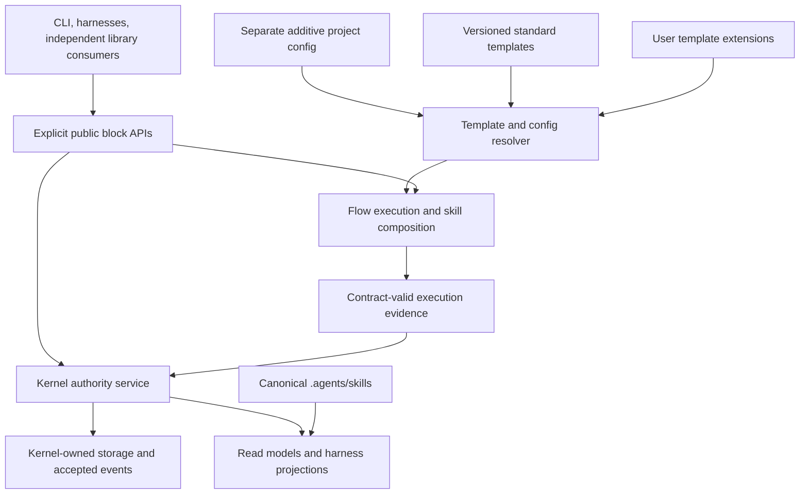

## Bottom line

1. Decisions needed: choose the transformation path and the first stable API surface; the defaults below are evolution in place and a deliberately bounded public surface. [inferred]
2. Contracts, Flow, and Memory have already been folded into the single `forge-workflow` package; separate product-package publication is obsolete work. [read] `package.json:2-13`; [ran] PR #601 is merged.
3. The three folded blocks have real public entries and enforced import boundaries, but the root package has no declared `exports` or `main`, and Kernel has no public index. [read] `lib/contracts/index.js:17`, `lib/flow/index.js:93`, `lib/memory-core/index.js:319`, `package.json:1-191`.
4. Kernel-only issue authority is implemented; the broader public service boundary remains incomplete, and the parked D46 no-importer correction is not implemented on master. [read] `lib/issue-backend.js:6-20`, `lib/forge-issues.js:4-11`, `lib/commands/migrate.js:304-338`.
5. The fixed default graph, adoption scaffolds, sparse config writer, and executable skill runtime are useful foundations; they are not yet a general system of user-extended workflow templates. [read] `lib/core/runtime-graph.js:236-299,645-666,972-984`, `lib/adoption-profiles.js:112-127`.
6. One skill authoring source already exists, but it is `skills/`; the approved `.agents/skills` canonical source with links still needs a distribution migration. [read] `lib/skills-sync.js:40-52,230-256`.
7. The boundary checks passed: 16 tests and 68 assertions with the repository's declared 15-second timeout; this does not certify runtime journeys or the published artifact. [ran] structural test command documented below.
8. The committed package baseline is 4,805,641 unpacked bytes across 454 files; CLI plus the broad `lib` bucket account for about 58%, so the remaining transformation is concentrated outside the three isolated blocks. [read] `scripts/package-size-baseline.json:2-63`; [inferred] ratio.
9. The August restructure has delivered substantial capability slices, but its authority integration, facade, delivery adapters, migration, and release tail remain partial or unverified; a completion percentage would mislead. [read] phase evidence below.
10. Pick evolution in place, using small replacements at command/service seams while keeping one Kernel authority; a broad rewrite would discard functioning contracts and safety logic without solving the missing product commitments. [inferred]

## Evidence basis and limits

**Leg:** L2-architecture. **Final source snapshot:** `origin/master` resolved to `7d448ec812ef8639790477af07c3c75962173f8a`. At initial fetch, the remote and worktree HEAD both resolved to `ba56b9201782c4d1246c77bde6380867603184bf`; the shared remote ref advanced during this leg with worktree-root fix #582. The worktree stayed at the original head. The parked release-plan branch resolved to `2f7fe92ce40195e85ca0e896c52c5d37786b2bd9`. [ran] fetch/ref commands and final `git rev-parse origin/master HEAD`.

[ran] Reviewed the complete old-to-new changed-path inventory, reread the new tracked import graph and refreshed affected source/test counts. The delta changes worktree/clean/detection/dependency-link/evaluation code and tests, plus CHANGELOG; it does not change the three block entries, structural tests, config/template resolver, authority/importer policy or committed package budget. All source citations below apply to the final remote snapshot; **executed tests apply only to the original worktree head**.

GitHub was read through `node bin/forge.js github run -- gh pr view ...`, with `FORGE_SESSION_ID=delivery-train-20260928a`. [ran] [PR #601](https://github.com/harshanandak/forge/pull/601) was merged at `2026-09-29T18:54:30Z`; [PR #564](https://github.com/harshanandak/forge/pull/564) remained OPEN at the parked commit above. Thus #564 is evidence of release direction, not proof of code merged into master.

Every source citation below refers to this remote snapshot unless prefixed **parked**. `[read]` means source/declaration evidence, `[ran]` means a command executed in this leg, and `[inferred]` means an architectural assessment or estimate. Test-file counts are not coverage or passing-test claims. No complete CI matrix, npm tarball installation, live harness journey, migration, or current Kernel issue-state audit was executed here. Committed historical receipts are not rounded up to current live proof.

The target is the owner's **one npm package**, open building-block APIs, a few extendable standard templates, separate additive configuration, and sole Kernel authority. Old decisions and restructure requirements are assessed against that target; missing superseded package splits are not defects. Node 24 minimum is already declared in `package.json:76-78` [read]; the owner's Node 24/26 CI requirement is a constraint, not an execution result in this report.

## A. Actual building blocks, boundaries, size, and maturity

### Public surface and import graph

The package exposes CLI binaries through `package.json:6-10`, but declares neither a root library entry nor package subpath exports anywhere in `package.json:1-191`. The three conventional block indexes therefore provide **source-level public entries**, not an explicit npm API compatibility promise. Kernel and most other modules are consumed through file paths. [read]

| Block | Current entry and useful surface | Dependencies on other `lib` blocks | Maturity evidence and limitation |
| --- | --- | --- | --- |
| Contracts | `lib/contracts/index.js:17-31`: canonical hashes, validation/parsing, semantic identity, schema versions, baseline verification | None | [read] 10 test files under `test/contracts`; 11 v1 schema files, compatibility matrix, baseline and fixtures under `lib/contracts`. `test/contracts/index.test.js:6` checks exports. Strong contract groundwork; consumer API documentation and an npm export promise remain missing. |
| Flow | `lib/flow/index.js:93-114`: executor, monitor/reducer/durability bridge, bounded loop, process lifecycle, skill runtime, efficiency supervisor | Contracts public entry only | [read] 9 test files under `test/flow`; executor and lifecycle failure cases exist. Production integration located outside Flow is PR monitoring, which imports monitor APIs (`lib/pr-monitor/flow-monitor.js:6-15`). Wider execution/skill primitives have not become the default command runtime. |
| Memory core | `lib/memory-core/index.js:319-331`: authority-provider wrapper, backend registry, feedback/usage/PR lifecycle and monitor-store APIs | Contracts public entry only | [read] 6 test files under `test/memory-core`; provider/backend/privacy/lifecycle tests. `createMonitorStore` still requires a monitor-capable SQLite driver (`index.js:265-268`), so the public seam is partly storage-shaped. |
| Kernel | No `index.js`; practical entries include `broker.js`, `sqlite-driver.js`, `cli-broker-factory.js`, `owned-kernel.js` | Memory core, workflow, adapters, root utilities | [read] 56 test files under `test/kernel`, plus broader command/e2e consumers; documented in `docs/reference/forge-kernel-schema.md` and the authority/storage plans. Sole issue authority is real. Stable client/lifecycle API and a whole-block import rule are not yet established. |
| PR monitor / Shepherd | No public index; `monitor.js`, `reconcile.js`, `reconcile-executor.js`, `flow-monitor.js`, watcher and verdict modules | Contracts, Flow, Memory core, Kernel, commands, root utilities | [read] 34 test files under `test/pr-monitor`; `docs/reference/shepherd.md`. Substantial working integration, but imports back into `commands/ship.js` prevent treating the whole directory as an independent API block. |
| Config / runtime graph | File-level exports from `lib/core/runtime-graph.js:1026-1050`, `lib/config-writer.js`, `lib/adoption-profiles.js` | Runtime graph itself has no other `lib` dependency; YAML dependency | [read] `test/runtime-graph-config.test.js`; `docs/reference/TEMPLATES.md`. Primitive constructors, validation, introspection and sparse writes exist. Resolver always clones one fixed default graph and only modifies known IDs. |
| Workflow / stage authority | `lib/workflow/{stages,state,state-manager,stage-transition,enforce-stage,plan-authority}.js`; no index | Kernel, commands, root utilities | [read] 9 test files under `test/workflow`; six-stage template and embedded pre-merge gate. Commands remain involved in enforcement/integration; do not expose all these files as stable APIs by default. |
| Memory integration | `lib/memory/{router,typed-api,graphiti-mcp,hygiene,usage-evidence}.js`; no index | Memory core, project-memory/root utilities | [read] 5 test files under `test/memory`; `docs/guides/memory-backends.md`. Kernel-backed local floor, typed metadata and optional enrichment exist; router state/config/environment semantics differ from the generic core registry. |
| CLI composition | `bin/forge.js`, `_manifest.js`, `_registry.js`, `_aliases.js`, `_issue.js`, and command handlers | Most capability/service blocks | [read] 103 test files under `test/commands`, plus structural/e2e tests; `docs/reference/COMMANDS.md`. This is an integration layer with substantial business logic, not yet a thin facade. |
| Other reusable file modules | Examples: `merge-rules.js`, `package-budget.js`, `validation-receipt.js`, hook/rule/skill renderers, protected-state authority, GitHub routing | Varies; broad root-utility cohort depends on Kernel, commands, workflow, memory and PR monitor | [read] Many separately exported helpers already exist; `package-budget.js:3-10` explicitly defines pure supplied-input logic. Reuse these before introducing a new service framework. Their exportability must be assessed individually. |

**Import-graph method.** [ran] Read tracked blobs from the final remote snapshot with `git ls-tree -r -l` and `git cat-file --batch`; parse JavaScript with the installed `@babel/parser`; resolve literal CommonJS, ESM import/export, and literal dynamic-import paths. The refreshed scan found **286 tracked JavaScript files in `lib/`**, **1,258 static module-specifier occurrences across `lib`, `bin`, and `scripts`** (including builtins/external imports and repeated occurrences), and four computed module calls. Computed calls occur in `lib/adapter-cli.js:157`, `lib/commands/_registry.js:194`, `lib/migrate-dry-run.js:314`, and `scripts/gen-command-manifest.js:70`. Those calls were not resolved into graph edges. This is a static graph, not runtime activation or import-time failure proof.

The exhaustive directory/cohort inventory is below. **Files/bytes** are tracked source blobs, not npm measurements. An arrow means a static dependency on another cohort; `root` denotes file modules directly under `lib/`. Empty dependencies mean no cross-cohort `lib` import found by the method above, not no builtin/dependency use. [ran]

| Cohort | Tracked files / bytes | Cross-cohort dependencies | Entry / disposition |
| --- | ---: | --- | --- |
| `activation` | 1 / 6,106 | root | `ensure-forge-home.js`; CLI activation helper |
| `adapters` | 4 / 83,641 | root | File-level issue/review/PR adapters; includes legacy Beads codec/import mapping |
| `agents` | 5 / 10,014 | Data, no JS edges | Four harness plugin descriptors plus README; render/input assets |
| `capabilities` | 3 / 17,621 | None | Has index; version-bound probes; **excluded from npm** by `package.json:100` |
| `commands` | 68 / 952,098 | activation, adapters, contracts, core, doc-gate, grounding, kernel, memory, memory-core, pr-monitor, preflight, root, status, workflow | Manifest/registry + handlers; composition layer |
| `contracts` | 40 / 98,007 | None | 7 JS files plus schemas/fixtures; protected public index |
| `core` | 1 / 37,392 | None | Runtime-graph constructors/resolver; file-level API |
| `dep-guard` | 8 / 41,823 | None | File modules; uses Babel parser; owner decided to deprecate |
| `doc-gate` | 5 / 62,059 | None | File modules; 5 matching-directory test files |
| `fixtures` | 10 / 7,374 | Data, no JS edges | Beta.5 corpus; excluded from npm by `package.json:99` |
| `flow` | 9 / 103,940 | contracts | Protected public index |
| `grounding` | 2 / 13,880 | core, kernel, root | Read-first/context-event integration; 3 matching-directory test files |
| `issue-sync` | 8 / 37,889 | None | Projection planning/codecs; 7 matching-directory test files; legacy link bridge excluded from npm |
| `kernel` | 22 / 571,785 | adapters, memory-core, root, workflow | No block index; authoritative implementation |
| `memory` | 5 / 32,556 | memory-core, root | Router/typed integration; no index |
| `memory-core` | 6 / 89,012 | contracts | Protected public index |
| `pr-monitor` | 19 / 336,797 | commands, contracts, flow, kernel, memory-core, root | No index; 2 source files excluded from npm (`package.json:93-94`) |
| `preflight` | 2 / 14,145 | commands, root | Gate composition; 2 matching-directory test files |
| Root file modules | 103 / 1,342,683 | adapters, commands, core, issue-sync, kernel, memory, memory-core, pr-monitor, status, text, workflow | Multiple concerns; not a single coherent building block; includes new `modules-link.js` |
| `smart-status` | 2 / 9,521 | None | Scoring/session helpers; 2 matching-directory test files |
| `status` | 3 / 14,960 | root, workflow | Identity/snapshot/presenter; 3 matching-directory test files |
| `text` | 1 / 1,140 | None | Levenshtein helper; 1 matching-directory test file |
| `validation` | 1 / 15,266 | kernel | Risk manifest; 2 matching-directory test files; excluded from npm |
| `workflow` | 6 / 60,138 | commands, kernel, root | Stage/configuration enforcement; no index |
| `workflow-templates` | 1 / 47,661 | Data, no JS edges | CI test-workflow YAML, **not a user workflow-template engine**; excluded from npm |

The one-package boundary test protects only Contracts, Flow, and Memory core. It allows `memory-core → contracts` and `flow → contracts`, rejects cross-block private imports, checks consumers in `lib/bin/scripts`, and tests computed-specifier rejection inside the blocks. It does not make Kernel, the facade, config, or all other modules conform to equivalent boundaries. [read] `test/structural/product-package-boundaries.test.js:8-23,131-184`.

Six multi-file strongly connected components were found in the `lib/bin` static graph [ran]:

| Cycle | Representative source edges | Architectural implication [inferred] |
| --- | --- | --- |
| Prime / status / orientation | `commands/prime.js:7 → orientation.js`; `orientation.js:1040 → commands/status.js`; `commands/status.js:766 → commands/prime.js` | Extract or reuse a shared read service; presenters should not depend on command handlers. |
| Protected workflow generators | `protected-state-authority.js:24 → bun-workflow-pins.js`; `bun-workflow-pins.js:564 → protected-state-authority.js`; npm/test/size generators also participate | Separate pure rendering/input inspection from authorized writes; preserve the owning authority and exact-head checks. |
| Flow monitor / legacy monitor | `pr-monitor/flow-monitor.js:17 → monitor.js`; `monitor.js:142 → flow-monitor.js` | Finish the integration seam before declaring a standalone monitor API. |
| Ship / reconcile executor | `commands/ship.js:15 → pr-monitor/reconcile-executor.js`; reverse edge at `reconcile-executor.js:1247` | Shared shipping orchestration belongs below both clients, with injectable provider effects. |
| Init / setup | `commands/setup.js:91 → init.js`; `commands/init.js:564 → setup.js` | Make scaffold/render/config services reusable below CLI handlers. |
| Registry / generated manifest / serve / skill evaluation | `_registry.js:26 → _manifest.js`; `_manifest.js:384 → serve.js`; `serve.js:189 → _registry.js`; `skill-eval.js:444 → _registry.js` | Some edges are lazy generated loaders. Retiring serve removes part of the cycle; avoid treating this as proof of an import-time crash. |

### Published-size budget

`scripts/package-budgets.json:8-21` declares 13 named budget blocks; the mapper adds reserved `other`. Longest prefix wins (`lib/package-budget.js:151-186`). These are **artifact accounting buckets**, not an architectural dependency decomposition. The broad `lib` bucket combines many unrelated modules; `templates` currently means rules/harness/hook assets. [read]

| Budget block | Committed unpacked bytes | Files | Baseline source |
| --- | ---: | ---: | --- |
| CLI | 1,127,119 | 73 | `scripts/package-size-baseline.json:8-10` |
| Kernel | 571,785 | 22 | `:24-26` |
| PR monitor | 311,295 | 17 | `:48-50` |
| Contracts | 98,007 | 40 | `:12-14` |
| Flow | 103,940 | 9 | `:20-22` |
| Memory core | 89,012 | 6 | `:32-34` |
| Broad `lib` bucket | 1,660,497 | 144 | `:28-30` |
| Skills | 300,172 | 80 | `:56-58` |
| Templates/assets | 61,020 | 11 | `:60-62` |
| Scripts | 371,634 | 42 | `:52-54` |
| Docs | 86,059 | 7 | `:16-18` |
| Metadata | 25,101 | 3 | `:36-38` |
| Nested dependencies | 0 | 0 | `:40-42` |
| Other | 0 | 0 | `:44-46` |
| **Total** | **4,805,641** | **454** | `:2-5` |

All numbers in this table are **[read] committed baseline values**, not a fresh pack measurement. Committed tarball size is 1,320,089 bytes (`:3`). The policy permits bounded growth and sets a 10,485,760-byte unpacked ceiling (`scripts/package-budgets.json:3-6`). No baseline was rewritten and no npm cache/tarball was created in this read-only leg.

### Verification actually executed

```text
Node v24.18.0; Bun 1.4.2
bun test --timeout 15000 test/structural/product-package-boundaries.test.js test/structural/pr2-root-integration.test.js
16 pass; 0 fail; 68 expect() calls; 2 files; 7.75 seconds
```

[ran] Both invocations ran on worktree head `ba56b9201782c4d1246c77bde6380867603184bf`. The first omitted `--timeout 15000` and hit Bun's default 5-second limit in the full consumer scan: 15 pass, 1 timeout, scan elapsed 9,768.94 ms. The second used the already-declared repository timeout (`package.json:15-18`), without changing tests, code, or gates. It establishes these two structural checks at that head only. The final remote delta leaves the test sources and protected block entries unchanged, but no executed-pass claim is made for the newer head. The package-root test also verifies no manifests/dependencies/bundling remain for the three folded blocks (`test/structural/pr2-root-integration.test.js:13-40`) [read].

## B. Decision ledger: D1–D45 and parked D46

**Status convention.** Implemented means the surviving source-level requirement exists; partial means some clauses exist; contradicted means current code/CLI intentionally or otherwise differs from an active old statement; stale/superseded means later decisions or owner direction displaced the premise; unknown means this audit cannot establish a current disposition. These are architectural assessments **[inferred] from the [read] evidence in each row**, not 46 executed acceptance tests. Decision descriptions come from `docs/work/2026-04-28-skeleton-pivot/locked-decisions.md`; the exact implementation citations follow.

| Decision and original commitment | Assessment | Current evidence / reconciliation |
| --- | --- | --- |
| D1 — curated pinned marketplace, compatibility ranges, collision-qualified names | Not implemented as specified; historical scope | [read] `.claude-plugin/marketplace.json:2-13` is a relative-source Forge self-marketplace. Searches for `forge-marketplace`, collision handling and SHA-bump implementation found no non-doc implementation. Do not make an external marketplace a prerequisite for the one-package target. |
| D2 — one patch index; extract bodies over 40 lines into included files | Partial | [read] `lib/patch-intent.js:9-18,536-615` implements an anchored project patch ledger. Source searches for the 40-line threshold, `.forge/patches` and `@include` did not locate the decided extraction mechanism. |
| D3 — refusing gates, L2 leniency, five immutable L1 rails, audited force-skip | Contradicted in part | [read] `lib/core/runtime-graph.js:519-523` unlocks TDD while locking the other four original rails; `:658-666` rejects disabling locked primitives. No source/test `lenient` or `force-skip` mechanism was located. Current toggles are a different model; preserve current security floors and document the revised policy. |
| D4 — regenerate AGENTS from effective layers and patches; reject hand edits | Partial | [read] `lib/agents-config.js:13-30` generates instructions; `lib/protected-state-surfaces.js:142` protects AGENTS. Setup preserves/merges user content (`lib/commands/setup.js:1795-1803,2524-2550,3678-3721`). Full rendering from effective config plus patch fragments is not established. |
| D5 — project patches plus personal overlays that cannot weaken L1 | Not implemented as specified | [read] Config uses `.forge/config.yaml` (`lib/core/runtime-graph.js:8`); patch intent uses `.forge/patch.md` (`lib/patch-intent.js:9`). Searches across lib/bin/.forge found no personal profile patch directory or four-layer resolver. Decide whether personal overlays are future scope; additive project config does not require them. |
| D6 — apply v2→v3 migration, repin extensions, temporary legacy commands | Partial; old transition stale | [read] `lib/migrate-dry-run.js:234-270` previews matrix/config conversion. `lib/commands/migrate.js:341-346` refuses application. Do not confuse this with the Beads importer or complete beta.5 rollback. |
| D7 — snapshot every upgrade, restore/rollback, 30-day unpinned retention | Not implemented as specified | [read] `_manifest.js:476-480` says self-heal does not snapshot/restore; `lib/upgrade-safety.js:241` excludes full restore. `bin/forge.js:4093-4458` has a different Git rollback path. Preserve the need for reversible release journeys, not necessarily this exact snapshot product. |
| D8 — options list/get/set/why with full L1→L4 explanation | Partial | [read] `lib/commands/options.js:145-150,192-228` provides stages/gates/adapters/roles/diff/why/lint. Explanation exists for package defaults plus project config, not the decided four-layer API. |
| D9 — CodeRabbit, blank review, generic JSON gate templates | Partial; historical template list | [read] `lib/adapter-cli.js:111-128` scaffolds review adapters with a Greptile-shaped template; searches for the named adapter templates found no implementation. These adapter examples are distinct from user workflow templates. |
| D10 — 228-issue migration dry-run is the Wave-0 no-go gate | Historical gate; current proof unknown | [read] PoC/fixture runners exist (`lib/migrate-dry-run.js:323-351,437-465`; `test/migrate-dry-run.test.js:138-182`). No 228-issue acceptance artifact was located. Original sequencing is stale under the Kernel and new release direction. |
| D11 — maintain six harness translators | Explicitly superseded | [read] Ledger `:135-145` supersedes D11 with D15. Current harness matrix lists four (`lib/harness-capability-matrix.js:5,88-91`). |
| D12 — canonical SKILL.md translated to native harness surfaces | Implemented foundation; target distribution incomplete | [read] `lib/skills-sync.js:8-14,40-52` generates mirrors from `skills/`. The approved source-location/link migration to `.agents/skills` remains; full standard conformance was not certified. |
| D13 — drop Pi, Hermes, Aider, Copilot, Roo and legacy Cursor | Stale in part | [read] Hermes is now a fourth declared harness (`lib/harness-capability-matrix.js:5,90-91`); legacy `.cursorrules` remains retired (`lib/commands/setup.js:1853-1861`). Do not present the old drop list as current support policy. |
| D14 — fold translation into N7/N10 without schedule changes | Stale planning allocation | [read] Current translator logic lives in `lib/skills-sync.js` and `lib/rules-sync.js:4-23`. Historical workstream numbering is not a product invariant. |
| D15 — exactly Claude/Cursor/Codex for MVP; Hermes dropped | Historical baseline, now stale | [read] Default adoption targets remain three (`lib/adoption-profiles.js:78,94`), while supported matrix has four (`lib/harness-capability-matrix.js:5`). Default selection and total supported set are different facts. |
| D16 — default-on stage gates, project required-stage locks, immutable TDD | Partial; TDD clause contradicted | [read] Profiles and resolver enable/toggle workflow gates (`lib/adoption-profiles.js:5-6,76,92`; `runtime-graph.js:708-716`). TDD is explicitly unlocked (`:519`); no equivalent project `required: true` lock surface was located. |
| D17 — append-only capture of every cross-harness agent action | Partial; original storage superseded | [read] `lib/audit-evidence.js:12,140-181` writes capped Forge audit evidence; dev emits a subagent event (`lib/commands/dev.js:606`). This does not prove every tool/test/git/hook/MCP action is captured. |
| D18 — Insights promotes recurring patterns into accepted local skills | Partial; retire under owner pruning | [read] `lib/insights.js:257-313,332-346,381-389` mines candidates and records accepted decisions in typed memory. It does not emit accepted SKILL.md artifacts. Do not finish this product now: retirement is already decided. |
| D19 — seven protected-path categories across native hooks/Git/CI | Substantially implemented; stale Beads policy | [read] `.forge/protected-paths.yaml:65-157`, `lib/protected-path-manifest.js:8-34`, `lib/hook-renderer.js:328-442`, `lefthook.yml:33`. `beads_state` still names `bd-cli-only` (`manifest:144-149`); preserve protection of existing data while correcting the owner policy. Full cross-harness live proof was not run here. |
| D20 — proposal → explicit skill accept; user-owned extensions preserved | Not implemented as specified; historical product scope | [read] `_manifest.js:414-419` exposes routing/evaluation/scores/coverage, not accept/regenerate. Insights acceptance writes typed memory (`lib/insights.js:381-389`). Searches for proposals, `skill accept`, regenerate and acceptance-aware upgrade paths found no implementation. |
| D21 — Forge-owned issue adapter instead of backend leakage | Implemented surviving boundary; Beads clause superseded | [read] `lib/issue-adapter.js:28-65`, `lib/adapters/kernel-issue-adapter.js:9-32,43-59`, `lib/issue-backend.js:6-20`. Sole production backend is Kernel. |
| D22 — thin typed memory with category/provenance; no new vector authority | Partial; storage premise revised | [read] `lib/memory/typed-api.js:3-11,19-25,37-39,50-101` implements typed writes/read/search through project memory. It differs from the original remember/recall/forget/compact quartet; `beadsRefs` persists at `:69`. |
| D23 — collapse audits into `bd audit record` | Superseded by Kernel/Beads retirement | [read] Current audit writer is Forge-owned (`lib/audit-evidence.js:12,140-145`), and Beads is a removed backend (`lib/issue-backend.js:6-20`). Do not restore this dependency. |
| D24 — FTS5 first; no mandatory vectors | Implemented core; revised representation | [read] `lib/kernel/migrations.js:258-275` creates FTS5. `lib/memory/router.js:6-24,37-40` keeps local Kernel storage as the floor, with experimental Graphiti enrichment. This is structured Kernel memory, not the original markdown-only representation. |
| D25 — consolidate audit streams into hash-chained `.forge/log.jsonl` | Partial | [read] `lib/audit-evidence.js:5-13,140-170` implements capped/redacted JSONL but no hash chain in that writer. Legacy audit paths remain recognized (`lib/protected-state-surfaces.js:84-87`; `lib/insights.js:257`). Operational logs must not become a competing authority store. |
| D26 — `forge new <template>` as day-one onboarding | Replaced by init; command commitment stale | [read] `docs/reference/TEMPLATES.md:7-19,104-106` specifies init and excludes new onboarding. `lib/commands/new.js:5-10` scaffolds adapters. Adoption-template intent survives. |
| D27 — collapse validate into dev | Contradicted by current template | [read] `lib/workflow/stages.js:12-19,39-48` retains validate as a separate stage. This is a template choice, not a reason to delete the validation capability. |
| D28 — premerge is a continuous PR-state hook, not a stage | Non-stage half implemented; hook model partial | [read] `lib/workflow/stages.js:51-60` embeds a pre-merge gate in ship/review. Current mechanism is a checkpoint in those skills, not the proposed universal transition hook. |
| D29 — five-stage workflow plus merge hook | Stale stage count | [read] `lib/workflow/stages.js:12-19` defines six stages; the graph/config surface separately models a four-phase command flow (`runtime-graph.js:251-287`). Reconcile these as named compositions, not one universal mandatory ladder. |
| D30 — embedded Beads/Dolt mode | Explicitly superseded | [read] D44 supersession at ledger `:567-575`; `lib/issue-backend.js:6-20,111-141` accepts Kernel only. |
| D31 — expand live Beads capability use | Explicitly superseded | [read] Ledger `:389-399` marks superseded by D44; `lib/forge-issues.js:104-123` defaults to KernelIssueAdapter. |
| D32 — hardened sandbox deferred to v3.2 | Historical deferral; current disposition unknown | [read] Ledger `:403-411`. Search for hardened/sandboxed-agent support found historical planning, not proof of a current release commitment or implementation. Do not revive it as an implied 0.1.0 prerequisite. |
| D33 — merge only a continuous hook, not a stage | Non-stage half implemented; CLI model revised | [read] `lib/commands/merge.js:4-31` provides explicit opt-in guarded `forge merge --auto`, with exact-head/live recheck seams. Merge remains outside the stage graph. This matches the owner's current merge direction. |
| D34 — optional plan / external planner input | Partial; useful intent preserved | [read] `skills/plan/SKILL.md:28-38,499-501` accepts external structured plans/criteria. Exact `planner: external` config is absent; planning options use `planning.template` (`docs/reference/TEMPLATES.md:49-84`). |
| D35 — description-driven automatic skill discovery | Partial / harness-dependent | [read] Skills contain descriptions; `lib/using-forge.js:180-209` routes deterministically with curated keywords rather than description scoring. `docs/reference/AGENT_SKILL_PARITY.md:48-52,158` distinguishes fixtures from live auto-invocation proof. |
| D36 — one backend per concern | Sole issue authority implemented; memory policy revised | [read] `lib/issue-backend.js:6-20` has one backend. Memory supports selected optional enrichment while always writing the local floor (`lib/memory/router.js:374-411`). D44 supersedes the Beads-specific premise; enrichment must not acquire issue/workflow authority. |
| D37 — eight-week W0–W5 delivery schedule | Explicitly superseded | [read] Ledger `:463-467` supersedes it with D39; current package is beta.8 (`package.json:2-4`). Historical schedule is not an effort estimate for this plan. |
| D38 — old W0–W5 kill criteria | Stale release criteria | [read] Ledger `:477-500` ties them to the old Beads/harness/launch sequence. Current release check targets 0.1.0 (`lib/commands/release.js:22-26`). Preserve evidence-based stop criteria, not these obsolete inputs. |
| D39 — v3.0/v3.1/v3.2/v3.3 release train | Stale naming/topology | [read] Ledger `:491-506`; `package.json:2-13` and `CHANGELOG.md:20-22` establish the beta.8 one-package direction. Old `v3.0-mvp` labels remain in the harness matrix (`:219-224`). |
| D40 — hybrid v3 semver lanes and universal schema envelope | Stale / only partly reflected | [read] Ledger `:514-527`; package uses beta semver (`package.json:3`) and artifacts have their own versions, e.g. runtime graph `0.0.17` (`runtime-graph.js:7`). Contract compatibility should be frozen deliberately, not by adopting the old universal envelope blindly. |
| D41 — reserve naming decision | Unresolved | [read] Ledger `:531-533` locks no new name. `forge-workflow` in package metadata proves current identity, not final branding approval. |
| D42 — alpha → Show HN → Product Hunt sequence | Historical / current disposition unverified | [read] Ledger `:537-551` uses D39's old cadence; `docs/reference/RELEASE.md:5-7` describes beta.8. This audit does not establish a current launch plan. |
| D43 — super-skills with callable sub-skills | Implemented composition foundation | [read] `lib/core/runtime-graph.js:114-205` and `skills/plan/SKILL.md:18-38` expose planning/Smith composition. `test/runtime-graph-config.test.js:232-313` and `test/skills/chain-integrity.test.js:257-395` cover source behavior. General user template extension is still a separate gap. |
| D44 — Kernel sole issue/workflow/run authority; local broker, optional team service | Authority cutover implemented; broader architecture partial | [read] `lib/issue-backend.js:6-20,111-141`, `lib/forge-issues.js:104-123`, `lib/adapters/kernel-issue-adapter.js:43-59`. The ledger retains the Kernel reset but revises Beads projection/export with D45 (`:567-575`). A stable public Kernel API and the optional team authority are not proved by backend selection alone. |
| D45 — no live Beads backend, CLI/runtime integration or projection target; retain inbound importer | Runtime retirement substantially implemented; cleanup/docs partial | [read] Kernel-only backend plus importer (`lib/commands/migrate.js:304-338`) matches the retained exception. Native export is `.forge/kernel` (`lib/kernel/projection-jsonl-writer.js:20-22`), but shared codec imports and default outbox label `beads` remain (`:6`; `lib/kernel/broker.js:1034`). Current docs still advertise runtime/selectable Beads (`docs/reference/COMMANDS.md:82-107`, `TOOLCHAIN.md:40-100`). These residues do not establish a live Beads authority. |
| D46 — 0.1.0 ships no Beads integration, including importer | Parked release correction; not implemented on master | [read] **parked** `docs/work/2026-09-14-forge-0.1.0-release-plan/decisions.md:5` calls it accepted/locked D46 and names removal issue `(56a99d9b-a5d2-4c10-bc8d-6cb436006075)`. [ran] #564 is still open. Master still ships importer, mapper and migration hints (`lib/commands/migrate.js:12-15,304-338`; `lib/issue-backend.js:19-20`). Apply the proposed release correction explicitly; do not claim it is already merged or that historical/imported user data should be deleted. |

**Reconciliation rule.** [inferred] Retain Kernel authority, contract validation, protected state, reusable skills and local memory. Rewrite the decision registry around the current template/config/support model. Retire historical Beads authority and the already-pruned Insights product. Mark old schedules, package splits and exact command shapes superseded instead of implementing them merely to make a 46-row checklist green. New proposals such as personal overlays, marketplace curation and automatic skill promotion need their own justified scope.

## C. What the August product restructure plans, and what exists

The plan proposes Memory as the durable authority product, optional Flow as execution, a stateless Forge facade, shared contracts, independent package evolution, a generic monitor/delivery lifecycle, reversible beta.5 migration, and exact-candidate release proof. It organizes this into seven milestones/eight PR slices: control plane → contracts → Memory → Flow core → PR integration → facade/harnesses → migration → convergence. [read] `docs/work/2026-08-09-forge-product-restructure/plan.md:131-184,325-423,613-709`; `tasks.md:8-13`.

The **capability separation** is useful; the **separate packages and versions** are superseded. The new target makes Kernel an explicit authoritative block within the one package. It does not require wrapping every Kernel API in a separately named Memory product, restoring independent publication, or creating `forge flow` merely because the old topology proposed it. [inferred]

| Planned slice | Actual completion at the audited head | Evidence and remaining requirement |
| --- | --- | --- |
| Admission checkpoint | Historical artifact present; live issue state unknown | [read] `admission-evidence.v1.json:4-8,20-24,37-46` records an August plan snapshot with 48 expected/observed/admitted and aggregate PASS. No current Kernel re-read was performed; these are not 48 currently verified completions. |
| Control-plane trust / fast validation | Substantial implementation; terminal acceptance unverified | [read] `lib/validation/risk-manifest.js:66-110,149-187,263-331` validates and selects risk-owned lanes/fallbacks; `lib/beta5-compatibility-evidence.js:1048-1092` provides corpus/inventory/verified backup/dry-run functions; `.github/workflows/npm-publish.yml:121-166` selects prerelease tags/provenance. Full train/CI acceptance was not run here. |
| Contracts / boundaries | Implemented in the superseding one-package form | [read] `lib/contracts/index.js:3-31`, schemas/fixtures, both structural tests. [ran] Those structural tests pass. Separate `@forge/*` manifests, publish lanes and physical extraction are obsolete acceptance requirements. Stable root export paths remain. |
| Memory foundation | Partial | [read] Public authority/backend/feedback/monitor APIs exist (`lib/memory-core/src/authority-provider.js:3-18,37-59`; `backend-registry.js:85-171`; `feedback-intake.js:66-156,167-215`; `index.js:265-331`). CLI and PR integration still import Kernel files directly (`commands/doctor.js:11-12`; `commands/merge.js:329-330,584-593`; `commands/shepherd.js:314-322`). Under the new target, establish a Kernel public service seam instead of another authority owner. |
| Flow core / skills / observers / efficiency | Substantial primitives; partial integration and policy | [read] `lib/flow/index.js:93-114`, `src/executor.js:217-276`, `src/monitor-durability.js:300-416`, `src/efficiency-supervisor.js:3-87`. The broader supervisor policies at plan `:495-513` are not implemented by this small supervisor. Receipt producer version is hard-coded beta.6 (`flow/index.js:57-59`) while package is beta.8. Decide identity/version semantics before API freeze; do not mass-rename wire schemas after the package fold. |
| Shepherd / review / merge | Substantial vertical integration; full handoff incomplete | [read] Shared monitor APIs (`pr-monitor/flow-monitor.js:6-15,1241-1264`), durable Shepherd store (`commands/shepherd.js:312-340`), merge lifecycle receipt (`commands/merge.js:580-609`). Search across PR monitor/Shepherd/merge/Memory core located no next-prioritized-packet post-merge request. Preserve current proven merge/review behavior while finishing seams. |
| Facade / harness / capability negotiation | Partial | [read] Version-bound probes exist (`lib/capabilities/probes.js:18-81,245-332`); issue/memory aliases exist (`commands/_aliases.js:40-85`; `_manifest.js:232-237`). Manifest inventory and tree search found no Flow or capabilities CLI command. Required product-absence diagnostic strings were not found in lib/bin/test. Doctor is two checks (`commands/doctor.js:99-139,168-186`), not the proposed manifest-driven scoped Health API. Probe code is excluded from npm. Complete T0–T4 implementation/certification was not located. |
| Migration / shadow / cutover / extraction | Early safety scaffolding; full journey unproved | [read] Inventory, backup/restore and non-mutating dry-run functions exist (`beta5-compatibility-evidence.js:1048-1092`); v2→v3 apply is explicitly unavailable (`_manifest.js:247-252`). Searches found no product identical-packet shadow comparison/cutover implementation, or exact `forge.release-bom`/`verify-bom`/DSSE/Sigstore implementation. Independent multi-package publishing/sparse-export clauses are superseded. Keep Kernel-native preservation and one-artifact upgrade/rollback acceptance. |
| Release convergence / exact candidate | Not established as complete | [read] Root version remains beta.8 (`package.json:3`). This leg did not obtain accepted RC matrix, observation-window, canary, current issue-disposition or stable-promotion receipts. Lack of such proof here is not proof no other branch/artifact exists. Completion requires current exact-artifact evidence, not plan status or a version label. |

Two documents demonstrably lag code: `tasks.md:101-103` still says admission is complete and PR1 is next, while Contracts/Flow/monitor slices exist; `decisions.md:23-35` leaves monitor persistence pending, while the public store and durability bridge exist. [read] The Node 22/24 matrix and multi-package BOM/publication topology also lag the owner constraints. Reconcile these once in the final plan rather than executing the old task list unchanged. [inferred]

**Completion accounting:** report implemented slices, partially integrated slices, unverified release journeys, and superseded requirements separately. There is no defensible single percentage: the implemented contract foundation and the missing release proof have different weights, and the original denominator contains abandoned package work. [inferred]

## D. Transformations still needed

Estimates below are **[inferred] scope classes**, not calendar promises: **S** = bounded helper/manifest change; **M** = one service or distribution slice with consumer checks; **L** = several coupled runtime/consumer slices; **XL** = broad rewrite or cross-platform authority migration. Risk includes compatibility, authority leakage and artifact delivery. The exact release matrix remains the owner's CI-first matrix; local source/unit proof cannot replace it.

### Intended data flow



[inferred] All nodes ship within the one Forge package except user extensions/consumers and optional external execution/enrichment providers. Contracts govern interoperability; Kernel alone accepts authoritative transitions. CLI/harness renderers are clients. Templates choose a composition; config supplies overrides/provider selections. A stateless facade may initialize owned services and render files through their APIs; it must not create shadow issue/run/gate authority.

| Transformation | Smallest credible work, reusing existing code | Effort / risk | Prerequisites and completion evidence |
| --- | --- | --- | --- |
| **Stable public APIs** | Declare supported package subpaths for Contracts, Flow, Memory capabilities and a narrow Kernel service; document arguments/results/errors, sync/async behavior, lifecycle, mutation ownership and compatibility. Use existing indexes/validators. Assess pure file modules such as merge rules/budget logic individually; do not export every internal file. | **M** for the three isolated blocks; **L** including Kernel/client cleanup. **Medium–high** compatibility risk. | Freeze capability/receipt baseline and define Kernel entry first. Search downstream deep imports before sealing private paths. Add an independent consumer example/conformance check against the real packed artifact for each promised API. Confirm receipt producer identity/version semantics rather than mechanically renaming existing schema IDs. |
| **Standard extendable templates** | Move the default workflow composition into a versioned template description; keep a few named standard templates and one simple local extension mechanism. Reuse primitive constructors, subskill registry and `SkillRuntime`; keep adoption levels minimal/standard/full separate from workflow choice. | **L**, **high** semantic/gate risk. | Public primitive/executor boundary, explicit authority floor, resolver contract. Validate template IDs, references, cycles, missing capabilities and locked guards. Prove a user can extend a standard template without editing Forge source, and that a minimal independent consumer can execute the resolved composition. No marketplace, general plugin dependency solver or network template loader is required. |
| **Separate additive config** | Make one resolver produce the effective immutable runtime config and an explanation of origins. Preserve sparse project overrides; move legacy readers toward this output. Define map/ID merge semantics and explicit list replacement/extension. Template content remains separately owned; config selects/binds and overrides it. | **M–L**, **medium–high** behavior risk. | Template schema and supported setting inventory. Today graph resolution fails malformed config (`runtime-graph.js:562-599`) while issue-backend config treats it as absent (`issue-backend.js:53-60`); reconcile outcomes. Inventory `.forge/adapters.json` (`adapter-cli.js:252`) and environment precedence before migration. Library callers should inject resolved config; process environment and filesystem discovery belong at integration edges. Prove legacy values, unknown keys, reset-to-default and malformed overrides behave consistently. |
| **One canonical skill source** | Make `.agents/skills` the authoring/distribution source; update installer, package file list, hooks, drift checks and references together. Link harness locations to it when appropriate, using existing symlink utilities; render only required native metadata/wrappers. Delete packages/skills after the mandated behavior/overlap check. | **M**, **medium** Windows/packaging/user-content risk. | Enumerate source/mirror/assets and accepted user extensions; retain an explicit owner for generated content. [ran] `skills/` has 80 tracked files/25 entries; `.agents/skills` has 79/25; corresponding mirror blobs match; neither contains tracked symlinks. `packages/skills` has 43 files/8 entries and a separate dependency set (`package.json:25-34`). Test fresh clone, installed tarball, link support and upgrade preservation. Do not assume an npm tarball preserves links or contains hidden canonical files without checking it. |
| **Harness projections and capability delivery** | Keep shared skill/rule/instruction bodies canonical; use current plugin descriptors and renderers for native differences. Resolve supported capabilities from installed-version evidence, with honest degradation. Align fixed harness lists/defaults and package the capability code required by supported APIs. | **L** for supported delivery plus certification, **high** integration risk; source-render refactor alone **M**. | Stable API/config/template and canonical-source migration. Current matrix has four harnesses while runtime graph/default adoption lists three (`harness-capability-matrix.js:5`; `runtime-graph.js:543`; `adoption-profiles.js:78`). Codex MCP is explicitly not delivered (`harness-capability-matrix.js:133`). Require T0–T4 behavior where promised and actual artifact/harness evidence; metadata fixtures explicitly disclaim live auto-invocation (`AGENT_SKILL_PARITY.md:158`). This is no authorization to invoke Claude or browsers in this leg. |
| **Stateless facade** | Make CLI handlers parse/validate/present and call owning services. First remove command-to-command cycles in init/setup, ship/reconcile and status/orientation; reuse current alias routing. Put protected writes, receipts and authority checks in their existing owning service below the facade. Preserve standalone CLI verbs and remove duplicate `forge pr <verb>` forms as already directed. | **L**, **high** regression/authority risk. | Public Kernel/Flow/config services and exact-head regression cases. Keep one Kernel database, lease epoch and issue/run acceptance path throughout cutover. Verify JSON/exit behavior, readonly commands, current-head merge/refusal and provider errors through both CLI and library consumers. Do not rebuild obsolete separate-product noun commands solely to match the August routing ledger. |
| **D46 cleanup and native preservation** | Remove shipped Beads importer/config hints/advertising if the release correction is adopted. First disentangle the shared JSONL codec used by native Kernel snapshots; keep native backup/export/import and preserve existing user data/history. | **M**, **medium** preservation risk. | Explicit D46 release disposition; overlap search. `projection-jsonl-writer.js:6` imports Beads compatibility only for codecs; deletion without replacing that dependency breaks native export. The outbox label at `broker.js:1034` and protected data policies also need reconciliation. Prove clean install without Beads and Kernel-native restore; avoid a replacement live backend. |
| **Owner-approved pruning and artifact closure** | Retire serve/dashboard and Insights, deprecate dep-guard/team shell suite, remove redundant PR forms and packages/skills after overlap checks, then reconcile manifest/docs/budgets. Separate source API conformance from shipped artifact proof. | **M** pruning; **L** including release journeys. **Medium** hidden-reference risk. | Wide caller/asset/package/hook/CI search before deletion. Current package excludes probes, validation and fixtures; preserve required artifact coverage rather than assuming repo tests exercise shipped contents. Use CI on the actual candidate, Node 24/26 and supported OS/harness rows; retain required gates and cited evidence. |

**Suggested dependency order.** [inferred] Reconcile the current decision/acceptance contract → prune approved dead surfaces and settle D46 preservation → add supported entrypoints and Kernel service seam → implement template/config resolution together → migrate canonical skills and projection consumers → thin the facade one vertical slice at a time → certify the one candidate artifact in CI. Pruning can run alongside API inventory, but a canonical-source move, template resolver and facade cutover should not independently mutate the same package/config interfaces without a single integration owner.

Do not make optional team/cloud authority, a new database, a remote service framework, automatic marketplace installation or a general inheritance engine prerequisites for this local one-package target. Team authority remains a separate **XL** authority/operations project when multi-machine requirements justify it; local SQLite file sharing is not a substitute. [inferred] Current local-versus-team boundary is documented at `docs/PROJECT_DESIGN.md:19` [read].

## E. Viable architectural paths

| Path | What it means under the fixed one-package/Kernel constraints | Advantages | Costs and failure modes | Effort / risk [inferred] |
| --- | --- | --- | --- | --- |
| **Evolve in place** | Keep current blocks and Kernel store; publish narrow APIs, introduce a real template/config resolver, and move business logic below CLI clients in bounded slices. | Reuses validators, leases, receipts, monitors, merge checks and fixtures; fewer simultaneous compatibility changes; each slice can be proved against current behavior. | Existing cross-imports must be resolved deliberately. Simply adding indexes/exports while leaving command ownership untouched would preserve the real coupling. | **L** overall; **medium** change risk with vertical consumer checks. |
| **Internal strangler** | Build a new clean runtime/API composition inside the same package, routing selected old commands through it while retaining the same Kernel authority/store; remove legacy handlers as each route is proved. | Useful when one seam cannot be separated safely; clean new consumer boundary; explicit gradual adoption. | Can temporarily double handlers/config/receipts; risks accidental dual authority and divergent behavior. Requires stable contracts, state-preservation checks and identical-input comparison first. It is not a second package or second Kernel. | **XL** if broad, **L** for one stubborn seam; **high** integration risk. |
| **Freeze and ship a thin 0.1.0** | Freeze the pruned existing CLI behavior and the mature blocks; ship only explicitly supported APIs, postponing general user template extension and a fully thinned facade. | Fastest stabilization scope; less immediate architectural churn; useful if artifact reliability is the binding launch requirement. | Does **not** achieve the complete requested target. Fixed workflows/source-path consumers and integration debt remain. Existing accepted migration, supported-harness and exact-artifact gates cannot be relabeled complete merely by shrinking the facade slice. | **M** stabilization now plus **L** deferred transformation; low–medium immediate risk, higher deferred cost. |

**Recommendation: evolve in place.** [inferred] The decisive evidence is that three isolated blocks already obey public-entry rules and the Kernel authority cutover already exists. The remaining problems are mostly API commitment, resolver/distribution design and integration ownership. Rewriting those functioning foundations would increase preservation and regression work. Use a small internal strangler only where an observed cycle cannot be separated with an existing helper/service; do not create a parallel runtime by default.

The plan should be honest about two separate outcomes: **stable release artifact** and **complete architecture target**. Freeze-and-ship is viable only with the deferred target stated explicitly. Evolution reaches both with less discarded work, provided release proof is tied to the packed artifact and each public API has a real consumer. No path permits another issue/workflow authority or weaker gates. [inferred]

## Open questions for the owner

These are decision inputs for the integrating final plan, not permission to begin implementation in this research leg.

1. **Transformation path:** **A — evolve in place**; **B — internal strangler** for the broad runtime; **C — thin release first**, with template/facade transformation explicitly deferred. **Default: A.** A bounded strangler remains an implementation technique within that default when a specific seam warrants it. [inferred]
2. **First stable API commitment:** **A — Contracts/Flow/Memory capabilities plus a narrow Kernel/config/template service surface**, with other helpers experimental until consumers justify them; **B — guarantee all existing lib cohorts immediately**, with substantially larger compatibility/consumer work. **Default: A.** One package, Kernel authority and the complete eventual target remain fixed in either choice. [inferred]

Valid replies are labels or a combination; silence uses the stated defaults. The separate-package topology, source duplication, Node minimum and already-decided pruning are not reopened here.

## Confidence

**Medium overall.** High confidence in the fetched layout, manifest, static import topology, budget declarations, three protected block boundaries and executed structural checks. Medium confidence in decision/restructure classification because the ledgers mix historical scope, unmerged corrections and partial implementation. Effort/risk/path assessments are architectural inference. No current full CI, installed-package, live harness, migration/restore, team-authority or RC certification was performed; those claims remain unverified.
